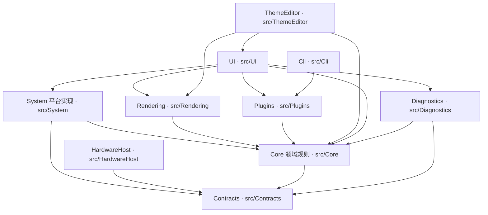

# 分层职责与依赖约束

## 1. 本文描述什么

本文描述 LiteMonitor++ 当前生效的分层模型：每一层拥有什么、明确不拥有什么，层与层之间允许与禁止的依赖方向，跨模块（进程内模块之间，以及主程序与硬件采样子进程之间）数据契约的形状，指标与设置这两类数据的模型分层，以及应用协调与生命周期的责任划分。

适用范围是 `src/` 下的全部工程与 `LiteMonitor.Updater`。渲染算法内部实现、插件 DSL 的语义、主题 JSON 的字段规范不在本文范围内，各有专门文档。本文只描述结构与约束，不描述实现步骤。

文中出现的类型名、方法名与文件路径是契约面的一部分；断言脚本与基线文件是可执行约束的落点。

---

## 2. 分层总览

### 2.1 层清单

| 层 | 位置 | 目标框架 | 职责 |
|---|---|---|---|
| Contracts | `src/Contracts` | `net8.0` | 采集契约与跨进程传输模型 |
| Core | `src/Core` | 主程序集 | 领域规则、设置存储模型与运行时投影、告警/趋势/情景规则 |
| System | `src/System` | 主程序集 | 硬件采集实现、Web 服务、网络流量采集、命名管道 IPC、主机监督 |
| HardwareHost | `src/HardwareHost` | `net8.0-windows` | 硬件采样子进程 |
| Rendering | `src/Rendering` | 主程序集 | Direct3D 11 / Direct2D GPU 渲染路线、渲染契约 |
| UI | `src/UI` | 主程序集 | WinForms 界面、自绘渲染、布局、设置页 |
| Plugins | `src/Plugins` | 主程序集 | 声明式 JSON 插件执行、插件市场与主题市场、主题校验 |
| ThemeEditor | `src/ThemeEditor` | 主程序集 | 主题工作室（主题文档模型、编辑会话、属性目录、预览） |
| Diagnostics | `src/Diagnostics` | 主程序集 | 进程内诊断事件出口、诊断快照与诊断包 |
| Cli | `src/Cli` | `net8.0-windows` | 命令行主题校验工具 |
| Updater | `LiteMonitor.Updater` | `net8.0-windows` | 独立更新器，不引用主程序集 |

主程序集 `LiteMonitor.csproj` 编译 `src/` 下除 `Contracts`、`HardwareHost`、`Cli` 之外的全部源码；这三者以独立工程存在，主程序集通过 `ProjectReference` 引用。同一类型不得同时编译进两个程序集。

### 2.2 被允许的依赖方向

箭头表示代码依赖：上游可依赖下游，下游不得回指上游。当前 `src/Core` 中存在的反向依赖逐条列在「当前分层现状与已知缺口」一节。

### 2.3 三条总原则

1. **目录名不构成约束，依赖方向才是约束。** `src/Core` 这个名字本身不保证任何事情；`scripts/architecture-assert.ps1` 才是可执行的约束落点。
2. **契约在最底层。** 跨模块通信只经过 `src/Contracts`，不得绕过契约直接引用对方的实现类型。
3. **组合根在依赖图的上方。** 启动组装入口可依赖所有层，其余层一律不得回指组合根。

---

## 3. 各层职责边界

### 3.1 拥有什么 / 不应拥有的对象

| 层 | 拥有 | 不应拥有的对象 |
|---|---|---|
| Contracts | 采集接口 `IHardwareClient`；传输模型 `MetricSample`、`HardwareSnapshot`、`HardwareCatalog`、`HardwareCatalogEntry`、`HardwareHealth`、`SamplingConfig`、`SamplingDemand`、`ConsumerSamplingDemand`、`SamplingApplyResult`、`DeviceSelection`、`ControllerProbePolicyData`、`DiskProbePolicyData`；操作模型 `HardwareOperationResult`、`HardwareOperationState`；IPC 帧编解码 `IpcCodec`、`IpcProtocol`、`IpcHeader`、`IpcEnvelope` 与各消息 DTO | WinForms 控件与 `System.Drawing` 绘图对象；LibreHardwareMonitor 的设备树、句柄与锁；全局设置实例；文件 IO 与业务决策 |
| Core | 指标身份与纯格式化规则（`MetricUtils`、`MetricItemFormatter`、`MetricItemFormatterState`、`MetricLabelResolver`）；监控项与插件实例配置 `MonitorItemConfig`、`PluginInstanceConfig`；设置存储模型 `Settings` 与运行时投影 `SettingsProjection`；差异分派（`SettingsChanger`、`SettingsApplyDispatcher`、`ModuleApplyResult`、`ApplyOperationResult`）；告警规则 `AlertEvaluator`；趋势缓冲 `ShortTermTrendBuffer`；情景 `ScenarioProfile`、`ScenarioPreflight`、`ScenarioProjection`、`ScenarioApplyCoordinator`；主题值解析 `ThemeColorParser`、`ThemeManager`；设备身份 `GpuKey`、`GpuRegistry` | 采集器的启动与释放；窗口与控件生命周期；采集设备树；插件执行器与网络请求；绘图资源；Web 监听 |
| System | 硬件采样实现（`HardwareMonitor`、`HardwareSamplingCoordinator`、`HardwareClientAdapter`）；设备目录与探测策略；网络流量采集；Web 服务（`LiteWebServer`、`WebSessionManager`、`WebServerAccessPolicy`）；命名管道 IPC（`PipeHardwareClient`、`PipeServerEndpoint`、`HardwareHostSupervisor`）；自启与更新检查 | 指标格式化决策；UI 控件；GPU 渲染实现；插件市场流程 |
| HardwareHost | 子进程内的最小采样器 `MinimalHardwareSampler`；主机侧命令处理 `HostCommandProtocol`、`HostPipeSession` | 主程序的设置与主题；任何 WinForms 类型；主程序窗口与渲染 |
| Rendering | GPU 渲染路线与设备生命周期（`D3D11DeviceService`、`GpuDeviceLifecycle`、`GpuAdapterSelector`）；场景快照 `SceneSnapshotBuilder`、`UiSceneSnapshotAdapter`；材质与前景绘制；渲染契约 `RenderContracts`；路线决策与降级 `RenderingRoutePolicy`、`GpuFailureFallbackScheduler` | 采集设备树与采样锁；用户设置对象；插件执行 |
| UI | 窗口与控件；自绘渲染（`UIRenderer`、`DecorRenderer`、`BarRenderer`、`TaskbarRenderer`）；布局；设置页；应用动作 `AppActions`、`WebActions` | 采集设备树与采集锁；插件沙箱策略；渲染路线决策 |
| Plugins | 插件模板与输出键模型（`PluginTemplate`、`PluginOutputKeys`）；市场安装记录 `MarketPluginRecord`；插件执行与沙箱 `PluginExecutor`、`PluginProcessor`；插件与主题市场；主题校验 `ThemeMarketValidator`；地址与网络授权策略 | 采集设备树；主窗口；用户设置持久化 |
| ThemeEditor | 主题文档模型与编辑会话 `ThemeDocumentStore`、`ThemeDocumentSession`、`ThemeEditHistory`；属性目录 `ThemePropertyCatalog`；预览控件与导出 | 采集与指标格式化规则；生产设置的持久化写入 |
| Diagnostics | 进程内诊断事件存储与出口 `DiagnosticHub`、`DiagnosticEventStore`、`DiagnosticEvent`；诊断快照与诊断包导出；脱敏 `DiagnosticRedaction` | 业务决策；界面绘制 |
| Cli | 命令行入口、退出码与 `error_code` 契约；主题校验命令 | 主程序运行时状态；采集器 |
| Updater | 自更新流程、下载与签名校验 | 主程序集的任何类型 |

### 3.2 几条容易越界的归属

- **规则与取值分离。** `MetricUtils`、`MetricItemFormatter` 决定"数值与单位如何成为文本、阈值如何决定颜色状态"；`MetricItem` 决定"这个指标在当前面板上如何摆放"。规则层不得知道摆放。
- **采集与展示分离。** `HardwareMonitor` 与 `HardwareSamplingCoordinator` 负责取得数据并按轮次发布快照；UI、Web、历史与诊断消费同一份快照，不得各自触发一次独立采样。
- **传输与业务分离。** `LiteMonitor.Contracts` 只描述形状；`IpcCodec` 只做编解码；管道端点只做连接与握手。业务语义由快照模型自身承载。
- **市场与执行分离。** `PluginMarket`、`ThemeMarket` 负责分发与安装状态；`PluginExecutor` 负责在沙箱内执行；主题校验由 `ThemeMarketValidator` 单独承担，客户端与命令行工具复用同一份判定。

---

## 4. 依赖方向约束

### 4.1 允许的依赖与理由

| 依赖 | 理由 |
|---|---|
| System → Contracts | 采集实现只需实现契约即可被消费方替换；进程内适配器与管道客户端对上层等价 |
| HardwareHost → Contracts | 子进程只依赖契约，才能与主程序在协议层而非类型层耦合 |
| 任意层 → Contracts | 契约是跨层公共词汇表，避免每对模块各造一套模型 |
| System → Core | 平台实现消费领域规则（指标键、单位口径、阈值语义） |
| Rendering → Core | 渲染层消费同一套指标身份与主题值，保证各渲染路线显示一致 |
| UI → Core / System / Rendering / Plugins / Diagnostics | 界面是组装与展示方，依赖被展示的实现 |
| Plugins → Core | 插件展示配置与指标身份共享领域模型 |
| ThemeEditor → Core / Rendering / UI | 主题工作室复用生产主题模型与渲染契约，编辑结果与运行时同构 |
| Diagnostics → Contracts / Core | 诊断既读取快照事实，也读取应用层模块结果 |

### 4.2 禁止的依赖与理由

| 禁止 | 理由 |
|---|---|
| Core → UI | 领域规则必须能在不创建窗口、不初始化硬件、不建立网络连接的条件下执行 |
| Core → System | Core 不得直接触达采集设备树与采集锁 |
| Core → Plugins | 插件类型不得渗入领域模型；插件只能以契约数据与 Core 交互 |
| Core → Rendering | 渲染配置不得成为领域层的输入 |
| Core → WebServer | Web 传输不属于领域层 |
| 采集实现（System 采集部分、HardwareHost）→ UI / Rendering / Plugins / Web | 采集实现不得依赖展示与技术栈，否则无法在独立子进程中运行 |
| Contracts → 主程序集 / WinForms / LibreHardwareMonitor / Vortice | 契约工程是 `net8.0` 且零第三方依赖，保证跨进程与跨宿主可用 |
| 任意层 → 组合根 | 组合根可依赖所有层，其余层不得回指组合根 |
| Cli / Updater → 主程序运行时状态 | 外部进程只消费契约与纯校验逻辑 |

### 4.3 可执行的断言

`scripts/architecture-assert.ps1` 是上述约束的可执行形态，包含两组断言。

**C 组：命名空间与目录一致**

| 断言 | 检查内容 |
|---|---|
| C-1 | 全仓不得存在 `LiteMonitor.src.` 前缀的命名空间 |
| C-2 | 全仓不得存在裸 `namespace LiteMonitor;` |
| C-3 | `src/` 下每个文件的声明命名空间必须与其所在目录对应；目录路径映射为命名空间，`src/System` 映射为 `SystemServices`；目录与命名空间的历史差异必须显式列在脚本白名单中，不得靠约定俗成 |
| C-4 | `LiteMonitor.src.*` 命名空间下不得暴露 public 类型 |

**A 组：Core 分层解耦**

| 断言 | 检查内容 |
|---|---|
| A-1 | `src/Core` 不得 `using` UI 命名空间 |
| A-2 | `src/Core` 不得 `using` SystemServices 与 WebServer 命名空间 |
| A-3 | `src/Core` 不得 `using` Plugins 命名空间 |
| A-4 | `src/Core` 不得 `using` Rendering 命名空间 |
| A-5 | `src/Core` 不得 `using System.Windows.Forms` |
| A-6 | `src/Core` 不得引用 WinForms 控件类型（`Label`、`Panel`、`Control`、`Application`、`Timer`）；命中口径为类型引用，成员名与枚举成员不计 |
| A-7 | `src/Core` 不得引用 `System.Drawing` 绘图类型（`Graphics`、`Brush`、`Pen`、`Image`） |
| A-8 | `src/Core/UIUtils.cs`、`src/Core/Actions/AppActions.cs`、`src/Core/Actions/WebActions.cs` 不得存在于 Core |

### 4.4 判定方式与运行位置

脚本采用棘轮判定：实测值与 `scripts/architecture-baseline.json` 中的基线比对，实测值不超过基线即通过，只拦截"变差"，允许"改善"。`-UpdateBaseline` 以当前实测值刷新基线并记录变更事由；`-WarnOnly` 只告警不阻断；默认模式下任一断言失败则退出码非零。

断言脚本当前只在本地手动执行，未接入 CI 流水线。CI 现有门禁是构建、测试发现数与其它独立检查。

---

## 5. 跨模块契约

### 5.1 基本原则

跨模块数据契约只使用基础数据类型：`string`、整数、浮点、布尔、枚举、`TimeSpan`，以及由它们构成的不可变 record 与只读集合。契约中不得出现控件、绘图对象、采集器句柄、锁、文件句柄、委托与事件。

理由：同一份契约既要能被进程内适配器直接使用，也要能被 JSON 序列化后跨进程传输。契约里一旦出现宿主专属类型，其中一条路径立即不可用。

`Color`、`Font`、`Rectangle`、`Point`、`Size` 属于 UI 主题与布局模型，留在 UI 与 Rendering 内；它们不进入采集契约，也不进入跨进程契约。

### 5.2 契约类型清单

| 类型 | 关键字段 |
|---|---|
| `MetricSample` | `Key`、`StableDeviceId`、`Value`、`Unit`、`Quality`、`MissingReason`、`SampleAgeMs` |
| `HardwareSnapshot` | `BatchId`、`CatalogVersion`、`ConfigRevision`、`Samples`、`SamplingDuration`、`TimestampMonoMs`、`SessionEpoch` |
| `HardwareCatalog` | `Version`、`Entries` |
| `HardwareCatalogEntry` | `StableId`、`RuntimeId`、`ParentStableId`、`DeviceType`、`SensorType`、`Available`、`Name`、`Value`、`Max` |
| `HardwareHealth` | `State`、`CurrentOperation`、`ProgressSeq`、`DiagnosticReason` |
| `SamplingConfig` | `Revision`、`RefreshMs`、`ControllerProbe`、`DiskProbe`、`Devices` |
| `SamplingDemand` | `Ui`、`Taskbar`、`Web`、`History`、`SensorWindow` 五个布尔 |
| `ConsumerSamplingDemand` | `ConsumerId`、`Active`、`MaxIntervalMs`、`Degradable`、`Reason`、`Channels` |
| `SamplingApplyResult` | `Applied`、`Revision`、`FailureReason` |
| `DeviceSelection` | `Kind`、`StableId`、`Enabled` |
| `HardwareOperationResult` | `Accepted`、`OperationId`、`State`、`FailureReason` |

### 5.3 采样需求与配置

`SamplingDemand` 表达"哪些展示面需要数据"，`SamplingChannels` 位标志与它的五个布尔一一对应。`ConsumerSamplingDemand` 以 `ConsumerId` 为主键，携带最大允许间隔与可降级性，是消费者登记需求的单位；`MaxIntervalMs` 为 0 表示沿用当前采样周期，聚合时被忽略，正值不低于 1000 毫秒。

`SamplingConfig` 只含采样相关字段。皮肤、窗体、菜单、API Key 与 Web 口令不属于采样配置。

`IHardwareClient` 分为两个面：

- **快照面**：`GetLatestSnapshot`、`GetCatalogAsync`、`GetHealth`、`GetNetworkIP`。
- **命令面**：`ApplyConfigAsync`、`RequestSamplingAsync`、`RequestFullRescanAsync`、`SubmitDemand`、`ReleaseDemand`。

采集侧不变量：

- 读取快照不得触发采样，也不得改变 `BatchId`。
- 目录整体版本化，版本号较低的目录不得覆盖版本号较高的目录。
- 需求按消费者身份登记；释放只影响该消费者自身。
- 同一采样周期内的重复请求合并为一次真实采集；关闭后拒绝新操作。
- 应用配置必须返回实际生效的 revision 或明确失败原因，不得隐式部分成功。
- 探测策略只以原始整数值传递（`-1` 表示未配置），策略语义解释归采集层。

### 5.4 快照与样本语义

- `SampleQuality` 取值：`Good`、`Stale`、`Missing`、`Error`。真实 0 必须是 `Good` 且 `Value` 为 0；缺失是 `Missing` 且带原因；过期是 `Stale` 且不重置时效。
- 快照以整体替换方式发布，值与设备目录不得混代次。
- `HardwareState` 取值：`Stopped`、`Starting`、`Ready`、`Degraded`、`Unresponsive`、`Stopping`；`ProgressSeq` 单调递增，用于判断采样是否仍在推进。
- `SessionEpoch` 是会话纪元：采集器重建或子进程重启时递增，已结束会话的数据不得混入新会话。
- `HardwareOperationState` 取值：`Queued`、`Running`、`Completed`、`Failed`、`Cancelled`、`Rejected`。调用方超时只表示停止等待，底层操作凭 `OperationId` 后续查询真实结局。

### 5.5 跨进程传输契约

帧格式为 `[int32 小端长度 N][N 字节 UTF-8 JSON]`，单条消息上限 1 MiB；接收侧先校验长度再分配内存。

协议版本由 `IpcProtocol.MajorVersion` 与 `IpcProtocol.MinorVersion` 承载。主版本不兼容必须拒绝连接，兼容新增字段走次版本；消息 JSON 采用大小写敏感的属性名匹配，不用宽松忽略策略掩盖主协议冲突。

消息类型：`hello`、`welcome`、`snapshot`、`heartbeat`、`command`、`response`、`goodbye`。未知类型属于协议违规。

命令操作名：`apply-config`、`submit-demand`、`rescan`、`get-catalog`、`shutdown`、`sampling-due`、`rescan-full-v2`、`submit-demand-v2`、`release-demand`、`operation-status`。

握手规则：主程序生成随机会话令牌并在每条消息头中携带；子进程身份以管道 API 独立核验，不采信载荷中的进程号。

协议违规（帧超限、非法 JSON、信封缺少头、未知类型）抛 `IpcProtocolException`；接收侧必须断连，不得尝试重新同步。

### 5.6 错误码契约

**命令行工具（`src/Cli`）**：`stdout` 每次调用恰好输出一个 JSON 对象，字段为 `ok`、`command`、`path`、`route`、`material`、`error_code`、`message`；`stderr` 输出一行人类可读摘要。退出码取值为 `0` 成功或校验通过、`1` 校验失败、`2` 环境不具备（文件不存在或不可读）、`64` 参数错误、`70` 未处理异常。`error_code` 取值包括 `invalid_arguments`、`file_not_found`、`unhandled_exception`。

**主题校验（`ThemeMarketValidator`）**：`theme_read_failed`、`theme_empty`、`theme_too_large`、`theme_size_mismatch`、`theme_utf8_invalid`、`theme_json_invalid`、`theme_root_not_object`、`theme_remote_reference`、`theme_color_invalid`、`theme_route_invalid`、`theme_material_invalid`、`theme_rendering_invalid`、`theme_route_mismatch`、`theme_material_mismatch`、`theme_rendering_backend_missing`。

**插件沙箱原因码（`PluginProcessor`）**：`LM009_RESPONSE_TOO_LARGE`、`LM009_REGEX_TIMEOUT`、`LM009_STEP_LIMIT`、`LM009_TARGET_LIMIT`、`LM009_DEADLINE_EXCEEDED`、`LM009_CONCURRENCY_LIMIT`、`LM009_CREDENTIAL_TARGET_NOT_ALLOWED`、`LM009_REDIRECT_TARGET_NOT_ALLOWED`、`LM009_REDIRECT_LIMIT`、`LM009_REQUEST_TARGET_NOT_ALLOWED`、`LM009_ADDRESS_POLICY_DENIED`、`LM009_LOCAL_NETWORK_NOT_ALLOWED`、`LM009_TARGET_UNRESOLVABLE`、`LM009_PLUGIN_PROXY_NOT_AUTHORIZED`。

**设置应用结果（`ApplyOperationResult`）**：外层状态取值为 `Applied`、`Partial`、`Pending`、`Failed`、`Cancelled`、`Unknown`；失败码包含 `preflight-blocked`（预检阻断）与 `stale-revision`（情景定义修订与请求修订不符）。

**渲染契约（`RenderContracts`）**：`RenderLifecycleState` 取值为 `Disabled`、`Probing`、`Initializing`、`Running`、`Suspended`、`Recovering`、`Fallback`、`Stopping`；`CaptureLifecycleState` 取值为 `Disabled`、`Initializing`、`Running`、`AccessLost`、`Stopping`、`Failed`；`MetricStatus` 取值为 `Normal`、`Warning`、`Danger`、`Missing`。

---

## 6. 指标三拆模型

指标数据按职责拆成三层，三层之间通过数据传递，不通过共享可变对象耦合。

| 模型 | 内容 | 生命周期 | 当前落点 |
|---|---|---|---|
| MetricSample（原始样本） | 指标键、稳定设备绑定、数值、单位、质量、缺失原因、采样年龄 | 一次采样发布后不可变 | `LiteMonitor.Contracts.MetricSample`，被快照、告警、趋势、诊断共同消费 |
| MetricDefinition（纯规则） | 指标类型、单位策略、阈值、用户显示选项 | 随配置修订更新 | `MetricUtils` 的单位与数值口径、阈值判定，配合 `MonitorItemConfig` 的用户单位选项 |
| MetricViewState（显示状态） | 插值后的显示值、布局矩形、缓存文本、颜色状态结果、选中状态 | 由界面拥有并释放 | `MetricItem`（插值值与四个布局矩形）与 `MetricFormatterState`（纯数据缓存快照） |

不变量：

- 格式化规则不得查询全局服务。插件色与配置兜底由组合根以委托注入（`MetricItem.DefaultPluginColorResolver`、`MetricItem.DefaultConfigLookup`），规则层只接收已解析的显式输入。
- 纯规则必须可在不创建窗口、不初始化硬件、不建立网络连接的条件下执行。
- 历史与告警消费原始样本，不得读取插值后的显示值。
- 既有指标键、单位选择、阈值语义与用户别名保持不变。
- 同一份快照在 UI、Web、历史与诊断中的质量与来源一致，各展示端的格式差异由展示端自己决定。
- 插件项与普通项的颜色语义不同：插件项颜色由插件覆盖值决定，普通项颜色由阈值判定决定；两者不得互相污染缓存。

---

## 7. 设置模型与运行时投影

### 7.1 存储模型与运行时投影

| 模型 | 作用 | 落点 |
|---|---|---|
| 存储模型 | 用户可编辑的 JSON DTO，是唯一的落盘来源 | `Settings` |
| 运行时投影 | 由存储模型派生的不可变快照，按模块分发 | `SettingsProjection` 的 `ToSamplingConfig`、`ToDisplayConfig`、`ToWebConfig`、`ToPluginConfig` |

投影的约束：

- 投影是纯函数，无 IO、无单例读取、无副作用。
- 运行时计数、自动设备选择、采集错误与缓存不得进入投影。
- 口令明文与盐不得进入投影；`WebConfigProjection` 只携带"是否已配置口令"标志。
- `DisplayConfigProjection` 携带语言、皮肤、设置窗体明暗模式与界面刷新间隔；`PluginConfigProjection` 携带插件实例数与已安装市场插件数。
- 探测策略只以原始整数值投影，策略语义归采集层解释。

### 7.2 draft-commit 边界

设置窗口持有草稿副本，live 设置是唯一被应用与持久化的对象。

- 提交入口：`SettingsChanger.ComputeDiff(live, draft)` 产出 `SettingsFieldDiff`（字段名 + 归属模块）；归属模块取值为 `Sampling`、`WebServer`、`Appearance`、`Taskbar`、`Plugins`、`Other`。
- 写回：`SettingsChanger.Merge(live, draft)` 把草稿写回 live。运行时属性在黑名单内，不得被草稿覆盖：`LastAutoNetwork`、`LastAutoDisk`、`ScreenDevice`、`MaxLimitTipShown`、`TotalUpload`、`TotalDownload`、`SessionUploadBytes`、`SessionDownloadBytes`、`LastAutoSaveTime`、`LastAlertTime`。
- 集合属性（`MonitorItems`、`PluginInstances`、`Thresholds`）以深拷贝写入，草稿与 live 不得共享可变引用。
- 取消：草稿丢弃，live 与已生效的外部状态不受影响。
- 差异为空时不触发任何应用动作，保存对系统零扰动。

### 7.3 副作用不可原子回滚

draft-commit 边界只隔离用户草稿，不为外部服务动作提供事务。设置提交会同时触发采集配置重建、Web 监听重启、主题重绘、开机启动等彼此独立的动作，这些动作无法一次回滚。因此结果模型必须显式区分三件事：已保存配置、实际生效状态、失败原因。

- `ModuleApplyResult`：模块名、是否应用成功、`SavedState`、`EffectiveState`、`FailureReason`、`ModuleRevision`、`Retryable`。
- `ApplyOperationResult`：`OperationId`、`RequestRevision`、`EffectiveRevision`、`OverallStatus`、`Modules`、`FailureCode`。外层状态由模块结果推导：全部成功为 `Applied`，部分成功为 `Partial`，全部失败为 `Failed`，模块结果为空为 `Unknown`——空结果不得伪装成成功。
- `ApplyPlan`：界面重建组、WebServer、Plugins 三个独立开关。`Appearance`、`Sampling`、`Taskbar`、`Other` 任一变化都整组重应用并保持既有顺序约束；WebServer 与 Plugins 与界面无交叉依赖，可独立应用。
- 颜色与语言变化不得触发硬件重建；设备访问策略变化才请求采集层重建；Web 端口变化只重启监听。
- `ScenarioApplyCoordinator` 的执行顺序是固定修订读取 → 预检 → 生成候选设置 → 持久化 → 按模块应用 → 由模块结果确认外层状态；保存失败时 live 设置不变，预检不通过时返回阻断原因而不触碰 live 设置。

---

## 8. 应用协调与生命周期

### 8.1 组合根

`UIController` 构造函数是当前唯一的组合根：创建 `HardwareMonitor`，按运行模式选择 `HardwareClientAdapter`（进程内）或 `PipeHardwareClient`（管道），注册 `HardwareGateway`，接线 `MetricItem` 的组合根委托，创建界面定时器与外观运行时。

`HardwareGateway` 是消费方取用采集能力的唯一入口（`Register`、`Unregister`、`Client` 及交互动作）。采集层未注册时，全部入口安全返回空或无操作。

不变量：其余层不得直接依赖组合根；组合根可依赖所有层；组合根是全局委托与静态注册的唯一接线点。

### 8.2 Start / Apply / Stop 责任划分

| 组件 | Start | Apply | Stop |
|---|---|---|---|
| 采集协调器 `HardwareSamplingCoordinator` | 由 `HardwareMonitor` 持有并置为就绪 | `RequestCollectionAsync` 合并同周期请求 | `Dispose` 后停止并等待在途采集结束 |
| 采集客户端 `IHardwareClient` | 无独立启动，首次使用时按需就绪 | `ApplyConfigAsync` 应用采集配置并返回生效 revision | `Dispose` 释放快照与订阅 |
| 硬件子进程 `HardwareHostSupervisor` | `Start` 拉起子进程并完成握手 | — | 终止子进程并回收作业对象 |
| Web 服务 `LiteWebServer` | `Start(out errorMsg)` | 端口与开关变化时单独重启监听 | `Stop` 与 `Dispose` |
| 插件运行时 `PluginManager` | `Start` | 插件配置变化时重启插件 | `Stop` 与 `Dispose` |
| GPU 呈现 `GpuPresentationHostController` | `Start` 建立设备与呈现会话 | 路线变化时由 `RenderingRoutePolicy` 决策 | `Dispose` 释放设备与资源账本 |
| 界面 `UIController` | 构造即启动刷新定时器 | `ApplyTheme` 等主题应用路径 | `Dispose` 按依赖逆序释放 |

生命周期不变量：

- 同一采样周期内只允许一次真实采集；重复请求合并到同一次采样；界面刷新快于采样周期时以采样周期为准。
- 应用退出时统一取消并等待；关闭过程中不得重建宿主、不得恢复窗口亲和性、不得重新创建渲染资源。
- 消费者只释放自己订阅的资源：释放自己的采样需求（`ReleaseDemand(consumerId)`）、自己的诊断订阅、自己的图形资源。关闭一个窗口不得释放其他消费者共用的采集器。
- 资源释放归属明确：渲染资源账本由 GPU 呈现控制器持有；窗口亲和性清理责任由界面生命周期持有，并以幂等方式终结。

---

## 9. 当前分层现状与已知缺口

以下为当前客观事实，不是目标状态。

### 9.1 `src/Core` 仍存在的反向依赖

| 反向依赖 | 现状文件 |
|---|---|
| Core → SystemServices | `src/Core/MetricUtils.cs`、`src/Core/MetricLabelResolver.cs`、`src/Core/SettingsHelper.cs` |
| Core → Plugins | `src/Core/Settings.cs`、`src/Core/SettingsHelper.cs`、`src/Core/Actions/AppActions.cs` |
| Core → Rendering | `src/Core/ThemeManager.cs`、`src/Core/ThemeColorParser.cs` |
| Core → UI | `src/Core/Actions/AppActions.cs` |
| Core → WebServer | `src/Core/Actions/AppActions.cs`、`src/Core/Actions/WebActions.cs` |
| Core → WinForms | `src/Core/Actions/AppActions.cs` |

另有三个职责属于适配层的文件仍位于 Core：`src/Core/UIUtils.cs`（GDI+ 绘图与 DPI 工具）、`src/Core/Actions/AppActions.cs`（以 `MainForm` 与 `UIController` 为入参的应用动作）、`src/Core/Actions/WebActions.cs`（Web 侧动作）。

因此 `src/Core` 目前是"名义核心层、实际混合层"：目录名不约束真实依赖。

### 9.2 命名空间统一尚未成立

`LiteMonitor.src.*` 前缀命名空间与裸 `namespace LiteMonitor;` 在 `src/` 下并存；`LiteMonitor.Rendering.*`、`LiteMonitor.ThemeEditor`、`LiteMonitor.Contracts`、`LiteMonitor.Diagnostics`、`LiteMonitor.Cli` 已采用干净命名空间。目录与声明命名空间不一致的文件按断言 C-3 的口径仍为不合格。

### 9.3 断言与基线的现状

`scripts/architecture-assert.ps1` 只在本地手动执行，未接入 CI；棘轮基线 `scripts/architecture-baseline.json` 与当前实测值之间存在漂移，C 组与 A 组中各有若干项已超出基线。

完整的缺口清单与逐项收敛口径见 `docs/architecture/known-gaps.md`。

---

## 10. 已知限制

- 架构断言只覆盖命名空间一致性与 `using` 引用两类口径，不校验工程引用图、运行时对象归属、订阅对称性与资源释放顺序。
- 契约工程只承载采集面与传输面；指标、设置、情景与渲染契约仍分布在各自程序集内，跨进程边界之外没有统一契约登记。
- 跨进程边界目前只覆盖硬件采集。主题、插件与设置不经进程边界，主程序与 `LiteMonitor.Updater` 之间也没有共享契约层。
- `src/Core` 内的规则与展示状态尚未在类型层面彻底分离：显示状态的承载类型仍同时暴露格式化缓存与布局字段，纯规则的取值来源仍有指向平台层的引用。
