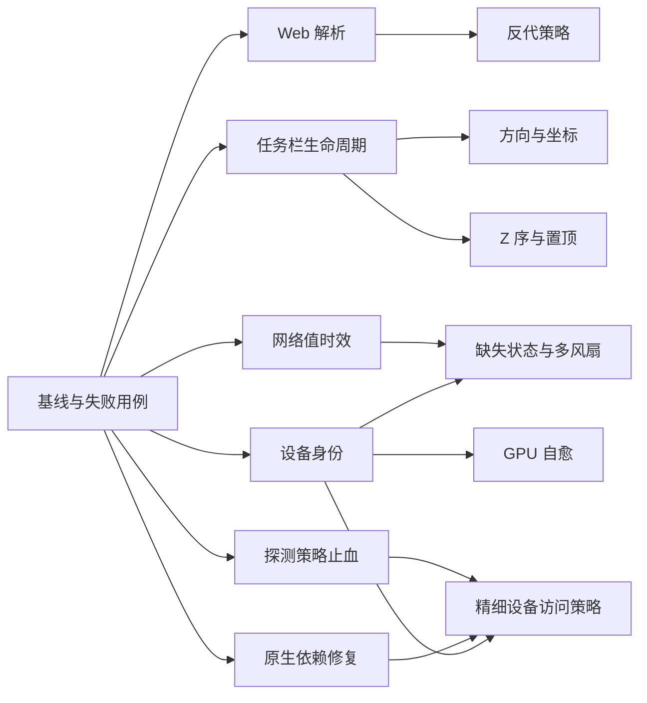

# LiteMonitor++ 已核实问题修复计划

日期：2026-10-25  
状态：待实施；本文只定义修复任务，不表示代码已修改或测试已通过。  
计划源码基线：`3ae64e8aaa85f3e7f0a1156a76228100301028d5`。  
既有验证基线：fork `2a1c57d`，upstream `3b91b5c`（1.3.7）；实施前重新核对相关文件差异。  
目标：修复确认的代码缺陷，补齐运行时恢复能力，并为依赖硬件或进一步归因的问题建立明确的关闭条件。

## 1. 范围与证据口径

主要依据：

- [核实总表](../verification/2026-10-25-SUMMARY-MASTER-TABLE.md)。
- [性能报告](../verification/2026-10-25-TASK-1-performance.md)、[GPU 报告](../verification/2026-10-25-TASK-2-gpu-sensors.md)。
- [崩溃与硬件报告](../verification/2026-10-25-TASK-3-crash-hardware.md)、[窗口报告](../verification/2026-10-25-TASK-4-window-display.md)。
- [Web 与插件报告](../verification/2026-10-25-TASK-5-web-plugin.md)、[Web 协议 A/B 实测](../verification/2026-10-25-WEB-PROTOCOL-LIVE-VERIFICATION.md)。

### 1.1 先修正统计口径

原总表的“生效 24 项”与明细不一致：用户摘要列出 21 个唯一 issue 和 1 个新发现；文档另有一个重复的 `245※` 汇总行，不能作为独立 issue。分报告中的 **#466、#514、#539、#611** 未进入总表的独立明细，本计划补齐。新协议问题使用内部编号 **WEB-OWS**，不使用 `614※`，避免与真实上游 #614 混淆。

| 覆盖范围 | 唯一数量 | 处理口径 |
|---|---:|---|
| 原“需处理”21 项 + 遗漏4项 | 25 | 含 #499 的显示语义和 #416 的调查；不是25个已完成根因归因的代码缺陷 |
| 部分生效 #592、#596 | 2 | 分开处理映射缺失与底层遥测不可用 |
| 原“不生效”清单 | 9 | 保留回归验证，不重复开发；不代替上游维护者关闭 issue |
| 独立证据不足项 #78、#582 | 2 | #416 已在第一行计数，其归因调查不重复计数 |
| 上游 issue 合计 | **38** | 逐项映射见第7节 |
| 新发现 WEB-OWS | **1** | 单独的 fork 回归 |

代码级证据、模拟 Win32 实验和目标硬件上的完整复现是不同层级。已知的无效映射、单槽风扇、无磁盘访问策略可以立项；“某用户的闪退已彻底解决”仍需原场景验证。相同依赖版本说明共享风险，不证明所有机器都会触发同一故障。

### 1.2 本轮边界

包括 Web 协议/反代、网络值过期、任务栏恢复、设备身份与选择迁移、GPU 映射自愈、原生依赖修复与设备访问策略、数据缺失语义、插件兜底和设置页体验。

不并入 Core 全面重构、命名空间统一、GPU 材质重写或新的市场功能。当前基线已含主题市场实现与 CI 变更；市场页优化必须覆盖插件和主题两种资产，不能按旧的仅插件页面实施。

## 2. 全程约束

1. **保留 fork 的已有能力。** 单调时钟采样、单次在途采样、多 GPU、插件执行边界/发布租约、Web 会话与一次性票据、GPU 回退和窗口关闭优先级均不得回退。
2. **修复包含迁移。** 新设备 ID 不直接替换所有已有指标 Key；用户排序、阈值、别名、隐藏状态和历史不能静默绑定到另一块设备。
3. **错误不能伪装成正常值。** 成功采到 0 是有效数据；设备消失、读取失败和过期各有状态。读取缓存不能延长数据寿命。
4. **恢复必须有界。** 设备重建、任务栏重挂和 GPU 映射重建要去抖、退避、单次在途；恢复不能新增高频硬件轮询或无限重试线程。
5. **UI 线程与采样线程分工不变。** UI 只投递恢复请求；硬件更新、重载、建图在采样协调器控制的串行边界完成。关闭过程中不再创建新 HWND 或重新打开硬件。
6. **同一问题分“代码完成”和“场景验收”。** 无目标设备时标记待实机验证，不能用 mock 结果关闭硬件特有问题。
7. **原生故障在正确边界解决。** 应用 catch、全局异常回调只能补充诊断，不能保证接住依赖自建线程异常或原生内存损坏。

## 3. 优先级、依赖与交付批次

P0：已验证的可用性回归、冻结数据，以及可导致进程终止/外部设备受影响的修复路径。P1：恢复能力、设备身份、数据正确性。P2：体验改善与需额外取证的问题。优先级不等于改动大小，也不等于立即发布。

| 任务 | 内容 | 优先级 | 前置 | 主要覆盖 |
|---|---|---|---|---|
| F00 | 固定基线、建立可重复失败用例 | P0 | 无 | 全部 |
| F01 | HTTP 头解析与升级分流 | P0 | F00 | WEB-OWS；防回归 #589 |
| F02 | 反代外部地址与可信代理策略 | P0 | F01 | #580 |
| F03 | 网络缓存时效与选卡恢复 | P0 | F00 | #96 |
| F04 | 任务栏宿主生命周期与重挂 | P1 | F00 | #553、#573、#583、#539 |
| F05 | 任务栏方向、坐标与占位恢复 | P1 | F04 | #568、#539、#573、#583 |
| F06 | 任务栏同级 Z 序与主窗置顶 | P1 | F04 | #599、#612 |
| F07 | 设备身份目录、槽位与配置迁移 | P1 | F00 | #290、#538；为 #577 提供基础 |
| F08 | 磁盘/控制器探测策略 | P0 | F00；精细允许列表依赖 F07、F09 | #466、#601、#245；降低 #579 暴露面 |
| F09 | NVML 与 DiskInfoToolkit 依赖修复 | P0 | F00 | #502、#579；支持 #290、#582 诊断 |
| F10 | GPU 运行时映射自愈 | P1 | F07；与 F09 集成验证 | #434、#450、#596；区分 #592 |
| F11 | 缺失/过期状态与多风扇展示 | P1 | F03、F07 | #514、#577、#499、#592 |
| F12 | 字体资源与布局测量安全 | P1 | F00 | #574 的已知结构风险 |
| F13 | 插件步骤失败兜底与倒计时恢复 | P1 | F00 | #611；防回归 #235 |
| F14 | 市场页缓存与设置页明暗配色 | P1/P2 | F00 | #437 |
| F15 | 内核 CPU、长期内存、缺失日志取证 | 调查 | F00 | #416、#78、#582、#574 |
| F16 | 合并验收、发布记录与关闭判据 | 发布门禁 | 对应批次任务 | 全部 |
| F17 | 插件市场安装事务与启动恢复的并发冲突 | P0 | 无（`PluginMarket.cs` 无活跃会话在改） | 新发现（无上游 issue）；支撑 #611/#235 的"恢复承诺" |



建议发布顺序：

- **R1 可用性修复**：F01、F02、F03，可加入独立验收通过的 F12、F13。避免被缺少 NVIDIA/Intel 测试机拖住。
- **R2 窗口恢复**：F04、F05、F06，连同 GDI+/GPU 路线及纯任务栏模式回归。
- **R3 硬件稳定性与语义**：F07～F11。F08 的全局安全模式或 F09 的独立依赖补丁可在证据充分时提前发布，不必等待全部多设备功能。
- **R4 设置体验**：F14；卡顿优化与暗色支持分别验收、分别提交。
- F15 从基线阶段启动；其调查结果按证据转为后续补丁，不以“完成调查”代替“完成修复”。

并行分工建议：Web、窗口、硬件、插件/UI 四条工作线。`Settings.cs`、`AppActions.cs`、`UIController.cs`、`HardwareMonitor.cs` 是共享热点，由集成负责人协调。F04/F05/F06 同一负责人顺序集成；F07/F08/F09/F10 不在同一文件上并行覆盖修改。

## 4. 逐项实施任务

### F00 — 固定基线与失败用例

**输入/落点**：七份验证报告、`.tmp/verification/` 探针、现有 `tests/` 和 `.github/workflows/{ci,release}.yml`。

实施：

1. 记录 HEAD、工作树差异、依赖解析结果、OS/DPI/显示器与 GPU 信息；检查 `2a1c57d..HEAD` 是否改变目标代码。保留已有未提交文档。
2. 从临时目录选取可复用的裸 TCP 和 Win32 探针，整理进受版本管理的测试/工具目录；临时原始输出只作历史证据，不能成为 CI 的隐藏依赖。
3. 每个任务先固定可失败的行为用例，再修实现。优先真实调用产品路径，避免仅复制产品算法后“自证通过”。
4. 保存当前测试发现数、跳过原因与失败列表；当前 CI/Release 配置的发现数下限为 **1876**、跳过上限为 **1**。这是静态读取的门禁配置，不是本次已运行结果。
5. 建立验收记录模板：任务 ID、issue、基线/补丁 SHA、用例命令、环境、实际结果、未覆盖场景、是否允许关闭。

**完成条件**：新失败用例能说明修复前后行为差异；所有验证命令可从干净检出运行，配置和测试端口均隔离于用户数据。

### F01 — 修正 WebSocket 升级识别

**文件**：`src/System/WebServer/WebSessionManager.cs`；扩展 `WebSessionProtocolTests.cs`、`WebSocketRejectCloseTests.cs`，补裸 TCP 集成用例。

实施：

1. 用已有结构化请求解析结果替换 `IsWebSocketUpgrade` 对整段请求的 `GET`/`Upgrade: websocket` 正则搜索。HTTP 路由与 WS 握手共享解析语义，避免两份解析器意见不一致。
2. 请求行校验真实方法、路径与 HTTP 版本；头名大小写不敏感；字段值只清理合法首尾 SP/HTAB。拒绝字段名与冒号之间的空白、折行和歧义输入。
3. `Connection` 按逗号分隔 token 判定 `Upgrade`；`Upgrade` 按协议 token 解析并匹配 `websocket`。不能用子串命中 `notwebsocket`。
4. 保留唯一 `Host`、唯一且合法的 WS Key、版本和票据校验；可合并的列表头与禁止重复的单值头采用不同规则。不要通过“取第一个值”隐藏冲突。
5. 面向 WS 路由的无效握手返回明确 4xx，不静默返回登录 HTML；普通网页 GET 仍走正常 HTTP 页面。错误优先级固定并写入测试。

**验收**：原 C1～C6 均在有效凭据下返回101，新增 Tab、尾部空白、Connection 多 token、TCP 拆包；非法/重复 Key 返回400，无/过期/重放票据保持401，非法 Origin保持403。伪造 `X-Upgrade`、正文中的 Upgrade 文本、非 GET、歧义长度头与超大头不进入握手。既有 #589 大小写用例保持通过。

### F02 — 反代配置真正生效，并保留访问边界

**文件**：`WebSessionManager.cs`、`WebServerAccessPolicy.cs`、`LiteWebServer.cs`、`Settings.cs`、`SystemHardwarPage.cs`、`AppActions.cs`、语言文件及 Web 认证测试。

**方案决定**：显式外部 authority 白名单解决原样保留 Host 的代理；可信代理端点 + 转发头处理解决重写 Host 的代理。仅打开 `TrustProxyHeaders` 并放宽所有端口不足以形成完整修复。

实施：

1. 新增 `WebServerAllowedHosts`（精确 host:port authority；无通配符）与 `WebServerTrustedProxies`（精确 IP，首版不接受任意代理链）。保留默认 `WebServerTrustProxyHeaders=false`；配置经 Draft-Commit 保存。
2. 将实际 TCP 对端地址传入访问策略。只有开关开启且对端在可信代理列表中，才采用 `X-Forwarded-Host`/`X-Forwarded-Proto`。首版要求可信代理覆盖为单一值；多值、重复或冲突返回明确4xx。其他转发头不参与身份判定，文档明确支持范围。
3. 外部请求的有效 authority 必须匹配白名单；HTTPS 默认443、HTTP默认80，非默认端口必须精确匹配。IPv6、大小写和非法端口使用统一严格解析。不得继续拿外部443与内部5000比较。
4. 直连请求保留现有环回/LAN规则；不可信对端提供的转发头不能改变 Host、Origin、客户端身份或安全属性。
5. Origin按有效外部 scheme/authority做同源判定，显式跨源例外仍由原 `AllowedOrigins` 控制；不把 Host 白名单直接变成允许任意协议/端口的 Origin 白名单。
6. 登录、票据、快照、OPTIONS与WS共用策略。对外代理即使从环回连接也要求配置访问口令，不继承“环回无凭据”的信任；会话 cookie 的 Secure 判定使用已验证的有效协议。
7. 收紧白名单/撤销代理信任后，按连接代次撤销不再被允许的会话/WS，避免旧连接绕过新策略。界面提供配置范例与错误原因，日志不记录口令、cookie、票据原文。

**验收矩阵**：

| 场景 | 预期 |
|---|---|
| 环回直连、现有有效认证 | 行为保持 |
| 已配置外部 Host，代理保留 Host，HTTPS443→内部5000 | 登录→取票→WS101→快照完整成功 |
| 可信对端 + 信任开关 + 合法单值转发头 | 使用外部 authority；同上 |
| 不可信对端伪造转发头 | 转发头不能使原本不允许的请求通过 |
| 信任开关关闭 | 转发头不参与策略 |
| 未授权域名、恶意Origin、重复Host、非法端口、代理头歧义 | 明确拒绝，不回退为200登录页 |
| 已连接后撤销白名单/代理信任 | 原连接按策略失效 |

先用本地可控反向代理覆盖两种 Host 模式；真实 Cloudflare Tunnel完整链路作为独立验收项，没有环境时保留“真实隧道待验证”，不把 C7 等价请求称为真实隧道测试。

### F03 — 网络值过期、失败恢复与自动选卡

**文件**：`NetworkManager.cs`、`HardwareValueProvider.cs`、`HardwareMonitor.cs`、`HardwareSamplingCoordinator.cs`；补网络时效测试并扩展 `SamplingCacheTests.cs`、`TrafficDeltaTests.cs`。

实施：

1. 为网络样本保存值、设备身份、设备代次、成功采样时间及质量；时间使用 `TimeProvider`/单调时钟。UI读取、快照读取、fallback返回都不更新时间。
2. 首批以网络指标落地，审计 `ReadNetworkSensor`、通用 `_lastValidMap`、启动缓存和采集中读取分支：任何一层都不能把旧值重新发布成新样本。不能只在 `NetworkManager` 加TTL而由上层再次无限回退。
3. 初始策略：最多短暂保留最后有效样本3个预定采样周期，上限15秒；保留期标为Stale，到期为Missing。阈值集中定义，可由测试时钟注入；正常0流量仍为Fresh。
4. 设备删除、首选设备变化、硬件重载时立即失效对应缓存和速率差分基线；新设备不能继承旧设备累计量，历史不写入缺失值或重复旧增量。
5. 自动模式以设备存活、采样成功和有效流量重新评分；读取失败触发有限重选。空闲不等于坏网卡，不因连续0强制反复切换；手动模式设备消失时保留选择并显示不可用。

**验收**：正值→采样失败→TTL边界→缺失→恢复完整可测；读缓存一万次不能刷新TTL；有效0始终为0；拔掉旧网卡后另一网卡可恢复；手动选卡不被改写；反复网络切换无负流量/巨额尖峰。硬件采样调用频率保持既有约束，不随UI刷新频率倍增。

### F04 — 任务栏宿主生命周期与有界恢复

**文件**：`TaskbarForm.cs`、`TaskbarBizHelper.cs`、`TaskbarWinHelper.cs`、`MainForm_Transparent.cs`；必要时新增单一任务栏恢复协调器。

实施：

1. 按第5节固定SHA适配PR #495/#555。将状态明确为等待目标任务栏、已挂载、恢复中、关闭中；恢复调度由独立于子HWND存活的UI宿主拥有。
2. 同时检查根句柄、内部子句柄、实际父子关系、目标显示器和本窗句柄代次，不能仅检查根HWND非零/有效。
3. 处理外部父窗口销毁导致的本窗句柄丢失；`OnHandleDestroyed`区分外部失效、受控重建与应用关闭。恢复在UI消息循环中排队，避免在销毁回调内递归重建。
4. 合并启动、Explorer重启、唤醒、电源恢复、锁屏解锁/会话变化、显示拓扑、DPI、任务栏设置变化事件；统一去抖。恢复期参考每2秒一次、持续10秒；期后若目标仍不可用，以低频退避等待目标重现，不永久停止。
5. 用户指定副屏尚未就绪时保持等待，不静默改写首选屏幕并永久绑定主屏；恢复后自动回到目标屏幕。显示“暂不可用”可通过托盘状态承载。
6. 纯任务栏模式下主窗隐藏仍执行恢复；关闭期间取消排队操作，注销事件、定时器，禁止复活窗口。保留fork现有GPU显示变化通知和主窗位置夹取逻辑。

**验收**：实际Win32测试宿主销毁父窗口、保留根但重建子层、延迟创建目标屏宿主均能恢复；恢复期间点击退出不重建窗口；重复100次宿主重建，活跃面板/定时器只有一份、句柄不持续增长。人工覆盖锁屏/解锁、睡眠/唤醒、Explorer重启、RDP断开重连；每项单独记录，不用模拟实验替代所有真实场景。

### F05 — 任务栏方向、坐标和占位幂等

**文件**：`TaskbarStrategyWin10.cs`、`TaskbarStrategyWin11.cs`、`TaskbarWinHelper.cs`、`TaskbarBizHelper.cs`。

实施：

1. 引入明确的Top/Bottom/Left/Right方向，使用任务栏相对所属显示器的物理矩形解析，不用宽高比猜测所有情形。
2. 固定坐标契约：系统几何查询与布局中间值使用物理屏幕像素，最终定位通过明确转换得到父客户区坐标；所有入口标注坐标空间。不要不经验证采用PR #495的20～100px高度启发式，避免高DPI/多行任务栏误判。
3. 几何缓存键包含根/子HWND代次、目标显示器、屏幕/工作区矩形、DPI、方向、面板尺寸与相关任务栏设置；变化时整体失效。
4. Win10占位维护“未施加本面板影响的基线”和本次占位量。重复Tick幂等；句柄/方向/分辨率变化时重新获取基线；禁用、退出或重挂时撤销旧占位。不得在已经缩短的任务列表上继续扣减。
5. 自定义第三方任务栏在未验证前明确为兼容性待验；原生Windows11不声称支持系统本身不提供的方向。

**验收**：Win10四方向、连续方向切换与重复Tick不累计漂移；重复启停100次不缩窄任务列表；100/150/200%混合DPI、负屏幕原点、非默认工作区下无重叠、越界或内容不可见；验证原报告1200→640/位置600→900场景修复。分辨率变化后恢复正确占位，退出恢复Explorer布局。

### F06 — 同级 Z 序与主窗置顶分别维护

**文件**：`TaskbarStrategyWin11.cs`、`TaskbarForm.cs`、`MainFormBizHelper.cs`、相关Win32封装。

实施：

1. 移植PR #600的按需同级Z序修复：可见合成层确实挡在前方才用`HWND_TOP`，带不移动、不改大小、不激活标志；不能把子窗口提升逻辑写成顶级窗口TOPMOST。
2. 显示变化时立即检查，后续低成本检查覆盖迟到的合成层。避免每帧无条件置顶、遍历所有系统窗口或反复重挂。
3. PR #373仅作为主窗置顶恢复参考：检查样式位和实际可见层级，遵守用户关闭置顶、自动隐藏、菜单和已有全屏行为；不强行压住安全桌面或所有其他置顶程序。
4. 任务栏维护独立于主窗`Visible`；用户主动隐藏主面板不能使任务栏恢复停止。

**验收**：模拟新建可见合成兄弟窗口后在下一次维护周期恢复；矩形、焦点不变；主窗样式还在但实际层级异常可恢复；关闭TopMost后不被看门狗重新打开；纯任务栏、虚拟桌面切换、全屏进入退出分别验证。

### F07 — 稳定设备身份与兼容迁移

**文件**：`HardwareScanner.cs`、`DiskManager.cs`、`SensorMap.cs`、`FanMapper.cs`、`GpuRegistry.cs`、`GpuKey.cs`、`GpuItemSync.cs`、`Settings.cs`、设置页与监控项同步代码。

实施：

1. 建立设备目录：`StableId / RuntimeId / DisplayName / ParentId / Kind / IsPresent`。GPU、磁盘、风扇共用身份原则，不强行共用一套硬件API。
2. 区分展示槽位与设备身份。保留已有`GPU.{index}.*`等公开指标Key，通过持久化槽位绑定稳定设备ID；不能把裸PCI路径直接拼进所有Key破坏主题/插件/Web约定。
3. 验证LHM Identifier是否跨枚举/重启稳定。优先使用可获得的PnP实例/设备唯一标识与GPU总线信息；LUID、枚举序号、显示名不能单独视为跨重启身份。无法可靠识别时显式标记不稳定，避免猜测绑定。
4. 磁盘选择项改为Label+Value；同名型号标签加可区分后缀，值是ID。关联Windows计数器的实例单独保存映射。设备目录枚举不得为取得ID先执行SMART探测，避免绕过F08。
5. 旧名称配置只在唯一匹配时迁移；同名歧义保留旧值与提示，等待明确选择，不随机选第一块。GPU旧槽位按可证明映射迁移，保持顺序、别名、阈值及隐藏状态；迁移幂等、原子写入并保留备份。
6. 手动首选卡消失时保持绑定、显示设备离线；自动模式允许重选但公开当前选择。重连恢复原身份；`MonitoredGpuCount=1`仍表示只显示一张，不为修#450静默改成全卡。

**验收**：双同型号SSD/双同型号GPU、枚举顺序互换、设备短暂消失、重启、驱动更新后的可用标识变化均有迁移用例；无法证明同一设备时不复用历史绑定。旧配置重复加载不重复新增指标，用户排序与阈值不漂移。

### F08 — 探测策略先于设备构造生效

**文件**：`HardwareMonitor.cs`、`DiskManager.cs`、`HardwareScanner.cs`、`DriverInstaller.cs`、`Settings.cs`、`SystemHardwarPage.cs`；新增`DiskProbePolicy`及适当的控制器策略。

实施：

1. 第一阶段提供`CountersOnly`模式：在第一次`Computer.Open()`前设置`IsStorageEnabled=false`，速度/活动率来自Windows计数器；温度/SMART显示策略禁用，不显示0。设置页扫描、后台维护和重载全部走同一策略。
2. 建议新安装默认CountersOnly。旧配置缺字段时设为显式迁移状态并提示兼容模式与SMART功能影响；首次打开硬件前仍采用CountersOnly，保留原磁盘偏好与监控项。用户主动选择后持久化，不静默丢弃温度配置。
3. 第二阶段提供仅内部盘/明确允许列表的SMART模式。排除USB、可移动盘及明确不允许设备的判定必须发生在库创建设备和打开句柄之前。若现有库不能做到，修库入口或暂不开放该模式，不能在构造后过滤列表冒充隔离。
4. 针对#245独立审计controller/HID/USB枚举路径，提供控制器探测开关及按可靠标识排除DAPLink等设备的能力。磁盘策略不被当作USB调试器问题的完整修复。
5. 模式变更通过采样协调器停止采样、释放旧对象、重建代次后恢复；失败时保持可用计数器数据并显示状态，不反复全盘扫描。关闭与移除时释放句柄。

**验收**：假设备工厂证明禁止设备构造次数为0；Process Monitor确认冷启动、打开设置、定时维护均未探测排除设备；可移动盘可安全移除；与HWiNFO并行、DAPLink连接/断开分别测试。无对应硬件时只能验收策略行为，相关用户问题标记待实机。

### F09 — 固定并验证原生依赖修复

**文件**：`LiteMonitor.csproj`、依赖锁定/构建配置、必要的固定源码补丁、`HardwareMonitor.cs`、`HardwareErrorLog.cs`及依赖集成测试。

当前解析依赖是LHM **0.9.6**、传递依赖DiskInfoToolkit **1.1.2**。LHM的[NVML修复PR #2539](https://github.com/LibreHardwareMonitor/LibreHardwareMonitor/pull/2539)已合并，merge SHA为`3aa9c6c5bfc45fd15f4166bd35d73609b2bb126c`。本次核对的是PR元数据与说明，不等于已确认某个NuGet包包含补丁。

实施：

1. 先做依赖候选验证：比较固定源码补丁与包含目标修复的已发布兼容包。验证实际程序集/源码是否包含NVML句柄重新获取及失效处理，确认API、PawnIO、Intel GCL和磁盘访问行为。
2. 不盲目用NuGet覆盖传递依赖主版本。报告提到的DiskInfoToolkit 2.2.1及LHM预发布版本仅是候选线索；以可重现构建、API适配和测试结果决定组合。
3. NVML路径按设备身份重新取得有效句柄并处理驱动/设备变化；能力不支持、设备离线时返回缺失状态。补丁必须同时覆盖双卡/同型号卡，不能只按枚举索引重取。
4. DiskInfoToolkit自建监听线程的设备事件、构造和回调边界由库侧逐项隔离；单设备失败有界退避，其他设备继续运行，退出可停止监听。应用层catch不能替代这些库侧边界。
5. 使用本地源码补丁时固定来源SHA、补丁文件、许可证、构建步骤及产物摘要；使用包时锁定版本/传递依赖。更新NOTICE（如适用）。
6. 日志保留设备代次、操作、来源版本及错误类型，限频并避免输出设备序列号等不必要标识。原生崩溃需要转储证据；若无法在库内隔离，另立辅助进程隔离设计，不在本轮临时引入半套IPC。

**验收**：受控子进程中注入设备构造/回调异常，主程序能继续；采样中移除/恢复GPU、无功耗能力、NVML暂不可用均可恢复；磁盘事件监听停止后不残留线程。NVIDIA实机通过后才关闭#502，磁盘事件场景通过后才关闭#579；缺#582原堆栈时不声称覆盖它。

### F10 — GPU运行时自愈与遥测缺失分流

**文件**：`HardwareMonitor.cs`、`SensorMap.cs`、`GpuWarmup.cs`、`HardwareRules.cs`、`HardwareValueProvider.cs`及GPU测试。

实施：

1. 在一次完整采样后区分“预期Key缺失”和“Key存在但Value为null”。前者触发串行重建映射，后者记录可用性，不能每轮重建。
2. 保留既有预热；设备到达、配置变化和恢复事件投递重建需求。建议退避1/2/5/10/30秒、最多5次；成功清零，耗尽后等待新设备事件或显式重试。计时使用单调时钟，可测试注入。
3. 在当前硬件代次构建完整映射与GPU注册快照，原子发布；过期代次结果丢弃。重建不并发调用LHM Update/Open/Close，不重置用户选卡。
4. #592的GCL不可用显示明确缺失原因并生成诊断报告入口；不以D3D显存读数冒充GPU负载，不把0当作“已恢复”。

**验收**：传感器晚注册后无需切首选卡即可出现；Key存在持续null不形成重建风暴；超时/关闭/代次变化后旧结果不发布；自动单卡、多卡并存、手动指定卡均保持语义。Intel核显与B580分别实测，B580无GCL时的正确缺失展示只算降级改善。

### F11 — 数据质量、多风扇与显存口径

**文件**：`MetricItem.cs`、`MetricUtils.cs`、`FanMapper.cs`、`SensorMap.cs`、`UIController.cs`、GDI+/GPU/任务栏渲染、Web快照/页面、`HardwareHistoryLogger.cs`及语言资源。

实施：

1. 将F03的样本质量扩展到硬件指标：Fresh、Stale、Missing，辅以reason区分初始化、无传感器、策略禁用、读取失败和设备离线。数值与显示插值分离；旧`DisplayValue=0`不能决定缺失语义。
2. 无值显示统一占位符并提供原因；真实0 RPM、0%和0 B/s保留正常0。过期值不继续动画，不用于阈值报警、统计平均或历史有效样本；历史用缺口表达。
3. 各展示端使用同一格式策略。Web以兼容的新增状态/时间字段传达质量，数值字段缺失时为null；同步更新内置客户端并记录外部消费者兼容要求，不能悄悄改数值字段类型。
4. 风扇按父设备和传感器稳定身份生成多个监控项，显示名允许重名，保存稳定槽位映射。旧`CASE.Fan`保留兼容别名，旧配置绑定到可确定的原传感器；歧义不随机覆盖。防止新增槽位与兼容别名同时默认重复显示。
5. 显存明确标识来源与口径：专用/共享/合计、厂商/D3D来源与容量分母一致。GPU负载0但显存非0可为正常现象，不为“对齐任务管理器”强制清零；来源切换不混用不同设备/代次。

**验收**：每种状态在竖排、横排、任务栏、GPU主题、Web中一致；两个同名机箱风扇独立变化、重启不互换；旧主题/配置可用；#499按对照截图及同一设备、同一指标口径解释差异，确认显示缺陷才进一步修改计算。

### F12 — 字体生命周期与DPI测量

**文件**：`HorizontalLayout.cs`、`UIController.cs`及主题/字体资源持有代码。

实施：

1. 排查所有`GetHeight`、`CreateGraphics`调用及字体替换/Dispose顺序。当前风险直接入口是`HorizontalLayout`构造函数；旧报告行号随主题市场提交变化，不按行号盲改。
2. 将字体测量移到受控布局阶段，在有效字体与稳定DPI下计算并缓存；缓存键包含字体、字号、单位、样式、DPI和主题代次。绘制帧只消费结果。
3. 不假设将`GetHeight(graphics)`替成`Font.Height`就自动安全且DPI等价；先核对缩放与资源所有权，避免双重缩放或访问已释放Font。句柄不存在/正在销毁时推迟测量，保留有效最小布局。

**验收**：高频切主题、缩放、跨屏、关闭/重建句柄时不访问已释放Graphics/Font；100/150/200%下行高无裁切；保留现有空状态最小高度。该任务只关闭已定位的结构风险；#574原始崩溃仍需堆栈对应。

### F13 — 插件失败兜底恢复

**文件**：`PluginModels.cs`、`PluginExecutor.cs`、`Plugins/Native/`、`resources/plugins/Holiday.json`、插件开发文档和`PluginExecutorSandboxTests.cs`。

实施：

1. 恢复步骤级`continue_on_error`，默认false；仅业务可恢复失败（请求失败、接口无有效数据、字段提取失败等）可进入下一步骤。
2. 外层取消、总执行截止、并发/响应大小/host限制及其他沙箱异常不可被吞掉。区分单请求超时与整个执行预算耗尽；所有备用步骤仍占用同一预算、步数限制和发布租约。
3. 步骤使用临时context，只有成功才合并变量；失败步骤不得留下半成品使`skip_if_set`错误跳过备用源。
4. 回补受控`native://newyear`处理器，使用本地日期且允许注入时钟；恢复Holiday HTTPS主源与元旦倒计时备用输出。不能把元旦倒计时冒充法定节假日/调休数据。
5. 主源恢复后自动回到主源；既有用户配置与插件身份保持兼容，备用处理器不绕过native白名单和资源限制。

**验收**：主源正常、null、超时、非法JSON、备用成功/失败、主源恢复；取消及沙箱违规仍终止；跨年12月31日/1月1日、闰年、时区和成功步骤变量提交测试。#235退避恢复、卸载后在途结果不得回写等现有测试全部保持。

### F14 — 市场页卡顿与设置明暗主题分开交付

**文件**：`PluginMarketPage.cs`、`ThemePreviewService.cs`、设置控件`LiteUI.cs`、`SettingsBase.cs`、`SettingsForm.cs`、语言与设置配置。

**F14-A 卡顿（P1）**：

1. 市场页的内容签名包括资产类型、索引版本/摘要、安装状态、选中项、语言、DPI、设置配色与请求代次；相同签名重新进入页面不全量销毁/创建控件。
2. 将固定控件、列表数据、进度/错误状态与预览生命周期分离；安装/卸载只更新受影响行，明确刷新仍获取新数据，分页/虚拟化按实测必要性选择。
3. 同时覆盖插件/主题两个页签；页面离开暂停或释放唯一活跃GPU预览，页面返回恢复，缓存不能把隐藏预览永久留在后台跑。旧异步回调不得写入新页面代次。

**验收**：缓存命中时列表控件创建/销毁计数为0；状态、语言、DPI变化及时刷新；100次切页后控件/句柄无持续增长；离开页面无活跃实时预览。用固定100项fixture记录首次与重复打开耗时，目标重复打开UI阻塞p95≤100ms，同机前后对比留证。

**F14-B 暗色（P2）**：提取设置控件统一配色，提供跟随系统/浅色/深色；与悬浮窗皮肤区分。覆盖禁用、选中、错误、提示、菜单和主题预览边界；取消设置遵守Draft-Commit，语言资源同步。验收覆盖全部设置页及系统配色切换，不用只改页面背景颜色认定完成。

### F15 — 证据不足与归因任务

| 问题 | 操作与输出 | 成功判据/停止条件 |
|---|---|---|
| #416 | 同机A/B记录应用关闭、默认功能、SMB、FPS、GPU采样、ETW排除分别开关的WPA CPU/DPC/ISR栈；固定驱动与采样周期 | 只有可重复与具体通路关联才开对应优化补丁；不能凭System CPU上升认定应用CPU泄漏 |
| #78 | ≥72小时记录私有字节、托管堆、句柄/GDI对象、线程与功能操作时间线；并行记录工作集但不拿它作泄漏依据 | 区分缓存平台期和持续增长；有增长再取堆/分配栈。原Win7环境与当前支持平台分开记录 |
| #582 | 收集出错版本、依赖版本、磁盘信息和真实堆栈，关联SMART构造/事件监听路径 | 堆栈命中已修路径且回归通过才关闭；无堆栈维持信息不足 |
| #574 | 收集当前`LiteMonitor++_Error.log`、异常源、主题/DPI切换时序，兼容查找旧日志名 | 不把所有`Parameter is not valid`都归因于字体；F12后原触发链不再发生才能关闭用户问题 |
| #592 | Intel B580实机、驱动/GCL能力与LHM报告；区分Key不存在和Value持续null | 只有真实负载可正确读取才算采集恢复；仅显示“不可用”算语义修复 |

取证输出不包含口令、票据、完整设备序列号。长跑独立执行并记录起止时间，计划文档完成不代表72小时观察已经完成。

## 5. 上游PR移植策略

2026-10-25通过GitHub连接器核对的元数据如下；`mergeable`针对上游当时的base，不保证适用于本fork。下列链接是参考来源，不是本聊天创建或待合并的PR。

| 上游PR | 固定head SHA | 当时状态 | 本计划采用范围 |
|---|---|---|---|
| [#495](https://github.com/Diorser/LiteMonitor/pull/495) | `21308ec1cdea6136eea051cfb1f307abea094ba0` | Open，非Draft，mergeable | 目标屏不错误回退、挂错屏重解析；DPI启发式重新验证 |
| [#555](https://github.com/Diorser/LiteMonitor/pull/555) | `90d822d3a3be076fbfbdd1fdec0a26c07a863d10` | Open，**Draft**，mergeable | 恢复窗口、事件与缓存键；补子HWND实际销毁后的恢复验证 |
| [#600](https://github.com/Diorser/LiteMonitor/pull/600) | `e4ed1bd81a8d793963a6dcfc760ed0fcd1a643f1` | Open，非Draft，mergeable | Win11合成层同级Z序修复；补迟到合成层场景 |
| [#373](https://github.com/Diorser/LiteMonitor/pull/373) | `1c279c6a88eaa5f3a74f5ccc305ecab1f928f6ba` | Open，非Draft，**不可直接合并** | 参考其置顶恢复意图，手工适配fork |

实施顺序以F04→F05/F06为准：先审查固定SHA的diff及提交依赖；在隔离分支上逐项移植，保留来源说明。`cherry-pick -x`只在补丁边界合适时使用；冲突解决须逐条对照fork的关闭优先级、GPU HWND代次、显示变化和纯任务栏行为。

四个PR不保证覆盖全部任务栏问题：#568仍需方向与占位幂等修复；#553需要证实父销毁后托管窗体能够恢复；#612需要主窗与任务栏维护解耦。不能以补丁应用成功代替行为验收。

## 6. 测试、兼容与发布门禁

### 6.1 分层验证

- **确定性测试**：时钟、设备枚举次序、重试预算、状态迁移、几何算法、插件context与代理信任决策。
- **真实组件集成**：裸TCP打实际Web服务；真实Win32父/子窗口触发销毁、Z序与坐标变化；库侧故障放在受控子进程；禁止只复制算法作为唯一证据。
- **目标环境验收**：Win10/11，混合DPI、多屏、RDP、锁屏与恢复，Intel/NVIDIA/AMD、双同型号设备、USB盘和DAPLink。资源不足时按用例标记待验。

每个改动只运行相关测试；候选批次集成后复用现有Debug/Release门禁、三个测试项目与所需GPU/外观探针。测试发现数随新增用例合理上调，CI与Release门禁同步，不能为了通过而降低下限或扩大跳过数。

可复用命令（实施阶段执行；当前未执行）：

```powershell
dotnet build LiteMonitor.sln -c Debug --nologo
dotnet test tests/LiteMonitor.Tests/LiteMonitor.Tests.csproj -c Debug --no-build --logger trx
dotnet test tests/LiteMonitor.GpuNonperformance.Tests/LiteMonitor.GpuNonperformance.Tests.csproj -c Debug --no-build --logger trx
dotnet test tests/LiteMonitor.Updater.Tests/LiteMonitor.Updater.Tests.csproj -c Debug --no-build --logger trx
```

Release同样执行；TRX交给仓库现有门禁脚本核对发现数/跳过数。按改动选择`run-probes.ps1`的组，窗口/渲染批次保留真实MainForm与GPU宿主生命周期验证；纯Web补丁不要求无关硬件长跑。所有实机探针使用专用测试配置，不覆盖用户settings.json。

### 6.2 必保留的回归集合

1. #35/#88/#235/#287/#497/#521/#569/#589/#603的现有修复保持；其中用户环境/驱动问题不强行写成通用软件单测。
2. 1Hz采样协调、采集中快照、重载互斥、ETW按需启停、流量统计正确性。
3. Web口令迁移、登录限制、主会话、一次性票据、来源检查、断开和策略变更。
4. 插件响应上限、总预算、host与重定向限制、取消、卸载后在途结果不可发布。
5. GPU三条渲染路线、显示变化、HWND代次、关闭时资源释放、捕获排除清理。
6. 主题/插件市场安装卸载事务、安装状态、新版本主题预览生命周期；设置Draft-Commit与原子写入。

### 6.3 回滚和数据迁移

- 每个任务独立提交，批次验收记录固定补丁SHA。依赖升级与应用逻辑尽量独立，避免无法定位回归。
- 配置迁移原子保存并备份；设备ID字段与旧Key兼容读取。旧版本回滚使用迁移前备份，不让旧程序误解释新绑定。
- 硬件修复可临时退回CountersOnly并停用受影响探测；记录“已缓解”而非“根因已修”。
- Web回滚优先关闭外部代理入口/恢复限制；不得通过移除认证或Host/Origin检查规避问题。
- 回滚任何合并批次前检查后续迁移依赖，不机械revert已被其他任务依赖的字段。

### 6.4 每批发布的完成条件

- 本批失败用例修复后通过，相关历史回归通过，Debug/Release构建与测试门禁通过。
- 对真实执行的用例保存环境、SHA与结果；未执行项逐条列出。模拟层通过不提升为实机层通过。
- 无重复后台任务、句柄/计数器持续增长、异常日志刷屏和未经说明的功能丢失。
- 用户可见变化、配置迁移、反代设置、SMART模式影响和缺失值文案有对应说明。
- 所有任务在第7节中更新到“代码完成 / 待实机 / 已验证 / 已缓解 / 仍需调查”之一；只有证据匹配才建议关闭对应问题。

## 7. 38个issue + 1个新发现的交付映射

| Issue | 任务 | 本轮关闭或保留条件 | 状态（截至 2026-10-26） |
|---|---|---|---|
| #35 | F00/F16回归 | 保持现有修复；不因内存波动重开代码任务 | 已验证（不生效·可关闭） |
| #78 | F15 | 72h私有字节及定位证据不足则保留调查 | 仍需调查（F15 取证脚本就绪，待 72h 私有字节实测） |
| #88 | F14/F16回归 | 原页面缓存修复不回退 | 已验证（不生效·可关闭） |
| #96 | F03 | 缓存过期与实际网络切换/恢复通过 | 代码完成（F03 四层时效 + F03b 事件驱动刷新；待实机：真实热插拔） |
| #235 | F13/F16回归 | 断网后恢复、重试与发布租约保持 | 已验证（不生效·可关闭；F13 另做兜底加固） |
| #245 | F08 | 控制器隔离与DAPLink实机通过；磁盘策略不替代此验收 | 已缓解（F08a 策略层已落地；DAPLink 实机待验） |
| #287 | F03/F16回归 | Wi-Fi/网卡切换后IP及时刷新 | 已验证（不生效·可关闭；F03 另做时效加固） |
| #290 | F07/F09/F10 | 身份稳定、原生句柄修复和显卡切换场景共同通过 | 代码完成（部分，F07 身份目录已落地；**现场闪退关闭仍需 F09b 的 NVML 句柄 + F10 映射自愈**） |
| #416 | F15 | 有内核栈归因后实施对应优化；未归因不宣称根因解决 | 仍需调查（F15 WPA 采集脚本就绪，待火焰图归因） |
| #434 | F10 | 缺失Key运行时恢复；区分无值遥测 | 未开始 |
| #437 | F14-A/F14-B | 卡顿与暗色两个子项分别验收 | 卡顿半项**代码完成**（F14a：重复打开 p95 8566ms → 1.58ms）；暗色半项未开始（F14b） |
| #450 | F10/F07 | 无需手动切卡恢复，自动选卡语义保持 | 未开始 |
| #466 | F08/F09 | 构造前排除与USB盘安全移除实测通过 | 已缓解（F08a CountersOnly 止血；F08b 精细策略未做） |
| #497 | F09/F16回归 | 保持已有AMD匹配能力，驱动问题不冒充软件修复 | 已验证（不生效·可关闭） |
| #499 | F11 | 显存口径与来源解释清楚；有计算差错才改算法 | 未开始 |
| #502 | F09 | 包含目标NVML补丁且NVIDIA场景通过 | 已决策待集成（F09a 结论：LHM `0.9.7-pre771`；F09b 未做） |
| #514 | F11 | 无传感器/失败与真实0在各界面可区分 | 未开始 |
| #521 | F10/F16回归 | 建图期核显预热保持 | 已验证（不生效·可关闭） |
| #538 | F07 | 同型号盘可分别选择，迁移不误绑定 | 代码完成（F07 磁盘改 Label+Value + 身份优先读回；待实机：真机同型号两块盘） |
| #539 | F04/F05 | 纯任务栏分辨率/DPI变化后位置与占位恢复 | 代码完成（F04 扩展缓存键 + F05 扩到 13 个分量；**遗留 `TaskbarForm.OnDpiChanged` 缺失**，需 F06 或后续包认领） |
| #553 | F04 | 锁屏/恢复与父子句柄重建实机验收 | 代码完成（待实机：锁屏/睡眠/Explorer 重启/RDP） |
| #568 | F05 | Win10方向变化和重复占位无漂移 | 代码完成（F05 显式四方向 + 占位幂等，1200→640/600→900 已锁死；待实机：Win10 真机方向切换） |
| #569 | F07/F10/F16回归 | 核显+独显同显保持 | 已验证（不生效·可关闭） |
| #573 | F04/F05 | 冷启动副屏迟到后正确挂载 | 代码完成（待实机：冷启动竞态 ≥5 次） |
| #574 | F12/F15 | 已知字体风险修复；原崩溃需日志对应 | 代码完成（字体生命周期已修；原崩溃仍需转储/日志） |
| #577 | F07/F11 | 多风扇独立展示与身份稳定 | 仅打基础（F07 已产出风扇身份 `ListAllFanOptions`；多槽位展示归 F11） |
| #579 | F09 | 依赖自建线程故障隔离与退出清理通过 | 已决策待集成（F09a 结论：DiskInfoToolkit 2.2.2；F09b 未做） |
| #580 | F01/F02 | 反代完整会话/WS链路；真实Tunnel单列结果 | 代码完成（F02 已落地，探针 C7 由 403 翻 101；**真实 Cloudflare Tunnel 待实机**） |
| #582 | F09/F15 | 取得堆栈并命中修复路径才关闭 | 仍需调查（F15 崩溃取证脚本就绪） |
| #583 | F04/F05 | RDP重连目标屏恢复，不永久绑定主屏 | 代码完成（待实机：RDP 接入/断开） |
| #589 | F01/F16回归 | 四种头名大小写保持通过 | 已验证（不生效·可关闭；探针实测 4/4 = 101） |
| #592 | F10/F11/F15 | GCL真机可读才算采集修复，缺失文案仅属改善 | 仍需调查（部分生效；需 B580 真机） |
| #596 | F10 | 运行时映射自愈，无手动切卡依赖 | 未开始（部分生效） |
| #599 | F06 | 合成兄弟窗口迟到覆盖后自动恢复，无焦点变化 | 未开始 |
| #601 | F08/F09 | HWiNFO共存实机验收；禁SMART只算明确缓解 | 已缓解（F08a 已落地策略层） |
| #603 | F10/F11/F16回归 | 预热路径保持；不以真实0触发无效重建 | 已验证（不生效·可关闭） |
| #611 | F13 | 主源失败→本地兜底→主源恢复全链路 | 代码完成（`continue_on_error` 与 `native://newyear` 已恢复） |
| #612 | F06 | 主窗置顶与纯任务栏Z序分别验收 | 未开始 |
| MARKET-RACE | F17 | 修复后安装事务在并发读取下不再抛 `ERROR_ACCESS_DENIED`；**全量测试 5 次连跑全绿**；安装与恢复并发后不出现"文件已换但记录没换" | **代码完成（F17）** —— 读取侧共享读 + 替换侧有界重试 + 可识别异常兜底；新增 5 条确定性用例；门禁全量连跑收口中 |
| WEB-OWS | F01 | 合法SP/HTAB请求进入握手，不再静默200 | 已验证（探针实测 C5/C6 由 200 翻 101） |

### 7.1 W1 批次集成记录（2026-10-25）

**集成方式**：专用 worktree `.worktrees/integration`（分支 `integration/w1`）从 `master@f3b65a4` 逐分支 `git merge --no-ff`。**八分支改动文件集两两零重叠 ⇒ 合并零冲突**。门禁通过后合回 master（主工作树当时有并行会话的未提交改动，故不在主工作树直接集成）。

| 包 | 分支 | 主要产物 | 新增用例 |
|---|---|---|---|
| F03 | `fix/F03-network-sample-freshness` | `NetworkSampleFreshness.cs`（新）、`NetworkManager.cs` 四层收口 | 27 |
| F08a | `fix/F08a-disk-counters-only` | `DiskProbePolicy.cs`（新）、`Settings.cs` 最小改动、`HardwareMonitor.cs` +29（≤30 限域）；收尾把 `DiskProbeMode` 改成 `int?` + `JsonIgnore(WhenWritingNull)` ⇒ **旧配置一个字节都不被改写** | 24 |
| F01 | `fix/F01-ws-upgrade-parse` | 结构化升级头解析（删正则） | 46 |
| F04 | `fix/F04-taskbar-host-lifecycle` | `TaskbarRecoveryCoordinator.cs`（新）、目标屏缺失不再回退主屏 | 12 |
| F12 | `fix/F12-font-measure-safety` | `FontMetricsCache.cs`（新）、`GetHeight(Graphics)` → `GetHeight(dpi)` | 25 |
| F13 | `fix/F13-plugin-fallback` | 恢复 `continue_on_error` / `native://newyear` | 19 |
| F15 | `tools/F15-forensics-harness` | `tools/forensics/` 取证工具（12 文件） | 0（工具包） |
| F09a | `research/F09a-dependency-candidate` | 依赖决策记录 + 受控验证工程 | 0（研究包） |

### 7.2 W2 批次集成记录（2026-10-26 起）

**集成方式**：同一 integration worktree 继续逐分支 `git merge --no-ff`。已合入 **F03b / F02 / F07 / F05 / F14a / F17** 六包，与 W1 各包**文件集零重叠 ⇒ 自动合并成功**。

| 包 | 分支 | 主要产物 | 新增用例 |
|---|---|---|---|
| F03b | `fix/F03b-network-cache-window` | `NetworkAddressCache.cs` / `NetworkChangeSource.cs` / `NetworkAdapterSource.cs`（3 个新接缝）+ `NetworkManager.cs` 两处固定秒数窗改为**事件驱动优先 + 时间窗兜底 + 有界** | 18 |
| F02 | `fix/F02-reverse-proxy-policy` | `WebServerAccessPolicy.cs`（新，469 行）、`WebServerAllowedHosts` / `WebServerTrustedProxies` 两个新字段、**`WebServerTrustProxyHeaders` 死设置真正生效** | 21 |
| F07 | `fix/F07-stable-device-identity` | `DeviceIdentity.cs` / `DeviceSlotResolver.cs` / `DeviceMigration.cs` / `DeviceBindingStore.cs`（4 个新文件）+ `HardwareScanner` 按身份去重 + `SensorMap` 槽位绑定 | 33 |
| F05 | `fix/F05-taskbar-geometry` | `TaskbarGeometry.cs` / `TaskbarReservationModel.cs`（2 个新文件）+ 显式四方向 + 坐标契约 + 占位幂等；几何缓存键扩到 **13 个分量** | 23 |
| F14a | `fix/F14a-market-page-cache` | `MarketPageCache.cs`（新）+ `PluginMarketPage.cs` 按内容签名差量刷新（不再每次进入全量重建 UI） | 10 |
| F17 | `fix/F17-market-install-race` | `MarketFileIo.cs`（新）+ 读取侧共享读（6 处）+ 替换侧有界重试（6 处）+ `MarketFileReplaceBlockedException` | 5 |

**F02（#580）核心成果**

WebProbe **C7（`Host`=隧道域名）由 `403 Forbidden` 翻为 `101 Switching Protocols`** ⇒ #580 代码层闭环。红→绿已留证（关闭新增行为后 7 条断言失败：403 而非 200、401 而非 400）。新增**反向**用例 C13（未授权外部域名 ⇒ 403）、C14（转发头指向未授权域名且信任开关关 ⇒ 101 ⇒ 证明转发头没被采信）。C1–C6 / C8 / C9 / C10 / C11 / C12 **逐行不变**。

**F02 偏离（协调者已裁定接受）**：① 授权清单写的 `SystemHardwarPage.cs` **零网页服务设置**（已 grep 核实），实际卡片在 `MainPanelPage.cs` ⇒ 接受该落点；② `tests/WebProbe/Program.cs` 不在清单内，但 C7 验收必须让沙箱带上白名单与访问口令（对外暴露强制口令），改动最小且**只加强不削弱**（新增 C13/C14），打印时口令脱敏 ⇒ 接受；③ 白名单条目支持 `https://host` 固定协议（否则"外部 HTTPS / 内部明文 HTTP"无法表达、浏览器同源必失败）⇒ 接受，**记入 F16 发布说明**。

**F07 关键取证（LHM 0.9.6，IL 级 + 本机验证）**

显卡 `Identifier` = `/gpu-nvidia/{枚举序号}`、存储 `Identifier` = `/nvme`（**媒体类型**）⇒ **都不是身份**；显卡 `DeviceId` 才是 PnP 实例路径。旧实现把 `/gpu-nvidia/0` 存进 `PreferredGpu` ⇒ 这就是 #290「切换后选卡被静默改写」的**结构性根因**。

**F07 偏离与下游约束（协调者已裁定）**：① `src/Core/Settings.cs` 是禁改文件 ⇒ 槽位绑定改用**旁挂 `device-bindings.json` + `.bak`**（原子写 + 备份 + 幂等）；用户可见选择仍留 `PreferredGpu` / `PreferredDisk`（值升级为稳定 ID）。**⇒ F10 / F11 若要把绑定并回 Settings，须先放开该文件。** ② 改了 `SensorMap.cs`（+195，含 `Rebuild` 的可注入重载 —— LHM 的 `Computer.Hardware` 按 group 计算，无法注入假硬件）⇒ **F08b / F10 与 F07 在 `SensorMap.cs` 上有冲突面，集成顺序须 F07 先**。③ `LastAutoDisk` **仍存显示名**（既有回归护栏 `ReviewMetricPresentationRegressionTests` 明确断言），读回路径升级为"身份优先、名称唯一命中才认" ⇒ 未破坏既有护栏。④ 风扇 `Value` 新格式**尚未**接入 `PreferredCpuFan` / `CaseFan` / `Pump`（避免半截迁移）⇒ 留给 F11 用同一迁移夹具处理。

**三个包的待实机清单（摘）**：F03b —— 真实 USB 网卡热插拔 / Wi-Fi↔有线的真实 `NetworkAvailabilityChanged` 时序；F02 —— **真实 Cloudflare Tunnel 全链路**（本机无 cloudflared，**未用等价请求冒充**）；F07 —— 同型号 SSD 真机分别可选、真机重启后仍绑定同一块盘、双 3080/3080Ti 枚举顺序互换后 `GPU.0` 仍是原卡。

**F14a 核心成果（#437 卡顿半项）**

同机（AMD 5800X / Win11）、同一 100 项固定夹具、40 次切页采样、同一命令：

| 指标 | 修复前 | 修复后 |
|---|---|---|
| 重复打开 **p95** | **8566.04 ms**（超标约 85 倍） | **1.58 ms**（min 0.63 / median 1.14 / max 10.90）⇒ 目标 ≤100ms **余量 63 倍** |
| 首次打开 | 1701.62 ms | 2320.57 ms |
| 100 次切页用例耗时 | 52 s | 0.25 s |

缓存签名**八个维度**：资产类型（插件/主题两页签分别计算、互不串台）、索引版本摘要、安装状态摘要、选中项、语言、DPI、设置配色（UIColors 12 项指纹）、请求代次。代次守卫经「临时禁用 → 单跑 → 失败 → 还原」验证**可证伪**。

遗留与相邻问题：`SettingsForm.SwitchPage` 仍用 `Controls.Clear()+Add` 切页 ⇒ 建议给 `ISettingsPage` 加 `OnHide()` 显式通知（归 F14b / 设置页重构）；`ThemePreviewService` 快照队列是进程级静态，离页后仍会渲染**一次性**快照（非持续跑）⇒ 同一归属。

**F05 核心成果与偏离（协调者已裁定）**

#568 **代码层满足**：显式 Top/Bottom/Left/Right（按任务栏相对所属显示器的**物理矩形**解析，删掉两处宽高比猜测）；占位改为「基线 + 本次占位量」，系统改动任务列表时先扣除占位量再施加。**1200→640 / 600→900 场景已锁死**：图标停在 900（不再右移 600px）、列表 940（不再被压到 640）、面板停在 600（不再跳到 900）。#539 **代码层满足**：几何缓存键扩到 13 个分量，任一变化整体失效。

偏离：① 新建 2 个生产文件（总则允许「清单内文件 + 新建文件」）⇒ 接受；② 对 F04 的 `TaskbarWin32TestHost.cs` **仅追加**一个方法 `CreateSlotChild`（+23 行，纯增量）⇒ 接受；③ **删除 Win11 的 48px 任务栏高度启发式**（母计划本就要求不采用未验证的高度启发式）⇒ 合规；④ Win10 居左时面板位置从「任务栏最左端 +6」改为「任务列表自然左边界」并参与挤占 ⇒ **行为变化，记入 F16 发布说明 + 待实机观感确认**。

遗留（不在本包可改范围）：**`TaskbarForm.OnDpiChanged` 缺失** ⇒ 任务栏面板 DPI 变化时不重算字体/尺寸（`TaskbarForm.cs` 归 F04 已合并区域，F05 禁改）⇒ **需 F06 或后续包认领**。

**F17 核心成果（MARKET-RACE —— flaky 收口）**

Windows 文件替换语义（**实测**，非推测）：

| 场景 | 结果 | Win32 错误 | .NET 异常 |
|---|---|---|---|
| 源、目标都不被占用 | **成功** | — | — |
| **目标**被任意共享模式占用（**含 `FileShare.ReadWrite\|Delete`**） | **失败** | `ERROR_ACCESS_DENIED` (0x80070005) | `UnauthorizedAccessException` |
| **源**被占用（任意共享模式） | **失败** | `ERROR_SHARING_VIOLATION` (0x80070070) | `IOException` |

⇒ **replace-existing 要求目标无任何打开的句柄**；**rename-away（目标不存在）只要求源允许 delete 共享**。
⇒ 读取侧共享 `FileShare.Delete` **修复不了 replace**（它只对 rename-away 有效）；replace 的唯一出路是**有界重试**。

修法（**根因 + 兜底都改**，用户裁定）：

- **根因层**：读取侧 6 处改 `FileShare.ReadWrite | FileShare.Delete`（`PluginMarket.cs:522/545/1117/1542/1613/1652`）⇒ 读者不再挡住写侧改名/删除。
- **主修**：替换侧 6 处（`PluginMarket.cs:1038/1219/1243/1258/1627` + `PluginMarketUninstallCore.cs:86`）统一收敛到 `MarketFileIo.MoveAtomic` ⇒ 在 `UnauthorizedAccessException` / `IOException` 上做**有界重试**（次数上限 4 + **单调时钟**预算上限 300ms，退避 25→50→100ms 且被剩余预算截断）。
- **兜底**：预算耗尽抛**可识别的** `MarketFileReplaceBlockedException` ⇒ 由既有回滚路径清理，**不吞掉、不伪装成成功、不留半成品**。

验证：新增 **5 条确定性用例**（显式文件句柄 + 显式重试闸门 + 手动单调时钟 ⇒ 无真实等待、无运气）；`ReviewMarketPersistenceRegressionTests` 与新增类连跑 **10 轮全绿**（38 条/轮）。修复前整类连跑约 **2/3** 概率失败（**纯净基线 `d52c0ab` 同样复现** ⇒ 非 W1/W2 引入），master 最新实测 **1/3**。

**协调者补充订正（3 处）**：① 执行体初稿把"读侧共享 Delete"写成"并发替换的根因修复点" ⇒ 经上表实测证明**不成立**，已订正代码注释与用例注释，明确区分 replace-existing 与 rename-away；② 执行体的临时诊断插桩 `MarketFileIoDiag.cs`（自带"不提交"标注、会向 `%TEMP%` 写盘）**已移除**，`MarketFileIo` 中对它的调用同步删除（已核对无残留引用）；③ 执行体新建的 3 个 `.cs` 文件工作区为**纯 LF**，与 `.gitattributes` 的"工作区 CRLF"不符 ⇒ 已在集成期统一为 CRLF（入库仍为 LF），避免 `git status` 假改动。

**集成期附带修正**：W2 三包新增测试文件（`MarketPageCacheTests.cs` / `TaskbarGeometryTests.cs` / `DeviceIdentityTests.cs`）使用可空标注，但工程为 `<Nullable>disable</Nullable>` 且这些文件无 `#nullable` 上下文 ⇒ 每次编译报 CS8632（W2 五包合并态实测 **+9 个唯一警告**）⇒ 按包分三个提交（`fix(F05)` / `fix(F07)` / `fix(F14a)`）去掉标注，零行为影响；**基线历史文件的同款写法不在本次范围内，不动**。

**相邻问题（各包主动上报，协调者已登记）**

| 问题 | 归属 |
|---|---|
| `InfoService.cs:72` 只监听地址变更、不监听可用性变更 ⇒ #287 的"网络变更即刷 UI"在 Wi-Fi↔有线切换时不触发 | 网络/UI 工作线（建议与 F03b 的 `INetworkChangeSource` 接缝合并） |
| `LiteWebServer.cs:487` 的 `?? "127.0.0.1"` 对空串无效 | Web 工作线（F02 已动该文件，可顺带收口） |
| `InfoService.cs:32` 的 `DEFAULT_IP = "0.0.0.0"` —— 用 `0.0.0.0` 冒充有效地址 | UI/信息层（与"0 是有效数据"约束相悖） |
| F03b 订阅面：多个既有测试用 `new NetworkManager()` 不注入事件源 ⇒ 会挂到静态单例且不解绑（旧实现同样只订阅不解绑，**非回归**；新写法更优） | 已更正 `NetworkChangeSource.cs` 的注释；后续测试一律注入假事件源 |

**门禁实测（W2 六包 + F17 合并态，2026-10-26）**

| 项 | 实测 |
|---|---|
| `dotnet build LiteMonitor.sln -c Debug --no-incremental` | 0 错误 / **530 警告**（**同口径** master `dd04fdd` W1 基线也是 530 ⇒ **本次新增代码零警告增量**）。W2 五包合并态一度为 547，来源全部是**新增测试文件**的 CS8632（本工程 `<Nullable>disable</Nullable>` 且无 `#nullable` 上下文）⇒ 已按包分 8 个提交清理干净；**基线历史文件**的同款写法不在本次范围内，不动 |
| `dotnet build LiteMonitor.sln -c Release --no-incremental` | 0 错误 / **530 警告** |
| `LiteMonitor.Tests` | **2048 总数**（2047 通过 + 1 指定 E2E 跳过）⇒ **全量连跑 5 轮全部 0 失败**（F17 收口前同口径约 **1/3** 轮命中 flaky） |
| `LiteMonitor.Updater.Tests` | 73 |
| `LiteMonitor.GpuNonperformance.Tests` | 19 |
| 合计（TRX `total` 口径） | **2140**（通过 2139 / 失败 0 / 跳过 1）⇒ `MIN_TEST_TOTAL` 由 2029 上调至 **2139**（`ci.yml` / `release.yml` **逐字一致**；`MAX_SKIPPED_TESTS: 1` **未放宽**） |

> **口径说明（2026-10-26 复核时订正）**：`MIN_TEST_TOTAL` 曾按"**通过数**"推导（2047+73+19=2139），而断言脚本实际比较的是 TRX 的 **`total`** 属性（2048+73+19=**2140**），两者差 1 —— 主工程有 1 条联网 E2E 被跳过，它计入 `total` 但不计入 `passed`。`MinTotal` 是 `sumTotal >= MinTotal` 的**下限断言**，2140 ≥ 2139 成立；偏差方向是安全的（门槛比实际低 1 条，删减用例仍会触发红灯），故**保持 2139 不动**。后续批次上调阈值一律以 TRX `total` 为准，勿再用通过数口径。

**CI 断言脚本 `.github/workflows/assert-test-counts.ps1` 本地实跑（CI 等价布局，2026-10-26）**

以 `ci-artifacts/test-results/Debug/<Assembly>/results.trx` 布局产出三份 TRX 后，按 `ci.yml` 同参数调用，**退出码 0 / 校验通过**：

| 程序集 | 总计 | 通过 | 失败 | 跳过 |
|---|---|---|---|---|
| `LiteMonitor.Tests` | 2048 | 2047 | 0 | 1 |
| `LiteMonitor.Updater.Tests` | 73 | 73 | 0 | 0 |
| `LiteMonitor.GpuNonperformance.Tests` | 19 | 19 | 0 | 0 |
| **合计** | **2140** | **2139** | **0** | **1** |

唯一被跳过的用例是 `MarketE2ETests.端到端_拉索引_安装_校验_卸载`（需 `LITEMONITOR_E2E=1`，CI 故意不设）。`MUST_EXECUTE_TEST_CLASS` 五类**全部真正执行且零跳过**：`MarketIndexContractTests` 6 条、`ReviewMarketPersistenceRegressionTests` 33 条、`ReviewMarketInstallRaceRegressionTests` **6** 条、`ThemeMarketContractTests` 8 条、`ThemeMarketPolicyTests` 6 条。

> 跑批要点（已踩过，勿复现）：本地复现必须设 `LITEMONITOR_PLUGIN_REPO` / `LITEMONITOR_THEME_REPO` 指向 `tests/fixtures/plugin-repo` / `theme-repo`，否则 `MarketIndexContractTests` 的 6 条契约用例会被记为 Skipped ⇒ 跳过数 7 > `MAX_SKIPPED_TESTS: 1`，断言必红。**那是环境变量缺失，不是代码问题。**
| `MUST_EXECUTE_TEST_CLASS` | 新增 `ReviewMarketInstallRaceRegressionTests`（执行体交付 5 条 < 门槛 6 ⇒ 集成期补足第 6 条后入选）⇒ 该类**一条都不许被跳过**，被删减到 6 条以下即 CI 红；两 workflow **逐字一致** |
| `pwsh scripts/run-probes.ps1 -Groups web` | **PASS**：C5/C6 = 101；**C7 由 403 翻 101**（#580）；**C13 = 403**（未授权外部域名）、**C14 = 101**（转发头指向未授权域名但信任开关关 ⇒ 证明转发头未被采信）；C1–C6 / C8 / C9 / C10 / C11 / C12 全部保持 |

**⚠️ 门禁上暴露的既有缺陷（**非 W1 引入**，归属主题市场工作线）**

`tests/LiteMonitor.Tests/ReviewMarketPersistenceRegressionTests.cs` 存在**间歇失败**。协调者已把它定位到**文件系统层**（不是逻辑状态污染）：

```
System.UnauthorizedAccessException: Access to the path is denied.
   at System.IO.FileSystem.MoveFile(String sourceFullPath, String destFullPath, Boolean overwrite)
   at LiteMonitor.src.Plugins.PluginMarketInstallCore.CommitInstall(...)
```

即 `src/Plugins/PluginMarket.cs:1038` 的 `File.Move(stagePath, targetPath, overwrite: true)`（写前日志 → 同目录暂存 → 备份 → 原子替换的落盘顺序里那一步）偶发返回 Win32 `ERROR_ACCESS_DENIED`。**受害用例随机轮换**（因为任何走 `CommitInstall` 的用例都可能中招），单条单跑全绿。

| 场景 | 总数 | 失败 | 失败用例 |
|---|---|---|---|
| **纯净基线 `d52c0ab`（无任何 W1 改动）** 全量 | 1784 | 1 | `GenericCallback_MutatesMemoryThenThrows_IsCompensated` |
| `integration/w1` 全量 | 1936 | 1 | `AfterRecordFileRestorationFailure_RemainsPendingUntilRequiredMoveOrDeleteSucceeds` |
| `integration/w1` 全量（**F08a 单例修复并入后**） | 1936 | 1 | `ExtendedJournalMetadata_IsValidatedBeforeRecovery` |
| `master@f423c84` 全量 第 1 轮（F08a 收尾 `86ba7e6` 后） | 1937 | **0** | — |
| `master@f423c84` 全量 第 2 轮 | 1937 | **0** | — |
| `master@f423c84` 全量 第 3 轮 | 1937 | **1** | `SuccessfulInstallAndUpdate_PersistRecordAndPayload` |
| `integration/w1` 整类单跑（第 1 轮） | 33 | 1 | `Recovery_CorruptPrimaryDoesNotUseBackupOrLiveRecordAsCommitEvidence` |
| `integration/w1` 整类单跑（第 2 轮） | 33 | **0** | — |
| `integration/w1` 整类单跑（第 3 轮） | 33 | 1 | `SuccessfulInstallAndUpdate_PersistRecordAndPayload` |
| `integration/w1` 整类单跑（失败轮） | 33 | 1 | `CommitAndRecovery_UseOneTransactionGate(update: True, crash: False)` ← **拿到完整异常原文** |
| 单条用例单跑 | — | 0 | — |

排除项（已实测）：
- 本机 **Windows Defender 实时保护为关闭状态**（`Get-MpComputerStatus` → `AntivirusEnabled=False`）⇒ **不是杀软抢文件**。
- 全仓**只有 `ReviewMarketPersistenceRegressionTests.cs` 自身**写 `SettingsHelper.PathOverride`（594/605/606/752 行）⇒ **不是** `MarketE2ETests` 并发改全局设置所致。*（F08a 执行者曾提出该假设，经逐行核对不成立，已撤回。）*

**根因（协调者核实，落在产品侧）**

Windows 上 `MoveFileEx(..., MOVEFILE_REPLACE_EXISTING)` 要求**目标文件当前没有任何打开的句柄**。而读取侧 `PluginMarketState.FindPersisted` → `ComputeFileSha` → **`File.ReadAllBytes(path)`**（`src/Plugins/PluginMarket.cs:522` 与 `:1652`）以 `FileShare.Read` 打开 ⇒ **并发读取者存在时，原子替换直接返回 Win32 `ERROR_ACCESS_DENIED`**，.NET 抛 `UnauthorizedAccessException`（而不是可识别的"文件被占用"异常）。

> ⚠️ **2026-10-26 实测订正（本段初判不准确，勿再沿用）**：replace-existing 要求的是"目标**无任何打开的句柄**"，**对方即使共享 `FileShare.Delete` 也照样失败** ⇒ 读取侧改共享 Delete **不能**修复 replace 冲突，它只对 **rename-away**（改名挪走、目标不存在）有效。replace 的唯一出路是**等占用解除后重试**。实测矩阵见 `docs/verification/acceptance/F17-report.md` §3.1。

`CommitAndRecovery_UseOneTransactionGate` 这条用例**故意**让恢复线程与提交线程并发 ⇒ 正好撞上这个窗口；窗口窄 ⇒ 表现为**间歇失败**、**受害用例随机轮换**（任何走 `CommitInstall` 的用例都可能中招），单条单跑则全绿。

**归属与撞车风险（2026-10-25 晚更正）**

`src/Plugins/PluginMarket.cs` 的主题市场功能（M5/M6）**已合入 master**。仓库里**唯一活跃的并行会话是 Windows 防火墙排查会话**，其工作面是防火墙规则、`.tmp/` 脚本与 `docs/development-windows-firewall.md`，**不碰 `src/Plugins/**`**；另一条 `feat/r06c-namespace` 分支最后提交在 2026-10-24，worktree 只剩未跟踪残留，不活跃。

⇒ **不存在"被并行会话同时修改"的撞车风险**，本会话可直接立项修复该缺陷（若用户批准）。此前基于"并行会话＝主题市场线"的判断不成立，已更正。

该文件还存在第二层问题：安装事务的并发替换失败路径**没有有界重试**（与「恢复有界」约束不符）。**W1 八分支零触碰该文件**（已逐一核对文件集）⇒ 判定为**既有缺陷**，非 W1 引入。

**真实用户影响**：`CommitInstall` 先写写前日志（`:1028`）再原子替换（`:1038`）；若**恢复线程**在这两步之间读到该日志并读取目标文件，就会与自己的替换相撞 ⇒ 安装**静默失败并留下事务日志**，下次启动被回滚 ⇒ **用户的安装丢失且没有明确报错**。触发窗口窄，但在"启动即恢复"与"用户正在安装"重叠时会真实发生。

**建议修法（两条都不在 W1 的授权文件清单内，故本轮未改）**：① `CommitInstall` 的原子替换对 `UnauthorizedAccessException` / `IOException` 做**有界重试**（配合既有写前日志 + 恢复机制，符合「恢复有界」）；② 读取侧（`ComputeFileSha` / `FindPersisted`）改用 `FileShare.ReadWrite | FileShare.Delete` 打开。

> **2026-10-26 实施结果**：F17 **两条都做了**，但分工与初判不同 —— ② 只解决 rename-away 类操作，**对 replace 无效**；**真正解决 replace 的是 ①**。详见 `docs/verification/acceptance/F17-report.md` §3。

⚠️ **CI 的 `MUST_EXECUTE_TEST_CLASS` 钉死了该类 ⇒ 一旦命中即流水线红**（最新 master 实测 **1/3 轮命中**；F08a 收尾把 `DiskProbeMode` 改成 `int?`+`WhenWritingNull`（旧配置不再被写盘）后症状从约 2/3 降到 1/3，**但根因未修**），须尽快收口。

**裁定（2026-10-25 用户已决）**：**立项 F17 修掉**，修法为**根因 + 兜底都改** —— ① 读取侧（`:522` / `:1542` / `:1652`）改用 `FileShare.ReadWrite | FileShare.Delete` 打开，消除"并发读取阻塞原子替换"；② 替换侧（`:1038` / `:1219` / `:1243` / `:1258` / `:1627` / 卸载 `:86`）对 `UnauthorizedAccessException` / `IOException` 做**有界重试**（可注入单调时钟控预算），耗尽则抛**可识别**异常并走既有回滚。派发单：`docs/plans/dispatch/P-F17.md`；验收口径 = **确定性用例（旧实现必红）+ 全量测试 5 次连跑全绿**。

**F01 遗留裁定（→ F16 发布说明）**

1. **普通 HTTP 路由对超大头块（> 8 KB）**：升级路径已返 431，普通路径仍走普通路由 → **裁定统一 431**，由 F16 实现。
2. **头块被截断（`HeaderBlockComplete == false`）的普通 HTTP 请求**：同上 → **裁定统一 431**。
3. **头字段名与冒号之间出现空白现在会被拒绝**（此前"默默修正"）：属 RFC 收敛方向但**行为变化**（`Host : x` ⇒ 缺 Host ⇒ 403）⇒ 写入发布说明。
4. **`Sec-WebSocket-Version` 缺失仍放行**：**本轮不收紧**——收紧需同步改 `tests/LiteMonitor.Tests/WebAuthHardeningTests.cs`（不在 F01 授权清单内，且会掐断既有兼容面）。归属后续包/F16。
5. **转发头零消费**（`WebServerTrustProxyHeaders` 是死设置）⇒ 归 **P-F02**。

**F03 / F15 发现、已指派的相邻问题**

| # | 问题 | 归属包 | 说明 |
|---|---|---|---|
| 1 | `GetCurrentIP()` 的 30 秒 IP 缓存窗在多网卡热插拔时滞后 | **P-F03b**（新建，W2 并行） | 落在 #96 关闭条件「实际网络切换/恢复通过」之内，属 F03 未收口项 |
| 2 | `MatchNativeNetworkAdapter` 的 10 秒重匹配节流 | **P-F03b**（新建，W2 并行） | 同上 |
| 3 | 产品无「完全关闭 GPU 传感器采样」开关（`MonitoredGpuCount` 下限 1） | **P-F10** | 与 #450/#592 一起收口 |
| 4 | `Intel GCL Initialized` 只出现在整机报告，而非单卡 `GetReport()` | **P-F10** | 支撑 #592 的「GCL 真机可读才算采集修复」 |

## 8. 实施启动清单

- [ ] F00：固定基线、测试发现数及可重复失败用例。
- [ ] 并行开始F01/F03、F04、F08安全模式与F09候选验证、F13；F15建立取证任务。
- [ ] F07身份约定先交付最小设计与迁移fixture，再推进F08精细策略、F10、F11。
- [ ] F02完成后发布R1候选；F04/F05/F06完成后发布R2候选。
- [ ] 硬件候选通过目标环境验收后发布R3；F14分别交付卡顿优化和暗色支持。
- [ ] F16：更新覆盖表、已知限制、发布说明和后续调查；不把待实机项写成全部已修复。
