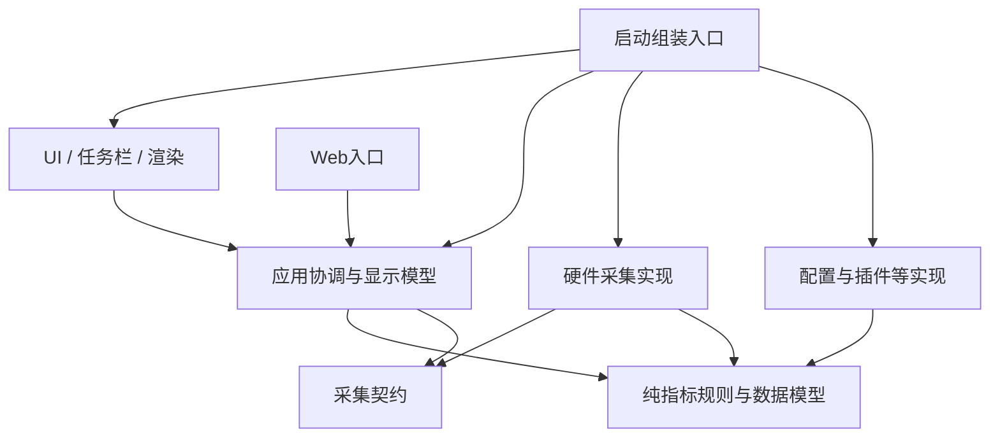

# Plan B：架构解耦与职责整理

- 日期：2026-10-26。
- 状态：B0～B2已批准（2026-10-26，与Plan A的I0～I1同批拍板）；B3～B6维持评估稿，由首批结果再评估。尚未开始实施，本文不表示架构已完成拆分。
- 源码观察基线：`1f652c1f0e402f124c4535fcf878f19c216c5e39`。B0 启动基线：`9da07af`（2026-10-26，W3 合并后），盘点见 [B0/I0 基线盘点](2026-10-26-B0-I0-baseline-inventory.md)。
- 对应问题：UI、硬件采集、全局设置、格式化和应用副作用相互引用，修改一处容易影响多条路径。
- 关联：[Plan A：采集进程隔离](2026-10-26-hardware-process-isolation-plan.md)、[原R06需求](2026-10-24-architecture-debt-requirements.md)、[原R06计划](2026-10-24-architecture-debt-plan.md)。

## 1. 评估摘要

本计划在单进程运行方式下整理职责与依赖，使界面、采样、指标规则和配置应用有明确边界。首要目标是控制改动影响面、降低测试和维护成本；完成后可以独立交付，也可以作为Plan A的基础。

| 评估项 | 结论 |
|---|---|
| 直接收益 | 修改显示、采样、配置时更少牵连；同一数据可供UI/Web/历史一致消费；故障更容易定位 |
| 解决边界 | 代码依赖和资源所有权；仍在单进程内，原生崩溃隔离由Plan A负责 |
| 改动规模 | 中到高；调用点多，主要风险是配置应用顺序、资源释放、显示格式和采样时序变化 |
| 运行成本 | 目标保持现有行为与资源水平；本计划本身不增加常驻进程 |
| 独立性 | 无需先实施Plan A；完成B1/B2就可向Plan A交接最小边界 |
| 建议节奏 | 先完成数据边界与调用点迁移，再拆应用协调和显示模型；每阶段可单独停下验收 |
| 与R06关系 | 继承其职责分离目标；命名空间全量整理独立处理，旧记录不能直接当作当前完成情况 |

## 2. 当前问题和目标改动

| 当前连接点 | 修改风险 | 本计划处理 |
|---|---|---|
| `UIController`直接创建`HardwareMonitor` | UI成为采集启动和释放的隐式所有者 | 把组装移到应用启动入口，UI接收采集接口 |
| 设置页/硬件窗口读取`ComputerInstance`与`SyncLock` | UI依赖具体库与并发细节 | 统一设备目录与传感器快照 |
| `MetricItem`同时保存数值、动画、布局矩形、样式和插件颜色读取 | 规则复用困难，非UI消费方容易走另一套逻辑 | 拆成样本、纯格式规则和UI显示状态 |
| `AppActions`协调采集、窗口、任务栏、Web和插件 | 小改动可能触发无关模块重建 | 保留应用协调入口，具体动作交给有归属的模块服务 |
| 模块持续读取同一个可变`Settings`单例 | 隐式依赖多，运行时可能读取不同阶段配置 | 保留持久化模型，为模块提供不可变配置投影 |
| `Core`中的工具包含UI/System/Plugins依赖 | 目录名不能约束真实依赖 | 明确领域规则和平台实现边界，通过工程引用与测试约束 |

当前基线仍能观察到上述连接点。仓库中已有F系列修复代码与并行验证工作，实施时按现状迁移，不重新删除或绕过已验收策略。

## 3. 目标职责与依赖方向

箭头表示代码依赖。应用协调通过契约调用采集实现，实际对象由启动入口组装，不需要全局服务定位器。

| 部分 | 职责 | 不应拥有的对象 |
|---|---|---|
| Contracts | 采集接口、样本/目录/需求/配置传输模型 | LHM对象、控件、锁、图形资源、全局设置实例 |
| Domain/纯规则 | 单位与数值格式、阈值判断、指标身份等无副作用规则 | `InfoService.Instance`、文件写入、硬件句柄、窗口生命周期 |
| Sampling | 设备采样、重建、缓存、访问策略与硬件状态 | 主窗、主题、菜单、Web票据、插件输入控件 |
| Application | 组装需求、配置变更计划、快照分发、生命周期协调 | 原生传感器对象、直接绘制 |
| UI/Rendering | 本地化显示、动画、布局、图形与窗体资源 | 原生采集锁和LHM设备树 |
| 其他平台实现 | 设置仓库、插件执行、Web传输、历史存储等 | 对其他模块私有字段的直接写入 |

工程拆分节奏：先引入`LiteMonitor.Contracts`（`net8.0`）；采样依赖清理完成后提取`LiteMonitor.Sampling`（`net8.0-windows`，无WinForms）。纯规则稳定且确有复用收益时再提取`LiteMonitor.Domain`（`net8.0`）。Application、UI和其他实现初期可以留在主程序集，通过目录和依赖检查约束，避免一开始拆成十几个项目。

新增类库目录后，主WinExe必须显式排除其源码的递归`Compile`通配，再通过`ProjectReference`引用；不能让同一类型同时编译进两个程序集。同步更新链接源码型测试、反射类型定位、资源名和发布依赖检查，避免出现开发目录正常、干净检出失败的情况。

`Color`、`Font`、`Rectangle`可继续留在UI主题和布局模型。跨模块/进程的数据契约只使用必要的基础数据类型；不为了“纯Core”把每个颜色都重写成一套自定义类。

## 4. 设计决定

### 4.1 采集边界C1：与Plan A共用

统一采用`IHardwareClient`、`SamplingConfig`、`SamplingDemand`、`HardwareSnapshot`、`DeviceCatalog`和`HardwareHealth`。这些类型的字段语义与Plan A第4节一致。

本计划先提供进程内适配器：仍由当前`HardwareMonitor`与采样协调器完成工作，接口调用不引入额外轮询。UI/Web/历史消费同一完整快照，保持真实0、缺失、过期、设备代次和配置revision语义。

首版接口围绕已有调用需求实现：

1. 同步读取本地最新快照，不在绘制中触发采样。
2. 异步获取设备/传感器目录，返回完整版本，不向UI暴露对象锁。
3. 应用采集配置与需求，返回生效revision或明确失败。
4. 查询状态与请求有界重扫；重复请求合并，关闭后拒绝新操作。

在Plan A未实施时，更新驱动等交互仍由应用层处理；采集层只报告能力和需求，不弹MessageBox。传感器窗口需要全目录时显式登记临时需求，关闭时释放，不能用界面遍历直接触发库更新。

### 4.2 设置模型：存储和运行时配置分开

保留现有`Settings`作为兼容持久化DTO及Draft-Commit入口，首版不改用户JSON形状。由应用层派生采集配置、显示配置、Web配置和插件配置的不可变投影，并保留来源revision。

运行时计数、自动设备选择、采集错误和缓存不塞进用户设置投影；确需保存的运行结果经受控命令交给设置仓库。禁止为满足接口而把完整`Settings`对象传遍所有模块。

应用配置时先验证候选值，再得到差异清单。颜色/语言变化不重建硬件；设备访问策略变化才请求采集层重建；Web端口变化单独重启监听。

Draft-Commit保证用户草稿隔离，不代表多个外部服务动作天然有事务。部分动作失败时保存可解释的“已保存配置/实际生效状态/失败原因”，按原有失败策略补偿或保留旧状态；不能声称Web绑定、硬件重建、开机启动等副作用可一次原子回滚。

### 4.3 指标：原始样本、规则、UI状态分开

| 模型 | 内容 | 生命周期 |
|---|---|---|
| MetricSample | Key、稳定设备绑定、值、单位、质量、原因和采样时间 | 一批数据，不可变 |
| MetricDefinition/FormatOptions | 指标类型、单位策略、阈值和用户显示选项 | 随配置revision更新 |
| MetricViewState | 插值值、布局矩形、缓存文本、选中状态、字体颜色结果 | 界面拥有并释放 |

现有`MetricItem`可以先保留为UI兼容包装，逐步委托纯规则；不要求一笔删除所有调用点。插件颜色由应用层取得后作为样式输入，格式化函数不自行查询`InfoService.Instance`。

数值/单位/质量的通用规则供UI和Web复用；紧凑显示、动画和布局仍由各展示端决定。历史消费原始样本，不读取动画后的`DisplayValue`。既有指标Key、单位选择、阈值含义和用户别名保持。

### 4.4 应用协调：明确服务归属

保留一个清楚的设置应用入口，内部可依次委托`SamplingConfigApplier`、`WindowAppearanceApplier`、`TaskbarController`、`WebServerController`和`PluginRuntimeController`等具体组件。

只在需要替换实现、隔离副作用或跨边界的位置引入接口；纯内部帮助类不机械增加I前缀接口。直接构造注入就能满足的地方不引入DI容器。

各模块明确Start/Apply/Stop责任，应用退出统一取消并等待；消费者只释放自己的订阅，不通过关闭某个窗口偷偷释放所有消费者共用的采集器。

### 4.5 依赖约束

- 新Contracts/Domain项目不引用主程序、WinForms、LHM或Vortice。
- UI可依赖采集契约，不直接引用LHM；设备目录UI使用平台无关类型枚举。
- Sampling不能引用UI、Rendering、主题编辑器、Web或插件执行器。
- 启动入口允许组装具体实现；其余层不能依赖启动入口。
- 现有命名空间全面统一作为独立机械改动，不能用“去掉src前缀”代替上述职责改造。需要迁移时保留反射、资源名和测试探针的兼容验证。
- 同步旧R06中的约束与新范围，避免旧脚本继续把合理的UI代码留在Core作为假设；新检查按实际归属与程序集验证，不只搜索using字符串。

## 5. 分阶段任务

| 阶段 | 任务 | 主要落点 | 阶段完成条件 |
|---|---|---|---|
| B0 基线与依赖图 | 调用点/静态对象/生命周期盘点，保留典型行为fixture | `Core`、`UIController`、设置页、硬件窗口、Web、采样层 | 确认修改面、现有F系列验收状态与并行热点；§7.1前置条件已满足，性能基线已按§6.3采集 |
| B1 C1契约 | 建立纯数据契约、快照语义和进程内适配器 | 新Contracts；现有HardwareMonitor外层 | 快照/目录/配置/需求有单一契约，采样频率不变 |
| B2 消费方迁移 | 迁移UI、Web、历史、设置和传感器窗口 | `UIController`、`LiteWebServer`、`HardwareInfoForm`、`SystemHardwarPage`、历史记录 | 消费方不访问`ComputerInstance`、`SyncLock`和LHM类型；同批数据一致 |
| B3 配置与协调 | 设置投影、差异应用、具体模块服务、单一启动组装 | `Settings`、`SettingsHelper`、`SettingsChanger`、`AppActions`、启动代码 | 草稿取消不生效；只重配受影响模块；失败状态可解释 |
| B4 指标与格式 | 分离MetricSample/规则/ViewState，插件显示输入显式传入 | `MetricItem`、`MetricUtils`、`MetricLabelResolver`、UI/Web适配 | 纯规则不查询全局服务；原显示格式与阈值结果保持 |
| B5 真实工程边界 | 提取Sampling，按收益提取Domain，清理资源归属 | csproj/sln、采样服务、主题/布局工具 | 工程引用无环，采集实现无WinForms/UI依赖；程序集归属明确 |
| B6 门禁和交付 | 架构规则、回归、性能比较、R06文档对齐 | 测试、CI/Release、相关开发文档 | 新边界被可执行检查保护，结果可复跑 |

顺序：B0→B1→B2→B3/B4→B5→B6。B3和B4接口确认后可以并行，但`UIController`、`Settings`、`MetricItem`等共享文件应由指定集成人收口。

**独立停靠点**：B1/B2完成即可作为第一批成果发布和向Plan A交接；B3完成可独立验收设置副作用；B4～B6完成后才称为本计划整体完成。停在前两阶段不声称全部Core解耦。

## 6. 兼容与验收

### 6.1 行为保持矩阵

| 范围 | 验证方法 | 通过条件 |
|---|---|---|
| 数值格式和单位 | 从现有行为采集固定输入/输出fixture，再对纯规则验证 | 正常/紧凑格式、阈值边界、用户单位、多语言结果保持 |
| 采样 | 不同消费者需求组合、重复刷新、采集中查询和重扫 | 只有一个协调器；采样次数不随显示刷新频率倍增 |
| 设备目录 | 多同型号设备、热插拔、目录切代、传感器窗口开关 | 稳定身份不漂移，关闭窗口释放需求，旧目录不覆盖新数据 |
| 设置 | 保存/取消、运行态更新、Web绑定失败、硬件策略失败 | 不覆盖运行统计，不偷偷应用草稿；失败后实际状态明确 |
| 生命周期 | 打开关闭设置/历史/传感器窗口、重建主窗、退出 | 订阅/Timer/绘图资源不持续增长，不由消费者错误停掉共享服务 |
| 多展示端 | GDI+/GPU/横排/任务栏/Web/历史消费相同批次 | 质量与来源一致，各自格式差异符合约定 |
| 现有修复 | F系列、主题/插件市场、更新与Web安全回归 | 已通过行为不回退；缺实机证据仍原样标记 |

### 6.2 架构检查

1. 工程引用图无环，Contracts/Domain依赖集合受白名单约束。
2. UI与Web的采集适配代码不引用`LibreHardwareMonitor`、`ComputerInstance`、`SyncLock`；若存在启动组装或临时桥接例外，范围与撤除阶段必须明确。
3. Sampling工程不引用UI/Rendering/Web/Plugins；采集配置中不出现`Control`、`Font`、`Theme`、全局`Settings`或主程序服务单例。
4. 格式规则可在不启动窗体、不初始化硬件、不建立网络连接时执行。
5. 所有新增约束绑定到真实执行的构建/测试步骤；不以注释编号或未接线脚本认定已受保护。

复用当前CI/Release和TRX发现数门禁，实施前记录实际数字及跳过原因，不能沿用2026-10-24/25旧计划的固定测试数。本次规划未运行产品构建或测试。

### 6.3 性能与时序

不追求通过重构直接承诺CPU下降。记录同机前后采样次数、CPU时间、私有字节、UI刷新延迟、目录查询延迟和启动时间。任何显著退化必须定位；新快照分配应有界，不在每个绘制帧复制整套设备树。

快照按完成批次更新，格式缓存按样本/配置/语言revision失效；计时继续使用既有单调时钟。异步迁移不新增`.Result`或UI线程等待锁，事件订阅统一注销。

## 7. 与既有计划及Plan A衔接

- 已核实问题修复优先保持功能语义。若某F任务仍在修改同一文件，先确定交接SHA，不在并行工作中覆盖其变更。
- 本计划不替代F08/F09硬件修复、不重新实现F11缺失语义，而是给已验收结果找到明确归属。
- 原R06已有需求/执行记录可能包含历史实施与回退情况。B0核对真实代码，已完成内容复用；必要的重新设计写清差异，不能同时保留两套互相矛盾的验收标准。
- C1契约由最先执行的一份计划交付；另一份直接复用。B1/B2与Plan A的I1是同一成果，不重复计费或重复迁移消费者。
- Plan A若先完成采集工程拆分，B5接收既有Sampling边界；本计划若先完成B5，Plan A只需增加Host承载、IPC和监督器。
- 两份计划同时实施时，共享契约和调用方迁移由同一负责人维护；协议传输在Plan A，纯规则/应用协调在本计划，避免两边各造一个数据模型。

### 7.1 并行分支处置与启动前置条件（2026-10-26裁决）

批准时仓库存在4条未合并分支与2个带未提交改动的工作树，处置记录如下：

| 对象 | 内容 | 裁决 |
|---|---|---|
| `fix/F17-market-install-race` | 仅XML文档注释 | 主体已在master（661ddb2）；分支仅余测试文件4行注释差异，无独立合入价值，随工作树清理一并放弃 |
| `fix/autohide-window-loss` | `AppActions.cs`（18行）、`MainForm_Transparent`、新增`AutoHideLogic` | 尽快合入；与f06在`MainForm_Transparent`的冲突先由双方解 |
| `fix/F08b-disk-allowlist` | `Settings.cs`（34行）、`ControllerProbePolicy` | 尽快合入；探测策略语义并入B1的`SamplingConfig`清单 |
| `f06`工作树（脏10文件） | 任务栏z序/置顶 | 与本计划低相关；完成合入即可 |
| `f14b`工作树（脏7文件） | `Settings.cs`与新增设置主题系统（`src/UI/Settings/*`、`src/Core/SettingThemeMode.cs`） | 落点与B2/B3重叠，完成合入后才可启动B0 |
| `feat/r06c-namespace` | 304文件、落后master 108提交、双边改动59文件 | **只摘脚本**（2026-10-26已执行）：`architecture-assert.ps1`已摘取并适配为棘轮模式——`scripts/architecture-baseline.json`锁定当日master现状（12项，含C-1=142、C-3=167、A-7=11），只拦新增违规并放行改善，B1/B2收紧A组基线、B5收紧C组、B6接线CI强制档；A-1～A-4的using前缀已同时匹配新旧命名空间，避免master现状下空转。`contracts-assert.ps1`与契约登记表所断言的契约在master尚不存在，留在封存分支待B1/B6再取。A1～A3解耦成果不重放，并入B1/B2/B5按本计划带行为验证重做；分支封存作参考，不删除 |

启动规则：上表分支全部合入或明确搁置、热点文件（`Settings.cs`、`SettingsHelper.cs`、`MetricItem.cs`、`UIController.cs`、`HardwareMonitor.cs`、`LiteWebServer.cs`、`SystemHardwarPage.cs`）冻结后，方可启动B0；启动时重录HEAD与未提交改动。B0完成条件包含本表执行情况核对。

两份首批同批批准即触发上文同一负责人条款：C1契约与消费方迁移（本计划B1/B2≙Plan A的I1）只做一次；合并WBS待B0/I0共同基线盘点后按实际重算。

**执行核对（2026-10-26，W3 合并后）**：F08b（含接线）/f14b/f06 已合入，F17 已放弃，r06c 已封存并摘取脚本——棘轮基线随 W3 上调（C-1=147、C-3=172、C-4=353，+5 文件/+15 public 类型，均为已验收代码；A 组零变化），历史见 `scripts/architecture-baseline.json`。autohide 未合入（待实机冒烟 4 步），其落点为 `AppActions`/`MainForm_Transparent` 等 B3 文件、不在冻结清单，不阻塞 B0～B2/I0～I1；B3 启动前必须合入或明确搁置。B0 已启动，静态盘点完成，见 [B0/I0 基线盘点](2026-10-26-B0-I0-baseline-inventory.md)。

## 8. 提交与回滚

- 按B阶段拆小提交；文件移动、类型/命名空间改名与行为修改分开，便于检查差异。
- 保留旧`MetricItem`或采集接口的短期适配层时写明撤除阶段。正式完成B6后，不得同时保留新旧两条采样循环或全局服务查询路径。
- 配置文件形状首版保持；新增运行时投影不落盘。确需调整JSON结构时另立可验证迁移任务，不混进纯重构提交。
- 回滚以阶段提交为单位，检查后续阶段引用依赖；不自动恢复旧的无限缓存、缺失值补零等已修行为。
- 所有发布候选走真实MainForm/GPU宿主和设置应用回归，不能只证明拆出的类库可编译。

## 9. 成本与评估选项

| 方案 | 收益 | 限制 |
|---|---|---|
| B0～B2 | 隔开UI和硬件对象，便于测试与后续进程隔离 | 全局配置和格式化耦合仍需后续整理 |
| B0～B3 | 增加设置应用边界，减少无关重建 | 指标显示模型仍存在混合职责 |
| B0～B6 | 采集、规则、显示与应用协调形成可检查边界 | 调用点多，需要完整行为回归；没有原生进程隔离收益 |

粗略工程估计：熟悉仓库的开发者，B0～B2约3～5人日，B3约2～4人日，B4～B6约4～7人日，总计约9～16人日。估计用于比较，实际取决于F系列收口程度、静态发布器及测试接缝数量，不包含等待目标硬件或其他工作线的时间。

若两份计划一起执行，不能直接把12～22与9～16人日相加：C1契约、消费方迁移和Sampling工程拆分有重复工作。合并估计应在共同基线盘点后按实际WBS重算。

建议先评估B0～B2作为首批：收益清楚、能独立验收，并给进程隔离留下稳定入口；整体架构解耦是否继续，由首批结果再评估。

2026-10-26拍板：B0～B2与Plan A的I0～I1同批批准；合并WBS待B0/I0共同基线盘点后按实际重算（见§7.1）。
