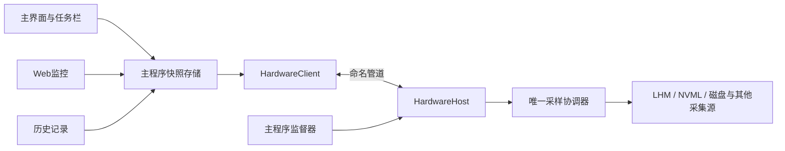

# Plan A：硬件采集进程隔离

- 日期：2026-10-26。
- 状态：I0～I1已批准（2026-10-26，与Plan B的B0～B2同批拍板）；I2～I5维持评估稿，I2原型后另设产品评估点。尚未开始实施，本文不表示已有隔离能力。
- 源码观察基线：`1f652c1f0e402f124c4535fcf878f19c216c5e39`。I0 启动基线：`9da07af`（2026-10-26，W3 合并后），盘点见 [B0/I0 基线盘点](2026-10-26-B0-I0-baseline-inventory.md)。
- 对应问题：底层采集库崩溃、原生调用卡住时，尽量保住主界面、任务栏和用户操作能力。
- 关联：[Plan B：架构解耦](2026-10-26-architecture-decoupling-plan.md)、[已核实问题修复计划](2026-10-25-verified-bugs-remediation-plan.md)。

## 1. 评估摘要

建议新增一个由主程序管理的`LiteMonitor++.HardwareHost.exe`，把LHM及其原生依赖、硬件对象和采样循环放入子进程。主程序通过本地命名管道取得完整数据快照，不在绘制过程中等待子进程响应。

| 评估项 | 结论 |
|---|---|
| 直接收益 | 采集进程异常退出或用户态调用卡住时，主程序继续响应，并能提示、降级或重启采集 |
| 解决边界 | 用户态进程级故障；不承诺隔离驱动引起的系统卡死、蓝屏或保证终止内核中不可中断的操作 |
| 改动规模 | 高；涉及采样所有权、静态发布器、IPC、后台进程生命周期、发布更新和验证工具 |
| 运行成本 | 多一套运行时及消息序列化；必须比较两进程合计CPU、私有字节和启动耗时 |
| 独立性 | 可单独实施；仅需本计划I1的最小接口边界，无需先完成Plan B全部内容 |
| 建议决策方式 | 先做I0/I1/I2最小验证，证明隔离有效并量化代价，再评估后续完整迁移 |
| 后续扩展 | 可为权限分离打基础；本计划首版不改变整套应用的提权方式 |

这是一项可靠性投资。若主要诉求是减少修改代码时的相互影响，可先评估Plan B；若希望采集故障不再直接结束整个应用，本计划的收益更直接。

## 2. 当前连接点与必要迁移

| 当前实现 | 隔离后的处理 |
|---|---|
| `UIController`直接`new HardwareMonitor(cfg)` | 启动入口组装客户端；UI接收接口，不持有采集器 |
| 设置页和硬件窗口访问`ComputerInstance`、`SyncLock` | 查询不可变设备/传感器目录；禁止跨边界暴露LHM对象和锁 |
| UI和Web调用`UpdateIfDueAsync` | 主程序汇总需求；唯一采样调度器在子进程运行 |
| CPU电压、提交内存、GPU注册等静态发布器 | 转为快照字段；主程序保持本地只读投影，不能期待跨进程共享静态字段 |
| `HardwareMonitor`读取全局`Settings`并拥有FPS/维护组件 | 接收采集配置投影；逐项确定组件和维护动作归属 |
| UI通过`Get(key)`逐项读取并记录历史 | 按完整批次发布，再由界面/Web/历史读取同一批数据 |
| 主程序启动前检查PawnIO，退出时清理FPS辅助进程 | 安装检查保持受控入口；辅助采集进程由所属HardwareHost会话管理 |

当前已有`DiskProbePolicy`、`DeviceIdentity`、网络样本时效代码和控制器探测策略（`ControllerProbePolicy`，随F08b合入后纳入）。本计划迁移其已经验收的语义，不再按旧的“尚未实现”假设重新设计。

## 3. 目标结构及所有权

| 对象/动作 | 唯一所有者 | 约束 |
|---|---|---|
| 硬件对象、原生句柄、设备重建 | HardwareHost | 打开/更新/释放在同一协调边界内串行执行 |
| 采样频率及设备访问策略 | HardwareHost | 使用配置版本与需求快照，不读取UI控件 |
| 配置文件及安装记录写入 | 主程序 | 子进程不写`settings.json`，只回报已应用版本/失败原因 |
| 设备自动选择等运行状态 | HardwareHost产生，主程序决定持久化 | 状态与用户手动选择分开；重启不能覆盖用户偏好 |
| 界面、D3D渲染、桌面背景捕获 | 主程序 | UI渲染用GPU资源不属于硬件读数采集，留在主程序 |
| Web、插件执行、主题市场 | 主程序 | 仅把硬件依赖改为快照，不搬入HardwareHost |
| 硬件历史、流量累计落盘 | 主程序 | 禁止两个进程同时写同一文件 |
| FPS及ETW采集资源 | HardwareHost及其会话 | 按需启停；辅助进程和会话退出清理必须纳入迁移 |
| 工作集整理、手动清理内存 | 依具体目标拆开 | 定期整理只针对所属进程；系统级手动动作使用独立受控服务，不盲目远程调用旧`CleanMemory` |

网络累计数据另设连续性策略：子进程报告带设备ID和计数器epoch的原始累计量或批次增量，主程序按`sessionId+sequence`去重并保存检查点。断连期间无法取得的流量记录为缺口，不根据最后速率补算，不让重连首个样本制造巨额尖峰。

## 4. 最小共享接口：C1

命名仅为设计建议，实施时固定一次；Plan B复用同一约定。

- `IHardwareClient`：读取最新快照、异步查询设备目录、提交采集配置和需求、查询健康状态、请求受控重扫。
- `SamplingConfig`：设备选择、探测策略及采样参数；没有皮肤、窗体、菜单、API Key或Web口令。
- `SamplingDemand`：UI、任务栏、已授权Web、历史和传感器窗口的需求合并结果。保留既有日志采集策略，不在本计划中顺带改变记录范围。
- `HardwareSnapshot`：完整采样批次、值/单位/质量/原因、设备身份、采样耗时、配置版本、目录版本。
- `DeviceCatalog`：设备/传感器的稳定身份、运行身份、父子关系、类型、能力和可用状态。
- `HardwareHealth`：启动/就绪/采样/降级/停止状态、当前操作、进度序号及可诊断原因。

原有`GPU.{index}.*`等外部指标Key保持兼容，由稳定设备绑定解释；不得通过IPC改造另起一套指标命名。主程序一次原子替换完整快照，避免值与GPU名称来自不同代次。

共享契约建议放入`LiteMonitor.Contracts`纯数据程序集，目标`net8.0`，无WinForms、LHM、Vortice依赖。采集实现放入`LiteMonitor.Sampling`（`net8.0-windows`，不启用WinForms），HardwareHost只负责进程入口和服务承载。禁止HardwareHost反向引用当前WinExe来获取`Settings`或UI工具。

## 5. IPC首版设计

### 5.1 传输和消息

- 采用Windows命名管道，长度前缀+UTF-8 JSON；首版不引入共享内存或复杂RPC框架。
- 消息头包含协议主/次版本、消息类型、`sessionId`、请求ID、序号；配置/需求命令带各自revision。
- 单条消息初始上限1MiB。目录按需查询并分页，每页有固定条目上限；接收长度先校验再分配内存。常规快照不夹带完整设备报告。
- 使用单个有界写入器串行编码消息；控制响应有优先级，快照槽位允许新批次替换未发出的旧批次；不得无限积压或写坏帧边界。
- 配置/重扫等命令有应答、超时和取消语义。客户端超时不等于底层操作已取消，调用方不得立即再开一个相同操作。
- 协议主版本不兼容时拒绝连接并提示组件版本不匹配；兼容新增字段只在次版本演进，不依赖JSON忽略未知字段掩盖主协议冲突。

### 5.2 身份与进程约束

- 主程序创建随机会话名的管道服务端后启动固定安装路径的HardwareHost；连接后验证实际子进程PID、用户/会话及握手身份，管道ACL限制为当前用户的本地访问。
- 禁止远程管道连接；不要把认证材料放进日志或公开命令行。需要启动凭据时使用可继承受限句柄等本地机制，并纳入伪造连接测试。
- 首版保持当前权限模型；跨完整性级别连接、普通权限UI+提权采集器属于后续单独设计。不能因增加管道就宣称权限隔离已完成。
- 子进程不接受任意文件路径、程序启动或系统命令；操作集合限定为采集任务。

### 5.3 时效与背压

采样时间戳用于展示；TTL以接收侧单调时钟结合传来的样本age与批次进度判断，不直接比较来自不同进程的任意`TimeProvider`计数。首次收到已经过期的样本不能重置为Fresh。

界面只读最新快照，可合并更新。历史和流量先在接收服务按批次处理，再通知UI；传输合并造成的序号缺口必须可观察。对需要完整增量的累计量使用检查点/原始计数差分，不能依赖每个UI事件都被消费。

## 6. 故障监督与降级

### 6.1 状态和期限

主程序监督器维护`Stopped → Starting → Ready → Unresponsive/Disconnected → Backoff → Starting`，以及`Degraded`和`Stopping`。以下是原型阶段候选参数，I2按实测固化：

| 项目 | 初始建议 | 处理 |
|---|---|---|
| 握手期限 | 5秒 | 只要求控制通道建立；设备初始化另有进度状态 |
| 心跳 | 2秒一次，连续3次缺失 | 判断控制通道失联；睡眠后先重新基准化，不直接当作3次故障 |
| 采样无进展 | 常规批次10秒；重建/初始化单独预算 | 同时检查操作状态和完成序号；有心跳也不能无限卡在采样 |
| 初始化上限 | 候选60秒，按明确阶段报告 | 超限停止本次尝试并记录卡住阶段，不用无限“启动中”掩盖 |
| 重启退避 | 1、3、10秒 | 5分钟内3次连续失败后暂停自动全功能重启 |
| 正常关闭期限 | 3秒 | 请求释放、等退出；超时结束子进程，无法退出则标记隔离失败并禁止启动重复采集器 |

恢复循环由主程序拥有。用Job Object绑定子进程及其受控FPS辅助进程，主程序异常退出后避免采集器和ETW会话孤立；必须测试现有外部采集工具是否适合加入Job，而非假设全部可随意终止。

### 6.2 降级原则

- 首选为受影响指标Missing，界面、任务栏、插件和设置继续响应。
- Crash-loop后暂停自动采集并提供显式重试；计数器安全模式由可用且健康的采集进程承担。
- 安全模式必须在`Computer.Open`前禁用相关探测；如果全功能模式再次失败，不在主进程偷偷创建第二份LHM补位。
- 重启前确认旧进程已退出；采集重启不重新创建主窗/任务栏，也不修改用户的设备绑定。
- 新会话应用最新配置和需求，目录与第一批有效数据到齐后再发布；旧会话消息和旧revision应答一律丢弃。
- 部分原生调用卡死无法精确归因到某设备；不能仅根据最后日志就自动永久禁用该设备。降级原因要区分已定位与待诊断。

## 7. 分阶段实施

| 阶段 | 主要产出 | 关键文件/范围 | 阶段完成条件 |
|---|---|---|---|
| I0 基线与故障地图 | 所有采集入口、写盘点、静态发布器、辅助进程清单；两模式性能基线 | `HardwareMonitor`、`HardwareValueProvider`、`Program`、UI/Web/历史 | 每个资源都有唯一拟定所有者；原有修复验收状态已核对；Plan B §7.1前置条件已满足，I0清单含F08b控制器探测策略 |
| I1 最小边界 | C1契约、进程内适配器、主程序快照存储 | `UIController`、`SystemHardwarPage`、`HardwareInfoForm`、`LiteWebServer` | 这些消费者不访问LHM对象/采集锁；进程内行为等价 |
| I2 隔离原型 | 真实HardwareHost、管道、最小监督器；实际CPU/GPU读数 | 新Contracts/Sampling/Host项目、启动入口 | 子进程真实退出/卡死时主窗可交互；资源成本量化 |
| I3 完整资源迁移 | 全硬件目录、FPS/ETW、流量连续性、配置与代次 | 所有采集服务、静态发布器、历史接入 | 主程序无LHM初始化/原生采集入口；写盘单一所有者 |
| I4 恢复与安全 | 状态机、退避、Job、身份限制、协议版本 | HostSupervisor、PipeTransport、SnapshotStore | 故障矩阵通过，无重复采集器/后台孤儿 |
| I5 发布和回滚 | 更新器兼容、新组件打包、模式切换、候选验收 | csproj、发布工作流、Updater、探针 | 干净安装/升级/失败回滚及真实环境验证通过 |

I1可复用Plan B的B1/B2；若本计划先做，则Plan B直接验收复用，不重复引入接口和工程。进程内与隔离模式用于迁移比较，最终模式由启动入口选定，不散布到每个控件分支。

启动前置条件与并行分支处置见Plan B §7.1（2026-10-26裁决）：小分支先清、r06c只摘脚本、热点文件冻结后启动I0；C1契约与消费方迁移由两计划共同的同一负责人收口。

新增工程时同步检查主项目SDK的递归`Compile`默认通配：把Contracts/Sampling/HardwareHost源码目录从主WinExe的直接编译范围排除，再以正确的`ProjectReference`引入；Host不被编进主程序，也不被当成主程序依赖启动。同步调整源文件链接型测试、反射探针、资源路径和发布文件清单。

I2之后设置一次产品评估点：看隔离收益、内存代价与部署复杂度，决定是否继续I3～I5。未完成I3不能把仍在主进程的采集路径宣称为已隔离。

## 8. 验收矩阵

| 类别 | 必须执行的验证 | 通过标准 |
|---|---|---|
| 故障隔离 | 真实子进程FailFast、访问异常退出、采样线程无限阻塞、进程被结束 | 主进程不退出，窗口与菜单持续响应；状态正确转换 |
| 协议健壮性 | 拆包、超大长度、非法JSON、错误版本、伪造连接、迟到响应 | 有界拒绝/断连，内存不无界增长，旧数据不发布 |
| 恢复 | 初始化失败、网络设备换序、GPU消失重现、睡眠唤醒 | 同一时刻最多一个采集器；配置/身份/质量正确恢复 |
| 资源释放 | 正常退出、主进程被结束、连续100次Host启动停止 | 无孤儿Host/辅助进程/ETW会话，句柄与线程无持续增长 |
| 数据一致性 | 值/目录原子切换、真实0与无值、历史缺口、流量重放 | 不混代次，不重置TTL，不重复累计，不补造数据 |
| 功能等价 | UI/任务栏/Web/历史不同需求组合，手动传感器和多GPU | 单一采样预算；无隐藏第二套轮询或重复设备打开 |
| 部署 | 新旧主程序/Host错配、更新中断、组件缺失 | 明确提示并可回滚，不静默启用未隔离旧路径 |

性能建议以I0的同机同配置A/B测量评估：两进程合计私有字节、CPU时间、首次有效样本时间和接收延迟均需保存。原型的讨论目标可设为额外私有字节≤50MiB、额外CPU≤5ms/秒、快照接收p95≤100ms；这些是评估阈值候选，不是已测结果。若无法达到，应报告实际收益与代价并重新决定目标，不删掉测量项使验收通过。

所有故障测试先使用专用假采集源和受控子进程。实际驱动重置/设备拔插不作为自动CI必跑步骤，目标硬件验收单列。复用当前Debug/Release、TRX门禁与采样/渲染探针；测试阈值按实施时实际版本读取，不沿用旧计划数字。

## 9. 发布、回滚与约束

- 主程序、Host和依赖作为一个版本包发布，更新器事务纳入所有新增文件；签名/摘要覆盖整个包。新安装和旧版升级都测试，不能只验证开发目录运行。
- 开发验证阶段保留进程内适配器用于A/B和诊断；正式发布禁止自动退回同进程LHM以掩盖隔离失败。人工兼容模式必须清楚说明当前未启用进程隔离。
- 回滚使用完整旧程序包及对应配置备份；新配置字段保持可忽略，现有指标Key和设备绑定迁移不因模式切换重复执行。
- 主程序配置仍是唯一持久化真相；重启Host不保存草稿、不改变用户首选设备。
- 既有F系列缺陷修复继续作为前置行为约束。进程隔离降低故障外溢，不代替F09原生修复、F08探测策略和目标硬件验证。

## 10. 成本与评估选项

| 方案 | 达到的效果 | 成本/限制 |
|---|---|---|
| 仅I0/I1 | 获得采集边界，降低后续迁移风险 | 仍是单进程，没有真实崩溃隔离 |
| I0～I2原型 | 可以测出进程隔离是否值得 | 不作为完整生产交付，部分路径尚未迁移 |
| I0～I5完整实施 | 故障隔离、监督恢复和可部署版本 | 较高开发/测试成本，增加进程、协议和部署维护 |

粗略工程估计：熟悉仓库的开发者，I0/I1约3～5人日，I2约2～4人日，I3～I5约7～13人日，总计约12～22人日。估计用于比较方案，不是工期承诺；不包含补齐特定硬件、72小时长跑或等待其他修复合入的时间。I0清单与I2测量后应更新估计。

建议评估顺序：先认可I0/I1的边界，再评估I2的隔离收益和资源成本；是否完整实施单独决定。
