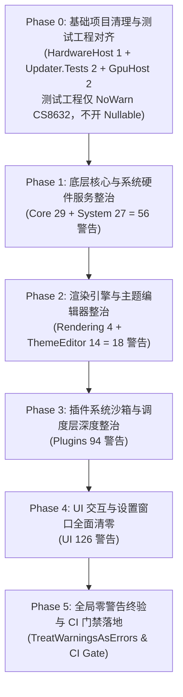

# LiteMonitor 编译警告与 Nullable 可空引用全面治理实施计划

- **制定日期**：2026-10-26
- **计划状态**：**v2.1 修订版** —— 全面调研已完成，并已按两轮独立复审意见修订定级、范围与验收口径，待实施派工
- **修订记录（v2.1 · 异常模型口径修正）**：
  1. **新增 §3.0 全局异常模型**：核实 `src/System/Program.cs:89-93` 注册了 `Application.SetUnhandledExceptionMode(UnhandledExceptionMode.CatchException)` + `Application.ThreadException`（处理器 `Application_ThreadException` 仅写日志并弹窗、**不 rethrow**）以及 `AppDomain.CurrentDomain.UnhandledException`（`LogCrash` 写 `LiteMonitor++_Error.log` + MessageBox，同样不 rethrow）。据此判定：**UI 线程的未处理异常（含 NRE）被全局兜底并吞掉，不会导致进程崩溃**；只有**后台线程未捕获异常**才会终止进程。仓库未注册 `TaskScheduler.UnobservedTaskException`，.NET 8 下未观察到的 Task 异常亦不终止进程。
  2. **P0 数量归零**：v2 稿宣称的「1 处 P0 + 6 处 P1 真实崩溃隐患」在全局异常模型口径下**不成立**，修订为 **3 处运行时真实可空缺陷（1 处 P1 + 2 处 P2）**，并明确：**30 处 CS8602 中无一条会导致进程崩溃**。四类分布同步调整为：运行时真实可空缺陷 3 处、流分析误报 14 处、WinForms 声明失误 9 处、防御性加固 4 处。
  3. **`GpuSceneRenderer` 4 处由 P1 降级为流分析误报**：`_swapChain`（构造函数第 180 行）与 `_emptyView`（第 219 行）在构造成功路径上无条件赋值，此后**无置 null 路径**（`Dispose` 于 1083/1086 行只释放不置空）；`CreateSwapChainForHwnd`（SharpGen，失败抛异常）与 `D3D11DeviceService.CreateShaderResourceView`（`D3D11DeviceService.cs:207-230`，返回非空或抛异常）均不会产出半初始化对象 → 迁入 §3.2 ⑧。
  4. **`CityCodeResolver.cs:237` 由 P1 降级为 P2**：其 NRE 被同方法第 269 行 `catch (Exception ex)` 吞掉（仅 `Debug.WriteLine`），且 `_db == null` 在第 52 行 `if (_db == null) throw new Exception("CityCode DB failed to load");` 已有守卫 → 真实影响是**诊断信息丢失**而非崩溃。
  5. **`SystemHardwarPage.cs:715` 由 P0 降级为 P2**：`AddDouble`（`SettingsUIBuilder.cs:78-93`）在 `return input` 之前已执行 `group.AddItem(new LiteSettingsItem(title, input))`，`input.Parent` 运行时必非空；`LiteSettingsItem` 必含 Label + 控件，`Controls[0]` 必存在 → 该 NRE 当前**不可达**（即便触发，构造函数路径无局部 catch，会中断 `CreateCalibrationCard` 使后续 5 个标定项不创建，但被全局处理器兜住）。
  6. 全面替换「闪退 / 崩溃隐患」措辞为「运行时可空缺陷 / 功能降级 / 静默失败」，并同步 §1、§2.1、§3、§5、§6.1、§7 与附录 A 的定级与计数。
- **修订记录（v2）**：
  1. 复审推翻原 P0 判定 3 项（`NetworkTrafficExclusionService.cs:415`、`UIController.cs:1447/1450`、`UpdateDialog.cs:488/489`），重排 §3 真实风险清单；
  2. 补全原计划未逐条分析的 6 处 CS8602，其中新识别出 1 处真实风险（`TaskbarPage.cs:259`）；`PluginExecutor.cs:1349` 经探针实测后由 P1 **再降级**为流分析误报（§3.2 ⑦）；
  3. 修正 `CityCodeResolver.cs:237` 的故障机理描述（应为 `JsonException` 而非 NRE）并补齐 `_db` 字段自身的可空声明；
  4. **重设 Phase 0 范围**：测试工程改为 `NoWarn CS8632` 消除假噪音，真实可空债务拆分为独立轨道（§5.1）；
  5. **修正 Phase 5 CI 门禁命令**：改为分层门禁，避免全解决方案 `/warnaserror` 必然失败（§5.6）；
  6. 燃尽表增列「测试工程新债」与「xUnit 分析器」两条独立赛道（§6.1）；
  7. 新增 **附录 A：30 处 CS8602 全量清单**（逐条定级 + 处置动作）。
- **基线提交**：`master` @ `42b6b61`（`ci+docs: W2 集成收口——门禁 2571→2686,计划状态更新(含测试串行运维约束)`，含近期架构解耦与 ThemeStudio 重构）
- **实测基线日志**：`dotnet build LiteMonitor.csproj --no-incremental` → 295 警告 / 0 错误（日志留存于 `.tmp/build-litemonitor-warnings.txt`；`.tmp/` 已被 `.gitignore` 忽略）
- **执行基线（Phase 0 实测校正 · 2026-10-26）**：治理在**独立工作树** `remediation-phase-0`（分支 `remediation/phase-0` 之外的 `remediation-phase-0`，基于 `master` @ `42b6b61`）中执行，以隔离主工作区里另一条 theme-studio 任务留下的未提交改动。
  - 主工作区的 295 条基线**是在带未提交改动的工作树上测得的**；在干净的 `42b6b61` 上，主程序 + HardwareHost 合计为 **293 条**（`ThemeStudioForm.cs` 在该提交上只有 1 条 CS8602，缺 Dirty 树上的 2 条 CS8603）。
  - Phase 0 修掉 `HostPipeSession.cs` 的 CS8604 后，**Phase 1–4 的治理起点为 292 条**（UI 126 / Plugins 94 / Core 29 / System 27 / ThemeEditor **12** / Rendering 4）。
  - 差异仅限 `ThemeEditor` 模块：计划中的 14 条是 Dirty 树口径，干净提交上是 **12 条**。其余模块与逐文件计数**完全一致**，30 处 CS8602 的位置也全部吻合（仅 `ThemeStudioForm.cs` 行号由 1173 变为 1018）。
  - 结论：主工作区的 theme-studio 未提交改动合入后，`ThemeStudioForm.cs` 会重新产生 2 条 CS8603，需在该任务内自行清理；本计划的燃尽表按 **292** 口径执行。
- **核心目标**：全面摸排并系统性消除全仓 295 个生产编译警告（主程序 `LiteMonitor.csproj` 294 个 + `LiteMonitor.HardwareHost.csproj` 1 个），彻底阻断潜在运行时 `NullReferenceException` 崩溃缺陷，建立可空安全标准范式与 `<TreatWarningsAsErrors>` 防回退门禁。

---

## 1. 调研背景与治理目标

在启用 C# 8.0+ Nullable 引用类型机制（`<Nullable>enable</Nullable>`）后，编译器会在不可空变量可能为 null、可空变量未判空即解引用、跨层传参可空性不匹配等场景发出 `CS86xx` 警告。

当前仓库在长期迭代与历史代码合并过程中积累了大量编译警告。根据调研：
1. **主程序（`LiteMonitor.csproj`）存在 294 个独立编译警告**，其中 288 个为可空相关警告（`CS86xx`、`CS8765`），6 个为通用编译器警告（`CS1998`、`CS0108`、`CS4014`、`CS0414`）。
2. **硬件服务（`LiteMonitor.HardwareHost.csproj`）存在 1 个警告**（`CS8604`）。
3. **合计生产代码编译警告 295 个**。
4. **测试与工具项目**：`LiteMonitor.Tests` 因 csproj 未开启 `<Nullable>` 但测试代码大量使用 `?` 标注，派生出 263 个 `CS8632` 警告与 **42 个 xUnit 规则警告**（v1 计划写 38，实测 42）；`LiteMonitor.Updater.Tests` 有 2 个 `CS8602`；`GpuHostLifecycleProbe` 有 2 个 `CS1998`。
   - **v2 实测补充**：`LiteMonitor.Tests` 若开启 `<Nullable>enable</Nullable>`，测试工程自身警告将从 265 条**升至 627 条**（新增 CS8600 153、CS8625 136、CS8602 84、CS8603 71、CS8629 30、CS8604 24、CS8601 22、CS8618 14、CS8605 8、CS8765 3、CS8619 2、CS8622 2、CS8767 2、CS8613 1）。这批**真实**可空债务独立于本计划主线，拆为 Phase 6（详见 §5.1、§6.1）。
5. **契约库（`LiteMonitor.Contracts`）与更新器（`LiteMonitor.Updater`）** 已实现 **0 警告**，证明规范治理完全可行。

**核心治理目标**：
- **零生产缺陷**：彻底修复 30 处 `CS8602`（解引用可能为空）中的 **3 处运行时真实可空缺陷**（1 处 P1 + 2 处 P2，含 v2 新识别的 `TaskbarPage.cs:259`），并清理 8 处 WinForms 声明失误、14 处流分析盲区（消除后续被误改的风险）、5 处防御性加固点；另修复 1 处 `CS4014`（调用未等待）。
  > **v2.1 口径修正**：经全局异常模型核验（§3.0），**30 处 CS8602 无一会导致进程崩溃** —— UI 线程异常已被 `src/System/Program.cs:89-93` 注册的全局处理器兜底并吞掉（写日志 + 弹窗，不 rethrow）。本计划的目标表述由 v1/v2 的「堵崩溃隐患」修正为「**消除运行时可空缺陷、修复功能降级与静默失败、显式化代码不变量**」。
- **零编译警告**：分 6 个独立验证批次推进，将生产项目（`LiteMonitor` + `HardwareHost`）的警告数从 **295 单调递减至 0**。
- **杜绝暴力抑制**：严禁采用 `!`（Null-forgiving 运算符）粗暴掩盖真实存在的空值流向缺陷。
- **防回退门禁**：治理完成后在项目配置中启用 `<TreatWarningsAsErrors>true</TreatWarningsAsErrors>`，在 CI 流程中建立硬性防回退卡点。

---

## 2. 全仓编译警告全面摸排与分类统计

### 2.1 按警告编号统计（数量与风险等级）

| 警告编号 | 数量 | 官方定义与严重性 | 风险等级 | 主要危害与潜在缺陷 |
|---|:---:|---|:---:|---|
| **CS8602** | **30** | Dereference of a possibly null reference（解引用可能出现空引用） | **中 (Medium)** · *v2.1 再修正* | v1 曾一律定为「极高（必定/概率触发 NRE）」；v2 逐处核验运行时可达性后修正；**v2.1 引入全局异常模型口径后再次修正**：UI 线程异常被 `src/System/Program.cs:89-93` 的全局处理器吞掉，**30 处无一会导致进程崩溃**。四类分布：**运行时真实可空缺陷 3 处**（1 P1 + 2 P2）、**流分析误报 14 处**、**WinForms 声明失误 9 处**、**防御性加固 4 处**。详见 §3 与附录 A |
| **CS4014** | **1** | Because this call is not awaited, execution continues before call completed | **中 (Medium)** | 异步任务未被等待，其异常被静默吞掉。仓库未注册 `TaskScheduler.UnobservedTaskException`，.NET 8 下未观察异常不会终止进程，但错误彻底丢失、诊断困难（`src/UI/Settings/PluginMarketPage.cs:901`） |
| **CS8604** | **60** | Possible null reference argument for parameter（实参可能传入 null） | **高/中 (High/Medium)** | 将潜在 null 传入约定非空的下游接口，导致下游方法内部发生级联崩溃 |
| **CS8600** | **39** | Converting null literal or possible null value to non-nullable type | **中 (Medium)** | 变量隐式丢失可空状态，欺骗编译器流分析，隐藏潜在空指针 |
| **CS8625** | **30** | Cannot convert null literal to non-nullable reference type | **中 (Medium)** | 显式将 null 赋给标记为非空的类型或参数，契约设计失真 |
| **CS8601** | **16** | Possible null reference assignment（可能出现 null 引用赋值） | **中 (Medium)** | 字段/属性状态被污染为 null，后续读取时引发解引用异常 |
| **CS8603** | **15** | Possible null reference return（可能返回 null 引用） | **中 (Medium)** | 方法签名承诺返回非空，实际却返回 null，调用方失去防守意识 |
| **CS8618** | **80** | Non-nullable member is uninitialized（构造函数退出时不可为 null 字段未赋值） | **结构/中 (Structural)** | WinForms 控件迟延绑定或 DTO 反序列化后字段仍为 null |
| **CS8622** | **17** | Nullability of reference types in type of parameter doesn't match target delegate | **规范/低 (Code Style)** | WinForms 事件处理方法签名与 `EventHandler`（`object? sender`）可空性不一致 |
| **CS1998** | **3** | Async method lacks 'await' operators and will run synchronously | **规范/低 (Hygiene)** | 伪异步方法造成上下文切换与 Task 分配额外开销 |
| **CS8765** | **1** | Nullability of parameter type doesn't match overridden member | **规范/低 (Code Style)** | 重写虚方法/基类属性时破坏了父类的可空协变规范 |
| **CS0108** | **1** | Member hides inherited member; missing 'new' keyword | **规范/低 (Hygiene)** | 方法名与基类属性重名，造成调用混淆与隐式覆盖 |
| **CS8619** | **1** | Nullability of reference types in value doesn't match target type | **规范/低 (Hygiene)** | 集合泛型参数或元组内部类型的为 Null 性冲突 |
| **CS0414** | **1** | Field is assigned but its value is never used | **冗余/低 (Dead Code)** | 死字段赋值，占用字段槽位与阅读干扰 |
| **总计** | **295** | **289 个可空引用警告 + 6 个通用编译器警告** | - | - |

---

### 2.2 按子系统/模块分布统计

生产代码中各模块的警告分布如下：

```
src/UI           [████████████████████████████] 126 (42.7%)
src/Plugins      [█████████████████████]        94  (31.9%)
src/Core         [███████]                      29  (9.8%)
src/System       [██████]                       27  (9.2%)
src/ThemeEditor  [███]                          14  (4.7%)
src/Rendering    [█]                            4   (1.4%)
src/HardwareHost [ ]                            1   (0.3%)
src/Contracts    [ ]                            0   (0.0%)
```

- **`src/UI`（126 个，占 42.7%）**：全仓最大警告源，主要集中在 WinForms 页面构造函数未赋值（CS8618: 52 个）、事件回调形参缺少 `?`（CS8622: 17 个）、解引用未守卫（CS8602: 11 个）及参数传空（CS8604: 20 个）。
- **`src/Plugins`（94 个，占 31.9%）**：第二大警告源，插件执行器沙箱数据解包（CS8604: 25 个、CS8600: 17 个、CS8625: 15 个）与插件管理选项字段未初始化（CS8618: 24 个）。
- **`src/Core`（29 个，占 9.8%）**：配置与度量格式化层，主要为主题颜色映射可能为空赋值（CS8601: 12 个）与三元表达式推断失效（CS8602: 1 个）。
- **`src/System`（27 个，占 9.2%）**：Web 服务与硬件监控层，含 1 处高危网络快照空指针（CS8602: 1 个）、Web 反序列化与返回值（CS8600: 8 个、CS8603: 5 个）。
- **`src/ThemeEditor`（14 个，占 4.7%）**：主题编辑器，包含 9 处 CS8602，绝大部分是窗体控件声明为可空导致全局解引用报警。
- **`src/Rendering`（4 个，占 1.4%）**：DirectX 11 交换链与背景视图生命周期解引用（CS8602: 4 个）。
- **`src/HardwareHost`（1 个，占 0.3%）**：IPC 写入队列实参可空性（CS8604: 1 个）。
- **`src/Contracts`（0 个，占 0.0%）**：已完全实现 0 警告，作为跨进程与跨模块的标准契约基座。

---

### 2.3 模块 × 警告编号交叉统计矩阵（Cross-Tabulation Matrix）

| 模块 (Module) | CS8618 | CS8604 | CS8600 | CS8625 | CS8602 | CS8622 | CS8601 | CS8603 | CS1998 | CS8765 | CS0108 | CS8619 | CS4014 | CS0414 | 模块小计 |
|---|:---:|:---:|:---:|:---:|:---:|:---:|:---:|:---:|:---:|:---:|:---:|:---:|:---:|:---:|:---:|
| **src/UI** | 52 | 20 | 11 | 9 | 11 | 17 | 2 | 1 | - | 1 | 1 | - | 1 | - | **126** |
| **src/Plugins** | 24 | 25 | 17 | 15 | 4 | - | 2 | 7 | - | - | - | - | - | - | **94** |
| **src/Core** | 2 | 6 | 3 | 4 | 1 | - | 12 | - | - | - | - | 1 | - | - | **29** |
| **src/System** | 2 | 5 | 8 | 2 | 1 | - | - | 5 | 3 | - | - | - | - | 1 | **27** |
| **src/ThemeEditor** | - | 3 | - | - | 9 | - | - | 2 | - | - | - | - | - | - | **14** |
| **src/Rendering** | - | - | - | - | 4 | - | - | - | - | - | - | - | - | - | **4** |
| **src/HardwareHost**| - | 1 | - | - | - | - | - | - | - | - | - | - | - | - | **1** |
| **合计 (Total)** | **80** | **60** | **39** | **30** | **30** | **17** | **16** | **15** | **3** | **1** | **1** | **1** | **1** | **1** | **295** |

---

### 2.4 高频警告文件分布清单

| 文件路径 | 警告数 | 主要警告构成 | 涉及子系统 |
|---|:---:|---|---|
| `src/Plugins/PluginExecutor.cs` | **40** | CS8604: 18, CS8600: 7, CS8625: 7, CS8618: 3, CS8601: 2, CS8603: 2, CS8602: 1 | 插件执行与 HTTP 沙箱 |
| `src/UI/Settings/MonitorPage.cs` | **24** | CS8618: 12, CS8622: 12 | 监控设置项与事件绑定 |
| `src/Plugins/PluginManager.cs` | **16** | CS8618: 13, CS8625: 2, CS8600: 1 | 插件生命周期与选项委托 |
| `src/UI/Settings/SystemHardwarPage.cs` | **11** | CS8618: 8, CS8625: 2, CS8602: 1 | 硬件校准与设置面板 |
| `src/Core/ThemeManager.cs` | **10** | CS8601: 9, CS8619: 1 | 主题与颜色属性同步 |
| `src/UI/TrafficHistoryForm.cs` | **10** | CS8618: 7, CS8622: 2, CS8602: 1 | 流量历史列表与绘制 |
| `src/UI/UIController.cs` | **10** | CS8604: 7, CS8602: 2, CS8600: 1 | 界面调度与 GPU 路由管理 |
| `src/Plugins/Native/CryptoNative.cs` | **9** | CS8604: 4, CS8600: 2, CS8625: 2, CS8618: 1 | 原生加解密互操作 |
| `src/System/WebServer/WebSessionManager.cs`| **9** | CS8600: 4, CS1998: 2, CS8603: 2, CS8604: 1 | Web 会话管理 |
| `src/UI/Controls/MonitorControls.cs` | **9** | CS8618: 5, CS8600: 2, CS8601: 2 | 监控条目自定义控件 |
| `src/ThemeEditor/ThemeEditorForm.cs` | **8** | CS8602: 8 | 经典主题编辑器 |
| `src/UI/Settings/PluginPage.cs` | **8** | CS8604: 3, CS8600: 3, CS8602: 2 | 插件管理界面 |
| `src/Plugins/Native/CityCodeResolver.cs` | **7** | CS8600: 2, CS8603: 2, CS8625: 2, CS8602: 1 | 城市天气代码解析 |
| `src/Plugins/PluginProcessor.cs` | **7** | CS8600: 4, CS8604: 2, CS8618: 1 | 插件数据后处理管道 |
| `src/UI/Controls/LiteUI.cs` | **7** | CS8618: 4, CS8603: 1, CS8625: 1, CS8765: 1 | 基础 UI 渲染控件 |
| `src/Plugins/PluginKeyOwnership.cs` | **6** | CS8602: 2, CS8603: 2, CS8625: 2 | 插件键所有权推导 |
| `src/UI/Settings/SettingsUIBuilder.cs` | **6** | CS8600: 3, CS8604: 2, CS8602: 1 | 设置界面构建辅助 |

---

## 3. CS8602 专项深度剖析与缺陷诊断

CS8602（解引用可能为空引用）代表编译器无法在类型系统上证明该变量在此处一定非空。通过对代码上下文的逐行审查，30 处 CS8602 呈现出四种截然不同的性质：**运行时真实可空缺陷**、**流分析盲区**、**WinForms 控件声明失误**与**防御性加固项**。

> **v2 修订说明**：v1 计划仅逐条分析了 30 处中的 24 处，且在定级上把「声明为可空」直接等同于「运行时可空」。经独立复审，本版完成两项关键修正：
> 1. **补全 6 处未分析项**：`PluginExecutor.cs:1349`、`PluginPage.cs:110`、`PluginPage.cs:380`、`SettingsUIBuilder.cs:234`、`TaskbarPage.cs:259`、`TrafficHistoryForm.cs:381`；
> 2. **逐处验证运行时可达性**，推翻 3 项误判（详见 §3.2），并新识别出 1 处真实风险（`TaskbarPage.cs:259`）；另有 `PluginExecutor.cs:1349` 经**探针工程实测**后由 P1 再降级为流分析误报（§3.2 ⑦）。
>
> **v2.1 修订说明（关键口径修正）**：v2 稿把 7 处 CS8602 定级为「真实生产级潜在崩溃隐患（1 P0 + 6 P1）」。经第二轮复审补充核实 `src/System/Program.cs:89-93` 的**全局异常处理模型**（详见 §3.0），该定级**不成立** —— 本应用的 UI 线程异常会被全局处理器吞掉，**没有任何一条 CS8602 会导致进程崩溃**。本版据此：
> 1. 新增 §3.0 全局异常模型与定级口径；
> 2. `GpuSceneRenderer` 4 处由 P1 **降级为流分析误报**（迁入 §3.2 ⑧）；
> 3. `CityCodeResolver.cs:237` 由 P1 **降级为 P2**（NRE 被局部 `catch` 吞掉）；
> 4. `SystemHardwarPage.cs:715` 由 P0 **降级为 P2**（运行时不可达）；
> 5. 全文替换「闪退 / 崩溃隐患」措辞。
>
> **全量清单见附录 A**（30 处逐条定级与处置动作）。

---

### 3.0 全局异常模型与定级口径（v2.1 新增 · 必读）

定级「一处 CS8602 有多严重」之前，必须先知道**本应用被抛出异常后会怎样**。核实结果：

| 异常发生位置 | 兜底机制 | 实际后果 | 是否终止进程 |
|---|---|---|:---:|
| **UI 线程**（事件回调、窗体构造、绘制回调） | `Application.SetUnhandledExceptionMode(UnhandledExceptionMode.CatchException)` + `Application.ThreadException += Application_ThreadException`（`src/System/Program.cs:89-90`） | `Application_ThreadException`（131-134 行）**只调用 `LogCrash`、不 rethrow**；`LogCrash`（142-168 行）写 `LiteMonitor++_Error.log` 并弹一个 MessageBox | **否**（弹窗后继续运行） |
| **后台线程**（ThreadPool / 定时器 / 无 await 的 Task） | `AppDomain.CurrentDomain.UnhandledException`（`Program.cs:93`、136-139 行） | 只写日志，**不 rethrow**；.NET 8 中该事件是 last-chance，进程随后仍被运行时终止 | **是**（唯一的真正「闪退」路径） |
| **未观察的 Task 异常**（`async` 方法未 await） | 仓库**未**注册 `TaskScheduler.UnobservedTaskException` | .NET 8 默认不终止进程，异常被彻底丢弃、无人知晓 | **否**（但错误彻底丢失） |

**由此得到的定级口径（v2.1）**：

1. **「声明为可空」≠「运行时可空」**：还需验证可空性来源是否真实（多余 `?.` 污染、bool 中转变量、字段在构造函数中无条件赋值等）。
2. **「运行时可空」≠「会崩」**：还需验证该语句运行在哪个线程、沿途是否有局部 `catch`。
3. **按「实际后果」而非「是否 NRE」定级**：
   - **P1（用户可感知的功能不可用）**：能真正取到 null + 无局部守卫 + 后果是某项功能直接不可用；
   - **P2（功能降级 / 静默失败 / 诊断困难）**：能取到 null 但被局部 `catch` 吞掉，或只中断一段构造流程导致后续控件缺失，或只写 `Debug.WriteLine` 导致根因丢失；
   - **流分析误报**：运行时不可达或非空有保证，但编译器无法证明 —— 加 `?.` 反而会**掩盖状态不变量**；
   - **声明失误**：类型签名与生命周期事实不符，属规范问题。
4. **禁止用 `?.` + `?? 默认值` 做静默降级**（见 §4.3 铁律五）—— 对本应用而言，掩盖一个真实的状态不变量比留下一个显式异常更危险。

### 3.1 运行时真实可空缺陷清单（1 处 P1 + 2 处 P2 · v2.1 修订后成立清单）

> **v2 修订说明**：原 v1 计划将 7 处 CS8602 一律列为 P0。经独立复审**逐处验证代码可达性**后，**其中 3 项的 P0 判定被推翻**（见 §3.2）；同时**补全了 6 处原未逐条分析的 CS8602**，并从中新识别出 1 处真实风险（`TaskbarPage.cs:259`）。
>
> **v2.1 修订说明**：叠加 §3.0 的全局异常模型口径后，v2 稿的「1 处 P0 + 6 处 P1 真实崩溃隐患」被再次修正为 **1 处 P1 + 2 处 P2**：**`GpuSceneRenderer` 4 处降级迁入 §3.2 ⑧、`CityCodeResolver.cs:237` 降级为 P2、`SystemHardwarPage.cs:715` 降级为 P2**。本节现有 **3 处**成立项，且**均不会导致进程崩溃**（UI 线程异常被全局处理器吞掉，详见 §3.0）。
>
> **重要方法论（v2.1 补齐第 ④ 条）**：判定一处 CS8602 的真实严重度，必须逐条核验 **① 变量在声明处是否确为可空类型 ② 该语句在运行时是否真的可达 ③ 触发条件在生产环境中是否现实存在 ④ 该异常最终被谁接住、后果是崩溃还是功能降级**。仅凭「字段声明为 `?`」不足以定级；**判定为可空也不等于运行时可空** —— 多余 `?.` 污染、bool 中转变量、构造函数中无条件赋值的字段，同样都是误报（见 §3.2 ⑦⑧）。

#### ① `src/UI/Settings/TaskbarPage.cs` 第 259 行 —— `Screen.PrimaryScreen` 可空（P1 · v2.1 重新定级为最高优先级）
- **缺陷代码**：
  ```csharp
  btnPick.Click += (s, e) => {
      using (Form f = new Form { FormBorderStyle = FormBorderStyle.None, ... })
      {
          Bitmap bmp = new Bitmap(Screen.PrimaryScreen.Bounds.Width, Screen.PrimaryScreen.Bounds.Height);
  ```
- **机理与风险**：`Screen.PrimaryScreen` 的声明类型为 `Screen?`，**运行时确实可能返回 `null`**（无显示器、显示器热插拔、远程/会话隔离、显示拓扑变化）。该语句位于「屏幕取色器」按钮的点击回调中 —— **用户可直接触发**，且**路径上没有任何局部 `catch`**。
- **实际后果（v2.1 按 §3.0 口径修正）**：异常发生在 **UI 线程** → 被 `Program.cs` 的 `Application_ThreadException` 接住 → 写 `LiteMonitor++_Error.log` + 弹「程序遇到致命错误」对话框 → **进程不会崩溃**，但**屏幕取色器整个功能不可用**。这是本次治理中唯一「声明可空 + 运行时真能为 null + 无局部守卫 + 用户可直接触发」四项同时成立的条目，故定为 P1。
- **安全修复**：
  ```csharp
  var screen = Screen.PrimaryScreen;
  if (screen == null)
  {
      MessageBox.Show(LanguageManager.T("Menu.ScreenUnavailable"), "LiteMonitor++",
          MessageBoxButtons.OK, MessageBoxIcon.Warning);
      return;
  }
  Bitmap bmp = new Bitmap(screen.Bounds.Width, screen.Bounds.Height);
  ```
  > ⚠️ 此处**不建议**用 `Screen.PrimaryScreen?.Bounds` + `?? Rectangle.Empty` 静默降级 —— 那会创建一张 0×0 位图，并在下一行 `CopyFromScreen` 处抛出更难懂的异常。显式早退 + 明确提示更符合 §4.3 铁律五。

#### ② `src/UI/Settings/SystemHardwarPage.cs` 第 715 行 —— 控件链解引用（v2.1 由 P0 降级为 P2）
- **缺陷代码**：
  ```csharp
  if(input.Parent.Controls[0] is Label lbl) lbl.Text = LanguageManager.T(key) + suffix;
  ```
- **v1/v2 判定的机理**：v1 定为 P0，理由是 `input.Parent` 可能为 `null`（控件未加入容器或已被移除）；且即使 `Parent` 非空，`Controls` 集合也可能为空，`Controls[0]` 将抛 `ArgumentOutOfRangeException`。
- **v2.1 复核结论（运行时实际不可达）**：
  - `input` 来自 `group.AddDouble(this, ...)`（`src/UI/Settings/SettingsUIBuilder.cs:78-93`）。该方法在 `return input` **之前**已执行 `group.AddItem(new LiteSettingsItem(title, input))`，因此 `input.Parent` 运行时**必非空**；
  - `LiteSettingsItem` 必然同时持有标题 `Label` 与被包装控件，故 `input.Parent.Controls.Count ≥ 1`，且 `Controls[0]` 即该 `Label`；
  - 该语句位于 `CreateCalibrationCard()` 内，经第 60 行被调用，**处于窗体构造路径**。
- **实际后果**：当前不可达 → 现实风险低。但一旦将来控件构建顺序变化（例如 `AddItem` 延后或控件被移除），异常会在构造路径上抛出并**中断 `CreateCalibrationCard()`**，导致第 719 行起的 **5 组标定项（CPU 功耗/主频、GPU 功耗/主频、SYS 功耗/主频、CPU 风扇…）不被创建**；又因在 UI 线程会被全局处理器吞掉 → **设置页静默缺项**。故保留为 **P2（防御性 + 显式化不变量）**。
- **安全修复**（经探针工程实测编译 0 警告，Roslyn 会沿 `?.` 成员链保持 null-state）：
  ```csharp
  if (input.Parent?.Controls.Count > 0 && input.Parent.Controls[0] is Label lbl)
      lbl.Text = LanguageManager.T(key) + suffix;
  ```

#### ③ `src/Plugins/Native/CityCodeResolver.cs` 第 237 行 —— 反序列化结果未判空（v2.1 由 P1 降级为 P2 · 机理与后果均已修正）
- **缺陷代码**：
  ```csharp
  var rawDb = JsonSerializer.Deserialize<Dictionary<string, List<List<string>>>>(json);
  // ...
  _db = new Dictionary<string, List<List<string>>>(rawDb.Count); // ← 未校验 rawDb 是否为 null！
  foreach (var kvp in rawDb)
  ```
- **机理（v2 修正 + v2.1 再修正）**：
  - `json` 在第 159 行被声明为 `string json = null;`（本身即一处可空缺陷），但运行时**必非 null**：第 181-193 行的本地文件分支或第 229 行的远程分支必然为其赋值（远程分支即使响应体为空也会赋值为 `""`）；
  - 当响应为空串或非法 JSON 时，`JsonSerializer.Deserialize` 抛出的是 `JsonException`；网络异常时抛出 `HttpRequestException` —— **均非 `NullReferenceException`**；
  - 只有当响应体为 JSON 字面量 `null` 时，`Deserialize` 才返回 `null`，此时第 237 行的 `rawDb.Count` 才触发 NRE；
  - 字段 `private static Dictionary<string, List<List<string>>> _db = null;`（第 29 行）**自身即声明为可空**。
- **实际后果（v2.1 关键修正）**：该 NRE 发生在 `EnsureDbLoadedAsync` 的 `try` 块内，被同方法第 269-272 行的 `catch (Exception ex) { Debug.WriteLine(...); }` **吞掉**；随后 `_db` 保持为 `null`，而消费侧第 52 行已有守卫 `if (_db == null) throw new Exception("CityCode DB failed to load");` → **不会崩溃**，但用户只会看到笼统的「CityCode DB failed to load」，真实根因只留在 `Debug.WriteLine` 里（Release 构建下不可见）→ **诊断信息丢失**。故降级为 **P2**。
- **安全修复**（同时覆盖「返回 null」「抛异常」「`_db` 字段可空」三种情况，且保留「失败可重试」语义）：
  ```csharp
  // 字段（第 29 行）：保持 "null = 未加载" 语义，使失败后下一次调用仍可重试
  private static Dictionary<string, List<List<string>>>? _db = null;

  // 加载处（第 233-237 行）
  Dictionary<string, List<List<string>>>? rawDb;
  try
  {
      rawDb = JsonSerializer.Deserialize<Dictionary<string, List<List<string>>>>(json);
  }
  catch (JsonException ex)
  {
      Debug.WriteLine($"[CityCodeResolver] city DB is malformed: {ex.Message}");
      _db = null;
      return;
  }
  if (rawDb == null)
  {
      Debug.WriteLine("[CityCodeResolver] city DB deserialized to null.");
      _db = null;
      return;
  }
  _db = new Dictionary<string, List<List<string>>>(rawDb.Count);
  ```
  同时把 `Lookup`（第 124-133 行）改为局部变量 + 显式判空，并将其返回类型标注为可空 `List<List<string>>?`（调用侧第 73/80 行本就按 null 判定）—— 这一并消除该文件已有的 **2 处 CS8603**：
  ```csharp
  private static List<List<string>>? Lookup(string key)
  {
      if (string.IsNullOrEmpty(key)) return null;
      var db = _db;
      if (db == null) return null;
      if (db.TryGetValue(key, out var res)) return res;
      // ...（后续 root 回退逻辑改用局部变量 db）
  }
  ```

> **v1 → v2 → v2.1 的条目迁移对照**：v1 原 ② `CityCodeResolver.cs:237` → v2 新 ④ → **v2.1 新 ③（P2）**；v1 原 ③ `UIController.cs:1447/1450`、原 ⑤ `UpdateDialog.cs:488/489` → 判定被推翻，降级并迁入 §3.2；v1 原 ④ `LiteTreeView.cs:151` → 降级迁入 §3.4；v1 原 ⑥ `SystemHardwarPage.cs:715` → v2 新 ①（P0）→ **v2.1 新 ②（P2）**；v1 原 ⑦ `GpuSceneRenderer.cs` → v2 新 ②（P1）→ **v2.1 降级迁入 §3.2 ⑧**；v1 遗漏的 `TaskbarPage.cs:259` → v2 新 ③（P1）→ **v2.1 新 ①（P1，本节最高优先级）**；v1 遗漏的 `PluginExecutor.cs:1349` → v2 初稿 P1 → 经**探针工程实测**后**降级为流分析误报**并迁入 §3.2 ⑦。
>
> **v2.1 汇总**：§3.1 由「1 P0 + 6 P1」修订为「**1 P1 + 2 P2**」；§3.2 由 10 处增至 **14 处**（新增 ⑧ `GpuSceneRenderer` 4 处）；声明失误 **9 处**（`ThemeEditorForm` 8 + `PluginPage.cs:110` 1，后者列在 §3.4 表中但按声明失误定级）、防御性加固 **4 处**不变，合计仍为 30 处。

---

### 3.2 流分析推断失效（False Positives from Compiler Limitations）

> **v2 修订说明**：本节在原 3 项基础上，**新增接收 3 项被复审推翻的原 P0 判定**（`NetworkTrafficExclusionService.cs:415`、`UIController.cs:1447/1450`、`UpdateDialog.cs:488/489`），以及 **1 项经探针实测后降级的新增项**（`PluginExecutor.cs:1349`）。这 4 处的 CS8602 **确属编译器流分析限制，但运行时并不会 NRE**；若按 v1 方案加 `?.` 反而会把「本不应为 null 的路径」静默降级，掩盖真实的状态不变量。
>
> **v2.1 修订说明**：新增 **⑧ `GpuSceneRenderer.cs` 4 处**（原 v2 判为 P1「DirectX 资源生命周期竞态」，复核后确认「设备重置会置空字段」这一前提**不成立** —— 两个字段仅在构造函数中赋值一次、此后从不置空，且赋值失败会抛异常中止构造）。本节共 **14 处**。

#### ① `src/Plugins/PluginKeyOwnership.cs` 第 14 与 36 行
- **代码**：
  ```csharp
  bool hasTargets = instance.Targets != null && instance.Targets.Count > 0;
  int count = hasTargets ? instance.Targets.Count : 1;
  ```
- **原因**：C# 编译器流分析不会跨三元表达式或不同语句自动维持复合属性的非空推断（因为 `instance.Targets` 可能是 getter 属性而非不变局部变量）。
- **安全修复**：引入局部变量单次读取：
  ```csharp
  var targets = instance.Targets;
  int count = (targets != null && targets.Count > 0) ? targets.Count : 1;
  ```

#### ② `src/Core/SettingsHelper.cs` 第 169 行
- **代码**：
  ```csharp
  if (s.MonitorItems == null || s.MonitorItems.Count == 0)
  {
      s.InitDefaultItems();
      foreach (var item in s.MonitorItems) // ← CS8602
  ```
- **原因**：分析器只看到 `if (s.MonitorItems == null)` 为 true，无法获知子方法 `InitDefaultItems()` 必然初始化了 `MonitorItems`。
- **安全修复**：给 `InitDefaultItems()` 添加 `[MemberNotNull(nameof(MonitorItems))]` 特性，或在循环前安全防御：
  ```csharp
  if (s.MonitorItems != null)
  {
      foreach (var item in s.MonitorItems) { ... }
  }
  ```

#### ③ `src/ThemeEditor/ThemeStudioForm.cs` 第 1173 行
- **代码**：
  ```csharp
  Text = "LiteMonitor 主题工作室" + (hasDoc && _session!.IsDirty ? " — *" : string.Empty) +
         (hasDoc ? " — " + _session.ThemeName : string.Empty); // ← CS8602
  ```
- **原因**：前一句写了 `_session!`，同一行后半句写成 `_session.ThemeName`，分析器不知道 `hasDoc` 意味着 `_session != null`。
- **安全修复**：使用局部变量模式匹配或可空传播：
  ```csharp
  var session = _session;
  Text = "LiteMonitor 主题工作室" + (session != null && session.IsDirty ? " — *" : string.Empty) +
         (session != null ? " — " + session.ThemeName : string.Empty);
  ```

#### ④ `src/System/NetworkTraffic/NetworkTrafficExclusionService.cs` 第 415 行（v2 新增 · 原 v1 判为 P0，复审推翻）
- **实际代码（394-415 行）**：
  ```csharp
  FilteredNetworkSnapshot? snap = _published;
  bool effective = snap != null && snap.IsValid;
  ...
  if (!effective)
  {
      return ...;   // ← 早退
  }
  // 415 行在此之后可达，运行时 snap 必非空
  ```
- **推翻理由**：v1 计划称「snap 为 null 时进入该状态生成路径将抛 NRE 导致网络流量服务崩溃」。**该路径不可达** —— 第 415 行位于 `if (!effective) return ...;` 早退之后，而 `effective` 为 false 的唯一条件就是 `snap == null` 或 `!snap.IsValid`。因此运行时 `snap` 必非空。CS8602 的真实成因是 **`bool effective` 这一中转变量导致 Roslyn 丢失 `snap` 的 null-state**。
- **v1 方案的问题**：`snap?.EventsApplied ?? 0` 属于冗余掩盖，且与同函数 408 行 `snap!.AdapterAmbiguous` 的既有风格自相矛盾；更重要的是，若未来 `effective` 的判定逻辑变化，`?.` 会把「不该为 null」的路径静默降级为 0，**掩盖真实的状态不变量**。
- **安全修复（消除中转变量，让编译器自行证明非空）**：
  ```csharp
  var snap = _published;
  if (snap == null || !snap.IsValid)
  {
      return ...;   // 与既有 early-return 语义保持一致
  }
  // 此后 snap 为非空，直接使用 snap.EventsApplied
  ```
  若因签名约束无法改写 `effective` 变量，则至少统一为「局部变量 + 早退」的写法，**禁止使用 `?.` + `?? 默认值` 静默降级**。

#### ⑤ `src/UI/UIController.cs` 第 1447 与 1450 行（v2 新增 · 原 v1 判为 P0，复审推翻）
- **实际代码（1425-1450 行）**：
  ```csharp
  bool canReconfigure = _gpuPresentation is not null && (...);
  if (canReconfigure)
  {
      reconfigured = true;
      ...
  }
  if (reconfigured)
  {
      // 1447 / 1450：此处 _gpuPresentation 运行时必非空
  }
  ```
- **推翻理由**：v1 计划称「无独立显卡 / GPU 初始化失败时 `_gpuPresentation` 为 null，Tick 触发将抛 NRE 破坏主循环」。**该路径不可达** —— 字段虽声明为 `GpuPresentationHostController?`，但进入 1442 行的 `if (reconfigured)` 块前，已经过 `_gpuPresentation is not null` 判定串联。CS8602 的真实成因是**字段在方法调用之后 null-state 被重置**（编译器无法跨方法调用保持字段的非空推断）。
- **v1 方案的问题**（`?.` 会引入**静默降级**）：
  - `_gpuPresentation?.LastErrorCode ?? decision.FallbackCode` → GPU 实例明明存在，却可能读到「回退码」，**把真实的 GPU 错误码吞掉，排障信息丢失**；
  - `_gpuPresentation?.ResetPerformanceWindows()` → **静默不重置性能窗口**，指标面板数据会跨会话串写。
- **安全修复（局部变量 + 早退断言，既消警告又不改语义）**：
  ```csharp
  var gpu = _gpuPresentation;
  if (gpu == null) { /* 记录并按既有 fallback 语义早退 */ }
  else
  {
      _gpuFallbackCode = decision.CaptureRequested && !gpu.IsLiveCaptureStarted
          ? gpu.LastErrorCode
          : decision.FallbackCode;
      gpu.ResetPerformanceWindows();
  }
  ```

#### ⑥ `src/UI/UpdateDialog.cs` 第 488 与 489 行（v2 新增 · 原 v1 判为 P0，复审推翻）
- **实际代码（447-454 行守卫）**：
  ```csharp
  string? expected = _context.ExpectedSha256;
  if (!UpdatePackageBinder.IsWellFormedDigest(expected))
  {
      throw new UpdateIntegrityException(...);   // ← 非法摘要在此抛出
  }
  // 488/489 行：expected 运行时必非空
  ```
- **推翻理由**：`IsWellFormedDigest`（同文件 65-78 行）对 `null` / 空白字符串返回 `false`，因此只要能到达 488/489 行，`expected` 就必然通过摘要格式校验、必非空。v1 计划所称的「元数据缺失散列值导致 NRE 掩盖真实校验失败日志」**不成立** —— 缺摘要的情况早在 447 行就已被 `UpdateIntegrityException` 拦截。
- **附带规范问题（非 P0，但应一并修正）**：v1 方案指出的 `expected!` 强制抑制属实，**应移除 `!`**，改为在 447 行守卫后使用局部变量：
  ```csharp
  var expected = _context.ExpectedSha256;
  if (!UpdatePackageBinder.IsWellFormedDigest(expected))
  {
      throw new UpdateIntegrityException(...);
  }
  if (!UpdatePackageBinder.Matches(actual, expected))
  {
      pinned.Dispose();
      throw new UpdateIntegrityException(
          IsChinese
              ? $"期望 SHA-256：{expected.Trim().ToLowerInvariant()}\n实际 SHA-256：{actual.ToLowerInvariant()}"
              : $"Expected SHA-256: {expected.Trim().ToLowerInvariant()}\nActual SHA-256: {actual.ToLowerInvariant()}");
  }
  ```
  > 注意：此处的「移除 `!`」是**在已有显式守卫之后**的局部补全，符合 §4.3 铁律的合法例外。

#### ⑦ `src/Plugins/PluginExecutor.cs` 第 1349 行（v2 新增 · 经**探针工程实测**后判定为误报）
- **实际代码（1338-1349 行）**：
  ```csharp
  private async Task<byte[]> ReadBodyWithLimitAsync(HttpResponseMessage response, CancellationToken token)
  {
      int limit = EffectiveMaxResponseBytes;
      string url = response?.RequestMessage?.RequestUri?.ToString();        // 1341 → CS8600
      long? declared = response?.Content?.Headers?.ContentLength;         // 1343 → 污染 null-state
      ...
      using var stream = await response.Content.ReadAsStreamAsync(token); // 1349 → CS8602
  ```
- **实测结论（探针工程 `.tmp/probe8602`，net8.0-windows + `<Nullable>enable</Nullable>`）**：
  | 场景 | 代码 | 结果 |
  |---|---|---|
  | A | `using var s1 = await response.Content.ReadAsStreamAsync(token);`（前面无任何 `?.`） | **0 警告** |
  | B | 先执行 `long? declared = response?.Content?.Headers?.ContentLength;`，再执行同一句 | **CS8602**（列号指向 `response.Content` 表达式起点） |
  → 证明 **.NET 8 引用程序集里 `HttpResponseMessage.Content` 声明为非可空且 getter 永不返回 null**；1349 行的 CS8602 **完全由 1343 行 `Content` 之后的 `?.` 污染 null-state 造成**。
- **其它证据**：
  - 方法签名（1338 行）参数为 `HttpResponseMessage response`（**非可空**），非 `HttpResponseMessage?`；
  - 唯一调用方 1066 行 `using var response = await client.SendAsync(...)`（非空），1077 行传入，**该调用点没有 CS8604**。
- **修正记录**：v2 初稿曾据「1341/1343 行使用 `response?.`」推断 `response` 本身可空、判为 **P1 真实风险**并给出「`if (response == null) throw ...`」的修法 —— **该推断错误**，因为把 `?.` 施加在一个本就非空的形参上不会使其变为可空，反而会**污染其后成员的 null-state**。本条已**降级为流分析误报**。
- **安全修复（同时消解 1341 的 CS8600 与 1360 的 CS8604）**：
  ```csharp
  string? url = response.RequestMessage?.RequestUri?.ToString();
  long? declared = response.Content.Headers.ContentLength;
  ...
  using var stream = await response.Content.ReadAsStreamAsync(token);
  ```
  并将 `PluginResponseTooLargeException` 构造函数的形参 `url` 由 `string` 改为 `string?`（该形参仅用于拼接诊断文本，不参与任何控制流判断），以消除 1360 行的 CS8604。
  > ⚠️ 禁止采用 `response?.Content?.ReadAsStreamAsync(token)`：那会引入 `Task<Stream>?`，使 `await` 结果类型变为可空，**把本应必然非空的路径静默降级**（违反 §4.3 铁律五）。

#### ⑧ `src/Rendering/Presentation/GpuSceneRenderer.cs` 第 567, 652, 700, 885 行（v2.1 新增 · 原判 P1，复审推翻）
- **缺陷代码**：
  ```csharp
  // 字段声明：
  private IDXGISwapChain1? _swapChain;                                    // 66
  private GpuOwnedResource<ID3D11ShaderResourceView>? _emptyView;          // 73
  // 构造函数内的唯一赋值点：
  _swapChain = _factory.CreateSwapChainForHwnd(...);                       // 180
  _emptyView = deviceService.CreateShaderResourceView(...);                // 219
  // 调用处：
  ID3D11ShaderResourceView backgroundView = _emptyView.Value;                        // 567
  using ID3D11Texture2D backBuffer = _swapChain.GetBuffer<ID3D11Texture2D>(0);      // 652
  _swapChain.ResizeBuffers(...);                                                     // 700
  Result statisticsResult = _swapChain.GetFrameStatistics(...);                      // 885
  ```
- **v1/v2 判定的机理**：v1/v2 认为「设备丢失、重置或后台释放期间 `_swapChain` 与 `_emptyView` 会被置为 `null`，残留 Tick 调用将触发 NRE」，定为 P1。
- **v2.1 复核结论（该假设不成立）**：
  1. **只有一处赋值点**：全文件 grep，`_swapChain =` 仅出现在第 180 行、`_emptyView =` 仅出现在第 219 行，**均位于构造函数内**；此后**没有任何置 `null` 的路径** —— `Dispose` 于第 1083/1086 行只做 `_emptyView?.Dispose()` / `_factory?.Dispose()`，**不置空**；
  2. **赋值失败即中止构造，不会产出半初始化对象**：`_factory.CreateSwapChainForHwnd(...)`（SharpGen 生成的 COM 包装）在失败时**抛异常**而非返回 null；`D3D11DeviceService.CreateShaderResourceView`（`src/Rendering/Gpu/Device/D3D11DeviceService.cs:207-230`）返回**非空** `GpuOwnedResource<...>`，失败时 `catch { lease.Dispose(); throw; }` 重新抛出；
  3. 因此**任何成功构造出来的 `GpuSceneRenderer` 实例，其 `_swapChain` 与 `_emptyView` 必非空**；`Render`（第 525 行）与 `Resize`（第 673 行）虽无局部 `catch`，但也遇不到 null（另注：`Render` 入口第 538-543 行已有 `_sceneRenderTargetView is null || _foregroundPainter is null || _foregroundView is null || _constants is null` 的就绪守卫，唯独漏掉这两个字段）；
  4. CS8602 的真正来源是**跨多出口构造函数** —— 编译器无法证明「构造函数正常执行到底 ⇒ 这两个字段已赋值」。
- **安全修复（显式化不变量，禁用 `?.` 静默降级）**：在 `Render` / `Resize` 入口用局部变量 + 显式快速失败，把「必非空」从隐式不变量变成显式契约：
  ```csharp
  var swapChain = _swapChain;
  var emptyView = _emptyView;
  if (swapChain is null || emptyView is null)
      throw new InvalidOperationException("GPU scene renderer resources are not initialized.");
  ```
  > ⚠️ 禁止用 `_swapChain?.GetBuffer(...)` 或 `return false;` 静默跳过 —— 静默返回会让「设备已丢失」被伪装成「这一帧没画出来」，属于 §4.3 铁律五禁止的静默降级。宁可显式抛 `InvalidOperationException`（由 `GpuPresentationHostController.RenderScene` 的 try/catch 统一记录），也不要掩盖状态不变量。

---

### 3.3 WinForms 控件声明失误（Type Nullability Gap）

#### `src/ThemeEditor/ThemeEditorForm.cs` 中的 8 处 CS8602
- **原因**：类中字段将控件错误地声明为可空：
  ```csharp
  private ListBox? lstThemes;
  private Panel? pageLayout;
  private Panel? pageFont;
  private Panel? pageColors;
  ```
  但在构造函数与 `InitializeComponent()` 中这些控件均被完整实例化。声明为 `?` 导致后续在 `LoadThemeList`、`BuildLayoutPage`、`BuildFontPage`、`BuildColorsPage` 等方法中的所有正常业务调用（如 `lstThemes.Items.Clear()`、`pageLayout.Controls.Clear()`）全部产生 CS8602 报警。
- **安全修复**：按照 WinForms 在可空环境下的标准范式，将由生命周期管理的控件字段声明为不可空，并使用 `= null!;` 初始化占位：
  ```csharp
  private ListBox lstThemes = null!;
  private Panel pageLayout = null!;
  private Panel pageFont = null!;
  private Panel pageColors = null!;
  ```
  一举消除该文件中的全部 8 处 CS8602 警告，且完全符合 WinForms 设计模型。
- **v2 补充（同类字段未统一，Phase 2/4 需一并处理）**：同一文件内还存在 `btnNew`、`btnRename`、`btnCopy`、`btnDelete`、`btnCancel`、`tab`、`preview`、`appearanceFields` 等同样由 `InitializeComponent()` 托管、却仍声明为可空的字段。它们目前未触发 CS8602，但**同属一类声明失误**，应在本批次内统一为 `= null!;` 范式，避免留下「一半改一半不改」的技术债。
- **同类推广范围**：`src/UI` 下 `MonitorPage.cs`（12 处 CS8618）、`SystemHardwarPage.cs`（8 处）、`TrafficHistoryForm.cs`（7 处）、`MonitorControls.cs`（5 处）、`LiteUI.cs`（4 处）、`CleanMemoryForm.cs` 等窗体/控件类，均属「控件字段声明为可空」这一同型成因，应统一套用本范式。

---

### 3.4 防御性加固（低优先级 · 非崩溃隐患）

以下 CS8602 确属「可空解引用」，但触发条件在生产环境中**极难成立**（框架契约保证其非空），因此**不列为 P0/P1**，但仍应在对应批次中按 §4.2 范式 3 做防御性加固，顺带消除警告。

| 位置 | 代码 | 说明 | 处置动作 |
|---|---|---|---|
| `src/UI/Controls/LiteTreeView.cs:151` | `e.Node.Level` | .NET 8 中 `DrawTreeNodeEventArgs.Node` 声明为 `TreeNode?`，但自绘回调按框架契约必然传入节点 | 方法头部加 `if (e.Node == null) return;` |
| `src/UI/TrafficHistoryForm.cs:381` | `e.Graphics` | `DataGridViewCellPaintingEventArgs.Graphics` 声明可空，自绘回调中框架保证非空 | 局部变量 + 空值早退 |
| `src/UI/Settings/PluginPage.cs:110` | `_container.SuspendLayout()` | `_container` 为可空控件字段，属 §3.3 同型声明失误 | 改为 `= null!;` |
| `src/UI/Settings/PluginPage.cs:380` | 委托参数转型 | `ComboBox` 自适应宽度回调参数需安全转型 | `if (s is ComboBox box)` 模式匹配 |
| `src/UI/Settings/SettingsUIBuilder.cs:234` | 委托参数转型 | 同上 | `if (s is ComboBox box)` 模式匹配 |

---

## 4. 典型成因与整治范式提炼

为保障整治代码的一致性、健壮性并杜绝引入二次缺陷，针对五大典型成因确立统一的整治范式与准则。

### 4.1 典型成因分类

1. **构造函数未完全赋值（CS8618，80 例）**：
   - WinForms 窗体/控件字段由 `InitializeComponent()`、`OnLoad()` 或迟延初始化逻辑赋值，构造函数结束时未赋值。
   - 数据契约/DTO 类由 `System.Text.Json` 反序列化反向赋值，默认缺少无参构造初始化。
   - 包含可选钩子/委托（如 `PluginManager` 中的 `VisibilityProbe`、`TimerFactory`），本质为可选能力却声明为非空。
2. **跨层传参与可空契约未明确声明（CS8604: 60 例，CS8625: 30 例）**：
   - 上游方法入参允许为 null（例如 `IHardwareClient?` 或 `CancellationToken`），下游方法形参要求非空，传递时未做守卫或类型标注缺失。
   - 默认形参写成 `= null`，但形参类型没有带 `?`（如 `PluginManager(PluginExecutor executor = null)`）。
3. **外部/系统 API 弱契约与未防守（CS8600: 39 例，CS8603: 15 例）**：
   - `JsonSerializer.Deserialize<T>`、`Dictionary.TryGetValue`、Win32 API/DirectX 句柄查询、WinForms 属性（如 `Screen.PrimaryScreen`、`Control.Parent`、`DataGridViewCellPaintingEventArgs.Graphics`）返回可空对象，接收方直接当非空使用。
4. **流分析局部盲区与属性推断丢失（CS8602: 30 例）**：
   - 三元运算符分支、属性重读、委托闭包捕获、辅助初始化方法调用造成编译器丢失非空状态。
5. **WinForms 事件委托类型不兼容（CS8622: 17 例，CS8765: 1 例）**：
   - .NET 8 中 `EventHandler` 的委托原型是 `void (object? sender, EventArgs e)`。旧代码将事件处理程序写成 `void OnClick(object sender, EventArgs e)`，缺少 `?` 导致委托挂载时报 CS8622 警告。

---

### 4.2 统一整治范式规范

#### 范式 1：何时使用 `?`（Expressing Intentional Nullability）
- **适用场景**：
  - 某个状态在业务生命周期中天然存在“未就绪”、“未配置”、“无”的含义（例如：可选的观察器委托、当前选中的项、未建立的 GPU 会话）。
  - 方法形参允许调用方传递空值（默认值 `= null` 的形参类型必须标注 `?`）。
  - 方法返回值在未查找到对应实体或失败时返回 null（如 `FindPluginInstance(string id)`）。
- **示例**：
  ```csharp
  // 改造前：报 CS8618
  internal Func<string, bool> VisibilityProbe { get; set; }
  // 改造后：清晰表达可选能力
  internal Func<string, bool>? VisibilityProbe { get; set; }
  ```

#### 范式 2：何时在构造函数设默认值或使用 `= null!;`（Lifecycle Invariants）
- **业务 DTO 与基础模型**：
  - 必须赋予安全默认值（如 `= string.Empty;`，`= new();`）。
- **WinForms 窗体与受管控件**：
  - 在窗体或控件类中，由 `InitializeComponent()` 必然初始化的控件成员，使用 `= null!;` 告知编译器该字段由框架托管生命周期。
- **不可空且必须外部注入的类字段**：
  - 在构造函数增加非空校验并赋值，或使用 C# `required` 修饰符。
- **示例**：
  ```csharp
  // 改造前：报 CS8618
  private Panel _container;
  // 改造后：明确由 InitializeComponent 建立
  private Panel _container = null!;
  ```

#### 范式 3：何时使用契约守护与快速失败（Defensive Guards）
- **系统核心入口与服务边界**：
  - 对外部入参使用 `ArgumentNullException.ThrowIfNull(param)` 进行快速失败阻断。
- **反序列化与系统 API 结果**：
  - 必须进行 null 守卫，提供降级默认值或抛出语义明确的格式异常，严禁放任穿透。
- **示例**：
  ```csharp
  // 改造前：CS8602 隐患
  var rawDb = JsonSerializer.Deserialize<Dictionary<string, List<List<string>>>>(json);
  _db = new Dictionary<string, List<List<string>>>(rawDb.Count);
  // 改造后：严密契约防护
  var rawDb = JsonSerializer.Deserialize<Dictionary<string, List<List<string>>>>(json);
  if (rawDb == null)
  {
      _logger.Warn("City code database deserialized to null.");
      _db = new Dictionary<string, List<List<string>>>(0);
      return;
  }
  _db = new Dictionary<string, List<List<string>>>(rawDb.Count);
  ```

#### 范式 4：事件处理函数统一使用 `object? sender`
- 批量将所有 WinForms 事件处理函数签名从 `object sender` 对齐为 `object? sender`：
  ```csharp
  // 改造前：报 CS8622
  private void BtnSave_Click(object sender, EventArgs e)
  // 改造后：消除 CS8622
  private void BtnSave_Click(object? sender, EventArgs e)
  ```

---

### 4.3 严禁滥用 `!`（Null-Forgiving）的“五条铁律”

为防止团队使用 `!` 暴力掩盖真实隐患，制定以下刚性红线：

> [!CAUTION]
> **绝对禁止使用 `!` 强制抑制的五类场景：**
> 1. **严禁在 JSON/XML 反序列化、文件读取或网络响应返回值后直接追加 `!`**。此类数据源于外部 I/O，存在天然的解析失败或返回 null 风险，必须使用判空或默认空对象兜底。
> 2. **严禁在 WinForms 事件参数（如 `e.Node!`、`e.Graphics!`）、`Control.Parent!` 属性上使用 `!`**。此类属性在特定系统消息或脱离父容器时必定为 null，必须使用条件判断 `if (e.Node == null) return;` 或可空传播 `?.`。
> 3. **严禁在多线程共享状态、异步回调或具有生命周期重置特性的对象（如 `_gpuPresentation!`、`_swapChain!`、`_source!`）上使用 `!`**。并发或重连场景下对象随时可能被置空，`!` 会直接掩盖竞态条件。
> 4. **严禁在公共 API 或内部服务核心接口的参数校验前使用 `!`**。禁止通过 `service.DoWork(param!)` 规避入参可空性检查。
> 5. **（v2 新增）严禁用 `?.` + `?? 默认值` 的组合做「静默降级」**。当对象在运行时**本应必然非空**（已被上游守卫证明、或属于生命周期托管字段）时，`?.` 会把「不该发生的空」静默吞掉，导致真实错误被掩盖（例如 `_gpuPresentation?.LastErrorCode ?? decision.FallbackCode` 会吞掉真实 GPU 错误码）。此类场景一律改用「局部变量 + 早退 + 显式断言」，保持运行时语义不变。
>
> **与铁律五配套的判别口径**：在动手加 `?.` 之前，先回答三个问题 ——
> ① 该变量在**运行时**是否真的可能为 null？② 若为 null，现有的 `?? 默认值` 是否会把**错误信号**替换成正常值？③ 是否存在「本应必然非空」的证据（上游守卫 / 框架契约 / 生命周期托管）？
> 若 ② 为「是」或 ③ 为「是」，**禁止使用 `?.`**，必须走局部变量 + 早退路线。

*合法使用 `!` 的仅有限定场景*：WinForms 控件字段定义处 `= null!;`；以及在已有显式判空防守之后由于编译器流分析缺陷（如复杂元组、嵌套 LINQ）局部补全推断。

---

## 5. 分批次实施计划（Phased Remediation Plan）

将全仓 295 个生产警告的整治拆解为 **6 个低风险、单向依赖、可独立编译验证与交付的批次（Phase 0–5）**。各批次遵循“由底向上、先稳契约再修业务、先易后难”的演进原则。Phase 6（测试工程真实可空债务 627 条）与 Phase 7（xUnit 42 条）**不在本次派工范围**，仅登记为已识别技术债。



---

### 5.1 Phase 0：基础项目清理与工程门禁对齐（Foundation Baseline Alignment）

> **v2 重大修订**：v1 计划在此阶段对 `tests/LiteMonitor.Tests/LiteMonitor.Tests.csproj` 开启 `<Nullable>enable</Nullable>`，声称「清理 263 个 CS8632 噪音，底座彻底理顺」。**经复审实测该估算严重失真**：
>
> - 复审方式：将测试工程（173 个文件）复制到隔离目录并开启 `<Nullable>enable</Nullable>` 后构建。
> - **实测结果**：测试工程自身警告从 265 条（CS8632 263 + CS0168 1 + CS0649 1）**升至 627 条**。CS8632 确实消失，但随之暴露的是 600+ 条**真实**可空债务：CS8600 153、CS8625 136、CS8602 84、CS8603 71、CS8629 30、CS8604 24、CS8601 22、CS8618 14、CS8605 8、CS8765 3、CS8619 2、CS8622 2、CS8767 2、CS8613 1。
> - **结论**：CS8632 是「注释里的 `?` 与真实代码无关」的假警告，消掉它零成本；但它同时充当了「真实可空债务的遮光板」。一次性掀开遮光板会引入约 **627 条**未预算的新债，而 v1 计划的燃尽表（§6.1）**完全没有测试工程这一科目**。
>
> **v2 决策**：Phase 0 **不在本次治理中开启测试工程的 `Nullable`**，改用 `NoWarn` 消除假噪音（零风险、零新债），把测试工程的真实可空治理**拆为独立轨道（Phase 6）**，不与生产代码清零混算。

- **整治范围（v2）**：
  - `LiteMonitor.HardwareHost`: `HostPipeSession.cs` (1 处 CS8604)。
  - `LiteMonitor.Updater.Tests`: `UpdaterLegacyBridgeTests.cs` (2 处 CS8602)。
  - `tools/GpuHostLifecycleProbe`: `RecreateHandleScenario.cs` (2 处 CS1998)。
  - `tests/LiteMonitor.Tests/LiteMonitor.Tests.csproj`: **新增 `<NoWarn>$(NoWarn);CS8632</NoWarn>`**（消除 263 条假噪音，**不改动任何测试代码语义**）。
- **重点修复说明**：
  - `HostPipeSession.cs:194`：`_control.TryTake(out IpcEnvelope? env)` 出参可能为 null，在 `writer.WriteAsync` 前添加 `if (env is not null)` 守卫。修复后 `LiteMonitor.HardwareHost` 警告数归零。
  - `UpdaterLegacyBridgeTests.cs:366, 367`：ECDsa 导出参数的 `Q.X`、`Q.Y` 属性补齐非空断言。
  - `RecreateHandleScenario.cs:498 / 588`：两处伪 async 方法（`StartGpuAsync`、`CaptureGpuDesktopAsync`）补 `await` 或改用 `Task.CompletedTask`。
  - `LiteMonitor.Tests.csproj`：仅追加 `NoWarn`，**不得**在 Phase 0 开启 `Nullable`。
- **预期成果**：
  - 生产警告数从 295 降至 294（`HardwareHost` 0 警告）。
  - 测试工程**假噪音**（CS8632 263 条）消除，真实可空债务保持 0 条新增，测试工程自身警告降至 **2 条**（CS0168 1 + CS0649 1，属另一轨道）。
  - 全解决方案构建不再被「注释风格」问题阻塞，为 Phase 5 门禁扫清前置障碍。
- **验收标准**：
  - `dotnet build src/HardwareHost/LiteMonitor.HardwareHost.csproj` 输出：**0 个警告，0 个错误**。
  - `dotnet build tests/LiteMonitor.Tests/LiteMonitor.Tests.csproj` 输出：**仅剩 2 条警告**（CS0168 1 + CS0649 1），**不得出现任何 CS86xx**。
  - `dotnet test tests/LiteMonitor.Updater.Tests` 全绿。
  - `dotnet test tests/LiteMonitor.Tests` 用例数不低于当前 CI 门禁阈值 **2686**（对齐 `.github/workflows/ci.yml` 与 `release.yml` 的 `MIN_TEST_TOTAL: 2686`，经 `assert-test-counts.ps1` 的防假绿校验）。

---

---

### 5.2 Phase 1：底层核心与系统硬件服务整治（Core & System Services）

- **整治范围**：
  - `src/Core`（8 个文件，共 29 个警告）：`ThemeManager.cs` (10), `Settings.cs` (4), `MetricItemFormatter.cs` (4), `MetricItem.cs` (3), `ThemeAppearanceOptions.cs` (3), `GpuItemSync.cs` (3), `SettingsHelper.cs` (1), `GpuRegistry.cs` (1)。
  - `src/System`（14 个文件，共 27 个警告）：`WebSessionManager.cs` (9), `NetworkManager.cs` (3), `Program.cs` (3), `HardwareHostSupervisor.cs` (2), `NetworkTrafficExclusionService.cs` (1), `HardwareMonitor.cs` (1), `HardwareScanner.cs` (1), `HardwareValueProvider.cs` (1), `UpdateChecker.cs` (1), `LiteWebServer.cs` (1), `WebPageContent.cs` (1), `WebThemeCss.cs` (1), `InfoService.cs` (1), `DiskManager.cs` (1)。
  - **本批次合计清除 56 个警告**。
- **重点修复说明**：
  - **`NetworkTrafficExclusionService.cs:415`（流分析误报 · 非 P0，v2 修正）**：消除 `bool effective` 中转变量导致的 null-state 丢失，改为「局部变量 `var snap = _published;` + `if (snap == null || !snap.IsValid) return ...;`」；**禁止**使用 `snap?.EventsApplied ?? 0` 静默降级（理由见 §3.2 ④ 与 §4.3 铁律五）。
  - **`SettingsHelper.cs:169`**：在 `InitDefaultItems()` 后对 `s.MonitorItems` 进行可空防守，阻断流分析丢失。
  - **`ThemeManager.cs` & `GpuItemSync.cs`**：修复主题调色板项从字典或配置读取时赋值给非空属性的 CS8601/CS8619 警告，提供明确默认颜色回退。
  - **`Settings.cs` & `MetricItem.cs`**：初始化 DTO 默认集合与属性（`MonitorItems = new();` 等），消除 CS8618。
  - **`HardwareScanner.cs:15`**：删除未使用的冗余字段 `_cachedDiskList`（CS0414）。
  - **`WebSessionManager.cs` & `HardwareMonitor.cs`**：修复 3 处没有 await 的 async 方法（CS1998），并完善 Web 路由返回值的可空标注。
- **预期成果**：
  - `src/Core` 警告数归零（29 → 0）。
  - `src/System` 警告数归零（27 → 0）。
  - 生产总警告数从 294 降至 238。
- **验收标准**：
  - `src/Core` 和 `src/System` 目录无任何编译器警告。
  - 运行网络流量测试、配置持久化与硬件监控集成测试全部通过。

---

### 5.3 Phase 2：渲染引擎与主题编辑器整治（Rendering & ThemeEditor）

- **整治范围**：
  - `src/Rendering`（1 个文件，共 4 个警告）：`GpuSceneRenderer.cs` (4)。
  - `src/ThemeEditor`（3 个文件，共 14 个警告）：`ThemeEditorForm.cs` (8), `ThemeDocumentSession.cs` (3), `ThemeStudioForm.cs` (3)。
  - **本批次合计清除 18 个警告**。
- **重点修复说明**：
  - **`GpuSceneRenderer.cs`（v2.1：由 P1「资源生命周期竞态」降级为流分析误报 · 显式化不变量）**：
    - 复核结论：`_swapChain`（第 180 行）与 `_emptyView`（第 219 行）**仅在构造函数中赋值一次，此后无置 null 路径**，`Dispose` 只释放不置空；赋值失败会抛异常中止构造 → 运行时必非空（详见 §3.2 ⑧）。
    - 在 `Render()`（525 行）与 `Resize()`（673 行）入口用**局部变量 + 显式快速失败**把隐式不变量显式化：`var swapChain = _swapChain; var emptyView = _emptyView; if (swapChain is null || emptyView is null) throw new InvalidOperationException(...);`。
    - **禁止**使用 `if (_swapChain is null || _emptyView is null) return false;` —— 静默跳过会把「设备已丢失」伪装成「这一帧没画出来」，违反 §4.3 铁律五。
    - 顺带把 `Render` 入口已有的就绪守卫（538-543 行）补齐为**五个字段**（现漏 `_swapChain` 与 `_emptyView`），使守卫集合完整。
  - **`ThemeEditorForm.cs`**：
    - 将 4 个窗体控件字段从 `ListBox?`、`Panel?` 纠正为 `ListBox lstThemes = null!;` 等 WinForms 标准范式，一次性消除该类全部 8 处 CS8602 误报。
    - **v2 补充**：同文件内 `btnNew`、`btnRename`、`btnCopy`、`btnDelete`、`btnCancel`、`tab`、`preview`、`appearanceFields` 等同型可空控件字段，一并统一为 `= null!;`，避免留下「一半改一半不改」的技术债（见 §3.3）。
  - **`ThemeStudioForm.cs`**：
    - 修复第 1173 行在设置标题时混合使用 `_session!` 与未受保护的 `_session.ThemeName`，采用局部变量单次读取模式。
  - **`ThemeDocumentSession.cs`**：
    - 规范主题文档加载时可空参数在内部传递的形参契约（CS8604）。
- **预期成果**：
  - `src/Rendering` 警告数归零（4 → 0）。
  - `src/ThemeEditor` 警告数归零（14 → 0）。
  - 生产总警告数从 238 降至 220。
- **验收标准**：
  - `ThemeStudioResourceTests`、`ThemeStudioGpuSessionAndFallbackTests` 等主题相关测试用例 100% 通过。
  - 渲染器在 GPU 会话切换与回退时无异常。

---

### 5.4 Phase 3：插件系统沙箱与调度层深度整治（Plugin Subsystem）

- **整治范围**：
  - `src/Plugins`（10 个文件，共 94 个警告）：`PluginExecutor.cs` (40), `PluginManager.cs` (16), `CryptoNative.cs` (9), `CityCodeResolver.cs` (7), `PluginProcessor.cs` (7), `PluginKeyOwnership.cs` (6), `PluginModels.cs` (5), `PluginHostPolicy.cs` (2), `PluginMonitorSyncService.cs` (1), `PluginRuntimeSnapshot.cs` (1)。
  - **本批次合计清除 94 个警告**。
- **重点修复说明**：
  - **`CityCodeResolver.cs:237`（v2.1：由 P1 降级为 P2 · 机理与后果均已修正）**：真实故障路径是**响应为空/非法 JSON 时抛 `JsonException`**，而非 NRE；且该 NRE 会被同方法 269 行的 `catch (Exception ex)` 吞掉、`_db == null` 在 52 行已有守卫 → **不会崩溃，真实后果是诊断信息丢失**。修复须同时覆盖三种情况 —— ① `Deserialize` 抛 `JsonException`（try/catch + 保持「未加载」语义以便重试）② 返回 `null`（显式判空）③ 字段 `_db` 自身声明为可空（改为 `Dictionary<...>? _db = null;`）。**v1 计划仅覆盖了第 ② 种。**
    - 附带收益：把 `Lookup`（124-133 行）返回类型标注为 `List<List<string>>?` 并用局部变量判空，可一并消除该文件已有的 **2 处 CS8603**。
  - **`PluginManager.cs`**：
    - 修正 5 个可选钩子属性的可空声明（`VisibilityProbe`、`TimerFactory` 等变更为 `Func<...>?`）。
    - 为内部运行态类 `Runtime` 提供初始化构造函数或合法初始值，清除 13 处 CS8618。
  - **`PluginKeyOwnership.cs:14, 36`**：引入局部变量 `var targets = instance.Targets;`，消除流分析失效产生的 2 处 CS8602。
  - **`PluginExecutor.cs`（40 处警告深度重构）**：
    - **第 1349 行（流分析误报 · 探针实测）**：`HttpResponseMessage.Content` 在 .NET 8 引用程序集里为**非可空**（getter 永不返回 null），1349 行的 CS8602 完全由 1343 行 `response?.Content?.Headers?.ContentLength` 中 `Content` 之后的 `?.` **污染 null-state** 造成。正确修法是**去掉多余的 `?.`**：1343 行改 `long? declared = response.Content.Headers.ContentLength;`、1341 行改 `string? url = response.RequestMessage?.RequestUri?.ToString();`，并把 `PluginResponseTooLargeException` 构造形参 `url` 改为 `string?`（仅用于诊断文本）以消解 1360 行 CS8604。**禁止**写成 `response?.Content?.ReadAsStreamAsync(token)`（会引入 `Task<Stream>?`，把必然非空的路径静默降级，违反铁律五）。
    - 规范插件执行请求上下文、缓存键与返回值转换时的类型标注，规范化 18 处 CS8604 与 7 处 CS8625。
  - **`CryptoNative.cs`**：
    - 强化 P/Invoke 互操作层的指针非空契约防守。
  - **`PluginModels.cs`**：
    - 为 DTO 类的非空字段赋予安全默认值（如 `= string.Empty;`）。
- **预期成果**：
  - `src/Plugins` 警告数归零（94 → 0）。
  - 生产总警告数从 220 降至 126。
- **验收标准**：
  - 插件加载、网络请求沙箱、脚本执行与键冲突测试全部通过。
  - `tests/LiteMonitor.Tests/PluginSchedulingTests.cs` 全部通过。

---

### 5.5 Phase 4：UI 交互与设置中心全面清零（UI & Settings Pages）

- **整治范围**：
  - `src/UI`（24 个文件，共 126 个警告）：
    - **设置面板**：`MonitorPage.cs` (24), `SystemHardwarPage.cs` (11), `PluginPage.cs` (8), `SettingsUIBuilder.cs` (6), `TaskbarPage.cs` (5), `SettingsForm.cs` (3), `SettingsBase.cs` (3), `MainPanelPage.cs` (2), `RenderingRoutePage.cs` (1), `PluginMarketPage.cs` (1)。
    - **独立窗体**：`TrafficHistoryForm.cs` (10), `CleanMemoryForm.cs` (5), `UpdateDialog.cs` (3), `SpeedTestForm.cs` (2), `HardwareInfoForm.cs` (2), `TaskbarForm.cs` (1), `MainForm_Transparent.cs` (1)。
    - **控件与布局**：`Controls/MonitorControls.cs` (9), `Controls/LiteUI.cs` (7), `HorizontalLayout.cs` (4), `Controls/LiteTreeView.cs` (3)。
    - **调度与菜单**：`UIController.cs` (10), `MenuManager.cs` (3), `Helpers/MenuMonitorHelper.cs` (2)。
  - **本批次合计清除 126 个警告**。
- **重点修复说明**：
  - **`UIController.cs:1447, 1450`（流分析误报 · 非 P0，v2 修正）**：改用「局部变量 `var gpu = _gpuPresentation;` + 早退」消除警告；**禁止**使用 `_gpuPresentation?.LastErrorCode ?? decision.FallbackCode` 与 `_gpuPresentation?.ResetPerformanceWindows()`，因为前者会吞掉真实 GPU 错误码、后者会静默跳过性能窗口重置（见 §3.2 ⑤ 与铁律五）。
  - **`UpdateDialog.cs:488, 489`（流分析误报 · 非 P0，v2 修正）**：447-454 行的 `IsWellFormedDigest(expected)` 守卫已保证 `expected` 运行时必非空，**不存在 NRE**；本批次只做一件事 —— 移除 `Matches(actual, expected!)` 中的 `!`，改为守卫后的局部变量（见 §3.2 ⑥）。
  - **`TaskbarPage.cs:259`（P1，v2.1 确认仍为本批最高优先级）**：`Screen.PrimaryScreen` 可空，无显示器/热插拔/远程会话下**运行时确实可能为 `null`**；改用局部变量 + 空值早退 + 明确提示（见 §3.1 ①）。**这是本批唯一「运行时真能为 null 且无局部守卫」的 CS8602**。
  - **`SystemHardwarPage.cs:715`（v2.1 由 P0 降级为 P2）**：运行时不可达（`AddDouble` 在返回前已 `AddItem`，`input.Parent` 必非空），但仍按 `input.Parent?.Controls.Count > 0 && input.Parent.Controls[0] is Label lbl` 显式化不变量（见 §3.1 ②）。
  - **`LiteTreeView.cs:151` & `TrafficHistoryForm.cs:381`**：增加 WinForms 绘图参数非空校验（`e.Node == null`、`e.Graphics == null`），定级为防御性加固（见 §3.4）。
  - **`PluginPage.cs:110` & `SettingsUIBuilder.cs:234` & `PluginPage.cs:380`**：按 §3.4 处置（控件字段 `= null!;` / 模式匹配安全转型）。
  - **`MonitorPage.cs`（24 处）**：批量对齐 12 处事件处理委托为 `(object? sender, EventArgs e)`，并将容器字段初始化为 `= null!;`。
  - **`SettingsUIBuilder.cs:234` & `PluginPage.cs:380`**：统一将 ComboBox 下拉自适应宽度的委托修改为模式匹配安全转型：`if (s is ComboBox box)`。
  - **`PluginMarketPage.cs:901`（CS4014）**：为未 await 的后台刷新任务显式包裹异常捕获或执行 `await`。
  - **`RenderingRoutePage.cs:36`（CS0108）**：重命名自定义 `Text(...)` 方法为 `GetText(...)` 或添加 `new` 关键字。
  - **`CleanMemoryForm.cs`**：为各 GDI 字体与控件字段提供初始化规范。
- **预期成果**：
  - `src/UI` 警告数归零（126 → 0）。
  - **主程序 `LiteMonitor.csproj` 警告数彻底归零（294 → 0）**。
  - **全仓生产代码警告彻底清零（295 → 0）**。
- **验收标准**：
  - 执行 `dotnet build LiteMonitor.csproj --no-incremental`，输出：**0 个警告，0 个错误**。
  - 所有 UI 单元测试与窗口生命周期测试全绿。

---

### 5.6 Phase 5：全局零警告终验与防回退门禁机制（Zero-Warning Verification & Anti-Regression Gates）

> **v2 重大修订**：v1 计划的 CI 卡点为 `dotnet build LiteMonitor.sln -c Release /warnaserror`。**该命令必然失败**，复审实测证据：
>
> - `LiteMonitor.sln` 包含主程序、HardwareHost、Contracts、Updater、**两个测试工程**与 **GpuHostLifecycleProbe 工具工程**。
> - 测试工程在 Phase 0 后仍有 2 条自有警告；工具工程有 2 条 CS1998；**xUnit 分析器警告实测 42 条**（xUnit2031 24、xUnit1030 22、xUnit1031 14、xUnit2013 14、xUnit1026 2、xUnit2000 2、xUnit2012 2、xUnit2017 2、xUnit2020 2；v1 计划写 38 条，偏差 4）。
> - 关键陷阱：即使只构建 `tools/GpuHostLifecycleProbe`（它 ProjectReference 了主程序），`/warnaserror` 也会把**主程序的全部警告提升为 error**：
>   ```
>   src/HardwareHost/HostPipeSession.cs(194,49): error CS8604
>   src/UI/MenuManager.cs(52,113): error CS8625
>   src/Plugins/PluginExecutor.cs(216,52)/(985,203)/(985,236)/(985,273): error CS8625
>   src/Plugins/PluginManager.cs(112,58)/(381,94): error CS8625
>   ```
>   → **全局 `/warnaserror` 会让门禁在「主程序已清零」之后依然红灯**，验收无法通过。
> - 另：`/warnaserror` 依赖具体 warning code 列表的语义不明确，且会误伤**历史遗留的 xUnit 规则债务**（与可空治理无关，属独立赛道）。

- **任务 1：开启强类型编译门禁（限定在生产工程，不下沉到根 props）**：
  仓库当前**不存在** `Directory.Build.props`。v2 决策：**新建根级 `Directory.Build.props` 只承载公共属性**，`TreatWarningsAsErrors` 则**写在三个生产工程各自的 csproj 内**，避免波及测试/工具工程：
  ```xml
  <!-- LiteMonitor.csproj（仓库根）/ src/HardwareHost/LiteMonitor.HardwareHost.csproj / src/Contracts/LiteMonitor.Contracts.csproj -->
  <PropertyGroup Condition="'$(Configuration)' == 'Release'">
    <TreatWarningsAsErrors>true</TreatWarningsAsErrors>
  </PropertyGroup>
  ```
  根级 `Directory.Build.props` 仅放公共项（如 `LangVersion`、`Deterministic`、统一的 `NoWarn` 追加点），**不得**在根级开启 `TreatWarningsAsErrors`。
- **任务 2：CI 构建门禁卡点（分层门禁 · v2 重写）**：
  ```pwsh
  # ── 门禁 1（硬门禁）：生产代码零警告，Phase 5 生效
  dotnet build LiteMonitor.csproj -c Release --no-incremental -warnaserror
  dotnet build src\HardwareHost\LiteMonitor.HardwareHost.csproj -c Release --no-incremental -warnaserror
  dotnet build src\Contracts\LiteMonitor.Contracts.csproj -c Release --no-incremental -warnaserror

  # ── 门禁 2（防回退）：全解决方案零新增警告，历史债务按基线放行
  #   ★ 分号必须写成 %3B：MSBuild 用 ";" 分隔多个属性，直接传 ";" 会报
  #     MSB1006（属性无效），实测确认。
  dotnet build LiteMonitor.sln -c Release --no-incremental `
    -p:TreatWarningsAsErrors=true `
    -p:WarningsNotAsErrors="CS8632%3BCS0168%3BCS0649%3BxUnit2031%3BxUnit1030%3BxUnit1031%3BxUnit2013%3BxUnit1026%3BxUnit2000%3BxUnit2012%3BxUnit2017%3BxUnit2020"
  ```
  - **机制说明**：`TreatWarningsAsErrors=true` + `WarningsNotAsErrors=<历史警告码清单>` 是 MSBuild 的正确组合 —— 历史债务降级为「警告」但**仍然可见**（便于持续跟踪），**任何新增警告码一律升级为 error 导致构建失败**。
  - **实测验证（2026-10-26，Release + `--no-incremental`）**：该组合生效 —— `src/HardwareHost/HostPipeSession.cs(194,49) error CS8604` 被正确提升为 error 并使构建失败（正是 Phase 0 要修的那一处）。同时确认**未转义的分号会直接让 MSBuild 报 `MSB1006: 属性无效`**，故上表统一使用 `%3B`。
  - ⚠️ **不得**使用 `warnaserror:CI_LEGACY` 之类的写法：编译器的 `warnaserror:<code>` 语义是「把这些码当作错误」，**不是**「豁免这些码」，语义完全相反。
  - **禁止**使用无差别全局 `/warnaserror` 或 `-warnaserror`（会误伤历史债务导致门禁永久红灯）。
  - 门禁脚本需接入仓库既有 CI（`.github/workflows/ci.yml`），遵循其「假绿禁令 G3」风格；建议新增独立 job `nullable-gate`，并复用 `assert-test-counts.ps1` 的用例数阈值（当前 `MIN_TEST_TOTAL: 2686`，`ci.yml` 与 `release.yml` 一致）作为防假绿副校验。
- **任务 3：xUnit 分析器债务（独立赛道，不计入本次燃尽表）**：
  实测 42 条（v1 计划写 38）。这些是**测试代码风格规则**，与可空治理无因果关系。决策：**本次治理不修复**，但需在门禁 2 中显式列入 `WarningsNotAsErrors` 抑制清单，并单独登记为后续技术债（建议独立 Phase 7 处置），避免其阻塞门禁 1。
- **任务 4：全量回归复验**：
  执行全量测试套件（**串行运行**以规避 LHM 进程竞争；注意运行前需结束残留 `testhost` 进程，否则 `dotnet build LiteMonitor.sln` 会因 DLL 被占用而报 MSB3021/MSB3027）：
  ```pwsh
  dotnet test --no-build -c Release
  ```

---

## 6. 批次度量、验收标准与回滚策略

### 6.1 阶段里程碑与警告削减燃尽表

> **v2 修订说明**：v1 燃尽表只有「生产警告」一列，**完全没有测试工程与 xUnit 分析器债务科目**，导致 Phase 0 的真实工作量被系统性低估。v2 将三条债务赛道**分列且禁止混算**。

| 实施阶段 | 范围涵盖 | 生产起始 | 生产消除 | **生产目标** | 测试工程新增债 | xUnit 分析器 | 预计风险 | 回归验证重点 |
|---|---|:---:|:---:|:---:|:---:|:---:|:---:|---|
| **Phase 0** | HardwareHost, Tests, Tools | 295 | 1 | **294** | **0**（`NoWarn` 消除 263 条假噪音，**不开 `Nullable`**） | 0（登记入 `WarningsNotAsErrors` 抑制清单） | 极低 | 跨进程管道通信、测试工程构建、用例数 ≥ 2686 |
| **Phase 1** | `src/Core`, `src/System` | 294 | 56 | **238** | 0 | 0 | 低 | 流量排除过滤、配置读写持久化、Web 服务 |
| **Phase 2** | `src/Rendering`, `src/ThemeEditor` | 238 | 18 | **220** | 0 | 0 | 低 | GPU 会话创建与回退、主题文件加载与保存 |
| **Phase 3** | `src/Plugins` | 220 | 94 | **126** | 0 | 0 | 中低 | 插件网络抓取、沙箱执行、加解密、城市编码 |
| **Phase 4** | `src/UI` | 126 | 126 | **0** | 0 | 0 | 中 | 监控面板渲染、设置页各项保存与交互、更新弹窗 |
| **Phase 5** | 全仓配置与 CI 门禁 | 0 | 0 | **0 (锁定)** | 0 | 0（42 条转入抑制清单） | 极低 | 全量单测套件、Release 模式生产工程警告为错误 |

**三条赛道的边界定义（v2 强制）**：

| 赛道 | 范围 | 本次治理是否处置 | 归属 |
|---|---|:---:|---|
| **① 生产可空债务** | `LiteMonitor.csproj` 294 + `LiteMonitor.HardwareHost.csproj` 1 | ✅ 是，Phase 0–4 清零 | 本计划主线 |
| **② 测试工程真实可空债务** | `tests/LiteMonitor.Tests` 开启 `Nullable` 后实测 627 条（CS8600 153 / CS8625 136 / CS8602 84 / CS8603 71 / CS8629 30 / CS8604 24 / CS8601 22 / CS8618 14 / CS8605 8 / CS8765 3 / CS8619 2 / CS8622 2 / CS8767 2 / CS8613 1） | ❌ 否，**拆为独立 Phase 6** | 后续技术债 |
| **③ xUnit 分析器债务** | 测试工程 42 条规则警告（xUnit2031 24 / xUnit1030 22 / xUnit1031 14 / xUnit2013 14 / 其余 8 条） | ❌ 否，**拆为独立 Phase 7** | 后续技术债 |

> **Phase 6 / Phase 7 不在本次派工范围内**，仅登记为已识别债务；其条目在 Phase 5 门禁 2 中列入 `WarningsNotAsErrors` 抑制清单，**不得**阻塞门禁 1。

---

### 6.2 验收基线与质量门禁

每个 Phase 必须满足以下 **“三要素验收准则”** 方可合入主干：
1. **构建指标**：对应模块目录及下游模块执行 `dotnet build --no-incremental`，目标模块警告必须精确减少到计划数值，**0 编译错误**。
2. **测试指标**：现有单测套件必须保持 **100% 通过（测试全绿）**，不得有任何因修改签名或可空判断引发的回归失败。
3. **安全规范**：审查提交差异（Diff），必须符合第 4.3 节的“五条铁律”，严禁使用非法的 `!` 操作符掩盖逻辑漏洞，**并禁止用 `?.` + `?? 默认值` 做静默降级**。

---

### 6.3 风险控制与独立回滚策略

1. **单批次独立分支管理**：
   - 每个 Phase 建立独立的特性分支（例如 `remediation/phase-1-core-system`）。
   - 禁止跨批次混杂提交。每个 Phase 完成并经验收后以 Squash or Rebase 方式独立合入，保证单次变更清晰可逆。
2. **行为不变性原则（Semantic Invariance）**：
   - 可空引用治理属于**类型系统强化与缺陷防护重构**，除了修复已识别出的真实 NRE 漏洞外，严禁在治理过程中顺带重构业务逻辑、重构架构关系或调整 UI 表现。
3. **快速回滚机制**：
   - 某一批次合入若在集成测试中发现偶发行为异常，可基于独立提交哈希直接 `git revert <commit-hash>`，不影响其他已完成批次。

---

## 7. 结论与下一步行动

通过本次深度摸排，我们全面查清了 LiteMonitor 仓库中 **295 个生产编译警告**（主程序 294 个 + 硬件宿主 1 个）的底层机理，**逐处核验了 30 处 CS8602 的运行时可达性**，并制定了清晰的分批次实施方案。

**v2.1 复审修正要点**（详见文首修订记录）：
- **引入全局异常模型**（§3.0）：UI 线程异常由 `Application.ThreadException` 捕获并弹窗、**不 rethrow**；后台线程无 `TaskScheduler.UnobservedTaskException` 兜底。→ **30 处 CS8602 中没有一处会导致进程崩溃**；「P0 = 进程崩溃」的 v2.1 前口径不成立，**P0 归零**。
- 30 处 CS8602 定级：**运行时真实可空缺陷 3 处**（1 P1 + 2 P2）、**流分析误报 14 处**、**WinForms 声明失误 9 处**、**防御性加固 4 处**。
- **推翻原方案 5 项 P0/P1 判定**：`NetworkTrafficExclusionService.cs:415`、`UIController.cs:1447/1450`、`UpdateDialog.cs:488/489`（v2 推翻）、`GpuSceneRenderer.cs` 4 处（v2.1 推翻，字段仅构造函数赋值、此后从不置 null）、`CityCodeResolver.cs:237`（v2.1 由 P1 降为 P2：NRE 被 269 行 `catch` 吞掉、`_db == null` 在 52 行有守卫 → 后果是**诊断信息丢失**而非崩溃）。
- **唯一仍然成立的运行时真风险**是 `TaskbarPage.cs:259`（`Screen.PrimaryScreen` 可空）；`PluginExecutor.cs:1349` 经探针实测后由 P1 再降级为流分析误报。
- 修正了 `SystemHardwarPage.cs:715` 的 P0 判定（`AddDouble` 返回前已 `AddItem` → 运行时不可达），改列 P2。
- 重设了 Phase 0 范围（测试工程 `NoWarn` 而非 `Nullable`），新增「测试工程真实可空债务（627 条）」与「xUnit 分析器债务（42 条）」两条独立赛道；
- 修正了 Phase 5 的 CI 门禁命令为**分层门禁**，避免全解决方案 `/warnaserror` 必然红灯。

**下一步行动建议**：
1. **审阅并批准本治理方案**。
2. **优先启动 Phase 0 与 Phase 1**，率先消除基础工程和底层核心模块（`src/Core` + `src/System`）中的 56 个警告，以及唯一成立的运行时真风险 `TaskbarPage.cs:259`。
3. **依序推进后续批次**，最终在 Phase 5 达成全仓生产零警告并合入 CI 防回退门禁。

---

## 附录 A：30 处 CS8602 全量清单（逐条定级与处置动作）

> 清单来源：`dotnet build LiteMonitor.csproj --no-incremental` 实测日志（295 个警告，0 个错误），行号与计划引用逐条核对一致。

| # | 位置 | 症状 | 定级 | 处置动作 | 归属批次 |
|:---:|---|---|:---:|---|:---:|
| 1 | `src/UI/Settings/SystemHardwarPage.cs:715` | `input.Parent.Controls[0]`（**v2.1：运行时不可达** —— `AddDouble` 返回前已 `AddItem`，`input.Parent` 必非空） | **P2** | `input.Parent?.Controls.Count > 0 && input.Parent.Controls[0] is Label lbl` | Phase 4 |
| 2 | `src/Rendering/Presentation/GpuSceneRenderer.cs:567` | `_emptyView.Value`（**v2.1：字段仅在构造函数 219 行赋值、此后从不置 null**） | 误报 | 局部变量 + 显式 `InvalidOperationException`；**禁静默 return** | Phase 2 |
| 3 | `src/Rendering/Presentation/GpuSceneRenderer.cs:652` | `_swapChain.GetBuffer`（同上，字段仅在 180 行赋值） | 误报 | 同上 | Phase 2 |
| 4 | `src/Rendering/Presentation/GpuSceneRenderer.cs:700` | `_swapChain.ResizeBuffers`（同上） | 误报 | 同上 | Phase 2 |
| 5 | `src/Rendering/Presentation/GpuSceneRenderer.cs:885` | `_swapChain.GetFrameStatistics`（同上） | 误报 | 同上 | Phase 2 |
| 6 | `src/UI/Settings/TaskbarPage.cs:259` | `Screen.PrimaryScreen` 可空（**运行时真能为 null**） | **P1** | 局部变量 + 空值早退 + 明确提示 | Phase 4 |
| 7 | `src/Plugins/PluginExecutor.cs:1349` | `response.Content` 被 1343 行 `?.` 链污染 null-state（**误报 · 探针实测**） | 误报 | 1343 行去 `?.`；1341 行改 `string? url`；异常 ctor 形参改 `string?` | Phase 3 |
| 8 | `src/Plugins/Native/CityCodeResolver.cs:237` | `rawDb.Count` + `_db` 字段可空 + `JsonException` 未捕获（**v2.1：NRE 被 269 行 `catch` 吞掉、`_db == null` 在 52 行有守卫 → 诊断丢失而非崩溃**） | **P2** | try/catch + 判空 + `_db` 改 `Dictionary<...>?`；`Lookup` 改可空返回（附带消 2 处 CS8603） | Phase 3 |
| 9 | `src/System/NetworkTraffic/NetworkTrafficExclusionService.cs:415` | `snap.EventsApplied`（**误报 · v1 曾判 P0**） | 误报 | 局部变量 + 早退；**禁 `?.` 静默降级** | Phase 1 |
| 10 | `src/UI/UIController.cs:1447` | `_gpuPresentation.LastErrorCode`（**误报 · v1 曾判 P0**） | 误报 | 局部变量 + 早退；**禁 `??` 吞错误码** | Phase 4 |
| 11 | `src/UI/UIController.cs:1450` | `_gpuPresentation.ResetPerformanceWindows()`（**误报 · v1 曾判 P0**） | 误报 | 局部变量 + 早退；**禁静默跳过重置** | Phase 4 |
| 12 | `src/UI/UpdateDialog.cs:488` | `expected.Trim()`（**误报 · v1 曾判 P0**） | 误报 | 移除 `expected!`，守卫后用局部变量 | Phase 4 |
| 13 | `src/UI/UpdateDialog.cs:489` | `expected.Trim()`（**误报 · v1 曾判 P0**） | 误报 | 同上 | Phase 4 |
| 14 | `src/Plugins/PluginKeyOwnership.cs:14` | 三元表达式属性重读 | 误报 | `var targets = instance.Targets;` | Phase 3 |
| 15 | `src/Plugins/PluginKeyOwnership.cs:36` | 三元表达式属性重读 | 误报 | 同上 | Phase 3 |
| 16 | `src/Core/SettingsHelper.cs:169` | 辅助初始化后流分析丢失 | 误报 | `[MemberNotNull]` 或循环前判空 | Phase 1 |
| 17 | `src/ThemeEditor/ThemeStudioForm.cs:1173` | 同行混用 `_session!` 与 `_session.ThemeName` | 误报 | 局部变量 `var session = _session;` | Phase 2 |
| 18 | `src/ThemeEditor/ThemeEditorForm.cs:240` | `lstThemes` 可空字段 | 声明失误 | `= null!;` | Phase 2 |
| 19 | `src/ThemeEditor/ThemeEditorForm.cs:264` | `lstThemes` 可空字段 | 声明失误 | `= null!;` | Phase 2 |
| 20 | `src/ThemeEditor/ThemeEditorForm.cs:392` | `lstThemes` 可空字段 | 声明失误 | `= null!;` | Phase 2 |
| 21 | `src/ThemeEditor/ThemeEditorForm.cs:455` | `pageLayout` 可空字段 | 声明失误 | `= null!;` | Phase 2 |
| 22 | `src/ThemeEditor/ThemeEditorForm.cs:562` | `pageFont` 可空字段 | 声明失误 | `= null!;` | Phase 2 |
| 23 | `src/ThemeEditor/ThemeEditorForm.cs:831` | `pageColors` 可空字段 | 声明失误 | `= null!;` | Phase 2 |
| 24 | `src/ThemeEditor/ThemeEditorForm.cs:850` | `pageColors` 可空字段 | 声明失误 | `= null!;` | Phase 2 |
| 25 | `src/ThemeEditor/ThemeEditorForm.cs:869` | `lstThemes` / `pageColors` 可空字段 | 声明失误 | `= null!;` | Phase 2 |
| 26 | `src/UI/Controls/LiteTreeView.cs:151` | `e.Node` 可空（框架契约保证非空） | 防御性 | `if (e.Node == null) return;` | Phase 4 |
| 27 | `src/UI/TrafficHistoryForm.cs:381` | `e.Graphics` 可空（框架契约保证非空） | 防御性 | 局部变量 + 空值早退 | Phase 4 |
| 28 | `src/UI/Settings/PluginPage.cs:110` | `_container` 可空控件字段 | 声明失误 | `= null!;` | Phase 4 |
| 29 | `src/UI/Settings/PluginPage.cs:380` | 委托参数需安全转型 | 防御性 | `if (s is ComboBox box)` | Phase 4 |
| 30 | `src/UI/Settings/SettingsUIBuilder.cs:234` | 委托参数需安全转型 | 防御性 | `if (s is ComboBox box)` | Phase 4 |

**统计（v2.1 修订）**：**P1 1 处 + P2 2 处 + 流分析误报 14 处 + WinForms 声明失误 9 处 + 防御性加固 4 处 = 30 处**；其中 **P0 0 处** —— 按 §3.0 的全局异常模型口径，**30 处 CS8602 无一会导致进程崩溃**。

> v1 计划仅逐条分析了 24 处（未含 #6、#7、#28、#29、#30 及 #9–#13 的重新定级），v2 已补全至 30/30，v2.1 在此基础上完成**定级口径的第二次修正**（引入全局异常模型 + 逐条复核可达性）。

