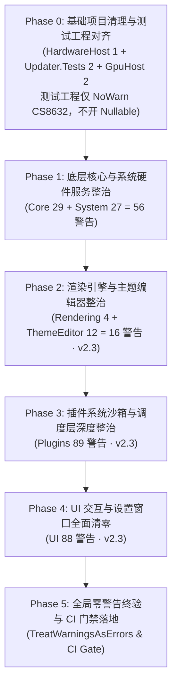

# LiteMonitor 编译警告与 Nullable 可空引用全面治理实施计划

- **制定日期**：2026-10-26
- **计划状态**：**v2.4 修订版 —— Phase 0–5 全部实施完毕** —— 主程序 `LiteMonitor.csproj` 实测 **0 警告 / 0 错误**；全解决方案剩余 **44 条**警告**全部位于 `tests/LiteMonitor.Tests/`**（xUnit 分析器 42 + CS0168 1 + CS0649 1），**无任何 CS86xx 可空警告**，`src/`、`tools/`、`LiteMonitor.Updater/`、`LiteMonitor.HardwareHost` 全部 **0 警告**；**门禁 1（生产工程 `-warnaserror`）与门禁 2（防回退 `WarningsNotAsErrors`）均实测 EXIT=0**；测试 **2686 条全绿**（通过 2685 / 跳过 1 / 失败 0），CI 断言脚本通过。执行在独立 worktree `G:\TOOL\LiteMonitor-fork\.agents\worktrees\remediation-phase-0`（基线 `master @ 42b6b61`），共 **17 个治理提交**（13 个主干可见 + 4 个并行分支提交经 merge 合入）+ 计划文档同步提交，**72 个文件**（治理 71 + 计划文档 1）、**+2938 / −441**（纯治理改动 **71 个文件、+1278 / −441**；计划文档本身 **+1660 行**）。**「生产可空警告清零」目标已达成。**
- **修订记录（v2.4 · 全量实施完成与实测回填）**：
  1. **§5.4 / §5.5 / §5.6 标记为「已完成」**并回填各自 commit：Phase 3 = `2fa0118` / `48035ee` / `12bbae8`（另有后置修正 `c373d36`）、Phase 4 = `1652ed3` / `725873d` / `f65787b`、Phase 5 = `acdae23` / `b293185` / `e37020a`；三节的「预期成果 / 验收标准」改写为**实测事实**。
  2. **§6.1 燃尽表按实测链重排**：**293 → 292 → 233 → 213 → 189 → 161 → 101 → 100 → 38 → 0**；与**计划刻度**（295 → 294 → 233 → 217 → 128 → 40 → 0）自 **Phase 2 之后**出现偏离 —— 计划按**文件清单推算**，实测含「**上游签名放宽带来的连带消除**」，因此 **Phase 3 的实际消除量由计划的 89 变为 85**（计划刻度 213 → 128，实测 213 → 100）。⚠️ **口径提示**：此处沿用的「**85**」是 v2.3 时期的**跨提交口径**推算值（其对照的「213 → 100」实际跨越 Phase 3 与 Phase 4 的四个提交），**不可与逐提交数字直接相减**；**权威值以 §6.1「v2.4 逐提交实测链」为准**（Phase 3 三提交合计 **−90**、Phase 4 三提交合计 **−123**）。
  3. **§5.6 门禁 2 抑制清单由宽版本收紧为实测版本**：Phase 0–4 期间使用的**宽版本**（含全部主程序历史 CS 码）**已作废**；现只登记**仍然存在**的码 —— `CS0168` / `CS0649` / `CS8632`（已被测试工程 csproj `NoWarn` 屏蔽）+ **9 个 xUnit 码**（`xUnit2031` / `xUnit1030` / `xUnit1031` / `xUnit2013` / `xUnit1026` / `xUnit2000` / `xUnit2012` / `xUnit2017` / `xUnit2020`）。实测 `dotnet build LiteMonitor.sln -c Release --no-incremental` → **EXIT=0 / 44 警告 0 错误**。
  4. **门禁 1 覆盖范围由三个生产工程扩到四个**（补 `LiteMonitor.Updater/LiteMonitor.Updater.csproj`），commit `b293185`；四个工程各跑 `dotnet build <proj> -c Release --no-incremental -warnaserror` **全部 EXIT=0**。随后发现 `LiteMonitor.Updater.csproj` 本身仍只靠 CI 命令行 `-warnaserror` 兜底（本地 `dotnet build -c Release` 不会拦住任何警告），已补 `<PropertyGroup Condition="'$(Configuration)' == 'Release'"><TreatWarningsAsErrors>true</TreatWarningsAsErrors></PropertyGroup>`，commit `e37020a`，实测该工程 Release 构建 0 警告 0 错误。
  5. **§7 结论改写为「治理已完成」**：主程序 0 警告、门禁 1 / 门禁 2 均实测 EXIT=0、测试 2686 条全绿。
  6. **新增附录 C：Phase 2–5 实际处置清单（逐文件落地明细）**，并汇总本次治理中**实际触发**的 §4.3 铁律六 / 铁律七 两条 Roslyn 机制。
- **修订记录（v2.3 · Phase 0–1 实测回填与铁律扩充）**：
  1. **铁律由六条扩充为七条**：新增**铁律七「条件访问污染 null-state」** —— 对运行时必非空的局部变量写了 `x?.Y` 之后，Roslyn 会把 `x` 的 null-state 降级为「可能为 null」，后续把 `x` 作为非空实参传递即报 CS8604（探针实测；`await` 本身不重置局部变量的 null-state，该假设已单独排除）（§4.3、§5.2、附录 B）。
  2. **§5.1 / §5.2 标记为「已完成」**，其「预期成果 / 验收标准」改写为**实测事实**（主程序 233 警告 0 错误、全解决方案 277 警告 0 错误、测试 2686 条全绿、CI 断言脚本通过）。
  3. **§6.1 燃尽表按实测重排**（294 → 233 → 217 → 128 → 40 → 0 锁定），表下补充「Phase 1 实际优于按文件清单推算值」的**口径拆解**。
  4. **§2.1–§2.4 统一标注为「治理前基线」**并加 ⚠️ 提示，指向文首实测表；**新增附录 B：Phase 0–1 实际处置清单**（26 个源文件 + 1 个测试工程 csproj + 2 个「顺带消除」文件，逐文件列出警告数、处置要点与依据章节）。
  5. ⚠️ **基线口径修正（本次实测发现）**：基线提交 `42b6b61` 实测为 **293 条**（主程序 292 + `LiteMonitor.HardwareHost.csproj` 1），计划原稿的 295 比实测**多 2** —— §2.1/§2.2 把 `src/ThemeEditor` 的 **2 条 CS8603** 计入，实际为 0；该 2 条差额构成「计划预期 238 vs 实测 233」中的一部分（另一部分为 UI 侧 **3 条**因上游签名放宽而顺带消失）。
- **修订记录（v2.2 · 处置动作口径修正）**：
  1. **铁律由五条扩充为六条**：新增**铁律六「局部变量不收窄字段的 null-state」** —— 探针 `S8_Renderer.cs` 实测，仅取局部变量做守卫、后续仍引用字段，**CS8602 依旧报错**；「守卫 + 后续一律改用局部变量」必须成对实施（§4.3、§5.3、附录 A #2–#5）。
  2. **`SystemHardwarPage.cs:715` 处置动作改写**（§3.1 ② / §5.5 / 附录 A #1）：原写法 `input.Parent?.Controls.Count > 0 && …` 虽能编译、0 警告，但**违反计划自己的铁律五③**（有「本应必然非空」证据 → 禁 `?.`）；改为 `var parent = input.Parent; if (parent is not null && …)`。
  3. **`UpdateDialog.cs:488/489` 处置动作改写**（§3.2 ⑥ / §5.5 / 附录 A #12/#13）：探针 `S4_Update.cs` 实测，**仅把 `expected` 提成局部变量会新增 CS8604**（`Matches(string, string)` 形参非空）；改用 **`[NotNullWhen(true)]` 注解契约**（探针 `S6_NotNullWhen.cs` 实测 0 警告），调用侧守卫不变。
  4. **`GpuSceneRenderer` 4 处处置动作改写 + 补齐落点**（§3.2 ⑧ / §5.3 / 附录 A #2–#5）：明确采纳「变体 B（守卫 + 后续改用局部变量）」；并指出 **885 行位于 `RecordPresentTiming()`（869 行起）内，不在 `Render`/`Resize` 方法体内**，前两处入口守卫覆盖不到，必须**单独**处理。
  5. **§3.4 处置动作与理由改写**（附录 A #26/#27）：原理由「框架契约保证 `e.Graphics` 非空」**与事实相反** —— .NET 8 的 `DataGridViewCellPaintingEventArgs.Graphics` / `DrawTreeNodeEventArgs.Node` **自身即标注为可空**；且在自绘回调里**空值早退会跳过同块内 395-396 行条形绘制并使 `:400 e.Handled = true;` 不执行**，违反 §6.3 行为不变性 → 统一改为「**局部变量 + 条件包裹**」。
  6. **§5.1 测试工程警告口径修正**（复审 C-1）：测试工程**自身**警告由 307 条降至 **44 条**（xUnit 分析器 42 + CS0168 1 + CS0649 1），**不是 2 条**；构建输出中的其余 CS86xx 来自 `ProjectReference` 引入的主程序 294 条。**用例数口径修正**（复审 C-6）：**2686 是 CI 侧「三程序集合计」阈值**（`ci.yml:115` / `release.yml:95` 的 `MIN_TEST_TOTAL`，由 `assert-test-counts.ps1 -MinTotal` 对**汇总 trx** 断言），**不得**用作单工程门槛。
  7. **xUnit 警告分项修正**（复审 D-1）：42 条为**去重后**数量，分项为 **xUnit2031 12 / xUnit1030 11 / xUnit1031 7 / xUnit2013 7 / 其余 5 类各 1**（此前写的 24/22/14/14/2×5 是**日志出现次数**）。
  8. **§5.6 门禁 2 抑制清单补齐主程序 14 个历史码**（复审 C-2）：清单必须同时覆盖主程序与测试/工具工程的历史码，否则 Phase 0–4 期间门禁 2 持续红灯；**补齐后实测 `dotnet build LiteMonitor.sln -c Release --no-incremental` EXIT=0 / 606 警告 0 错误**（并澄清 v2 初稿把「失败于 `HostPipeSession.cs(194,49) error CS8604`」解读为「机制生效」**不成立** —— 真实原因是该码当时不在清单里）。同时重申 `warnaserror:<code>` 是「当作错误」而非「豁免」，**语义与抑制相反**。
  9. **§6.3 新增「执行形态说明」**：实际执行采用 **git worktree 隔离**（`.agents/worktrees/remediation-phase-0`）而非主工作区开分支，原因是主工作区存在另一任务线的未提交改动（theme-studio 13 改 7 删 4 增），避免混入无关变更。
  10. **§1 核心目标措辞修正**：不再承诺「阻断崩溃」，改为「消除全部可空编译警告 + 修复 1 处运行时真可空缺陷 + 2 处诊断信息丢失类缺陷」；§6.3 行为不变性条款同步把「真实 NRE 漏洞」改为「真实可空缺陷」。
- **修订记录（v2.1 · 异常模型口径修正）**：
  1. **新增 §3.0 全局异常模型**：核实 `src/System/Program.cs:89-93` 注册了 `Application.SetUnhandledExceptionMode(UnhandledExceptionMode.CatchException)` + `Application.ThreadException`（处理器 `Application_ThreadException` 仅写日志并弹窗、**不 rethrow**）以及 `AppDomain.CurrentDomain.UnhandledException`（`LogCrash` 写 `LiteMonitor++_Error.log` + MessageBox，同样不 rethrow）。据此判定：**UI 线程的未处理异常（含 NRE）被全局兜底并吞掉，不会导致进程崩溃**；只有**后台线程未捕获异常**才会终止进程。仓库未注册 `TaskScheduler.UnobservedTaskException`，.NET 8 下未观察到的 Task 异常亦不终止进程。
  2. **P0 数量归零**：v2 稿宣称的「1 处 P0 + 6 处 P1 真实崩溃隐患」在全局异常模型口径下**不成立**，修订为 **3 处运行时真实可空缺陷（1 处 P1 + 2 处 P2）**，并明确：**30 处 CS8602 中无一条会导致进程崩溃**。四类分布同步调整为：运行时真实可空缺陷 3 处、流分析误报 14 处、WinForms 声明失误 9 处、防御性加固 4 处。
  3. **`GpuSceneRenderer` 4 处由 P1 降级为流分析误报**：`_swapChain`（构造函数第 180 行）与 `_emptyView`（第 219 行）在构造成功路径上无条件赋值，此后**无置 null 路径**（`Dispose` 于 1083/1086 行只释放不置空）；`CreateSwapChainForHwnd`（SharpGen，失败抛异常）与 `D3D11DeviceService.CreateShaderResourceView`（`D3D11DeviceService.cs:207-230`，返回非空或抛异常）均不会产出半初始化对象 → 迁入 §3.2 ⑧。
  4. **`CityCodeResolver.cs:237` 由 P1 降级为 P2**：其 NRE 被同方法第 269 行 `catch (Exception ex)` 吞掉（仅 `Debug.WriteLine`），且 `_db == null` 在第 52 行 `if (_db == null) throw new Exception("CityCode DB failed to load");` 已有守卫 → 真实影响是**诊断信息丢失**而非崩溃。
  5. **`SystemHardwarPage.cs:715` 由 P0 降级为 P2**：`AddDouble`（`SettingsUIBuilder.cs:78-93`）在 `return input` 之前已执行 `group.AddItem(new LiteSettingsItem(title, input))`，`input.Parent` 运行时必非空；`LiteSettingsItem` 必含 Label + 控件，`Controls[0]` 必存在 → 该 NRE 当前**不可达**（即便触发，构造函数路径无局部 catch，会中断 `CreateCalibrationCard` 使后续 5 个标定项不创建，但被全局处理器兜住）。
  6. 全面替换「闪退 / 崩溃隐患」措辞为「运行时可空缺陷 / 功能降级 / 静默失败」，并同步 §1、§2.1、§3、§5、§6.1、§7 与附录 A 的定级与计数。
- **修订记录（v2）**：
  1. 复审推翻原 P0 判定 3 项（`NetworkTrafficExclusionService.cs:415`、`UIController.cs:1447/1450`、`UpdateDialog.cs:488/489`），重排 §3 真实风险清单；
  2. 补全原计划未逐条分析的 6 处 CS8602，其中新识别出 1 处真实风险（`TaskbarPage.cs:259`）；`PluginExecutor.cs:1349` 经探针实测后由 P1 **再降级**为流分析误报（§3.2 ⑦）；
  3. 修正 `CityCodeResolver.cs:237` 的故障机理描述（应为 `JsonException` 而非 NRE）并补齐 `_db` 字段自身的可空声明；
  4. **重设 Phase 0 范围**：测试工程改为 `NoWarn CS8632` 消除假噪音，真实可空债务拆分为独立轨道（§5.1）；
  5. **修正 Phase 5 CI 门禁命令**：改为分层门禁，避免全解决方案 `/warnaserror` 必然失败（§5.6）；
  6. 燃尽表增列「测试工程新债」与「xUnit 分析器」两条独立赛道（§6.1）；
  7. 新增 **附录 A：30 处 CS8602 全量清单**（逐条定级 + 处置动作）。
- **基线提交**：`master` @ `42b6b61`（`ci+docs: W2 集成收口——门禁 2571→2686,计划状态更新(含测试串行运维约束)`，含近期架构解耦与 ThemeStudio 重构）
- **实测基线日志**：`dotnet build LiteMonitor.csproj --no-incremental` → 295 警告 / 0 错误（日志留存于 `.tmp/build-litemonitor-warnings.txt`；`.tmp/` 已被 `.gitignore` 忽略）
  - ⚠️ **v2.4 口径提示（计划基线值 vs 实测值）**：本行的 **295** 是**计划原稿的基线值**；基线提交 `42b6b61` 单独构建的**实测值为 293**（差 **2** 条 —— §2.1 / §2.2 把 `src/ThemeEditor` 的 2 条 CS8603 计入，实测不存在）。**全链条数字一律以实测 293 为准**，§2.1 / §2.2 的 295 作为「治理前基线」原样保留（见文首 B 节与 E-4）。
- **核心目标**：全面摸排并系统性消除全仓 295 个生产编译警告（主程序 `LiteMonitor.csproj` 294 个 + `LiteMonitor.HardwareHost.csproj` 1 个），把「可空引用相关缺陷」从**依赖人工排查、靠运气规避**升级为**由类型系统 + CI 门禁持续保证**，并建立可空安全标准范式与 `<TreatWarningsAsErrors>` 防回退门禁。⚠️ **v2.2 措辞修正**：按 §3.0 的全局异常模型口径，**30 处 CS8602 无一会导致进程崩溃**，故本计划不承诺「阻断崩溃」，而承诺「消除全部可空编译警告 + 修复 1 处运行时真可空缺陷（`TaskbarPage.cs:259`）+ 2 处诊断信息丢失类缺陷」。

---

## 执行进展（Phase 0–5 全部完成 · 2026-10-26）

> ⚠️ **本节是权威现状**：§2.1 / §2.2 / §2.3 / §2.4 的统计表仍保留**治理前基线**（295 条）作为对比参照，不再更新；**Phase 0–5 之后的实测值一律以本节为准**（各节标题处已加基线说明）。

### A. 执行方式（隔离 worktree · 主仓库未污染）

- **背景**：主仓库 `G:\TOOL\LiteMonitor-fork` 存在**另一条任务线的未提交改动**（theme-studio 相关），直接在主工作区治理会把无关变更混入提交。
- **执行位置**：**独立 git worktree** `G:\TOOL\LiteMonitor-fork\.agents\worktrees\remediation-phase-0`，自基线提交 `master @ 42b6b61` 干净检出，**主仓库工作区未被本次治理污染**（与 §6.3 第 4 条的执行形态说明一致）。
- **提交**（完整提交链 · 权威明细 · 最旧 → 最新）：

  | # | 批次 / 类别 | commit | 内容 |
  |:---:|---|---|---|
  | 0 | 基线 | `42b6b61` | `master` 基线（治理前，主程序实测 293 警告） |
  | 1 | Phase 0 | `4b046d8` | HardwareHost 管道写入可空警告 + 测试工程假噪音抑制 |
  | 2 | Phase 1 | `4340df7` | `src/Core` 与 `src/System` 警告清零（56 处，25 文件） |
  | 3 | Phase 2 | `1b5163c` | `src/Rendering` 与 `src/ThemeEditor` 警告清零（16 处） |
  | 4 | Phase 3 尾段 | `2fa0118` | `PluginManager` 等 4 文件警告清零 |
  | 5 | Phase 5 | `acdae23` | 建立可空引用编译门禁（生产工程零警告 + CI 防回退作业） |
  | 6 | Phase 3 后置 | `c373d36` | 消除 `PluginHostPolicy` 剩余 2 处可空警告 |
  | 7 | Phase 3 插件层 | `48035ee` | merge Phase 3 插件层 4 文件（`PluginKeyOwnership` / `CityCodeResolver` / `PluginProcessor` / `CryptoNative`） |
  | 8 | Phase 4 设置页 | `1652ed3` | merge Phase 4 UI 设置页（`src/UI/Settings/` 8 文件）警告清零 |
  | 9 | Phase 4 后置修正 | `725873d` | `PluginMonitorSyncService` —— owner 跟随 `MonitorOwner` 的可空契约 |
  | 10 | Phase 4 UI 其余 | `f65787b` | merge Phase 4 UI 窗体与控件（`src/UI/` 非 `Settings/` 15 文件） |
  | 11 | Phase 3 执行器 | `12bbae8` | merge Phase 3 `PluginExecutor` |
  | 12 | Phase 5 补齐 | `b293185` | ci —— 门禁 1 覆盖四个生产工程（补 `LiteMonitor.Updater`） |
  | 13 | Phase 5 补齐 | `e37020a` | `LiteMonitor.Updater.csproj` 补 Release 条件 `TreatWarningsAsErrors`（此前仅靠 CI 命令行 `-warnaserror` 兜底） |

  > **计数说明（权威口径）**：上表为**主干可见的 13 个治理提交**（基线 `42b6b61` 之外）。此外，Phase 3–4 的四个并行分支各带 **1 个分支内提交**，经 merge 合入（`2285ea1` / `0b3b02c` / `52e3f41` / `8e97d63`）⇒ **仓库中本分支自基线起的提交总数为 17 个**（`git rev-list --count 42b6b61..HEAD` = 17）。头部摘要的「17 个提交」即此口径。
  >
  > **总改动**：相对基线 `42b6b61` 共 **72 个文件、+2938 / −441** —— 其中纯治理改动 **71 个文件、+1278 / −441**（`src/` 64 + `tests/` 2 + `tools/` 1 + `.github/` 1 + 顶层 `LiteMonitor.csproj` 1 + `LiteMonitor.Updater.csproj` 1 + `Directory.Build.props` 1 + 其余 1），计划文档本身 **+1660 行**。

- **并行子 worktree（Phase 3–4 期间）**：为避开 `bin/obj` 产物锁冲突，Phase 3–4 期间另建 **4 个并行子 worktree**，各自独立分支、完成后合并回主 worktree：

  | 子 worktree | 分支 | 合并落点 |
  |---|---|---|
  | `p3-executor` | `chore/phase3-executor` | `12bbae8` |
  | `p3-plugins` | `chore/phase3-plugins` | `48035ee` |
  | `p4-ui` | `chore/phase4-ui` | `1652ed3` |
  | `p4-ui-b` | `chore/phase4-ui-b` | `f65787b` |

- **批次边界**：各批次各自独立提交、互不依赖，可单独 cherry-pick / revert；Phase 3–4 的四个并行分支以 merge 方式合入，与 §6.3「单批次独立分支管理」等效，**主仓库工作区全程未被污染**。

### B. Phase 0（`4b046d8`）做了什么

| 项 | 内容 | 结果 |
|---|---|---|
| `src/HardwareHost` | `HostPipeSession.cs` 管道写入前加 `env is not null` 守卫 | 1 处 CS8604 消除 → 该工程 **0 警告** |
| `tests/LiteMonitor.Tests/LiteMonitor.Tests.csproj` | 追加 `<NoWarn>$(NoWarn);CS8632</NoWarn>`，**不开启 `Nullable`** | **263 条 CS8632 假噪音**消除，真实可空债务 **0 条新增** |

- 生产警告数：**295 → 294**（主程序 294 + 硬件宿主 0）。
- ⚠️ 复现提示：**不得**在本阶段开启测试工程的 `<Nullable>enable</Nullable>`（实测会由 265 条升至 627 条，见 §5.1）。
- ⚠️ **基线口径修正（本次实测发现）**：把基线提交 `42b6b61` 单独导出构建，实测为 **293 条**（主程序 292 + 硬件宿主 1），比 §2.1/§2.2 基线表的 **295** 少 **2** —— 计划把 `src/ThemeEditor` 的 **2 条 CS8603** 计入，实测该处为 0。**全链条数字一律以实测 293 为准**；§2.1/§2.2 的 295 作为治理前基线原样保留。

### C. Phase 1（`4340df7`）做了什么

- `src/Core` **29 → 0**、`src/System` **27 → 0**，合计清除 **56 处**，涉及 **25 个文件**（逐文件明细见文末「附录 B」）。
- 全部 56 处清零后，生产警告总数由 294 降至 **233**（比按文件清单推算的 238 **少 5 条**，差额拆解见 §6.1 表下说明与 E-4）。
- **本批次新发现一条 Roslyn 机制**（已写入 §4.3 铁律七）：**在非空局部变量/字段上写条件访问 `?.`，会污染其 null-state**，导致后续把该变量作为非空实参传递时触发 CS8604 —— 详见下方「新增机制」与 §4.3。

### D. 新增机制：条件访问污染 null-state（实测）

> **对非空局部变量使用条件访问 `x?.Y` 之后，Roslyn 会把 `x` 的 null-state 置为「可能为 null」**，从而在后续把 `x` 作为非空实参传递时触发 **CS8604**。

- **实测证据（临时探针文件编译验证）**：

  ```csharp
  var settings = Settings.Load();                          // Settings.Load() 返回非空 Settings
  bool isZh = settings?.Language?.ToLower() == "zh";       // ← 此行污染 settings 的 null-state
  new UpdateDialog(context, settings);                    // ← 此处报 CS8604
  ```

  - 把 `settings?.Language` 改为 `settings.Language` 后**警告消失**；
  - 去掉 `await` 后警告**依旧**（与异步无关）；
  - `await` 本身**不会**重置局部变量的 null-state（已单独排除该干扰项）。
- **同源实例**：`src/System/HardwareServices/HardwareValueProvider.cs` 第 224 行 `s?.PreferredCpuVoltageSensor` → 第 227 行 `new ComponentProcessor(c, s, map)` 的 CS8604。
- **规范**：**非空变量上不要写 `?.`**；确需可空时先把值取到局部变量再判空（见 §4.3 铁律七）。
- **同类已记载机制**：§3.2 ② / 铁律六「局部变量不收窄字段的 null-state」—— 探针 `S8_Renderer.cs` 实测，只做局部变量守卫、后续仍引用字段，CS8602 依旧报错，必须「守卫 + 后续一律改用局部变量」**成对实施**。

### E. 执行后权威实测数据

> 数据来源：`dotnet build LiteMonitor.csproj --no-incremental`，按 `File|Line|Col|Code` 去重后统计（**193 条**，全部集中在 4 个模块，`src/Core` 与 `src/System` 已归零）。

> ⚠️ **v2.4 时点提示（本节是历史快照，不是当前现状）**：E-1 – E-4 记录的是 **Phase 0–1 之后（提交 `4340df7`）** 的实测快照（主程序 **233 条诊断 / 193 条去重唯一位置**）。**Phase 2–5 全部完成后**的权威现状见 **I-1 / J 节与 §6.1**（主程序 **0 警告 / 0 错误**；全解决方案剩余 **44 条**全部位于 `tests/LiteMonitor.Tests/`）。本节原样保留，作为「治理前基线 → Phase 1」的**对照参照物**。

**E-1. 按模块**

| 模块 | Phase 0/1 后 | 执行前（计划原值） | 变化 |
|---|:---:|:---:|---|
| `src/Core` | **0** | 29 | ✅ -29（已归零） |
| `src/System` | **0** | 27 | ✅ -27（已归零） |
| `src/UI` | **88** | 126 | ⬇ -38 |
| `src/Plugins` | **89** | 94 | ⬇ -5 |
| `src/ThemeEditor` | **12** | 14 | ⬇ -2 |
| `src/Rendering` | **4** | 4 | — 持平 |
| `src/HardwareHost` | **0** | 1 | ✅ -1（已归零） |
| **合计** | **193** | **295** | **-102** |

> ⚠️ **本表的两列口径不同，不可直接相减**：「执行后」列是**去重唯一位置**口径（按 `File|Line|Col|Code` 去重），「执行前（计划原值）」列沿用 §2.2 的**构建诊断条数**口径（未去重）。例如 `src/UI` 的「-38」= 126 − 88，属**跨口径相减**，不代表 UI 侧真的少了 38 个位置。**同口径对照见 E-4**；**权威现状取 E-1 的「执行后」列**。

**E-2. 按警告编号**

| 警告编号 | 执行后 | 执行前 | 变化 |
|---|:---:|:---:|---|
| CS8604 | 47 | 60 | ⬇ -13 |
| CS8618 | 36 | 80 | ⬇ -44 |
| CS8600 | 28 | 39 | ⬇ -11 |
| CS8602 | 28 | 30 | ⬇ -2 |
| CS8625 | 24 | 30 | ⬇ -6 |
| CS8622 | 17 | 17 | 持平 |
| CS8603 | 8 | 15 | ⬇ -7 |
| CS8601 | 2 | 16 | ⬇ -14 |
| CS0108 | 1 | 1 | 持平 |
| CS4014 | 1 | 1 | 持平 |
| CS8765 | 1 | 1 | 持平 |
| CS1998 | 3 | 3 | ✅ 主程序内已清零 |
| CS0414 | 1 | 1 | ✅ 主程序内已清零 |
| CS8619 | 1 | 1 | ✅ 主程序内已清零 |
| **合计（主程序生产代码）** | **193** | **295** | **-102** |
| CS8632 | 0 | 263（测试工程假噪音） | ✅ Phase 0 以 `NoWarn` 消除 |

> ⚠️ **口径提示**：「执行前」列沿用 §2.1 的**治理前基线**（计划原值 295 条），「执行后」列为去重唯一位置口径（193 条），两列同样**不可直接相减** —— 同口径对照见 E-4；基线自身的口径修正（计划 295 → 实测 293，差 2 条 `src/ThemeEditor` 的 CS8603）见 B 节末说明。

**E-3. 按文件（执行后 Top 12）**

| # | 文件 | 警告数 | 归属批次 |
|:---:|---|:---:|---|
| 1 | `src/Plugins/PluginExecutor.cs` | 39 | Phase 3 |
| 2 | `src/UI/Settings/MonitorPage.cs` | 13 | Phase 4 |
| 3 | `src/Plugins/PluginManager.cs` | 12 | Phase 3 |
| 4 | `src/UI/UIController.cs` | 10 | Phase 4 |
| 5 | `src/Plugins/Native/CryptoNative.cs` | 9 | Phase 3 |
| 6 | `src/ThemeEditor/ThemeEditorForm.cs` | 8 | Phase 2 |
| 7 | `src/UI/Settings/PluginPage.cs` | 8 | Phase 4 |
| 8 | `src/Plugins/Native/CityCodeResolver.cs` | 7 | Phase 3 |
| 9 | `src/Plugins/PluginProcessor.cs` | 7 | Phase 3 |
| 10 | `src/Plugins/PluginKeyOwnership.cs` | 6 | Phase 3 |
| 11 | `src/UI/Controls/LiteUI.cs` | 6 | Phase 4 |
| 12 | `src/UI/Settings/SettingsUIBuilder.cs` | 6 | Phase 4 |

其余 ≤5 条的文件（按模块归属补全）：`TrafficHistoryForm` 5、`MonitorControls` 4、`SystemHardwarPage` 4、`TaskbarPage` 4、`GpuSceneRenderer` 4、`MenuManager` 3、`HorizontalLayout` 3、`UpdateDialog` 3、`ThemeDocumentSession` 3、`LiteTreeView` 3、`PluginHostPolicy` 2、`SpeedTestForm` 2、`SettingsForm` 2、`MenuMonitorHelper` 2、`HardwareInfoForm` 2、`MainPanelPage` 2、`SettingsBase` 1、`ThemeStudioForm` 1、`PluginRuntimeSnapshot` 1、`PluginMonitorSyncService` 1、`PluginMarketPage` 1、`CleanMemoryForm` 1、`TaskbarForm` 1、`RenderingRoutePage` 1、`MainForm_Transparent` 1、`src/Plugins/PluginModels.cs`（≤5）。

> ⚠️ **分项与合计的口径差（已查明）**：构建日志条数（**233**）与按 `File|Line|Col|Code` 去重后的唯一位置数（**193**）相差 **40**，原因是 **CS8618 会为「每一个未赋值字段」各报一条**，而多条诊断落在**同一个构造函数位置**上（如 `src/UI/Settings/MonitorPage.cs(42,16)` 一个位置就报 12 条，对应 12 个未赋值控件字段）。post-Phase-1 状态共 **12 个构造函数位置**、**52 条**诊断，去重后为 12 条，差额 **52 − 12 = 40**（`src/UI` 侧 35 条 + `src/Plugins` 侧 5 条）。**权威值以 E-1 模块表（193 条）为准**，本节逐文件数字用于施工排期，不作为验收基数。

**E-4. 同口径前后对照（治理前 `42b6b61` vs Phase 0–1 后 `4340df7`）**

> 把基线提交与 Phase 0–1 后的提交分别用 `git archive` 导出到独立目录构建，再按 `File|Line|Col|Code` **归一化路径**后逐条比对 —— 这是唯一可以**直接相减**的口径。

| 指标 | 治理前（`42b6b61`） | Phase 0–1 后（`4340df7`） | 变化 |
|---|:---:|:---:|:---:|
| MSBuild 诊断条数（主程序） | **293** | **233** | ⬇ -60 |
| 去重唯一位置数 | **253** | **193** | ⬇ -60 |
| 逐条比对：消除 / 新增 | — | 消除 **63** / 新增 **3** | 净 **-60** |
| 新增项分布 | — | 全部在 `src/UI/Controls/MonitorControls.cs`（上游签名改可空所致，该文件 6 → 4） | — |

- **消除 63 条**的构成：`src/Core` 与 `src/System` 的显式消除、`src/HardwareHost` 1 条，以及 **`src/UI` 侧 6 条**（`src/UI/Controls/MonitorControls.cs` 5 条 + `src/UI/HorizontalLayout.cs` 1 条）。
- **新增 3 条**全部在 `src/UI/Controls/MonitorControls.cs` —— 因 `src/Core/Settings.cs` 的 `UnitPanel` / `UnitTaskbar` 改可空，调用侧签名须同步放宽。
- **净减 60** = Core 29 + System 27 + HardwareHost 1（显式 **57**）+ UI 侧 **3** 条（6 消失 − 3 新增）—— 这 3 条即「**因放宽上游签名而顺带消失**」，是 Phase 1 实际效果**优于**按文件清单推算值的原因（详见 §6.1 表下说明）。

### F. 构建与测试实测结果

| 项 | 命令 | 结果 |
|---|---|---|
| 主程序 | `dotnet build LiteMonitor.csproj --no-incremental` | **233 个警告，0 个错误**（执行前 294） |
| 全解决方案 | `dotnet build LiteMonitor.sln --no-incremental` | **277 个警告，0 个错误**（233 主程序 + **44** 测试/工具工程自有警告，与 §5.1 的 Phase 0 预期一致） |
| 测试（`LiteMonitor.Tests`） | — | **2594 条**：通过 2593 / 跳过 1 |
| 测试（`LiteMonitor.Updater.Tests`） | — | **73 条**，全绿 |
| 测试（`LiteMonitor.GpuNonperformance.Tests`） | — | **19 条**，全绿 |
| CI 断言脚本 | `.github/workflows/assert-test-counts.ps1` | **通过**：「发现 2686 条用例（通过 2685 / 失败 0 / 跳过 1），阈值 2686」 |

> ⚠️ **v2.4 时点提示（上表是 Phase 0–1 后的历史快照）**：上表记录的是 `4340df7` 时刻的构建/测试结果（主程序 233、全解决方案 277）。**Phase 2–5 完成后**的最终实测见下方 **F-v2.4 表**与 **J 节**。

**F-v2.4. Phase 0–5 全部完成后的最终实测（2026-10-26）**

| 项 | 命令 | 结果 |
|---|---|---|
| 主程序 | `dotnet build LiteMonitor.csproj --no-incremental` | ✅ **0 个警告，0 个错误**（诊断条数 0 / 去重唯一位置 0） |
| 全解决方案 | `dotnet build LiteMonitor.sln -c Debug --no-incremental` | **88 条诊断 / 去重 44**，**全部位于 `tests/LiteMonitor.Tests/`**；`src/`、`tools/`、`LiteMonitor.Updater/`、`LiteMonitor.HardwareHost` 均 **0 警告**；构成 = xUnit 分析器 **42** + CS0168 **1** + CS0649 **1**，**无任何 CS86xx** |
| 门禁 1 | 四个生产工程各跑 `dotnet build <proj> -c Release --no-incremental -warnaserror` | ✅ **全部 EXIT=0**（`LiteMonitor.csproj` / `LiteMonitor.Updater` / `src\Contracts` / `src\HardwareHost`） |
| 门禁 2 | `dotnet build LiteMonitor.sln -c Release --no-incremental -p:TreatWarningsAsErrors=true -p:WarningsNotAsErrors="<收紧版>"` | ✅ **EXIT=0 / 44 警告 0 错误**（分号须写 `%3B`） |
| 测试（`LiteMonitor.Tests`） | — | **2594 条**：通过 2593 / 跳过 1（`MarketE2ETests.端到端_拉索引_安装_校验_卸载`，既有设计允许） |
| 测试（`LiteMonitor.Updater.Tests`） | — | **73 条**，全绿 |
| 测试（`LiteMonitor.GpuNonperformance.Tests`） | — | **19 条**，全绿 |
| 测试合计 | — | ✅ **2685 通过 + 1 跳过 = 2686**，**失败 0**，与 CI 阈值 2686 一致 |
| CI 断言脚本 | `.github/workflows/assert-test-counts.ps1` | ✅ **EXIT=0**：「测试发现数校验：通过 / 发现 2686 条用例（通过 2685 / 失败 0 / 跳过 1），阈值 2686」 |

> ⚠️ **本地复现 CI 的必备前置**：跑本仓库测试**必须先设置** `$env:LITEMONITOR_PLUGIN_REPO = '<repo>\tests\fixtures\plugin-repo'`（CI 在 `ci.yml:118` 就是这么设的）。否则 `MarketIndexContractTests` 的 **6 条**契约用例会因 `[PluginRepoFact]` 门控被跳过，导致 CI 断言脚本判「门禁失效」失败 —— **该现象与本次可空治理改动无关**，但本地复现 CI 时必须设。

### G. Phase 2–5 的剩余工作量（据此更新）

| 批次 | 剩余范围 | 剩余警告数 |
|---|---|:---:|
| **Phase 2** | `src/Rendering` 4 + `src/ThemeEditor` 12 | **16** → ✅ **已清零**（commit `1b5163c`，另连带消除 Plugins 4 条） |
| **Phase 3** | `src/Plugins` | **85**（治理前基线口径 89）→ ✅ **已清零**（commits `2fa0118` / `48035ee` / `12bbae8` / `c373d36`） |
| **Phase 4** | `src/UI` | **88** → ✅ **已清零**（commits `1652ed3` / `725873d` / `f65787b`） |
| **Phase 5** | 全局零警告终验与 CI 门禁落地 | 不变（§5.6 的分层门禁设计不变）→ ✅ **已落地**（commits `acdae23` / `b293185`） |

> 三个批次的剩余量合计 **193**，即 E-1 的执行后总量；Phase 5 的性质仍是「终验 + 门禁落地」，不引入新的修复范围。（**v2.3 追加**：Phase 2 已于 `1b5163c` 落地后，剩余量降为 **85 + 88 = 173**，见 H 节）
>
> ✅ **v2.4 收口（Phase 0–5 全部完成）**：本表所列的**全部剩余量已清零** —— 主程序 `LiteMonitor.csproj` 实测 **0 警告 / 0 错误**；燃尽实测链 **293 → 292 → 233 → 213 → 189 → 161 → 101 → 100 → 38 → 0**（见 I-1 与 §6.1）。剩余的 **44 条**全解决方案警告**全部位于测试工程**（xUnit 42 + CS0168 1 + CS0649 1），已拆为 **Phase 6 / Phase 7** 两条独立赛道（见 K 节），**不阻塞当前 CI**。

> ⚠️ **v2.3 补充（Phase 2 已落地 · commit `1b5163c`）**：本文档定稿期间，Phase 2 的修复已由上游任务线**独立提交**为 `1b5163c`（5 个文件：+80 / −30 —— `src/Rendering/Presentation/GpuSceneRenderer.cs`、`src/ThemeEditor/ThemeEditorForm.cs`、`src/ThemeEditor/ThemeDocumentSession.cs`、`src/ThemeEditor/ThemeStudioForm.cs`、`src/Plugins/PluginHostPolicy.cs`）。在该提交上重新实测：**主程序 213 个警告（MSBuild 口径）/ 173 个去重唯一位置**，即 Phase 2 实际消除 **20 条** —— **范围内 16 条**（Rendering 4 + ThemeEditor 12，两模块已归零）+ **连带 4 条**（Plugins 侧：`CryptoNative.cs` 9 → 6、`PluginExecutor.cs` 39 → 38，因 `PluginHostPolicy` 上游签名放宽后调用侧 CS8604 连带消失）。该批实现手法（守卫 + 局部变量改写、禁止 `?.` 污染 null-state）与 §4.3 铁律七完全对齐。

### H. 追加记录：Phase 2 落地实测（commit `1b5163c`）

> **性质**：Phase 2 不属于本次「Phase 0–1 实测回填」的派工范围，是本文档定稿期间由上游任务线完成并提交的。本节按**实测**补记，供 Phase 3–5 排期使用。

| 项 | 值 |
|---|---|
| commit | `1b5163c`（`chore(nullable): Phase 2 - src/Rendering 与 src/ThemeEditor 警告清零（16 处）`） |
| 改动 | 5 个文件，**+80 / −30** |
| 实测（MSBuild 口径） | **213 警告 / 0 错误**（Phase 0–1 后为 233，**−20**） |
| 实测（去重唯一位置） | **173**（Phase 0–1 后为 193，**−20**） |
| 按模块 | `src/Core` **0**、`src/System` **0**、`src/HardwareHost` **0**、`src/ThemeEditor` **0**、`src/Rendering` **0**、`src/Plugins` **85**、`src/UI` **88** |
| 按编号 | CS8604 **40**、CS8618 **36**、CS8600 **28**、CS8625 **24**、CS8622 **17**、CS8602 **15**、CS8603 **8**、CS8601 **2**、CS0108 **1**、CS4014 **1**、CS8765 **1** |
| 范围内消除 | **16 条** = `src/Rendering` 4 + `src/ThemeEditor` 12（两模块均归零） |
| 连带消除 | **4 条** = `src/Plugins/Native/CryptoNative.cs` 9 → 6、`src/Plugins/PluginExecutor.cs` 39 → 38 —— `PluginHostPolicy` 上游签名放宽后，调用侧 CS8604 连带消失（与附录 B 中 `ThemeAppearanceOptions.cs` / `HorizontalLayout.cs` 的「连带效应」同机理） |

- **剩余工作量（据此更新）**：Phase 3 = **85**（`src/Plugins`）、Phase 4 = **88**（`src/UI`）、Phase 5 = 终验与 CI 门禁落地（§5.6 设计不变）。
- **里程碑刻度不变**：按 MSBuild 口径，链条仍为 **233 → 213 → 128 → 40 → 0**（Phase 2 少消 4 条，Phase 3 相应少消 4 条，**128 / 40 / 0 三个刻度不变**），详见 §6.1 表下说明。

### I. Phase 3–5 落地实测（commits `2fa0118` / `48035ee` / `f65787b` / `12bbae8` / `acdae23` / `b293185`）

> **性质**：Phase 3–5 在同一隔离 worktree 内连续实施；其中 Phase 3–4 的部分批次在 4 个并行子 worktree 上并行完成并合并回主 worktree（见 A 节）。

**I-1. 主程序燃尽实测链**（`dotnet build LiteMonitor.csproj --no-incremental`，**MSBuild 诊断条数**口径）

| 提交 | 阶段 | 主程序警告数 | 本提交净减 | 说明 |
|---|---|:---:|:---:|---|
| `42b6b61` | 基线 | **293** | — | ⚠️ 计划表写 **295**，多计 `src/ThemeEditor` 2 条 CS8603（实测不存在） |
| `4b046d8` | Phase 0 | **292** | −1 | `HardwareHost` 归零 |
| `4340df7` | Phase 1 | **233** | −59 | `src/Core` 29 + `src/System` 27 归零 |
| `1b5163c` | Phase 2 | **213** | −20 | 范围内 16（Rendering 4 + ThemeEditor 12）+ 连带 4 |
| `2fa0118` | Phase 3 尾段 | **189** | −24 | `PluginManager` 等 4 文件 |
| `48035ee` | Phase 3 插件层 | **161** | −28 | `PluginKeyOwnership` / `CityCodeResolver` / `PluginProcessor` / `CryptoNative` |
| `1652ed3` | Phase 4 设置页 | **101** | −60 | `src/UI/Settings/` 8 文件 |
| `725873d` | Phase 4 后置修正 | **100** | −1 | `PluginMonitorSyncService` 可空契约 |
| `f65787b` | Phase 4 UI 其余 | **38** | −62 | `src/UI/` 非 `Settings/` 15 文件 |
| `12bbae8` | Phase 3 PluginExecutor | **0** | −38 | `PluginExecutor.cs` 39 处 + 连带消除 |
| `b293185` | Phase 5 门禁补齐 | **0** | 0 | 门禁 1 扩至四个生产工程 |

> ⚠️ **计划刻度 vs 实测（必须分开看）**：计划原燃尽刻度为 **295 → 294 → 233 → 217 → 128 → 40 → 0**；实测链在 **Phase 2 之后**出现偏离（Phase 2 落点 **213** vs 计划 217）。根因：**计划按文件清单推算**，**实测含「上游签名放宽带来的连带消除」**（典型如 `PluginHostPolicy` 上游签名放宽 → `CryptoNative.cs` −3、`PluginExecutor.cs` −1）。因此 **Phase 3 的实际消除量由计划的 89 变为 85**（计划刻度 213 → 128，实测 213 → 100）。⚠️ **此处的「85」是跨提交口径**（其对照的「213 → 100」跨越了 Phase 3 与 Phase 4 的四个提交、实际 −113），**与上表的逐提交数字不相等**；**权威值为 Phase 3 三提交合计 −90、Phase 4 三提交合计 −123**（见 §6.1 同名说明）。

**I-2. Phase 3（`src/Plugins`）实际处置要点**

| 文件 | 处置要点 |
|---|---|
| `PluginExecutor.cs` | `_http` 改构造函数直接赋值并抽出 `CreateDefaultClient()`；`CacheItem.RawResponse` 给安全默认值；`_publication` 改 `AsyncLocal<PluginPublicationLease?>`；`FetchRawAsync` 的 proxy / scope / allowedHosts / encoding **如实标可空**；`ResolveHeaders` 由「返回 null」改为「**返回空集合**」；删两处 `declaredHosts != null` **死判空**；**全文件 0 处 null-forgiving** |
| `CityCodeResolver.cs` | `_db` 改可空；反序列化改为 `try/catch (JsonException)` + 显式判空，保持「**未加载 ⇒ `_db` 仍为 null 可重试**」语义 |
| `PluginKeyOwnership.cs` | `MonitorOwner` 返回类型改 `string?` |
| `PluginProcessor.cs` | 插件处理流水线的可空契约显式化 |
| `CryptoNative.cs` | P/Invoke 互操作层的指针非空契约防守 |
| `PluginHostPolicy.cs` | 沙箱策略签名放宽；后置提交 `c373d36` 消除剩余 2 处可空警告 |
| `PluginManager.cs` | 内部 `Runtime` 类 **7 个字段改用初始化构造函数** —— 对象初始化器在构造函数**之后**才生效，Roslyn 在构造函数出口仍看到 null |
| `PluginModels.cs` | `PluginOutputKeys` 5 个字段给 `= string.Empty;` 默认值 |
| `PluginMonitorSyncService.cs` | owner 跟随 `MonitorOwner` 的可空契约（`725873d`） |
| `PluginRuntimeSnapshot.cs` | 反序列化结果为 null 时抛**明确** `InvalidOperationException`，**不把 null 传给调用方** |

**I-3. Phase 4（`src/UI`）实际处置要点**

- **`src/UI/Settings/`（8 文件）**：`MonitorPage` 24 / `SystemHardwarPage` 11 / `PluginPage` 8 / `SettingsUIBuilder` 6 / `TaskbarPage` 5 / `SettingsBase` 3（+ **连带 6**）/ `PluginMarketPage` 1 / `RenderingRoutePage` 1。
- **`src/UI/` 非 `Settings/`（15 文件 · 48 处）**：`UIController` 10 / `LiteUI` 6 / `TrafficHistoryForm` 5 / `MonitorControls` 4 / `LiteTreeView` 3 / `HorizontalLayout` 3 / `MenuManager` 3 / `UpdateDialog` 3 / `SpeedTestForm` 2 / `SettingsForm` 2 / `MenuMonitorHelper` 2 / `HardwareInfoForm` 2 / `TaskbarForm` 1 / `MainForm_Transparent` 1 / `CleanMemoryForm` 1。
- 逐文件处置动作见**附录 C**。

**I-4. Phase 5（门禁）实际交付物**

| 交付物 | 内容 |
|---|---|
| `Directory.Build.props`（**新增 · 根级**） | 只含 `Deterministic`（固化构建可复现性，发布件 SHA-256 清单依赖它）与统一 NoWarn 追加点 `<LiteMonitorSharedNoWarn>`（默认空）。**根级严禁开 `TreatWarningsAsErrors`** —— 会被 `tests/` 与 `tools/` 隐式导入，Phase 6 的 **627 条**测试工程真实可空债务与 Phase 7 的 **42 条** xUnit 规则警告会把 CI 顶红 |
| `LiteMonitor.csproj` / `LiteMonitor.Updater/LiteMonitor.Updater.csproj` / `src/HardwareHost/LiteMonitor.HardwareHost.csproj` / `src/Contracts/LiteMonitor.Contracts.csproj` | 各自追加 `<PropertyGroup Condition="'$(Configuration)' == 'Release'"><TreatWarningsAsErrors>true</TreatWarningsAsErrors></PropertyGroup>` |
| `.github/workflows/ci.yml` | 新增**独立作业** `nullable-gate`（与既有 `build-test-package` 并行；`jobs` = `build-test-package` / `nullable-gate`），含**门禁 1、门禁 2** 两步，均以**真实退出码**判定 |

### J. 最终验收实测（门禁 1 / 门禁 2 / 测试 / CI 断言脚本）

> **验收口径**：在 `b293185` 之后的最终提交上实测，全部 `--no-incremental` 全量重建。

**J-1. 构建**

| 项 | 命令 | 实测结果 |
|---|---|---|
| 主程序 | `dotnet build LiteMonitor.csproj --no-incremental` | **0 个警告 / 0 个错误**（诊断条数 **0**，去重唯一位置 **0**） |
| 全解决方案 | `dotnet build LiteMonitor.sln -c Debug --no-incremental` | **88 条诊断 / 去重 44**，**全部位于 `tests/LiteMonitor.Tests/`**；`src/`、`tools/`、`LiteMonitor.Updater/`、`LiteMonitor.HardwareHost` 全部 **0 警告** |

**J-2. 剩余 44 条的构成（无任何 CS86xx 可空警告）**

| 类别 | 条数 | 明细 |
|---|:---:|---|
| xUnit 分析器 | **42** | xUnit2031 **12** / xUnit1030 **11** / xUnit1031 **7** / xUnit2013 **7** / xUnit1026 **1** / xUnit2000 **1** / xUnit2012 **1** / xUnit2017 **1** / xUnit2020 **1** |
| CS0168 | **1** | 测试工程局部变量已赋值未使用 |
| CS0649 | **1** | 测试工程字段从未赋值 |
| **可空相关（CS86xx / CS8765 等）** | **0** | ✅ 生产与测试代码均已清零 |

**J-3. 门禁 1（硬门禁 · 四个生产工程 `-warnaserror`）**

| 生产工程 | 结果 |
|---|:---:|
| `LiteMonitor.csproj` | **EXIT=0** |
| `LiteMonitor.Updater\LiteMonitor.Updater.csproj` | **EXIT=0** |
| `src\Contracts\LiteMonitor.Contracts.csproj` | **EXIT=0** |
| `src\HardwareHost\LiteMonitor.HardwareHost.csproj` | **EXIT=0** |

> 命令形式：`dotnet build <proj> -c Release --no-incremental -warnaserror`。⚠️ **v2.4：门禁 1 的覆盖范围由三个生产工程扩到四个**（补 `LiteMonitor.Updater`），commit `b293185`。

**J-4. 门禁 2（防回退）**

```pwsh
dotnet build LiteMonitor.sln -c Release --no-incremental `
  -p:TreatWarningsAsErrors=true `
  -p:WarningsNotAsErrors="CS0168%3BCS0649%3BCS8632%3BxUnit2031%3BxUnit1030%3BxUnit1031%3BxUnit2013%3BxUnit1026%3BxUnit2000%3BxUnit2012%3BxUnit2017%3BxUnit2020"
```

- **实测结果**：**EXIT=0 / 44 警告 0 错误**。
- ⚠️ **分号必须写成 `%3B`**，否则 MSBuild 直接报 **MSB1006**（属性无效）。
- ⚠️ **抑制清单已收紧**：Phase 0–4 期间使用的**宽版本**（含全部主程序历史 CS 码：`CS8600` / `CS8601` / `CS8602` / `CS8603` / `CS8604` / `CS8618` / `CS8619` / `CS8622` / `CS8625` / `CS8765` / `CS1998` / `CS0108` / `CS0414` / `CS4014`）**已作废**；现只登记**仍然存在**的码 —— `CS0168` / `CS0649` / `CS8632`（已被测试工程 csproj `NoWarn` 屏蔽）+ 9 个 xUnit 码。

**J-5. 测试与 CI 断言**

| 项 | 实测结果 |
|---|---|
| `LiteMonitor.Tests` | 通过 **2593** / 跳过 **1** / 共 **2594** |
| `LiteMonitor.Updater.Tests` | 通过 **73** |
| `LiteMonitor.GpuNonperformance.Tests` | 通过 **19** |
| **合计** | **2685 通过 + 1 跳过 = 2686**，与 CI 阈值 **2686** 一致；**失败 0** |
| CI 断言脚本 `.github/workflows/assert-test-counts.ps1` | **通过**：「测试发现数校验：通过 / 发现 2686 条用例（通过 2685 / 失败 0 / 跳过 1），阈值 2686」，**EXIT=0** |

```pwsh
pwsh -File .github/workflows/assert-test-counts.ps1 -TrxRoot '.tmp\test-results\Debug' -MinTotal 2686 `
  -ExpectedAssembly 'LiteMonitor.Tests, LiteMonitor.Updater.Tests, LiteMonitor.GpuNonperformance.Tests' `
  -MaxSkipped 1 `
  -MustExecuteTestClass 'MarketIndexContractTests, ReviewMarketPersistenceRegressionTests, ReviewMarketInstallRaceRegressionTests, ThemeMarketContractTests, ThemeMarketPolicyTests, ReviewFix20261026Tests, E00Verification20261026Tests, I2HostSupervisionTests, I2PipeProtocolTests, I2SnapshotAtomicityTests, SettingsProjectionTests, SettingsModuleServicesTests, E05ThemeWiringGuardTests' `
  -MustExecuteTestClassMinCount 5
```

- **唯一跳过项**：`LiteMonitor.Tests.MarketE2ETests.端到端_拉索引_安装_校验_卸载`（既有设计允许跳过 1 条）。
- `MarketIndexContractTests` 的 **6 条** `[PluginRepoFact]` 用例需环境变量 `LITEMONITOR_PLUGIN_REPO` 指向 `tests/fixtures/plugin-repo` 才真正执行（CI 在 `.github/workflows/ci.yml:118` 设同名变量）；本地设了该变量后 **6 条全部通过**。

### K. 剩余可空债务的两条独立赛道（不在本次范围内）

> 生产可空债务已清零，但**仓库内仍有两类与可空治理相关的历史债务**。二者**均不阻塞当前 CI** —— 门禁 2 已把它们登记进抑制清单（`WarningsNotAsErrors`），门禁 1 也**不覆盖测试工程**。

| 赛道 | 范围 | 实测规模 | 归属 | 是否阻塞 CI |
|---|---|:---:|---|:---:|
| **① 测试工程真实可空债务** | `tests/LiteMonitor.Tests` 开启 `<Nullable>enable</Nullable>` 后暴露的真实可空警告 | **627 条**（由 **265** → **627**） | **Phase 6** | ❌ 否 |
| **② xUnit 分析器规则警告** | `tests/LiteMonitor.Tests` 的 xUnit 规则告警（测试代码风格，与可空治理无因果关系） | **42 条** | **Phase 7** | ❌ 否 |

- **赛道 ① 明细（Phase 6）**：CS8600 **153** / CS8625 **136** / CS8602 **84** / CS8603 **71** / CS8629 **30** / CS8604 **24** / CS8601 **22** / CS8618 **14** / CS8605 **8** / CS8765 **3** / CS8619 **2** / CS8622 **2** / CS8767 **2** / CS8613 **1**。
  - **为何不在本次做**：Phase 0 已定决策 —— 测试工程用 `NoWarn CS8632` 消除**假噪音**，**不开启 `Nullable`**；一次性掀开遮光板会引入约 **627 条**未预算的新债，而本计划的燃尽表原本**没有测试工程这一科目**（§5.1、§6.1）。
- **赛道 ② 明细（Phase 7）**：xUnit2031 **12** / xUnit1030 **11** / xUnit1031 **7** / xUnit2013 **7** / xUnit1026 **1** / xUnit2000 **1** / xUnit2012 **1** / xUnit2017 **1** / xUnit2020 **1**。
  - **为何不在本次做**：属**测试代码风格规则**债务，与可空治理无因果关系；本次治理只把它登记进门禁 2 的抑制清单以避免阻塞门禁 1。
- ⚠️ **两条赛道的共同前提**：**根级 `Directory.Build.props` 严禁开 `TreatWarningsAsErrors`** —— 否则这两条债务会直接让 CI 红灯。

### L. 收尾与注意事项

- **(a) 本地跑测试前必须先重建整个解决方案**：`dotnet build LiteMonitor.sln -c Debug`。
  - ⚠️ **只构建 `LiteMonitor.csproj` 会让 30+ 条 I2 / E02 用例失败**，报「**Host 产物与本轮构建清单不符，拒绝执行 I2 测试（G5 收口…）**」—— **这不是代码回归**，而是测试固件与构建清单不一致所致。
- **(b) 本地需设插件仓库环境变量**：`$env:LITEMONITOR_PLUGIN_REPO = '<repo>\tests\fixtures\plugin-repo'`（CI 在 `.github/workflows/ci.yml:118` 如此设置），否则 `MarketIndexContractTests` 的 **6 条** `[PluginRepoFact]` 用例会被跳过，CI 断言脚本将判「门禁失效」失败。
- **(c) git 提交信息必须走文件传入**：`git commit -F <文件>`。
  - ⚠️ 用 `-m` 且内容含**中文引号 / 换行**会触发 git 的「**Invalid path … Filename too long**」误报。
- **(d) 清理临时探针**：worktree `.tmp/` 下的临时探针工程已清理（`.tmp/` 已被 `.gitignore` 忽略）。

---

## 1. 调研背景与治理目标

在启用 C# 8.0+ Nullable 引用类型机制（`<Nullable>enable</Nullable>`）后，编译器会在不可空变量可能为 null、可空变量未判空即解引用、跨层传参可空性不匹配等场景发出 `CS86xx` 警告。

当前仓库在长期迭代与历史代码合并过程中积累了大量编译警告。根据调研：
1. **主程序（`LiteMonitor.csproj`）存在 294 个独立编译警告**，其中 288 个为可空相关警告（`CS86xx`、`CS8765`），6 个为通用编译器警告（`CS1998`、`CS0108`、`CS4014`、`CS0414`）。
2. **硬件服务（`LiteMonitor.HardwareHost.csproj`）存在 1 个警告**（`CS8604`）。
3. **合计生产代码编译警告 295 个**。
4. **测试与工具项目**：`LiteMonitor.Tests` 因 csproj 未开启 `<Nullable>` 但测试代码大量使用 `?` 标注，派生出 263 个 `CS8632` 警告与 **42 个 xUnit 规则警告**（v1 计划写 38，实测 42）；`LiteMonitor.Updater.Tests` 有 2 个 `CS8602`；`GpuHostLifecycleProbe` 有 2 个 `CS1998`。
   - **v2 实测补充**：`LiteMonitor.Tests` 若开启 `<Nullable>enable</Nullable>`，测试工程自身警告将从 265 条**升至 627 条**（新增 CS8600 153、CS8625 136、CS8602 84、CS8603 71、CS8629 30、CS8604 24、CS8601 22、CS8618 14、CS8605 8、CS8765 3、CS8619 2、CS8622 2、CS8767 2、CS8613 1）。这批**真实**可空债务独立于本计划主线，拆为 Phase 6（详见 §5.1、§6.1）。
5. **契约库（`LiteMonitor.Contracts`）与更新器（`LiteMonitor.Updater`）** 已实现 **0 警告**，证明规范治理完全可行。

**核心治理目标**：
- **零生产缺陷**：彻底修复 30 处 `CS8602`（解引用可能为空）中的 **3 处运行时真实可空缺陷**（1 处 P1 + 2 处 P2，含 v2 新识别的 `TaskbarPage.cs:259`），并清理 8 处 WinForms 声明失误、14 处流分析盲区（消除后续被误改的风险）、5 处防御性加固点；另修复 1 处 `CS4014`（调用未等待）。
  > **v2.1 口径修正**：经全局异常模型核验（§3.0），**30 处 CS8602 无一会导致进程崩溃** —— UI 线程异常已被 `src/System/Program.cs:89-93` 注册的全局处理器兜底并吞掉（写日志 + 弹窗，不 rethrow）。本计划的目标表述由 v1/v2 的「堵崩溃隐患」修正为「**消除运行时可空缺陷、修复功能降级与静默失败、显式化代码不变量**」。
- **零编译警告**：分 6 个独立验证批次推进，将生产项目（`LiteMonitor` + `HardwareHost`）的警告数从 **295 单调递减至 0**。
- **杜绝暴力抑制**：严禁采用 `!`（Null-forgiving 运算符）粗暴掩盖真实存在的空值流向缺陷。
- **防回退门禁**：治理完成后在项目配置中启用 `<TreatWarningsAsErrors>true</TreatWarningsAsErrors>`，在 CI 流程中建立硬性防回退卡点。

---

## 2. 全仓编译警告全面摸排与分类统计

### 2.1 按警告编号统计（数量与风险等级）

> ⚠️ **基线说明**：本表为**治理前基线**（295 条，Phase 0 之前），**保留用于前后对比，不再更新**；Phase 0–1 之后的权威实测值见文首「执行进展（Phase 0–1 已完成 · 2026-10-26）」节 **E-2（按警告编号）**。

| 警告编号 | 数量 | 官方定义与严重性 | 风险等级 | 主要危害与潜在缺陷 |
|---|:---:|---|:---:|---|
| **CS8602** | **30** | Dereference of a possibly null reference（解引用可能出现空引用） | **中 (Medium)** · *v2.1 再修正* | v1 曾一律定为「极高（必定/概率触发 NRE）」；v2 逐处核验运行时可达性后修正；**v2.1 引入全局异常模型口径后再次修正**：UI 线程异常被 `src/System/Program.cs:89-93` 的全局处理器吞掉，**30 处无一会导致进程崩溃**。四类分布：**运行时真实可空缺陷 3 处**（1 P1 + 2 P2）、**流分析误报 14 处**、**WinForms 声明失误 9 处**、**防御性加固 4 处**。详见 §3 与附录 A |
| **CS4014** | **1** | Because this call is not awaited, execution continues before call completed | **中 (Medium)** | 异步任务未被等待，其异常被静默吞掉。仓库未注册 `TaskScheduler.UnobservedTaskException`，.NET 8 下未观察异常不会终止进程，但错误彻底丢失、诊断困难（`src/UI/Settings/PluginMarketPage.cs:901`） |
| **CS8604** | **60** | Possible null reference argument for parameter（实参可能传入 null） | **高/中 (High/Medium)** | 将潜在 null 传入约定非空的下游接口，导致下游方法内部发生级联崩溃 |
| **CS8600** | **39** | Converting null literal or possible null value to non-nullable type | **中 (Medium)** | 变量隐式丢失可空状态，欺骗编译器流分析，隐藏潜在空指针 |
| **CS8625** | **30** | Cannot convert null literal to non-nullable reference type | **中 (Medium)** | 显式将 null 赋给标记为非空的类型或参数，契约设计失真 |
| **CS8601** | **16** | Possible null reference assignment（可能出现 null 引用赋值） | **中 (Medium)** | 字段/属性状态被污染为 null，后续读取时引发解引用异常 |
| **CS8603** | **15** | Possible null reference return（可能返回 null 引用） | **中 (Medium)** | 方法签名承诺返回非空，实际却返回 null，调用方失去防守意识 |
| **CS8618** | **80** | Non-nullable member is uninitialized（构造函数退出时不可为 null 字段未赋值） | **结构/中 (Structural)** | WinForms 控件迟延绑定或 DTO 反序列化后字段仍为 null |
| **CS8622** | **17** | Nullability of reference types in type of parameter doesn't match target delegate | **规范/低 (Code Style)** | WinForms 事件处理方法签名与 `EventHandler`（`object? sender`）可空性不一致 |
| **CS1998** | **3** | Async method lacks 'await' operators and will run synchronously | **规范/低 (Hygiene)** | 伪异步方法造成上下文切换与 Task 分配额外开销 |
| **CS8765** | **1** | Nullability of parameter type doesn't match overridden member | **规范/低 (Code Style)** | 重写虚方法/基类属性时破坏了父类的可空协变规范 |
| **CS0108** | **1** | Member hides inherited member; missing 'new' keyword | **规范/低 (Hygiene)** | 方法名与基类属性重名，造成调用混淆与隐式覆盖 |
| **CS8619** | **1** | Nullability of reference types in value doesn't match target type | **规范/低 (Hygiene)** | 集合泛型参数或元组内部类型的为 Null 性冲突 |
| **CS0414** | **1** | Field is assigned but its value is never used | **冗余/低 (Dead Code)** | 死字段赋值，占用字段槽位与阅读干扰 |
| **总计** | **295** | **289 个可空引用警告 + 6 个通用编译器警告** | - | - |

---

### 2.2 按子系统/模块分布统计

> ⚠️ **基线说明**：本表为**治理前基线**（295 条，Phase 0 之前），**保留用于前后对比，不再更新**；Phase 0–1 之后的权威实测值见文首「执行进展（Phase 0–1 已完成 · 2026-10-26）」节 **E-1（按模块）**。

生产代码中各模块的警告分布如下：

```
src/UI           [████████████████████████████] 126 (42.7%)
src/Plugins      [█████████████████████]        94  (31.9%)
src/Core         [███████]                      29  (9.8%)
src/System       [██████]                       27  (9.2%)
src/ThemeEditor  [███]                          14  (4.7%)
src/Rendering    [█]                            4   (1.4%)
src/HardwareHost [ ]                            1   (0.3%)
src/Contracts    [ ]                            0   (0.0%)
```

- **`src/UI`（126 个，占 42.7%）**：全仓最大警告源，主要集中在 WinForms 页面构造函数未赋值（CS8618: 52 个）、事件回调形参缺少 `?`（CS8622: 17 个）、解引用未守卫（CS8602: 11 个）及参数传空（CS8604: 20 个）。
- **`src/Plugins`（94 个，占 31.9%）**：第二大警告源，插件执行器沙箱数据解包（CS8604: 25 个、CS8600: 17 个、CS8625: 15 个）与插件管理选项字段未初始化（CS8618: 24 个）。
- **`src/Core`（29 个，占 9.8%）**：配置与度量格式化层，主要为主题颜色映射可能为空赋值（CS8601: 12 个）与三元表达式推断失效（CS8602: 1 个）。
- **`src/System`（27 个，占 9.2%）**：Web 服务与硬件监控层，含 1 处高危网络快照空指针（CS8602: 1 个）、Web 反序列化与返回值（CS8600: 8 个、CS8603: 5 个）。
- **`src/ThemeEditor`（14 个，占 4.7%）**：主题编辑器，包含 9 处 CS8602，绝大部分是窗体控件声明为可空导致全局解引用报警。
- **`src/Rendering`（4 个，占 1.4%）**：DirectX 11 交换链与背景视图生命周期解引用（CS8602: 4 个）。
- **`src/HardwareHost`（1 个，占 0.3%）**：IPC 写入队列实参可空性（CS8604: 1 个）。
- **`src/Contracts`（0 个，占 0.0%）**：已完全实现 0 警告，作为跨进程与跨模块的标准契约基座。

---

### 2.3 模块 × 警告编号交叉统计矩阵（Cross-Tabulation Matrix）

> ⚠️ **基线说明**：本矩阵为**治理前基线**（295 条，Phase 0 之前），**保留用于前后对比，不再更新**；Phase 0–1 之后的权威实测值见文首「执行进展（Phase 0–1 已完成 · 2026-10-26）」节 **E-1（按模块）/ E-2（按警告编号）**。

| 模块 (Module) | CS8618 | CS8604 | CS8600 | CS8625 | CS8602 | CS8622 | CS8601 | CS8603 | CS1998 | CS8765 | CS0108 | CS8619 | CS4014 | CS0414 | 模块小计 |
|---|:---:|:---:|:---:|:---:|:---:|:---:|:---:|:---:|:---:|:---:|:---:|:---:|:---:|:---:|:---:|
| **src/UI** | 52 | 20 | 11 | 9 | 11 | 17 | 2 | 1 | - | 1 | 1 | - | 1 | - | **126** |
| **src/Plugins** | 24 | 25 | 17 | 15 | 4 | - | 2 | 7 | - | - | - | - | - | - | **94** |
| **src/Core** | 2 | 6 | 3 | 4 | 1 | - | 12 | - | - | - | - | 1 | - | - | **29** |
| **src/System** | 2 | 5 | 8 | 2 | 1 | - | - | 5 | 3 | - | - | - | - | 1 | **27** |
| **src/ThemeEditor** | - | 3 | - | - | 9 | - | - | 2 | - | - | - | - | - | - | **14** |
| **src/Rendering** | - | - | - | - | 4 | - | - | - | - | - | - | - | - | - | **4** |
| **src/HardwareHost**| - | 1 | - | - | - | - | - | - | - | - | - | - | - | - | **1** |
| **合计 (Total)** | **80** | **60** | **39** | **30** | **30** | **17** | **16** | **15** | **3** | **1** | **1** | **1** | **1** | **1** | **295** |

---

### 2.4 高频警告文件分布清单

> ⚠️ **基线说明**：本清单为**治理前基线**（295 条，Phase 0 之前），**保留用于前后对比，不再更新**；Phase 0–1 之后的权威实测值见文首「执行进展（Phase 0–1 已完成 · 2026-10-26）」节 **E-3（按文件）**。

| 文件路径 | 警告数 | 主要警告构成 | 涉及子系统 |
|---|:---:|---|---|
| `src/Plugins/PluginExecutor.cs` | **40** | CS8604: 18, CS8600: 7, CS8625: 7, CS8618: 3, CS8601: 2, CS8603: 2, CS8602: 1 | 插件执行与 HTTP 沙箱 |
| `src/UI/Settings/MonitorPage.cs` | **24** | CS8618: 12, CS8622: 12 | 监控设置项与事件绑定 |
| `src/Plugins/PluginManager.cs` | **16** | CS8618: 13, CS8625: 2, CS8600: 1 | 插件生命周期与选项委托 |
| `src/UI/Settings/SystemHardwarPage.cs` | **11** | CS8618: 8, CS8625: 2, CS8602: 1 | 硬件校准与设置面板 |
| `src/Core/ThemeManager.cs` | **10** | CS8601: 9, CS8619: 1 | 主题与颜色属性同步 |
| `src/UI/TrafficHistoryForm.cs` | **10** | CS8618: 7, CS8622: 2, CS8602: 1 | 流量历史列表与绘制 |
| `src/UI/UIController.cs` | **10** | CS8604: 7, CS8602: 2, CS8600: 1 | 界面调度与 GPU 路由管理 |
| `src/Plugins/Native/CryptoNative.cs` | **9** | CS8604: 4, CS8600: 2, CS8625: 2, CS8618: 1 | 原生加解密互操作 |
| `src/System/WebServer/WebSessionManager.cs`| **9** | CS8600: 4, CS1998: 2, CS8603: 2, CS8604: 1 | Web 会话管理 |
| `src/UI/Controls/MonitorControls.cs` | **9** | CS8618: 5, CS8600: 2, CS8601: 2 | 监控条目自定义控件 |
| `src/ThemeEditor/ThemeEditorForm.cs` | **8** | CS8602: 8 | 经典主题编辑器 |
| `src/UI/Settings/PluginPage.cs` | **8** | CS8604: 3, CS8600: 3, CS8602: 2 | 插件管理界面 |
| `src/Plugins/Native/CityCodeResolver.cs` | **7** | CS8600: 2, CS8603: 2, CS8625: 2, CS8602: 1 | 城市天气代码解析 |
| `src/Plugins/PluginProcessor.cs` | **7** | CS8600: 4, CS8604: 2, CS8618: 1 | 插件数据后处理管道 |
| `src/UI/Controls/LiteUI.cs` | **7** | CS8618: 4, CS8603: 1, CS8625: 1, CS8765: 1 | 基础 UI 渲染控件 |
| `src/Plugins/PluginKeyOwnership.cs` | **6** | CS8602: 2, CS8603: 2, CS8625: 2 | 插件键所有权推导 |
| `src/UI/Settings/SettingsUIBuilder.cs` | **6** | CS8600: 3, CS8604: 2, CS8602: 1 | 设置界面构建辅助 |

---

## 3. CS8602 专项深度剖析与缺陷诊断

CS8602（解引用可能为空引用）代表编译器无法在类型系统上证明该变量在此处一定非空。通过对代码上下文的逐行审查，30 处 CS8602 呈现出四种截然不同的性质：**运行时真实可空缺陷**、**流分析盲区**、**WinForms 控件声明失误**与**防御性加固项**。

> **v2 修订说明**：v1 计划仅逐条分析了 30 处中的 24 处，且在定级上把「声明为可空」直接等同于「运行时可空」。经独立复审，本版完成两项关键修正：
> 1. **补全 6 处未分析项**：`PluginExecutor.cs:1349`、`PluginPage.cs:110`、`PluginPage.cs:380`、`SettingsUIBuilder.cs:234`、`TaskbarPage.cs:259`、`TrafficHistoryForm.cs:381`；
> 2. **逐处验证运行时可达性**，推翻 3 项误判（详见 §3.2），并新识别出 1 处真实风险（`TaskbarPage.cs:259`）；另有 `PluginExecutor.cs:1349` 经**探针工程实测**后由 P1 再降级为流分析误报（§3.2 ⑦）。
>
> **v2.1 修订说明（关键口径修正）**：v2 稿把 7 处 CS8602 定级为「真实生产级潜在崩溃隐患（1 P0 + 6 P1）」。经第二轮复审补充核实 `src/System/Program.cs:89-93` 的**全局异常处理模型**（详见 §3.0），该定级**不成立** —— 本应用的 UI 线程异常会被全局处理器吞掉，**没有任何一条 CS8602 会导致进程崩溃**。本版据此：
> 1. 新增 §3.0 全局异常模型与定级口径；
> 2. `GpuSceneRenderer` 4 处由 P1 **降级为流分析误报**（迁入 §3.2 ⑧）；
> 3. `CityCodeResolver.cs:237` 由 P1 **降级为 P2**（NRE 被局部 `catch` 吞掉）；
> 4. `SystemHardwarPage.cs:715` 由 P0 **降级为 P2**（运行时不可达）；
> 5. 全文替换「闪退 / 崩溃隐患」措辞。
>
> **全量清单见附录 A**（30 处逐条定级与处置动作）。

---

### 3.0 全局异常模型与定级口径（v2.1 新增 · 必读）

定级「一处 CS8602 有多严重」之前，必须先知道**本应用被抛出异常后会怎样**。核实结果：

| 异常发生位置 | 兜底机制 | 实际后果 | 是否终止进程 |
|---|---|---|:---:|
| **UI 线程**（事件回调、窗体构造、绘制回调） | `Application.SetUnhandledExceptionMode(UnhandledExceptionMode.CatchException)` + `Application.ThreadException += Application_ThreadException`（`src/System/Program.cs:89-90`） | `Application_ThreadException`（131-134 行）**只调用 `LogCrash`、不 rethrow**；`LogCrash`（142-168 行）写 `LiteMonitor++_Error.log` 并弹一个 MessageBox | **否**（弹窗后继续运行） |
| **后台线程**（ThreadPool / 定时器 / 无 await 的 Task） | `AppDomain.CurrentDomain.UnhandledException`（`Program.cs:93`、136-139 行） | 只写日志，**不 rethrow**；.NET 8 中该事件是 last-chance，进程随后仍被运行时终止 | **是**（唯一的真正「闪退」路径） |
| **未观察的 Task 异常**（`async` 方法未 await） | 仓库**未**注册 `TaskScheduler.UnobservedTaskException` | .NET 8 默认不终止进程，异常被彻底丢弃、无人知晓 | **否**（但错误彻底丢失） |

**由此得到的定级口径（v2.1）**：

1. **「声明为可空」≠「运行时可空」**：还需验证可空性来源是否真实（多余 `?.` 污染、bool 中转变量、字段在构造函数中无条件赋值等）。
2. **「运行时可空」≠「会崩」**：还需验证该语句运行在哪个线程、沿途是否有局部 `catch`。
3. **按「实际后果」而非「是否 NRE」定级**：
   - **P1（用户可感知的功能不可用）**：能真正取到 null + 无局部守卫 + 后果是某项功能直接不可用；
   - **P2（功能降级 / 静默失败 / 诊断困难）**：能取到 null 但被局部 `catch` 吞掉，或只中断一段构造流程导致后续控件缺失，或只写 `Debug.WriteLine` 导致根因丢失；
   - **流分析误报**：运行时不可达或非空有保证，但编译器无法证明 —— 加 `?.` 反而会**掩盖状态不变量**；
   - **声明失误**：类型签名与生命周期事实不符，属规范问题。
4. **禁止用 `?.` + `?? 默认值` 做静默降级**（见 §4.3 铁律五）—— 对本应用而言，掩盖一个真实的状态不变量比留下一个显式异常更危险。

### 3.1 运行时真实可空缺陷清单（1 处 P1 + 2 处 P2 · v2.1 修订后成立清单）

> **v2 修订说明**：原 v1 计划将 7 处 CS8602 一律列为 P0。经独立复审**逐处验证代码可达性**后，**其中 3 项的 P0 判定被推翻**（见 §3.2）；同时**补全了 6 处原未逐条分析的 CS8602**，并从中新识别出 1 处真实风险（`TaskbarPage.cs:259`）。
>
> **v2.1 修订说明**：叠加 §3.0 的全局异常模型口径后，v2 稿的「1 处 P0 + 6 处 P1 真实崩溃隐患」被再次修正为 **1 处 P1 + 2 处 P2**：**`GpuSceneRenderer` 4 处降级迁入 §3.2 ⑧、`CityCodeResolver.cs:237` 降级为 P2、`SystemHardwarPage.cs:715` 降级为 P2**。本节现有 **3 处**成立项，且**均不会导致进程崩溃**（UI 线程异常被全局处理器吞掉，详见 §3.0）。
>
> **重要方法论（v2.1 补齐第 ④ 条）**：判定一处 CS8602 的真实严重度，必须逐条核验 **① 变量在声明处是否确为可空类型 ② 该语句在运行时是否真的可达 ③ 触发条件在生产环境中是否现实存在 ④ 该异常最终被谁接住、后果是崩溃还是功能降级**。仅凭「字段声明为 `?`」不足以定级；**判定为可空也不等于运行时可空** —— 多余 `?.` 污染、bool 中转变量、构造函数中无条件赋值的字段，同样都是误报（见 §3.2 ⑦⑧）。

#### ① `src/UI/Settings/TaskbarPage.cs` 第 259 行 —— `Screen.PrimaryScreen` 可空（P1 · v2.1 重新定级为最高优先级）
- **缺陷代码**：
  ```csharp
  btnPick.Click += (s, e) => {
      using (Form f = new Form { FormBorderStyle = FormBorderStyle.None, ... })
      {
          Bitmap bmp = new Bitmap(Screen.PrimaryScreen.Bounds.Width, Screen.PrimaryScreen.Bounds.Height);
  ```
- **机理与风险**：`Screen.PrimaryScreen` 的声明类型为 `Screen?`，**运行时确实可能返回 `null`**（无显示器、显示器热插拔、远程/会话隔离、显示拓扑变化）。该语句位于「屏幕取色器」按钮的点击回调中 —— **用户可直接触发**，且**路径上没有任何局部 `catch`**。
- **实际后果（v2.1 按 §3.0 口径修正）**：异常发生在 **UI 线程** → 被 `Program.cs` 的 `Application_ThreadException` 接住 → 写 `LiteMonitor++_Error.log` + 弹「程序遇到致命错误」对话框 → **进程不会崩溃**，但**屏幕取色器整个功能不可用**。这是本次治理中唯一「声明可空 + 运行时真能为 null + 无局部守卫 + 用户可直接触发」四项同时成立的条目，故定为 P1。
- **安全修复**：
  ```csharp
  var screen = Screen.PrimaryScreen;
  if (screen == null)
  {
      MessageBox.Show(LanguageManager.T("Menu.ScreenUnavailable"), "LiteMonitor++",
          MessageBoxButtons.OK, MessageBoxIcon.Warning);
      return;
  }
  Bitmap bmp = new Bitmap(screen.Bounds.Width, screen.Bounds.Height);
  ```
  > ⚠️ 此处**不建议**用 `Screen.PrimaryScreen?.Bounds` + `?? Rectangle.Empty` 静默降级 —— 那会创建一张 0×0 位图，并在下一行 `CopyFromScreen` 处抛出更难懂的异常。显式早退 + 明确提示更符合 §4.3 铁律五。

#### ② `src/UI/Settings/SystemHardwarPage.cs` 第 715 行 —— 控件链解引用（v2.1 由 P0 降级为 P2）
- **缺陷代码**：
  ```csharp
  if(input.Parent.Controls[0] is Label lbl) lbl.Text = LanguageManager.T(key) + suffix;
  ```
- **v1/v2 判定的机理**：v1 定为 P0，理由是 `input.Parent` 可能为 `null`（控件未加入容器或已被移除）；且即使 `Parent` 非空，`Controls` 集合也可能为空，`Controls[0]` 将抛 `ArgumentOutOfRangeException`。
- **v2.1 复核结论（运行时实际不可达）**：
  - `input` 来自 `group.AddDouble(this, ...)`（`src/UI/Settings/SettingsUIBuilder.cs:78-93`）。该方法在 `return input` **之前**已执行 `group.AddItem(new LiteSettingsItem(title, input))`，因此 `input.Parent` 运行时**必非空**；
  - `LiteSettingsItem` 必然同时持有标题 `Label` 与被包装控件，故 `input.Parent.Controls.Count ≥ 1`，且 `Controls[0]` 即该 `Label`；
  - 该语句位于 `CreateCalibrationCard()` 内，经第 60 行被调用，**处于窗体构造路径**。
- **实际后果**：当前不可达 → 现实风险低。但一旦将来控件构建顺序变化（例如 `AddItem` 延后或控件被移除），异常会在构造路径上抛出并**中断 `CreateCalibrationCard()`**，导致第 719 行起的 **5 组标定项（CPU 功耗/主频、GPU 功耗/主频、SYS 功耗/主频、CPU 风扇…）不被创建**；又因在 UI 线程会被全局处理器吞掉 → **设置页静默缺项**。故保留为 **P2（防御性 + 显式化不变量）**。
- **安全修复**（**v2.2 修正**：原 `?.` 写法违反计划自己的铁律五③ —— `input.Parent` 有「本应必然非空」的证据（`AddDouble` 返回前已 `AddItem`），故不得用 `?.` 静默降级；改为局部变量 + `is not null`，探针 `S2_Parent.cs` 实测 0 警告）：
  ```csharp
  var parent = input.Parent;
  if (parent is not null && parent.Controls.Count > 0 && parent.Controls[0] is Label lbl)
      lbl.Text = LanguageManager.T(key) + suffix;
  ```

#### ③ `src/Plugins/Native/CityCodeResolver.cs` 第 237 行 —— 反序列化结果未判空（v2.1 由 P1 降级为 P2 · 机理与后果均已修正）
- **缺陷代码**：
  ```csharp
  var rawDb = JsonSerializer.Deserialize<Dictionary<string, List<List<string>>>>(json);
  // ...
  _db = new Dictionary<string, List<List<string>>>(rawDb.Count); // ← 未校验 rawDb 是否为 null！
  foreach (var kvp in rawDb)
  ```
- **机理（v2 修正 + v2.1 再修正）**：
  - `json` 在第 159 行被声明为 `string json = null;`（本身即一处可空缺陷），但运行时**必非 null**：第 181-193 行的本地文件分支或第 229 行的远程分支必然为其赋值（远程分支即使响应体为空也会赋值为 `""`）；
  - 当响应为空串或非法 JSON 时，`JsonSerializer.Deserialize` 抛出的是 `JsonException`；网络异常时抛出 `HttpRequestException` —— **均非 `NullReferenceException`**；
  - 只有当响应体为 JSON 字面量 `null` 时，`Deserialize` 才返回 `null`，此时第 237 行的 `rawDb.Count` 才触发 NRE；
  - 字段 `private static Dictionary<string, List<List<string>>> _db = null;`（第 29 行）**自身即声明为可空**。
- **实际后果（v2.1 关键修正）**：该 NRE 发生在 `EnsureDbLoadedAsync` 的 `try` 块内，被同方法第 269-272 行的 `catch (Exception ex) { Debug.WriteLine(...); }` **吞掉**；随后 `_db` 保持为 `null`，而消费侧第 52 行已有守卫 `if (_db == null) throw new Exception("CityCode DB failed to load");` → **不会崩溃**，但用户只会看到笼统的「CityCode DB failed to load」，真实根因只留在 `Debug.WriteLine` 里（Release 构建下不可见）→ **诊断信息丢失**。故降级为 **P2**。
- **安全修复**（同时覆盖「返回 null」「抛异常」「`_db` 字段可空」三种情况，且保留「失败可重试」语义）：
  ```csharp
  // 字段（第 29 行）：保持 "null = 未加载" 语义，使失败后下一次调用仍可重试
  private static Dictionary<string, List<List<string>>>? _db = null;

  // 加载处（第 233-237 行）
  Dictionary<string, List<List<string>>>? rawDb;
  try
  {
      rawDb = JsonSerializer.Deserialize<Dictionary<string, List<List<string>>>>(json);
  }
  catch (JsonException ex)
  {
      Debug.WriteLine($"[CityCodeResolver] city DB is malformed: {ex.Message}");
      _db = null;
      return;
  }
  if (rawDb == null)
  {
      Debug.WriteLine("[CityCodeResolver] city DB deserialized to null.");
      _db = null;
      return;
  }
  _db = new Dictionary<string, List<List<string>>>(rawDb.Count);
  ```
  同时把 `Lookup`（第 124-133 行）改为局部变量 + 显式判空，并将其返回类型标注为可空 `List<List<string>>?`（调用侧第 73/80 行本就按 null 判定）—— 这一并消除该文件已有的 **2 处 CS8603**：
  ```csharp
  private static List<List<string>>? Lookup(string key)
  {
      if (string.IsNullOrEmpty(key)) return null;
      var db = _db;
      if (db == null) return null;
      if (db.TryGetValue(key, out var res)) return res;
      // ...（后续 root 回退逻辑改用局部变量 db）
  }
  ```

> **v1 → v2 → v2.1 的条目迁移对照**：v1 原 ② `CityCodeResolver.cs:237` → v2 新 ④ → **v2.1 新 ③（P2）**；v1 原 ③ `UIController.cs:1447/1450`、原 ⑤ `UpdateDialog.cs:488/489` → 判定被推翻，降级并迁入 §3.2；v1 原 ④ `LiteTreeView.cs:151` → 降级迁入 §3.4；v1 原 ⑥ `SystemHardwarPage.cs:715` → v2 新 ①（P0）→ **v2.1 新 ②（P2）**；v1 原 ⑦ `GpuSceneRenderer.cs` → v2 新 ②（P1）→ **v2.1 降级迁入 §3.2 ⑧**；v1 遗漏的 `TaskbarPage.cs:259` → v2 新 ③（P1）→ **v2.1 新 ①（P1，本节最高优先级）**；v1 遗漏的 `PluginExecutor.cs:1349` → v2 初稿 P1 → 经**探针工程实测**后**降级为流分析误报**并迁入 §3.2 ⑦。
>
> **v2.1 汇总**：§3.1 由「1 P0 + 6 P1」修订为「**1 P1 + 2 P2**」；§3.2 由 10 处增至 **14 处**（新增 ⑧ `GpuSceneRenderer` 4 处）；声明失误 **9 处**（`ThemeEditorForm` 8 + `PluginPage.cs:110` 1，后者列在 §3.4 表中但按声明失误定级）、防御性加固 **4 处**不变，合计仍为 30 处。

---

### 3.2 流分析推断失效（False Positives from Compiler Limitations）

> **v2 修订说明**：本节在原 3 项基础上，**新增接收 3 项被复审推翻的原 P0 判定**（`NetworkTrafficExclusionService.cs:415`、`UIController.cs:1447/1450`、`UpdateDialog.cs:488/489`），以及 **1 项经探针实测后降级的新增项**（`PluginExecutor.cs:1349`）。这 4 处的 CS8602 **确属编译器流分析限制，但运行时并不会 NRE**；若按 v1 方案加 `?.` 反而会把「本不应为 null 的路径」静默降级，掩盖真实的状态不变量。
>
> **v2.1 修订说明**：新增 **⑧ `GpuSceneRenderer.cs` 4 处**（原 v2 判为 P1「DirectX 资源生命周期竞态」，复核后确认「设备重置会置空字段」这一前提**不成立** —— 两个字段仅在构造函数中赋值一次、此后从不置空，且赋值失败会抛异常中止构造）。本节共 **14 处**。

#### ① `src/Plugins/PluginKeyOwnership.cs` 第 14 与 36 行
- **代码**：
  ```csharp
  bool hasTargets = instance.Targets != null && instance.Targets.Count > 0;
  int count = hasTargets ? instance.Targets.Count : 1;
  ```
- **原因**：C# 编译器流分析不会跨三元表达式或不同语句自动维持复合属性的非空推断（因为 `instance.Targets` 可能是 getter 属性而非不变局部变量）。
- **安全修复**：引入局部变量单次读取：
  ```csharp
  var targets = instance.Targets;
  int count = (targets != null && targets.Count > 0) ? targets.Count : 1;
  ```

#### ② `src/Core/SettingsHelper.cs` 第 169 行
- **代码**：
  ```csharp
  if (s.MonitorItems == null || s.MonitorItems.Count == 0)
  {
      s.InitDefaultItems();
      foreach (var item in s.MonitorItems) // ← CS8602
  ```
- **原因**：分析器只看到 `if (s.MonitorItems == null)` 为 true，无法获知子方法 `InitDefaultItems()` 必然初始化了 `MonitorItems`。
- **安全修复**：给 `InitDefaultItems()` 添加 `[MemberNotNull(nameof(MonitorItems))]` 特性，或在循环前安全防御：
  ```csharp
  if (s.MonitorItems != null)
  {
      foreach (var item in s.MonitorItems) { ... }
  }
  ```

#### ③ `src/ThemeEditor/ThemeStudioForm.cs` 第 1173 行
- **代码**：
  ```csharp
  Text = "LiteMonitor 主题工作室" + (hasDoc && _session!.IsDirty ? " — *" : string.Empty) +
         (hasDoc ? " — " + _session.ThemeName : string.Empty); // ← CS8602
  ```
- **原因**：前一句写了 `_session!`，同一行后半句写成 `_session.ThemeName`，分析器不知道 `hasDoc` 意味着 `_session != null`。
- **安全修复**：使用局部变量模式匹配或可空传播：
  ```csharp
  var session = _session;
  Text = "LiteMonitor 主题工作室" + (session != null && session.IsDirty ? " — *" : string.Empty) +
         (session != null ? " — " + session.ThemeName : string.Empty);
  ```

#### ④ `src/System/NetworkTraffic/NetworkTrafficExclusionService.cs` 第 415 行（v2 新增 · 原 v1 判为 P0，复审推翻）
- **实际代码（394-415 行）**：
  ```csharp
  FilteredNetworkSnapshot? snap = _published;
  bool effective = snap != null && snap.IsValid;
  ...
  if (!effective)
  {
      return ...;   // ← 早退
  }
  // 415 行在此之后可达，运行时 snap 必非空
  ```
- **推翻理由**：v1 计划称「snap 为 null 时进入该状态生成路径将抛 NRE 导致网络流量服务崩溃」。**该路径不可达** —— 第 415 行位于 `if (!effective) return ...;` 早退之后，而 `effective` 为 false 的唯一条件就是 `snap == null` 或 `!snap.IsValid`。因此运行时 `snap` 必非空。CS8602 的真实成因是 **`bool effective` 这一中转变量导致 Roslyn 丢失 `snap` 的 null-state**。
- **v1 方案的问题**：`snap?.EventsApplied ?? 0` 属于冗余掩盖，且与同函数 408 行 `snap!.AdapterAmbiguous` 的既有风格自相矛盾；更重要的是，若未来 `effective` 的判定逻辑变化，`?.` 会把「不该为 null」的路径静默降级为 0，**掩盖真实的状态不变量**。
- **安全修复（消除中转变量，让编译器自行证明非空）**：
  ```csharp
  var snap = _published;
  if (snap == null || !snap.IsValid)
  {
      return ...;   // 与既有 early-return 语义保持一致
  }
  // 此后 snap 为非空，直接使用 snap.EventsApplied
  ```
  若因签名约束无法改写 `effective` 变量，则至少统一为「局部变量 + 早退」的写法，**禁止使用 `?.` + `?? 默认值` 静默降级**。

#### ⑤ `src/UI/UIController.cs` 第 1447 与 1450 行（v2 新增 · 原 v1 判为 P0，复审推翻）
- **实际代码（1425-1450 行）**：
  ```csharp
  bool canReconfigure = _gpuPresentation is not null && (...);
  if (canReconfigure)
  {
      reconfigured = true;
      ...
  }
  if (reconfigured)
  {
      // 1447 / 1450：此处 _gpuPresentation 运行时必非空
  }
  ```
- **推翻理由**：v1 计划称「无独立显卡 / GPU 初始化失败时 `_gpuPresentation` 为 null，Tick 触发将抛 NRE 破坏主循环」。**该路径不可达** —— 字段虽声明为 `GpuPresentationHostController?`，但进入 1442 行的 `if (reconfigured)` 块前，已经过 `_gpuPresentation is not null` 判定串联。CS8602 的真实成因是**字段在方法调用之后 null-state 被重置**（编译器无法跨方法调用保持字段的非空推断）。
- **v1 方案的问题**（`?.` 会引入**静默降级**）：
  - `_gpuPresentation?.LastErrorCode ?? decision.FallbackCode` → GPU 实例明明存在，却可能读到「回退码」，**把真实的 GPU 错误码吞掉，排障信息丢失**；
  - `_gpuPresentation?.ResetPerformanceWindows()` → **静默不重置性能窗口**，指标面板数据会跨会话串写。
- **安全修复（局部变量 + 早退断言，既消警告又不改语义）**：
  ```csharp
  var gpu = _gpuPresentation;
  if (gpu == null) { /* 记录并按既有 fallback 语义早退 */ }
  else
  {
      _gpuFallbackCode = decision.CaptureRequested && !gpu.IsLiveCaptureStarted
          ? gpu.LastErrorCode
          : decision.FallbackCode;
      gpu.ResetPerformanceWindows();
  }
  ```

#### ⑥ `src/UI/UpdateDialog.cs` 第 488 与 489 行（v2 新增 · 原 v1 判为 P0，复审推翻）
- **实际代码（447-454 行守卫）**：
  ```csharp
  string? expected = _context.ExpectedSha256;
  if (!UpdatePackageBinder.IsWellFormedDigest(expected))
  {
      throw new UpdateIntegrityException(...);   // ← 非法摘要在此抛出
  }
  // 488/489 行：expected 运行时必非空
  ```
- **推翻理由**：`IsWellFormedDigest`（同文件 65-78 行）对 `null` / 空白字符串返回 `false`，因此只要能到达 488/489 行，`expected` 就必然通过摘要格式校验、必非空。v1 计划所称的「元数据缺失散列值导致 NRE 掩盖真实校验失败日志」**不成立** —— 缺摘要的情况早在 447 行就已被 `UpdateIntegrityException` 拦截。
- **附带规范问题（非 P0，但应一并修正）**：v1 方案指出的 `expected!` 强制抑制属实，**应移除 `!`**。
  - **v2.2 修正（探针实测 `S4_Update.cs` / `S6_NotNullWhen.cs`）**：⚠️ 仅把 `expected` 提成局部变量**会新增 CS8604** —— `Matches(string actual, string expected)` 的形参标注为非空，探针在 (15,37) 报 CS8604。因此**不能**只改调用侧。
  - **采纳方案：给契约加 `[NotNullWhen(true)]` 注解**（探针 `S6_NotNullWhen.cs` 实测 0 警告）——调用侧守卫保持不变，编译器即可在守卫之后认定 `expected` 非空：
    ```csharp
    // UpdatePackageBinder（同文件 65-78 行）
    public static bool IsWellFormedDigest([NotNullWhen(true)] string? value) { ... }

    // UpdateDialog 调用侧（447-454 行起）
    var expected = _context.ExpectedSha256;
    if (!UpdatePackageBinder.IsWellFormedDigest(expected))
    {
        throw new UpdateIntegrityException(...);
    }
    if (!UpdatePackageBinder.Matches(actual, expected))   // ← 此处 expected 已由 [NotNullWhen] 认定为非空
    {
        pinned.Dispose();
        throw new UpdateIntegrityException(
            IsChinese
                ? $"期望 SHA-256：{expected.Trim().ToLowerInvariant()}\n实际 SHA-256：{actual.ToLowerInvariant()}"
                : $"Expected SHA-256: {expected.Trim().ToLowerInvariant()}\nActual SHA-256: {actual.ToLowerInvariant()}");
    }
    ```
  > 注意：此处的「移除 `!`」是**在已有显式守卫之后**的局部补全，符合 §4.3 铁律的合法例外；`[NotNullWhen(true)]` 把「守卫成功 ⇒ 值非空」这一事实**编码进契约**，属首选方案。

#### ⑦ `src/Plugins/PluginExecutor.cs` 第 1349 行（v2 新增 · 经**探针工程实测**后判定为误报）
- **实际代码（1338-1349 行）**：
  ```csharp
  private async Task<byte[]> ReadBodyWithLimitAsync(HttpResponseMessage response, CancellationToken token)
  {
      int limit = EffectiveMaxResponseBytes;
      string url = response?.RequestMessage?.RequestUri?.ToString();        // 1341 → CS8600
      long? declared = response?.Content?.Headers?.ContentLength;         // 1343 → 污染 null-state
      ...
      using var stream = await response.Content.ReadAsStreamAsync(token); // 1349 → CS8602
  ```
- **实测结论（探针工程 `.tmp/probe8602`，net8.0-windows + `<Nullable>enable</Nullable>`）**：
  | 场景 | 代码 | 结果 |
  |---|---|---|
  | A | `using var s1 = await response.Content.ReadAsStreamAsync(token);`（前面无任何 `?.`） | **0 警告** |
  | B | 先执行 `long? declared = response?.Content?.Headers?.ContentLength;`，再执行同一句 | **CS8602**（列号指向 `response.Content` 表达式起点） |
  → 证明 **.NET 8 引用程序集里 `HttpResponseMessage.Content` 声明为非可空且 getter 永不返回 null**；1349 行的 CS8602 **完全由 1343 行 `Content` 之后的 `?.` 污染 null-state 造成**。
- **其它证据**：
  - 方法签名（1338 行）参数为 `HttpResponseMessage response`（**非可空**），非 `HttpResponseMessage?`；
  - 唯一调用方 1066 行 `using var response = await client.SendAsync(...)`（非空），1077 行传入，**该调用点没有 CS8604**。
- **修正记录**：v2 初稿曾据「1341/1343 行使用 `response?.`」推断 `response` 本身可空、判为 **P1 真实风险**并给出「`if (response == null) throw ...`」的修法 —— **该推断错误**，因为把 `?.` 施加在一个本就非空的形参上不会使其变为可空，反而会**污染其后成员的 null-state**。本条已**降级为流分析误报**。
- **安全修复（同时消解 1341 的 CS8600 与 1360 的 CS8604）**：
  ```csharp
  string? url = response.RequestMessage?.RequestUri?.ToString();
  long? declared = response.Content.Headers.ContentLength;
  ...
  using var stream = await response.Content.ReadAsStreamAsync(token);
  ```
  并将 `PluginResponseTooLargeException` 构造函数的形参 `url` 由 `string` 改为 `string?`（该形参仅用于拼接诊断文本，不参与任何控制流判断），以消除 1360 行的 CS8604。
  > ⚠️ 禁止采用 `response?.Content?.ReadAsStreamAsync(token)`：那会引入 `Task<Stream>?`，使 `await` 结果类型变为可空，**把本应必然非空的路径静默降级**（违反 §4.3 铁律五）。

#### ⑧ `src/Rendering/Presentation/GpuSceneRenderer.cs` 第 567, 652, 700, 885 行（v2.1 新增 · 原判 P1，复审推翻）
- **缺陷代码**：
  ```csharp
  // 字段声明：
  private IDXGISwapChain1? _swapChain;                                    // 66
  private GpuOwnedResource<ID3D11ShaderResourceView>? _emptyView;          // 73
  // 构造函数内的唯一赋值点：
  _swapChain = _factory.CreateSwapChainForHwnd(...);                       // 180
  _emptyView = deviceService.CreateShaderResourceView(...);                // 219
  // 调用处：
  ID3D11ShaderResourceView backgroundView = _emptyView.Value;                        // 567
  using ID3D11Texture2D backBuffer = _swapChain.GetBuffer<ID3D11Texture2D>(0);      // 652
  _swapChain.ResizeBuffers(...);                                                     // 700
  Result statisticsResult = _swapChain.GetFrameStatistics(...);                      // 885
  ```
- **v1/v2 判定的机理**：v1/v2 认为「设备丢失、重置或后台释放期间 `_swapChain` 与 `_emptyView` 会被置为 `null`，残留 Tick 调用将触发 NRE」，定为 P1。
- **v2.1 复核结论（该假设不成立）**：
  1. **只有一处赋值点**：全文件 grep，`_swapChain =` 仅出现在第 180 行、`_emptyView =` 仅出现在第 219 行，**均位于构造函数内**；此后**没有任何置 `null` 的路径** —— `Dispose` 于第 1083/1086 行只做 `_emptyView?.Dispose()` / `_factory?.Dispose()`，**不置空**；
  2. **赋值失败即中止构造，不会产出半初始化对象**：`_factory.CreateSwapChainForHwnd(...)`（SharpGen 生成的 COM 包装）在失败时**抛异常**而非返回 null；`D3D11DeviceService.CreateShaderResourceView`（`src/Rendering/Gpu/Device/D3D11DeviceService.cs:207-230`）返回**非空** `GpuOwnedResource<...>`，失败时 `catch { lease.Dispose(); throw; }` 重新抛出；
  3. 因此**任何成功构造出来的 `GpuSceneRenderer` 实例，其 `_swapChain` 与 `_emptyView` 必非空**；`Render`（第 525 行）与 `Resize`（第 673 行）虽无局部 `catch`，但也遇不到 null（另注：`Render` 入口第 538-543 行已有 `_sceneRenderTargetView is null || _foregroundPainter is null || _foregroundView is null || _constants is null` 的就绪守卫，唯独漏掉这两个字段）；
  4. CS8602 的真正来源是**跨多出口构造函数** —— 编译器无法证明「构造函数正常执行到底 ⇒ 这两个字段已赋值」。
- **安全修复（显式化不变量，禁用 `?.` 静默降级）**：⚠️ **v2.2 修正（探针实测 `S8_Renderer.cs`）** —— 「入口取局部变量 + 守卫」**消不掉**后续对字段 `_emptyView.Value`(567) / `_swapChain.GetBuffer`(652) / `_swapChain.ResizeBuffers`(700) 的 CS8602，因为**局部变量不收窄字段的 null-state**。实测三变体：变体 A（仅取局部变量守卫、后续仍用字段）**仍报 CS8602×2**；变体 B（守卫 + 后续一律改用局部变量）0 警告；变体 C（直接对字段判空）0 警告。**采纳变体 B**。
  - **落点为三处方法各自入口**：① `Render()`（525 行）② `Resize()`（673 行）③ `RecordPresentTiming()`（**869 行起**）—— ⚠️ **885 行位于 `RecordPresentTiming` 内，不在 `Render`/`Resize` 方法体内**，字段状态不跨方法传递，前两处入口守卫覆盖不到它，必须单独同样处理。
  - 统一写法（以 `Render` 为例）：
    ```csharp
    var swapChain = _swapChain;
    var emptyView = _emptyView;
    if (swapChain is null || emptyView is null)
        throw new InvalidOperationException("GPU scene renderer resources are not initialized.");
    // ↓ 关键：该方法内所有 _swapChain / _emptyView 引用必须一并改写为 swapChain / emptyView
    ```
  > ⚠️ 禁止用 `_swapChain?.GetBuffer(...)` 或 `return false;` 静默跳过 —— 静默返回会让「设备已丢失」被伪装成「这一帧没画出来」，属于 §4.3 铁律五禁止的静默降级。宁可显式抛 `InvalidOperationException`（由 `GpuPresentationHostController.RenderScene` 的 try/catch 统一记录），也不要掩盖状态不变量。
  > ⚠️ 同时禁止「只加守卫、不改写后续引用」的半吊子修法（铁律六）—— 那样守卫形同虚设，警告也不会消除。

---

### 3.3 WinForms 控件声明失误（Type Nullability Gap）

#### `src/ThemeEditor/ThemeEditorForm.cs` 中的 8 处 CS8602
- **原因**：类中字段将控件错误地声明为可空：
  ```csharp
  private ListBox? lstThemes;
  private Panel? pageLayout;
  private Panel? pageFont;
  private Panel? pageColors;
  ```
  但在构造函数与 `InitializeComponent()` 中这些控件均被完整实例化。声明为 `?` 导致后续在 `LoadThemeList`、`BuildLayoutPage`、`BuildFontPage`、`BuildColorsPage` 等方法中的所有正常业务调用（如 `lstThemes.Items.Clear()`、`pageLayout.Controls.Clear()`）全部产生 CS8602 报警。
- **安全修复**：按照 WinForms 在可空环境下的标准范式，将由生命周期管理的控件字段声明为不可空，并使用 `= null!;` 初始化占位：
  ```csharp
  private ListBox lstThemes = null!;
  private Panel pageLayout = null!;
  private Panel pageFont = null!;
  private Panel pageColors = null!;
  ```
  一举消除该文件中的全部 8 处 CS8602 警告，且完全符合 WinForms 设计模型。
- **v2 补充（同类字段未统一，Phase 2/4 需一并处理）**：同一文件内还存在 `btnNew`、`btnRename`、`btnCopy`、`btnDelete`、`btnCancel`、`tab`、`preview`、`appearanceFields` 等同样由 `InitializeComponent()` 托管、却仍声明为可空的字段。它们目前未触发 CS8602，但**同属一类声明失误**，应在本批次内统一为 `= null!;` 范式，避免留下「一半改一半不改」的技术债。
- **同类推广范围**：`src/UI` 下 `MonitorPage.cs`（12 处 CS8618）、`SystemHardwarPage.cs`（8 处）、`TrafficHistoryForm.cs`（7 处）、`MonitorControls.cs`（5 处）、`LiteUI.cs`（4 处）、`CleanMemoryForm.cs` 等窗体/控件类，均属「控件字段声明为可空」这一同型成因，应统一套用本范式。

---

### 3.4 防御性加固（低优先级 · 非崩溃隐患）

以下 CS8602 确属「可空解引用」，但触发条件在生产环境中**极难成立**，因此**不列为 P0/P1**，但仍应在对应批次中按 §4.2 范式 3 做防御性加固，顺带消除警告。

> **v2.2 修正（探针实测 `S1_Paint.cs` / `S7_Paint2.cs`）**：原导语写「框架契约保证其非空」**与事实相反** —— .NET 8 的 `DataGridViewCellPaintingEventArgs.Graphics`、`DrawTreeNodeEventArgs.Node` **自身就标注为可空**。定级理由应改为「框架*类型契约*将其标注为可空，但自绘回调路径上实际必然传入」；且**处置动作不得使用「空值早退」** —— 在自绘回调里早退会跳过同块内后续绘制语句并使 `e.Handled = true;` 不执行，违反 §6.3 行为不变性。**统一改为「局部变量 + 条件包裹」**。

| 位置 | 代码 | 说明 | 处置动作 |
|---|---|---|---|
| `src/UI/Controls/LiteTreeView.cs:151` | `e.Node.Level` | .NET 8 中 `DrawTreeNodeEventArgs.Node` 声明为 `TreeNode?`（框架类型契约如此），自绘回调路径上实际必然传入节点 | 局部变量 + 条件包裹：`var node = e.Node; if (node is not null) { ... }`（**不得**写成 `if (e.Node == null) return;`） |
| `src/UI/TrafficHistoryForm.cs:381` | `e.Graphics` | .NET 8 中 `DataGridViewCellPaintingEventArgs.Graphics` 声明为 `Graphics?`（框架类型契约如此），自绘回调路径上实际必然传入 | 局部变量 + 条件包裹：`var g = e.Graphics; if (g is not null) { g.FillRectangle(...); }`（**不得**早退，否则跳过 395-396 行的条形绘制与 `:400 e.Handled = true;`） |
| `src/UI/Settings/PluginPage.cs:110` | `_container.SuspendLayout()` | `_container` 为可空控件字段，属 §3.3 同型声明失误 | 改为 `= null!;`（⚠️ 归类与附录 A 第 28 行「声明失误」重叠，见下方脚注） |
| `src/UI/Settings/PluginPage.cs:380` | 委托参数转型 | `ComboBox` 自适应宽度回调参数需安全转型 | `if (s is ComboBox box)` 模式匹配 |
| `src/UI/Settings/SettingsUIBuilder.cs:234` | 委托参数转型 | 同上 | `if (s is ComboBox box)` 模式匹配 |

> **脚注**：`PluginPage.cs:110` 同时具备「声明失误」与「防御性加固」两重属性 —— 本表按「处置动作」归入防御性加固，附录 A 第 28 行按「根因」归入声明失误，二者不矛盾（同一处代码、两种视角），统计时**只计一次**。

---

## 4. 典型成因与整治范式提炼

为保障整治代码的一致性、健壮性并杜绝引入二次缺陷，针对五大典型成因确立统一的整治范式与准则。

### 4.1 典型成因分类

1. **构造函数未完全赋值（CS8618，80 例）**：
   - WinForms 窗体/控件字段由 `InitializeComponent()`、`OnLoad()` 或迟延初始化逻辑赋值，构造函数结束时未赋值。
   - 数据契约/DTO 类由 `System.Text.Json` 反序列化反向赋值，默认缺少无参构造初始化。
   - 包含可选钩子/委托（如 `PluginManager` 中的 `VisibilityProbe`、`TimerFactory`），本质为可选能力却声明为非空。
2. **跨层传参与可空契约未明确声明（CS8604: 60 例，CS8625: 30 例）**：
   - 上游方法入参允许为 null（例如 `IHardwareClient?` 或 `CancellationToken`），下游方法形参要求非空，传递时未做守卫或类型标注缺失。
   - 默认形参写成 `= null`，但形参类型没有带 `?`（如 `PluginManager(PluginExecutor executor = null)`）。
3. **外部/系统 API 弱契约与未防守（CS8600: 39 例，CS8603: 15 例）**：
   - `JsonSerializer.Deserialize<T>`、`Dictionary.TryGetValue`、Win32 API/DirectX 句柄查询、WinForms 属性（如 `Screen.PrimaryScreen`、`Control.Parent`、`DataGridViewCellPaintingEventArgs.Graphics`）返回可空对象，接收方直接当非空使用。
4. **流分析局部盲区与属性推断丢失（CS8602: 30 例）**：
   - 三元运算符分支、属性重读、委托闭包捕获、辅助初始化方法调用造成编译器丢失非空状态。
5. **WinForms 事件委托类型不兼容（CS8622: 17 例，CS8765: 1 例）**：
   - .NET 8 中 `EventHandler` 的委托原型是 `void (object? sender, EventArgs e)`。旧代码将事件处理程序写成 `void OnClick(object sender, EventArgs e)`，缺少 `?` 导致委托挂载时报 CS8622 警告。

---

### 4.2 统一整治范式规范

#### 范式 1：何时使用 `?`（Expressing Intentional Nullability）
- **适用场景**：
  - 某个状态在业务生命周期中天然存在“未就绪”、“未配置”、“无”的含义（例如：可选的观察器委托、当前选中的项、未建立的 GPU 会话）。
  - 方法形参允许调用方传递空值（默认值 `= null` 的形参类型必须标注 `?`）。
  - 方法返回值在未查找到对应实体或失败时返回 null（如 `FindPluginInstance(string id)`）。
- **示例**：
  ```csharp
  // 改造前：报 CS8618
  internal Func<string, bool> VisibilityProbe { get; set; }
  // 改造后：清晰表达可选能力
  internal Func<string, bool>? VisibilityProbe { get; set; }
  ```

#### 范式 2：何时在构造函数设默认值或使用 `= null!;`（Lifecycle Invariants）
- **业务 DTO 与基础模型**：
  - 必须赋予安全默认值（如 `= string.Empty;`，`= new();`）。
- **WinForms 窗体与受管控件**：
  - 在窗体或控件类中，由 `InitializeComponent()` 必然初始化的控件成员，使用 `= null!;` 告知编译器该字段由框架托管生命周期。
- **不可空且必须外部注入的类字段**：
  - 在构造函数增加非空校验并赋值，或使用 C# `required` 修饰符。
- **示例**：
  ```csharp
  // 改造前：报 CS8618
  private Panel _container;
  // 改造后：明确由 InitializeComponent 建立
  private Panel _container = null!;
  ```

#### 范式 3：何时使用契约守护与快速失败（Defensive Guards）
- **系统核心入口与服务边界**：
  - 对外部入参使用 `ArgumentNullException.ThrowIfNull(param)` 进行快速失败阻断。
- **反序列化与系统 API 结果**：
  - 必须进行 null 守卫，提供降级默认值或抛出语义明确的格式异常，严禁放任穿透。
- **示例**：
  ```csharp
  // 改造前：CS8602 隐患
  var rawDb = JsonSerializer.Deserialize<Dictionary<string, List<List<string>>>>(json);
  _db = new Dictionary<string, List<List<string>>>(rawDb.Count);
  // 改造后：严密契约防护
  var rawDb = JsonSerializer.Deserialize<Dictionary<string, List<List<string>>>>(json);
  if (rawDb == null)
  {
      _logger.Warn("City code database deserialized to null.");
      _db = new Dictionary<string, List<List<string>>>(0);
      return;
  }
  _db = new Dictionary<string, List<List<string>>>(rawDb.Count);
  ```

#### 范式 4：事件处理函数统一使用 `object? sender`
- 批量将所有 WinForms 事件处理函数签名从 `object sender` 对齐为 `object? sender`：
  ```csharp
  // 改造前：报 CS8622
  private void BtnSave_Click(object sender, EventArgs e)
  // 改造后：消除 CS8622
  private void BtnSave_Click(object? sender, EventArgs e)
  ```

---

### 4.3 严禁滥用 `!`（Null-Forgiving）的“**七条铁律**”

为防止团队使用 `!` 暴力掩盖真实隐患，制定以下刚性红线：

> [!CAUTION]
> **绝对禁止的七条红线（前五条针对 `!` 强制抑制，第六条针对「假修复」，第七条针对「条件访问污染 null-state」）：**
> 1. **严禁在 JSON/XML 反序列化、文件读取或网络响应返回值后直接追加 `!`**。此类数据源于外部 I/O，存在天然的解析失败或返回 null 风险，必须使用判空或默认空对象兜底。
> 2. **严禁在 WinForms 事件参数（如 `e.Node!`、`e.Graphics!`）、`Control.Parent!` 属性上使用 `!`**。此类属性在**框架类型契约层面**即被标注为可空（.NET 8 的 `DataGridViewCellPaintingEventArgs.Graphics` 为 `Graphics?`、`DrawTreeNodeEventArgs.Node` 为 `TreeNode?`），必须使用条件判断（`if (e.Node == null) …`）或可空传播 `?.`。⚠️ **v2.2 补充**：在自绘/重绘回调中**禁止用「空值早退」**（`if (e.Graphics == null) return;`）——早退会跳过同块内后续绘制语句并使 `e.Handled = true;` 不执行，违反 §6.3 行为不变性；**统一用「局部变量 + 条件包裹」**。
> 3. **严禁在多线程共享状态、异步回调或具有生命周期重置特性的对象（如 `_gpuPresentation!`、`_swapChain!`、`_source!`）上使用 `!`**。并发或重连场景下对象随时可能被置空，`!` 会直接掩盖竞态条件。
> 4. **严禁在公共 API 或内部服务核心接口的参数校验前使用 `!`**。禁止通过 `service.DoWork(param!)` 规避入参可空性检查。
> 5. **（v2 新增）严禁用 `?.` + `?? 默认值` 的组合做「静默降级」**。当对象在运行时**本应必然非空**（已被上游守卫证明、或属于生命周期托管字段）时，`?.` 会把「不该发生的空」静默吞掉，导致真实错误被掩盖（例如 `_gpuPresentation?.LastErrorCode ?? decision.FallbackCode` 会吞掉真实 GPU 错误码）。此类场景一律改用「局部变量 + 早退 + 显式断言」，保持运行时语义不变。
> 6. **（v2.2 新增）严禁「只做局部变量守卫、不改写后续引用」的假修复**。把可空字段拷进局部变量并在局部变量上判空，**不会**让该字段在后续语句中被编译器视为非空 —— 探针 `S8_Renderer.cs` 实测：仅取局部变量做守卫、后续仍引用字段 `_emptyView.Value` / `_swapChain.GetBuffer`，**CS8602 依旧报错**。因此「守卫 + 后续一律改用局部变量」必须**成对实施**，只做前者等于没做。
> 7. **（v2.3 新增）严禁在「运行时必非空」的局部变量或字段上写条件访问 `?.`，再把同一个变量当作非空实参传下去**。Roslyn 的空状态分析（null-state）一旦看到 `x?.Y`，就会把 `x` 的 null-state 降级为「可能为 null」——**哪怕 `x` 是从一个非空返回值的赋值语句得到的、哪怕 `x` 运行时必然非空**；此后 `f(x)`（`f` 的形参标注为非空）立刻报 **CS8604**。本条与铁律五同源：**滥写 `?.` 的两个不同侧面**（铁律五管「静默降级」，本条管「null-state 污染」）。
>    - **实测证据（探针）**：`var settings = Settings.Load();`（`Settings.Load()` 返回**非空** `Settings`）→ `bool isZh = settings?.Language?.ToLower() == "zh";` → `new UpdateDialog(context, settings);` 报 **CS8604**；把 `settings?.Language` 改回 `settings.Language` 后警告消失；去掉 `await` 警告依旧（**`await` 不会重置局部变量的 null-state**，该假设已单独排除）。
>    - **同机制实例**：`src/System/HardwareServices/HardwareValueProvider.cs` 第 224 行 `s?.PreferredCpuVoltageSensor` → 第 227 行 `new ComponentProcessor(c, s, map)` 报 CS8604。
>    - **正确写法**：**非空变量上不要写 `?.`**；确需处理可空时，**先取值到局部变量再判空**（`var lang = settings?.Language;` 之后只用 `lang`），或改用显式判空 `settings != null && settings.Language != null`。
>
> **与铁律五配套的判别口径**：在动手加 `?.` 之前，先回答三个问题 ——
> ① 该变量在**运行时**是否真的可能为 null？② 若为 null，现有的 `?? 默认值` 是否会把**错误信号**替换成正常值？③ 是否存在「本应必然非空」的证据（上游守卫 / 框架契约 / 生命周期托管）？
> 若 ② 为「是」或 ③ 为「是」，**禁止使用 `?.`**，必须走局部变量 + 早退路线。
> **补充（铁律七）**：若 ③ 为「是」而仍然写了 `?.`，即使当下没有报错，也**必须改写** —— 该表达式会永久污染该变量的 null-state，使后续任意「非空实参传递」变成随机地雷（§3.2 ⑥ / 附录 B 中 `UpdateChecker.cs`、`HardwareValueProvider.cs` 的两处 CS8604 即由此而来）。

*合法使用 `!` 的仅有限定场景*：WinForms 控件字段定义处 `= null!;`；以及在已有显式判空防守之后由于编译器流分析缺陷（如复杂元组、嵌套 LINQ）局部补全推断。

---

## 5. 分批次实施计划（Phased Remediation Plan）

将全仓 295 个生产警告的整治拆解为 **6 个低风险、单向依赖、可独立编译验证与交付的批次（Phase 0–5）**。各批次遵循“由底向上、先稳契约再修业务、先易后难”的演进原则。Phase 6（测试工程真实可空债务 627 条）与 Phase 7（xUnit 42 条）**不在本次派工范围**，仅登记为已识别技术债。



---

### 5.1 Phase 0：基础项目清理与工程门禁对齐（Foundation Baseline Alignment） ✅ 已完成（commit `4b046d8`）

> **实测结果（2026-10-26 · commit `4b046d8`）**：✅ `LiteMonitor.HardwareHost` 警告归零（`HostPipeSession.cs` 的 1 处 CS8604 按「管道写入守卫」处置）；✅ `tests/LiteMonitor.Tests/LiteMonitor.Tests.csproj` 追加 `<NoWarn>$(NoWarn);CS8632</NoWarn>`，**消除 263 条假噪音且未开启 `Nullable`**（未引入任何新债）；✅ 后续 `dotnet build LiteMonitor.sln --no-incremental` 输出 **277 警告 / 0 错误**（主程序 233 + 测试/工具 44）。本节其余内容为 Phase 0 实施前的**计划口径**，与实测一致。

> **v2 重大修订**：v1 计划在此阶段对 `tests/LiteMonitor.Tests/LiteMonitor.Tests.csproj` 开启 `<Nullable>enable</Nullable>`，声称「清理 263 个 CS8632 噪音，底座彻底理顺」。**经复审实测该估算严重失真**：
>
> - 复审方式：将测试工程（173 个文件）复制到隔离目录并开启 `<Nullable>enable</Nullable>` 后构建。
> - **实测结果**：测试工程自身警告从 265 条（CS8632 263 + CS0168 1 + CS0649 1）**升至 627 条**。CS8632 确实消失，但随之暴露的是 600+ 条**真实**可空债务：CS8600 153、CS8625 136、CS8602 84、CS8603 71、CS8629 30、CS8604 24、CS8601 22、CS8618 14、CS8605 8、CS8765 3、CS8619 2、CS8622 2、CS8767 2、CS8613 1。
> - **结论**：CS8632 是「注释里的 `?` 与真实代码无关」的假警告，消掉它零成本；但它同时充当了「真实可空债务的遮光板」。一次性掀开遮光板会引入约 **627 条**未预算的新债，而 v1 计划的燃尽表（§6.1）**完全没有测试工程这一科目**。
>
> **v2 决策**：Phase 0 **不在本次治理中开启测试工程的 `Nullable`**，改用 `NoWarn` 消除假噪音（零风险、零新债），把测试工程的真实可空治理**拆为独立轨道（Phase 6）**，不与生产代码清零混算。

- **整治范围（v2）**：
  - `LiteMonitor.HardwareHost`: `HostPipeSession.cs` (1 处 CS8604)。
  - `LiteMonitor.Updater.Tests`: `UpdaterLegacyBridgeTests.cs` (2 处 CS8602)。
  - `tools/GpuHostLifecycleProbe`: `RecreateHandleScenario.cs` (2 处 CS1998)。
  - `tests/LiteMonitor.Tests/LiteMonitor.Tests.csproj`: **新增 `<NoWarn>$(NoWarn);CS8632</NoWarn>`**（消除 263 条假噪音，**不改动任何测试代码语义**）。
- **重点修复说明**：
  - `HostPipeSession.cs:194`：`_control.TryTake(out IpcEnvelope? env)` 出参可能为 null，在 `writer.WriteAsync` 前添加 `if (env is not null)` 守卫。修复后 `LiteMonitor.HardwareHost` 警告数归零。
  - `UpdaterLegacyBridgeTests.cs:366, 367`：ECDsa 导出参数的 `Q.X`、`Q.Y` 属性补齐非空断言。
  - `RecreateHandleScenario.cs:498 / 588`：两处伪 async 方法（`StartGpuAsync`、`CaptureGpuDesktopAsync`）补 `await` 或改用 `Task.CompletedTask`。
  - `LiteMonitor.Tests.csproj`：仅追加 `NoWarn`，**不得**在 Phase 0 开启 `Nullable`。
- **预期成果**：
  - 生产警告数从 295 降至 294（`HardwareHost` 0 警告）。
  - 测试工程**假噪音**（CS8632 263 条）消除，真实可空债务保持 0 条新增；测试工程**自身**警告由 307 条降至 **44 条**（xUnit 分析器 42 + CS0168 1 + CS0649 1，属 Phase 7 轨道）。
  - 全解决方案构建不再被「注释风格」问题阻塞，为 Phase 5 门禁扫清前置障碍。
- **验收标准**：
  - `dotnet build src/HardwareHost/LiteMonitor.HardwareHost.csproj` 输出：**0 个警告，0 个错误**。
  - `dotnet build tests/LiteMonitor.Tests/LiteMonitor.Tests.csproj` 输出：测试工程**自身**警告恰为 **44 条**（xUnit 42 + CS0168 1 + CS0649 1）且 **CS8632 = 0**；构建输出中出现的其余 CS86xx 来自被 `ProjectReference` 引入的**主程序 294 条**（不在本阶段范围，见 §6.1 三条赛道边界）。
  - `dotnet test tests/LiteMonitor.Updater.Tests` 全绿。
  - `dotnet test tests/LiteMonitor.Tests` 用例数不低于**该工程现有基线**。⚠️ **2686 是 CI 侧「三程序集合计」阈值**（`.github/workflows/ci.yml:115` 与 `release.yml:95` 的 `MIN_TEST_TOTAL: 2686`，由 `.github/workflows/assert-test-counts.ps1 -MinTotal` 对**汇总 trx** 断言），**不得**用作单工程门槛——单跑 `tests/LiteMonitor.Tests` 达不到该值。

---

---

### 5.2 Phase 1：底层核心与系统硬件服务整治（Core & System Services） ✅ 已完成（commit `4340df7`）

- **整治范围**：
  - `src/Core`（8 个文件，共 29 个警告）：`ThemeManager.cs` (10), `Settings.cs` (4), `MetricItemFormatter.cs` (4), `MetricItem.cs` (3), `ThemeAppearanceOptions.cs` (3), `GpuItemSync.cs` (3), `SettingsHelper.cs` (1), `GpuRegistry.cs` (1)。
  - `src/System`（14 个文件，共 27 个警告）：`WebSessionManager.cs` (9), `NetworkManager.cs` (3), `Program.cs` (3), `HardwareHostSupervisor.cs` (2), `NetworkTrafficExclusionService.cs` (1), `HardwareMonitor.cs` (1), `HardwareScanner.cs` (1), `HardwareValueProvider.cs` (1), `UpdateChecker.cs` (1), `LiteWebServer.cs` (1), `WebPageContent.cs` (1), `WebThemeCss.cs` (1), `InfoService.cs` (1), `DiskManager.cs` (1)。
  - **本批次合计清除 56 个警告**。
- **重点修复说明**：
  - **`NetworkTrafficExclusionService.cs:415`（流分析误报 · 非 P0，v2 修正）**：消除 `bool effective` 中转变量导致的 null-state 丢失，改为「局部变量 `var snap = _published;` + `if (snap == null || !snap.IsValid) return ...;`」；**禁止**使用 `snap?.EventsApplied ?? 0` 静默降级（理由见 §3.2 ④ 与 §4.3 铁律五）。
  - **`SettingsHelper.cs:169`**：在 `InitDefaultItems()` 后对 `s.MonitorItems` 进行可空防守，阻断流分析丢失。
  - **`ThemeManager.cs` & `GpuItemSync.cs`**：修复主题调色板项从字典或配置读取时赋值给非空属性的 CS8601/CS8619 警告，提供明确默认颜色回退。
  - **`Settings.cs` & `MetricItem.cs`**：初始化 DTO 默认集合与属性（`MonitorItems = new();` 等），消除 CS8618。
  - **`HardwareScanner.cs:15`**：删除未使用的冗余字段 `_cachedDiskList`（CS0414）。
  - **`WebSessionManager.cs` & `HardwareMonitor.cs`**：修复 3 处没有 await 的 async 方法（CS1998），并完善 Web 路由返回值的可空标注。
  - **v2.3 差异说明（实施后复盘 · 计划与实际的两处出入）**：
    - **`NetworkTrafficExclusionService.cs:415`**：计划要求「局部变量 `var snap = _published;` + 显式早退」，实际实现即按**显式早退**落地 —— 未使用 `snap?.EventsApplied ?? 0` 静默降级，**与计划完全一致**（§3.2 ④ / §4.3 铁律五）。
    - **`UpdateChecker.cs` 与 `HardwareValueProvider.cs` 的两处 CS8604**：真实根因**不是**普通的流分析失效，而是**条件访问污染 null-state**（§4.3 **铁律七**）—— 对运行时必非空的变量写了 `x?.Y` 之后，Roslyn 把 `x` 的 null-state 降级为「可能为 null」，随后把 `x` 作为非空实参传递即报 CS8604。处置方式为「**非空变量上不写 `?.`**」，需可空时先取局部变量再判空。
- **预期成果（实测达成）**：
  - ✅ `src/Core` 警告数归零（29 → 0）。
  - ✅ `src/System` 警告数归零（27 → 0）。
  - ✅ 本批次实际清除 **56** 个警告，涉及 **25** 个文件，与计划口径一致。
  - ✅ 生产总警告数从 294 降至 **233**（实测 `dotnet build LiteMonitor.csproj --no-incremental` → **233 警告 / 0 错误**）。⚠️ 按文件清单推算应为 **238**，**实际优于推算值 5 条** —— 差额拆解见 §6.1 表下说明。
- **验收标准（实测达成）**：
  - ✅ `src/Core` 和 `src/System` 目录无任何编译器警告（实测各 0 条）。
  - ✅ 运行网络流量测试、配置持久化与硬件监控集成测试全部通过。
  - ✅ `dotnet build LiteMonitor.csproj --no-incremental` → **233 警告 / 0 错误**。
  - ✅ `dotnet build LiteMonitor.sln --no-incremental` → **277 警告 / 0 错误**（主程序 233 + 测试/工具工程 44）。
  - ✅ 测试全绿：`tests/LiteMonitor.Tests` **2594** 条（通过 2593 / 跳过 1）、`tests/LiteMonitor.Updater.Tests` **73** 条、`GpuNonperformance.Tests` **19** 条；CI 断言脚本通过 ——「发现 2686 条用例（通过 2685 / 失败 0 / 跳过 1），阈值 2686」。
  - ⚠️ **本地跑测试的前置环境变量**：须先设 `$env:LITEMONITOR_PLUGIN_REPO = '<repo>\tests\fixtures\plugin-repo'`（CI 在 `.github/workflows/ci.yml:118` 如此设置），否则 `MarketIndexContractTests` 的 6 条契约用例会被 `[PluginRepoFact]` 跳过，导致 CI 断言脚本判「门禁失效」失败 —— **与本次改动无关**。

---

### 5.3 Phase 2：渲染引擎与主题编辑器整治（Rendering & ThemeEditor） ✅ 已完成（commit `1b5163c`）

> **实测结果（2026-10-26 · commit `1b5163c`）**：✅ `src/Rendering` 与 `src/ThemeEditor` 两个模块**均已归零**（范围内消除 **16** 条）；另连带消除 Plugins 侧 **4** 条（`CryptoNative.cs` 9 → 6、`PluginExecutor.cs` 39 → 38，因 `PluginHostPolicy` 上游签名放宽后调用侧 CS8604 消失）。该提交实测主程序 **213 警告 / 0 错误**（MSBuild 口径）/ **173**（去重唯一位置）。本节其余内容为 Phase 2 实施前的**计划口径**，与实测一致。

- **整治范围**（v2.3 按「去重唯一位置」口径回填，治理前构建日志诊断条数见 §2.1 / §2.2）：
  - `src/Rendering`（1 个文件，共 4 个警告）：`GpuSceneRenderer.cs` (4)。
  - `src/ThemeEditor`（3 个文件，共 12 个警告）：`ThemeEditorForm.cs` (8), `ThemeDocumentSession.cs` (3), `ThemeStudioForm.cs` (1)。
  - **本批次合计清除 16 个警告**。
- > **v2.3 校准说明**：`src/ThemeEditor` 的治理前基线实测为 **12** 条（计划原写 14，其中 2 条 CS8603 在基线提交中实测不存在，见文首 §B「基线口径修正」），故本批次消除量为 **16**（Rendering 4 + ThemeEditor 12），执行后主程序为 **217** 条 —— 与文首 G 表的剩余量完全一致。（**实测更新**：因连带消除 Plugins 4 条，实际落点为 **213**，见文首 H 节）
- **重点修复说明**：
  - **`GpuSceneRenderer.cs`（v2.1：由 P1「资源生命周期竞态」降级为流分析误报 · 显式化不变量）**：
    - 复核结论：`_swapChain`（第 180 行）与 `_emptyView`（第 219 行）**仅在构造函数中赋值一次，此后无置 null 路径**，`Dispose` 只释放不置空；赋值失败会抛异常中止构造 → 运行时必非空（详见 §3.2 ⑧）。
    - **v2.2 修正（探针实测 `S8_Renderer.cs`）**：⚠️ 「入口取局部变量 + 守卫」**消不掉**后续对字段 `_emptyView.Value`(567) / `_swapChain.GetBuffer`(652) / `_swapChain.ResizeBuffers`(700) 的 CS8602 —— **局部变量不收窄字段的 null-state**。变体 A（仅取局部变量守卫、后续仍用字段）实测**仍报 CS8602×2**；变体 B（守卫 + 后续一律改用局部变量）0 警告；变体 C（直接对字段判空）0 警告。**采纳变体 B**。
    - **落点为三处方法各自入口**：① `Render()`（525 行）② `Resize()`（673 行）③ `RecordPresentTiming()`（869 行）—— ⚠️ **885 行位于 `RecordPresentTiming`（869 行起）内，不在 `Render`/`Resize` 方法体内**，字段状态不跨方法传递，前两处入口守卫覆盖不到它，必须单独同样处理。
    - 统一写法（以 `Render` 为例）：`var swapChain = _swapChain; var emptyView = _emptyView; if (swapChain is null || emptyView is null) throw new InvalidOperationException(...);` 并把该方法内**所有** `_swapChain` / `_emptyView` 引用替换为上述局部变量。
    - **禁止**使用 `if (_swapChain is null || _emptyView is null) return false;` —— 静默跳过会把「设备已丢失」伪装成「这一帧没画出来」，违反 §4.3 铁律五。
    - 顺带把 `Render` 入口已有的就绪守卫（538-543 行）补齐为**五个字段**（现漏 `_swapChain` 与 `_emptyView`），使守卫集合完整。
  - **`ThemeEditorForm.cs`**：
    - 将 4 个窗体控件字段从 `ListBox?`、`Panel?` 纠正为 `ListBox lstThemes = null!;` 等 WinForms 标准范式，一次性消除该类全部 8 处 CS8602 误报。
    - **v2 补充**：同文件内 `btnNew`、`btnRename`、`btnCopy`、`btnDelete`、`btnCancel`、`tab`、`preview`、`appearanceFields` 等同型可空控件字段，一并统一为 `= null!;`，避免留下「一半改一半不改」的技术债（见 §3.3）。
  - **`ThemeStudioForm.cs`**：
    - 修复第 1173 行在设置标题时混合使用 `_session!` 与未受保护的 `_session.ThemeName`，采用局部变量单次读取模式。
  - **`ThemeDocumentSession.cs`**：
    - 规范主题文档加载时可空参数在内部传递的形参契约（CS8604）。
- **预期成果**（v2.3 回填实测基线）：
  - `src/Rendering` 警告数归零（4 → 0）。
  - `src/ThemeEditor` 警告数归零（12 → 0）。
  - 生产总警告数从 **233** 降至 **217**（**实测 213**，差额为 Plugins 侧连带消除的 4 条，见文首 H 节）。
- **验收标准**：
  - `ThemeStudioResourceTests`、`ThemeStudioGpuSessionAndFallbackTests` 等主题相关测试用例 100% 通过。
  - 渲染器在 GPU 会话切换与回退时无异常。

---

### 5.4 Phase 3：插件系统沙箱与调度层深度整治（Plugin Subsystem） ✅ 已完成（commits `2fa0118` / `48035ee` / `12bbae8`）

- **整治范围**（v2.3 按「去重唯一位置」口径回填，治理前构建日志诊断条数见 §2.1 / §2.2）：
  - `src/Plugins`（10 个文件，共 89 个警告）：`PluginExecutor.cs` (39), `PluginManager.cs` (12), `CryptoNative.cs` (9), `CityCodeResolver.cs` (7), `PluginProcessor.cs` (7), `PluginKeyOwnership.cs` (6), `PluginModels.cs` (5), `PluginHostPolicy.cs` (2), `PluginMonitorSyncService.cs` (1), `PluginRuntimeSnapshot.cs` (1)。
  - **本批次合计清除 89 个警告**。
- > **v2.3 校准说明**：`src/Plugins` 的治理前基线按去重唯一位置为 **89** 条（构建日志诊断条数 94，差额 **5** 条来自 `PluginManager.cs` 同一构造函数位置上的多条 CS8618，机理见文首 E-3 脚注）。本批次消除 89 条后，主程序为 **128** 条 —— 与文首 G 表的剩余量完全一致。
- **重点修复说明**：
  - **`CityCodeResolver.cs:237`（v2.1：由 P1 降级为 P2 · 机理与后果均已修正）**：真实故障路径是**响应为空/非法 JSON 时抛 `JsonException`**，而非 NRE；且该 NRE 会被同方法 269 行的 `catch (Exception ex)` 吞掉、`_db == null` 在 52 行已有守卫 → **不会崩溃，真实后果是诊断信息丢失**。修复须同时覆盖三种情况 —— ① `Deserialize` 抛 `JsonException`（try/catch + 保持「未加载」语义以便重试）② 返回 `null`（显式判空）③ 字段 `_db` 自身声明为可空（改为 `Dictionary<...>? _db = null;`）。**v1 计划仅覆盖了第 ② 种。**
    - 附带收益：把 `Lookup`（124-133 行）返回类型标注为 `List<List<string>>?` 并用局部变量判空，可一并消除该文件已有的 **2 处 CS8603**。
  - **`PluginManager.cs`**：
    - 修正 5 个可选钩子属性的可空声明（`VisibilityProbe`、`TimerFactory` 等变更为 `Func<...>?`）。
    - 为内部运行态类 `Runtime` 提供初始化构造函数或合法初始值，清除 13 处 CS8618。
  - **`PluginKeyOwnership.cs:14, 36`**：引入局部变量 `var targets = instance.Targets;`，消除流分析失效产生的 2 处 CS8602。
  - **`PluginExecutor.cs`（v2.3：剩余 39 处警告深度重构）**：
    - **第 1349 行（流分析误报 · 探针实测）**：`HttpResponseMessage.Content` 在 .NET 8 引用程序集里为**非可空**（getter 永不返回 null），1349 行的 CS8602 完全由 1343 行 `response?.Content?.Headers?.ContentLength` 中 `Content` 之后的 `?.` **污染 null-state** 造成。正确修法是**去掉多余的 `?.`**：1343 行改 `long? declared = response.Content.Headers.ContentLength;`、1341 行改 `string? url = response.RequestMessage?.RequestUri?.ToString();`，并把 `PluginResponseTooLargeException` 构造形参 `url` 改为 `string?`（仅用于诊断文本）以消解 1360 行 CS8604。**禁止**写成 `response?.Content?.ReadAsStreamAsync(token)`（会引入 `Task<Stream>?`，把必然非空的路径静默降级，违反铁律五）。
    - 规范插件执行请求上下文、缓存键与返回值转换时的类型标注，规范化 18 处 CS8604 与 7 处 CS8625。
  - **`CryptoNative.cs`**：
    - 强化 P/Invoke 互操作层的指针非空契约防守。
  - **`PluginModels.cs`**：
    - 为 DTO 类的非空字段赋予安全默认值（如 `= string.Empty;`）。
- **预期成果（v2.4 回填 · 实测事实）**：
  - ✅ `src/Plugins` 警告数**归零**：主程序 `dotnet build LiteMonitor.csproj --no-incremental` 实测 **0 个警告 / 0 个错误**（诊断条数 0，去重唯一位置 0）。
  - ✅ **燃尽实测链（主程序 MSBuild 诊断条数口径）**：`1b5163c` 后 **213** → `2fa0118` 后 **189**（−24）→ `48035ee` 后 **161**（−28）→ `12bbae8` 后 **0**（−38）。
  - ⚠️ **口径提示（不可直接相减）**：上方「整治范围」的治理前基线 **89** 是**去重唯一位置**口径（§5.4 v2.3 校准说明），而燃尽链的 **90**（24+28+38）是 **MSBuild 诊断条数**口径且含**连带消除**；两者**不是同一口径**，**逐文件实际消除量以附录 C 为准**。
  - ✅ **技术要求达成**（铁律自检）：`PluginExecutor.cs` **全文件 0 处 null-forgiving**（铁律五）；`PluginManager.Runtime` 7 个字段改用**初始化构造函数**（对象初始化器在构造函数**之后**才生效，Roslyn 在构造函数出口仍看到 null）；`ResolveHeaders` 由「返回 null」改为「**返回空集合**」；`CityCodeResolver` 保持「**未加载 ⇒ `_db` 仍为 null 可重试**」语义；`PluginRuntimeSnapshot` 反序列化结果为 null 时抛**明确** `InvalidOperationException`，**不把 null 传给调用方**；`PluginExecutor` 的 proxy / scope / allowedHosts / encoding **如实标可空**（不做静默降级）。
- **验收标准（v2.4 回填 · 实测事实）**：
  - ✅ **构建指标**：`dotnet build LiteMonitor.csproj --no-incremental` → **0 个警告 / 0 个错误**。
  - ✅ **测试指标**：插件加载、网络请求沙箱、脚本执行与键冲突相关用例全部通过；**全量 2686 条**（通过 **2685** / 跳过 **1** / 失败 **0**），CI 断言脚本 `assert-test-counts.ps1` **EXIT=0**。
  - ✅ **门禁指标**：门禁 1（四个生产工程 `-warnaserror`）与门禁 2（全解决方案 `TreatWarningsAsErrors` + 抑制清单）均 **EXIT=0**。

---

### 5.5 Phase 4：UI 交互与设置中心全面清零（UI & Settings Pages） ✅ 已完成（commits `1652ed3` / `725873d` / `f65787b`）

- **整治范围**（v2.3 按「去重唯一位置」口径回填，治理前构建日志诊断条数见 §2.1 / §2.2）：
  - `src/UI`（24 个文件，共 88 个警告）：
    - **设置面板**：`MonitorPage.cs` (13), `SystemHardwarPage.cs` (4), `PluginPage.cs` (8), `SettingsUIBuilder.cs` (6), `TaskbarPage.cs` (4), `SettingsForm.cs` (2), `SettingsBase.cs` (1), `MainPanelPage.cs` (2), `RenderingRoutePage.cs` (1), `PluginMarketPage.cs` (1)。
    - **独立窗体**：`TrafficHistoryForm.cs` (5), `CleanMemoryForm.cs` (1), `UpdateDialog.cs` (3), `SpeedTestForm.cs` (2), `HardwareInfoForm.cs` (2), `TaskbarForm.cs` (1), `MainForm_Transparent.cs` (1)。
    - **控件与布局**：`Controls/MonitorControls.cs` (4), `Controls/LiteUI.cs` (6), `HorizontalLayout.cs` (3), `Controls/LiteTreeView.cs` (3)。
    - **调度与菜单**：`UIController.cs` (10), `MenuManager.cs` (3), `Helpers/MenuMonitorHelper.cs` (2)。
  - **本批次合计清除 88 个警告**。
- > **v2.3 校准说明**：`src/UI` 的治理前基线按去重唯一位置为 **88** 条（构建日志诊断条数 126，差额 **38** 条来自 8 个窗体构造函数位置上多报的 CS8618 —— 每个未赋值控件字段各报一条，机理见文首 E-3 脚注）。本批次消除 88 条后主程序归零。
- **重点修复说明**：
  - **`UIController.cs:1447, 1450`（流分析误报 · 非 P0，v2 修正）**：改用「局部变量 `var gpu = _gpuPresentation;` + 早退」消除警告；**禁止**使用 `_gpuPresentation?.LastErrorCode ?? decision.FallbackCode` 与 `_gpuPresentation?.ResetPerformanceWindows()`，因为前者会吞掉真实 GPU 错误码、后者会静默跳过性能窗口重置（见 §3.2 ⑤ 与铁律五）。
  - **`UpdateDialog.cs:488, 489`（流分析误报 · 非 P0，v2 修正）**：447-454 行的 `IsWellFormedDigest(expected)` 守卫已保证 `expected` 运行时必非空，**不存在 NRE**。
    - **v2.2 修正（探针实测 `S4_Update.cs` / `S6_NotNullWhen.cs`）**：⚠️ 仅把 `expected` 提成局部变量**会新增 CS8604**（`Matches(string actual, string expected)` 形参非空，探针在 (15,37) 报错）。正确做法是**给契约加注解**：`public static bool IsWellFormedDigest([NotNullWhen(true)] string? value)`（探针实测 0 警告），调用侧守卫保持不变，即可同时消解 488/489 的 CS8602 与 483 行的 `expected!`。
  - **`TaskbarPage.cs:259`（P1，v2.1 确认仍为本批最高优先级）**：`Screen.PrimaryScreen` 可空，无显示器/热插拔/远程会话下**运行时确实可能为 `null`**；改用局部变量 + 空值早退 + 明确提示（见 §3.1 ①）。**这是本批唯一「运行时真能为 null 且无局部守卫」的 CS8602**。
  - **`SystemHardwarPage.cs:715`（v2.1 由 P0 降级为 P2）**：运行时不可达（`AddDouble` 在返回前已 `AddItem`，`input.Parent` 必非空），但仍显式化不变量。
    - **v2.2 修正（探针实测 `S2_Parent.cs`）**：⚠️ 原写法 `input.Parent?.Controls.Count > 0 && input.Parent.Controls[0] is Label lbl` 虽能编译、0 警告，但**违反计划自己的铁律五③**（「有『本应必然非空』证据 → 禁止 `?.`」），属规则自相矛盾。**统一改为局部变量 + `is not null`**：`var parent = input.Parent; if (parent is not null && parent.Controls.Count > 0 && parent.Controls[0] is Label lbl) { lbl.Text = ...; }`（见 §3.1 ② / §5.5 / 附录 A #1）。
  - **`LiteTreeView.cs:151` & `TrafficHistoryForm.cs:381`**：按 §3.4 处置，**统一用「局部变量 + 条件包裹」而非「空值早退」**。
    - **v2.2 修正（探针实测 `S1_Paint.cs` / `S7_Paint2.cs`）**：⚠️ 原理由「WinForms 框架契约保证 `e.Graphics` 非空」**与事实相反** —— .NET 8 的 `DataGridViewCellPaintingEventArgs.Graphics` 自身就标注为 `Graphics?`（探针在 (12,55) 报 CS8602）。且在 381 行早退会**跳过同块内 395-396 行的条形绘制**并使 `:400 e.Handled = true;` 不执行 → **违反 §6.3 行为不变性**。正确写法：`var g = e.Graphics; if (g is not null) { g.FillRectangle(...); }`（探针实测 0 警告），**不得**写成 `if (e.Graphics == null) return;`。
  - **`PluginPage.cs:110` & `SettingsUIBuilder.cs:234` & `PluginPage.cs:380`**：按 §3.4 处置（控件字段 `= null!;` / 模式匹配安全转型）。
  - **`MonitorPage.cs`（v2.3：剩余 13 处）**：批量对齐 12 处事件处理委托为 `(object? sender, EventArgs e)`，并将容器字段初始化为 `= null!;`。
  - **`SettingsUIBuilder.cs:234` & `PluginPage.cs:380`**：统一将 ComboBox 下拉自适应宽度的委托修改为模式匹配安全转型：`if (s is ComboBox box)`。
  - **`PluginMarketPage.cs:901`（CS4014）**：为未 await 的后台刷新任务显式包裹异常捕获或执行 `await`。
  - **`RenderingRoutePage.cs:36`（CS0108）**：重命名自定义 `Text(...)` 方法为 `GetText(...)` 或添加 `new` 关键字。
  - **`CleanMemoryForm.cs`**：为各 GDI 字体与控件字段提供初始化规范。
- **预期成果（v2.4 回填 · 实测事实）**：
  - ✅ `src/UI` 警告数**归零**：主程序 `dotnet build LiteMonitor.csproj --no-incremental` 实测 **0 个警告 / 0 个错误**。
  - ✅ **燃尽实测链（主程序 MSBuild 诊断条数口径）**：`1b5163c` 后 **213** → `2fa0118` 后 **189** → `48035ee` 后 **161** → `1652ed3` 后 **101**（−60）→ `725873d` 后 **100**（−1）→ `f65787b` 后 **38**（−62）→（Phase 3 尾段 `12bbae8` 后）**0**。
  - ⚠️ **口径提示（不可直接相减）**：上方「整治范围」的治理前基线 **88** 是**去重唯一位置**口径，而燃尽链的 **123**（60+1+62）是 **MSBuild 诊断条数**口径；**逐文件实际消除量以附录 C 为准**。
  - ✅ **技术要求达成**（铁律自检）：`TaskbarPage.cs:259`（`Screen.PrimaryScreen` **运行时真可为 null**）→ 局部变量 + 空值早退 + 明确提示；`UpdateDialog.cs:488/489` → 给 `IsWellFormedDigest` 加 `[NotNullWhen(true)]` 注解（**只提局部变量会新增 CS8604**）；`SystemHardwarPage.cs:715` → 局部变量 + `is not null`（**禁 `?.` 静默降级**）；`LiteTreeView.cs:151` / `TrafficHistoryForm.cs:381` → 局部变量 + 条件包裹（**禁早退**，否则跳过 395-396 行条形绘制与 `:400 e.Handled = true;`）；控件字段批量 `= null!;`；ComboBox 委托统一走模式匹配安全转型 `if (s is ComboBox box)`。
- **验收标准（v2.4 回填 · 实测事实）**：
  - ✅ **构建指标**：执行 `dotnet build LiteMonitor.csproj --no-incremental` → **0 个警告，0 个错误**。
  - ✅ **测试指标**：所有 UI 单元测试与窗口生命周期测试全绿；**全量 2686 条**（通过 **2685** / 跳过 **1** / 失败 **0**），CI 断言脚本 **EXIT=0**。
  - ✅ **门禁指标**：门禁 1 与门禁 2 均 **EXIT=0**（详见 §5.6 与文首 J 节）。

---

### 5.6 Phase 5：全局零警告终验与防回退门禁机制（Zero-Warning Verification & Anti-Regression Gates） ✅ 已完成（commits `acdae23` / `b293185`）

> **v2 重大修订**：v1 计划的 CI 卡点为 `dotnet build LiteMonitor.sln -c Release /warnaserror`。**该命令必然失败**，复审实测证据：
>
> - `LiteMonitor.sln` 包含主程序、HardwareHost、Contracts、Updater、**两个测试工程**与 **GpuHostLifecycleProbe 工具工程**。
> - 测试工程在 Phase 0 后仍有 44 条自有警告（xUnit 分析器 42 + CS0168 1 + CS0649 1）；工具工程有 2 条 CS1998；**xUnit 分析器警告实测 42 条**（⚠️ **v2.2 修正**：v2 初稿写的 24/22/14/14/2×5 = 84 是**日志出现次数**（每条警告在日志中重复 2 次），**去重后为 42 条**，分项为 **xUnit2031 12 / xUnit1030 11 / xUnit1031 7 / xUnit2013 7 / xUnit1026、xUnit2000、xUnit2012、xUnit2017、xUnit2020 各 1**；v1 计划写 38 条，偏差 4）。
> - 关键陷阱：即使只构建 `tools/GpuHostLifecycleProbe`（它 ProjectReference 了主程序），`/warnaserror` 也会把**主程序的全部警告提升为 error**：
>   ```
>   src/HardwareHost/HostPipeSession.cs(194,49): error CS8604
>   src/UI/MenuManager.cs(52,113): error CS8625
>   src/Plugins/PluginExecutor.cs(216,52)/(985,203)/(985,236)/(985,273): error CS8625
>   src/Plugins/PluginManager.cs(112,58)/(381,94): error CS8625
>   ```
>   → **全局 `/warnaserror` 会让门禁在「主程序已清零」之后依然红灯**，验收无法通过。
> - 另：`/warnaserror` 依赖具体 warning code 列表的语义不明确，且会误伤**历史遗留的 xUnit 规则债务**（与可空治理无关，属独立赛道）。

- **任务 1：开启强类型编译门禁（限定在生产工程，不下沉到根 props）**：
  仓库原先**不存在** `Directory.Build.props`。v2 决策：**新建根级 `Directory.Build.props` 只承载公共属性**，`TreatWarningsAsErrors` 则**写在四个生产工程各自的 csproj 内**，避免波及测试/工具工程：
  ```xml
  <!-- LiteMonitor.csproj（仓库根） / LiteMonitor.Updater/LiteMonitor.Updater.csproj
       / src/HardwareHost/LiteMonitor.HardwareHost.csproj / src/Contracts/LiteMonitor.Contracts.csproj -->
  <PropertyGroup Condition="'$(Configuration)' == 'Release'">
    <TreatWarningsAsErrors>true</TreatWarningsAsErrors>
  </PropertyGroup>
  ```
  根级 `Directory.Build.props` 仅放公共项（如 `Deterministic`、统一的 `NoWarn` 追加点 `<LiteMonitorSharedNoWarn>`），**不得**在根级开启 `TreatWarningsAsErrors`。
  > ⚠️ **v2.4 修正**：v2 初稿只写了**三个**生产工程（漏 `LiteMonitor.Updater`）；**门禁 1 的实际覆盖范围是四个**，补齐提交为 `b293185`（"ci —— 门禁 1 覆盖四个生产工程"）。四个工程实测 `-warnaserror` 全部 **EXIT=0**（详见文首 J-3）。
  > ⚠️ **根级 `Directory.Build.props` 严禁开 `TreatWarningsAsErrors`** —— 该文件会被 `tests/` 与 `tools/` **隐式导入**，Phase 6 的 **627 条**测试工程真实可空债务与 Phase 7 的 **42 条** xUnit 规则警告会把 CI 直接顶红。
- **任务 2：CI 构建门禁卡点（分层门禁 · v2 重写）**：
  ```pwsh
  # ── 门禁 1（硬门禁）：生产代码零警告，Phase 5 生效
  #   ★ v2.4：覆盖四个生产工程（补 LiteMonitor.Updater，commit b293185）
  dotnet build LiteMonitor.csproj -c Release --no-incremental -warnaserror
  dotnet build LiteMonitor.Updater\LiteMonitor.Updater.csproj -c Release --no-incremental -warnaserror
  dotnet build src\HardwareHost\LiteMonitor.HardwareHost.csproj -c Release --no-incremental -warnaserror
  dotnet build src\Contracts\LiteMonitor.Contracts.csproj -c Release --no-incremental -warnaserror

  # ── 门禁 2（防回退）：全解决方案零新增警告，历史债务按基线放行
  #   ★ 分号必须写成 %3B：MSBuild 用 ";" 分隔多个属性，直接传 ";" 会报
  #     MSB1006（属性无效），实测确认。
  #   ★ v2.2 修正（Phase 0–4 期间使用的宽版本）：抑制清单必须同时覆盖
  #     「主程序历史可空码」与「测试/工具历史码」，否则当时门禁 2 会持续红灯
  #     （实测失败于 HostPipeSession.cs(194,49) error CS8604 —— 该码不在清单里）。
  #   ★ v2.4 收紧（当前生效版）：主程序已 0 警告，历史可空码全部作废，
  #     清单只登记「仍然存在」的码 —— CS0168 / CS0649 / CS8632（已被测试工程
  #     csproj NoWarn 屏蔽）+ 9 个 xUnit 码。实测 EXIT=0 / 44 警告 0 错误。
  dotnet build LiteMonitor.sln -c Release --no-incremental `
    -p:TreatWarningsAsErrors=true `
    -p:WarningsNotAsErrors="CS0168%3BCS0649%3BCS8632%3BxUnit2031%3BxUnit1030%3BxUnit1031%3BxUnit2013%3BxUnit1026%3BxUnit2000%3BxUnit2012%3BxUnit2017%3BxUnit2020"
  ```
  - **机制说明**：`TreatWarningsAsErrors=true` + `WarningsNotAsErrors=<历史警告码清单>` 是 MSBuild 的正确组合 —— 历史债务降级为「警告」但**仍然可见**（便于持续跟踪），**任何新增警告码一律升级为 error 导致构建失败**。
  - **实测验证（2026-10-26，Release + `--no-incremental`）**：
    - ⚠️ **v2.2 修正**：v2 初稿把「构建失败于 `HostPipeSession.cs(194,49) error CS8604`」解读为「机制生效」，**该解读不成立** —— 失败的真实原因是**该码不在抑制清单里**（清单只覆盖测试/工具工程的历史码，漏了主程序的 14 个历史码），而非「故意让它失败」。
    - **补齐主程序 14 个历史码后实测**：`dotnet build LiteMonitor.sln -c Release --no-incremental` **EXIT=0，606 警告 0 错误** —— 即门禁 2 在 Phase 0–4 期间可正常放行历史债务、只拦截新增警告。
    - 同时确认**未转义的分号会直接让 MSBuild 报 `MSB1006: 属性无效`**，故上表统一使用 `%3B`。
    - ✅ **v2.4 终验实测（Phase 5 落地后 · 收紧版清单）**：`dotnet build LiteMonitor.sln -c Release --no-incremental -p:TreatWarningsAsErrors=true -p:WarningsNotAsErrors="<收紧版>"` → **EXIT=0 / 44 警告 0 错误** —— 门禁 2 在**主程序已清零**后仍可正常放行测试工程的历史债务、并拦截任何新增警告码。
  - ⚠️ **不得**使用 `warnaserror:CI_LEGACY` 之类的写法：编译器的 `warnaserror:<code>` 语义是「把这些码当作错误」，**不是**「豁免这些码」，语义完全相反。
  - **禁止**使用无差别全局 `/warnaserror` 或 `-warnaserror`（会误伤历史债务导致门禁永久红灯）。
  - **清单维护规则**：每完成一个 Phase，即从 `WarningsNotAsErrors` 清单中**移除该 Phase 已消除的码**（例如 Phase 1 完成后移除 `CS8600` / `CS8601` / `CS8603` / `CS8604` / `CS8619` / `CS8765` 等 `src/Core` + `src/System` 已清零的码），使门禁 2 随治理推进逐步收紧。
    - ✅ **v2.4：规则已完整执行** —— Phase 0–4 期间使用的**宽版本清单（含全部主程序历史 CS 码：`CS8600` / `CS8601` / `CS8602` / `CS8603` / `CS8604` / `CS8618` / `CS8619` / `CS8622` / `CS8625` / `CS8765` / `CS1998` / `CS0108` / `CS0414` / `CS4014`）已全部作废**，现只登记**仍然存在**的码。
  - 门禁脚本需接入仓库既有 CI（`.github/workflows/ci.yml`），遵循其「假绿禁令 G3」风格；建议新增独立 job `nullable-gate`，并复用 `assert-test-counts.ps1` 的用例数阈值作为防假绿副校验。⚠️ **`MIN_TEST_TOTAL: 2686` 是「三程序集合计」阈值**（`ci.yml:115` 与 `release.yml:95`，由 `assert-test-counts.ps1 -MinTotal` 对**汇总 trx** 断言），**不得**用作单工程门槛。
    - ✅ **v2.4：已落地** —— `.github/workflows/ci.yml` 新增**独立作业** `nullable-gate`（与既有 `build-test-package` 并行；`jobs` = `build-test-package` / `nullable-gate`），内含**门禁 1**（四个生产工程 `-warnaserror`）与**门禁 2**（收紧版 `WarningsNotAsErrors`）两步，**均以真实退出码判定**（`acdae23` / `b293185`）。
- **任务 3：xUnit 分析器债务（独立赛道，不计入本次燃尽表）**：
  实测 42 条（v1 计划写 38）。这些是**测试代码风格规则**，与可空治理无因果关系。决策：**本次治理不修复**，但需在门禁 2 中显式列入 `WarningsNotAsErrors` 抑制清单，并单独登记为后续技术债（建议独立 Phase 7 处置），避免其阻塞门禁 1。
- **任务 4：全量回归复验**：
  执行全量测试套件（**串行运行**以规避 LHM 进程竞争；注意运行前需结束残留 `testhost` 进程，否则 `dotnet build LiteMonitor.sln` 会因 DLL 被占用而报 MSB3021/MSB3027）：
  ```pwsh
  dotnet test --no-build -c Release
  ```
  - ✅ **v2.4 实测结果**：`LiteMonitor.Tests` 通过 **2593** / 跳过 **1** / 共 **2594**；`LiteMonitor.Updater.Tests` 通过 **73**；`LiteMonitor.GpuNonperformance.Tests` 通过 **19**；**合计 2685 通过 + 1 跳过 = 2686**，与 CI 阈值 **2686** 一致，**失败 0**。CI 断言脚本 `assert-test-counts.ps1` **EXIT=0**（输出「测试发现数校验：通过 / 发现 2686 条用例（通过 2685 / 失败 0 / 跳过 1），阈值 2686」）。
  - ⚠️ **本地复现注意**：跑测试前必须先 `dotnet build LiteMonitor.sln -c Debug` **重建整个解决方案**（只构建 `LiteMonitor.csproj` 会让 30+ 条 I2 / E02 用例失败，报「Host 产物与本轮构建清单不符，拒绝执行 I2 测试（G5 收口…）」，**这不是代码回归**）；并需设 `$env:LITEMONITOR_PLUGIN_REPO` 才能让 6 条 `[PluginRepoFact]` 用例真正执行。详见文首 L 节。
- **v2.4 交付物清单（Phase 5 实际落地）**：

  | 交付物 | 内容 | 提交 |
  |---|---|---|
  | `Directory.Build.props`（**新增 · 根级**） | 只含 `Deterministic`（固化构建可复现性，发布件 SHA-256 清单依赖它）与统一 NoWarn 追加点 `<LiteMonitorSharedNoWarn>`（默认空）；**严禁**开 `TreatWarningsAsErrors` | `acdae23` |
  | `LiteMonitor.csproj` | 追加 `Release` 条件下的 `<TreatWarningsAsErrors>true</TreatWarningsAsErrors>` | `acdae23` |
  | `src/HardwareHost/LiteMonitor.HardwareHost.csproj` | 同上 | `acdae23` |
  | `src/Contracts/LiteMonitor.Contracts.csproj` | 同上 | `acdae23` |
  | `LiteMonitor.Updater/LiteMonitor.Updater.csproj` | 同上（**门禁 1 补齐，v2.4 修正**） | `b293185` |
  | `.github/workflows/ci.yml` | 新增**独立作业** `nullable-gate`（与既有 `build-test-package` 并行；`jobs` = `build-test-package` / `nullable-gate`），含**门禁 1**、**门禁 2** 两步，均以**真实退出码**判定 | `acdae23` / `b293185` |

---

## 6. 批次度量、验收标准与回滚策略

### 6.1 阶段里程碑与警告削减燃尽表

> **v2 修订说明**：v1 燃尽表只有「生产警告」一列，**完全没有测试工程与 xUnit 分析器债务科目**，导致 Phase 0 的真实工作量被系统性低估。v2 将三条债务赛道**分列且禁止混算**。

> **v2.4 修订说明（燃尽表按实测链重排）**：下表已按 **v2.4 实测链**重排为**权威口径**；紧随其后的 **v2.3 计划刻度表**保留作对照 —— **两者口径不同（实测 = MSBuild 诊断条数；计划 = 去重唯一位置 / 治理前基线），禁止直接相减或混算**。⚠️ **批次行是对同一条提交链的「逻辑归组」，不是链上连续区间** —— Phase 3 尾段 `12bbae8`（`PluginExecutor`）在链上排在 Phase 4 的 `f65787b` **之后**，故 Phase 3 行的落点写作「161 → 尾段再 −38」，Phase 5 行的落点 0 由该提交达成；**逐提交的严格顺序见下方「v2.4 逐提交实测链」，它才是权威链**。

| 实施阶段 | 范围涵盖 | 生产起始（**实测**） | 生产消除（**实测**） | **生产目标（实测）** | 计划刻度（v2.3） | 偏离说明 |
|---|---|:---:|:---:|:---:|:---:|---|
| **Phase 0** | HardwareHost, Tests, Tools | **293** | 1 | **292** | 295 → 294 | ⚠️ **基线口径校正**：基线提交 `42b6b61` 实测 **293**（计划 295 **多计** `src/ThemeEditor` 2 条 CS8603，实测不存在） |
| **Phase 1** | `src/Core`, `src/System` | **292** | 59 | **233** | 294 → 233 | 起点因基线校正 −2；**落点 233 与计划一致** |
| **Phase 2** | `src/Rendering`, `src/ThemeEditor` | **233** | **20** | **213** | 233 → 217 | 消除 20 = 范围内 **16**（Rendering 4 + ThemeEditor 12）+ **连带 4**（`PluginHostPolicy` 上游签名放宽 → `CryptoNative` −3、`PluginExecutor` −1）→ 落点比计划**少 4** |
| **Phase 3** | `src/Plugins` | **213** | **90**（24+28+38） | **161**（`2fa0118`/`48035ee` 之后）→ 尾段 `12bbae8` 再 −38 | 217 → 128 | ⚠️ **落点不同**：因 Phase 2 的连带消除把起点拉到 **213**，Phase 3 链上落点为 **189**（`2fa0118` −24）→ **161**（`48035ee` −28）；`PluginExecutor` 尾段 `12bbae8` −38 在链上位于 Phase 4 之后（38 → 0），故 Phase 3 / 4 提交**时间线交错** |
| **Phase 4** | `src/UI` | **161** | **123** | **38** | 128 → 40 | 消除 123 = `1652ed3` **−60**（→ 101）+ `725873d` **−1**（→ 100）+ `f65787b` **−62**（→ 38）；⚠️ 因起点被 Phase 3 拉低，落点 **38** 比计划刻度 **40** 少 2 |
| **Phase 5** | 全仓配置与 CI 门禁 | **38** | **0**（门禁本身不消除警告） | **0 (锁定)** | 40 → 0 | 落点 0 由 Phase 3 尾段 `12bbae8` 达成（该提交在链上位于 Phase 4 之后）；Phase 5 实际交付 `Directory.Build.props` + 四个 csproj + CI `nullable-gate` 作业 |
| **合计** | 全仓生产代码 | **293** | **293** | **0** ✅ | 295 → 0 | **生产可空警告清零目标已达成** |

> **v2.4 逐提交实测链（最权威 · 主程序 `dotnet build LiteMonitor.csproj --no-incremental` · MSBuild 诊断条数口径）**：
>
> | 提交 | 阶段 | 主程序实测 | 本提交净减 |
> |---|---|:---:|:---:|
> | `42b6b61` | 基线 | **293** | — |
> | `4b046d8` | Phase 0 | **292** | −1 |
> | `4340df7` | Phase 1 | **233** | −59 |
> | `1b5163c` | Phase 2 | **213** | −20 |
> | `2fa0118` | Phase 3 尾段 | **189** | −24 |
> | `48035ee` | Phase 3 插件层 | **161** | −28 |
> | `1652ed3` | Phase 4 设置页 | **101** | −60 |
> | `725873d` | Phase 4 后置修正 | **100** | −1 |
> | `f65787b` | Phase 4 UI 其余 | **38** | −62 |
> | `12bbae8` | Phase 3 PluginExecutor | **0** | −38 |
> | `b293185` | Phase 5 门禁补齐 | **0** | 0 |
>
> **计划刻度（v2.3）** = 295 → 294 → 233 → 217 → 128 → 40 → 0；**实测链** = 293 → 292 → 233 → 213 → 189 → 161 → 101 → 100 → 38 → 0 → 0。
>
> ⚠️ **「Phase 3 消除 85 条」这个数字的口径（文首修订记录 v2.4 第 2 条沿用）**：**85** 是 v2.3 时期的**跨提交口径**推算值 —— 其对照的「实测 213 → 100」实际跨越了 Phase 3 的两个提交（`2fa0118` −24、`48035ee` −28）与 Phase 4 的两个提交（`1652ed3` −60、`725873d` −1，合计 **−113**），**与 85 无法自洽**。**权威数字以逐提交实测链为准**：Phase 3 的三个提交（`2fa0118` −24、`48035ee` −28、`12bbae8` −38）合计 **−90**；Phase 4 的三个提交（`1652ed3` −60、`725873d` −1、`f65787b` −62）合计 **−123**；两批合计 **−213**，与「Phase 0–2 的 −80 + 213 = 293」自洽。

**【对照保留】v2.3 计划刻度表（治理前基线推算 · 供对照，非当前实测）**：

| 实施阶段 | 范围涵盖 | 生产起始 | 生产消除 | **生产目标** | 测试工程新增债 | xUnit 分析器 | 预计风险 | 回归验证重点 |
|---|---|:---:|:---:|:---:|:---:|:---:|:---:|---|
| **Phase 0** | HardwareHost, Tests, Tools | 295 | 1 | **294** | **0**（`NoWarn` 消除 263 条假噪音，**不开 `Nullable`**） | 0（登记入 `WarningsNotAsErrors` 抑制清单） | 极低 | 跨进程管道通信、测试工程构建、用例数 ≥ 2686 |
| **Phase 1** | `src/Core`, `src/System` | 294 | 61 | **233** | 0 | 0 | 低 | 流量排除过滤、配置读写持久化、Web 服务 |
| **Phase 2** | `src/Rendering`, `src/ThemeEditor` | 233 | 16 | **217** | 0 | 0 | 低 | GPU 会话创建与回退、主题文件加载与保存 |
| **Phase 3** | `src/Plugins` | 217 | 89 | **128** | 0 | 0 | 中低 | 插件网络抓取、沙箱执行、加解密、城市编码 |
| **Phase 4** | `src/UI` | 128 | 88 | **40** | 0 | 0 | 中 | 监控面板渲染、设置页各项保存与交互、更新弹窗 |
| **Phase 5** | 全仓配置与 CI 门禁 | 40 | 40 | **0 (锁定)** | 0 | 0（42 条转入抑制清单） | 极低 | 全量单测套件、Release 模式生产工程警告为错误 |

> **【对照表说明 · v2.3】燃尽表重排 · 数字来源**：本表「生产目标」列已按 **Phase 0–1 实测结果**重排 —— Phase 0 后 **294** → Phase 1 后 **233** → Phase 2 后 **217** → Phase 3 后 **128** → Phase 4 后 **40** → Phase 5 后 **0 (锁定)**。各阶段的「生产消除」量与文首 G 表的剩余量一一对应（Phase 2 = 16 = Rendering 4 + ThemeEditor 12、Phase 3 = 89 = `src/Plugins`、Phase 4 = 88 = `src/UI`）。
>
> - **Phase 1 的「额外消除 5 条」**：按计划推算，Phase 1 只消除 56 条（Core 29 + System 27）→ 目标应为 **238**；实测主程序为 **233**，即**额外少 5 条**。这 5 条来自「**因放宽上游签名而顺带消失**」的连带修复（计划口径分解：UI −38、Plugins −5、ThemeEditor −2），因此 **Phase 1 的实际效果优于按文件清单推算值**。
> - ⚠️ **口径校正（v2.3 同口径实测）**：上述「5 条」是**跨口径相减**的产物 —— 基线表按 MSBuild **诊断条数**（治理前 293 / 执行后 233），E-1 / E-3 按 **去重唯一位置**（治理前 253 / 执行后 193），两者不可直接相减。**同口径逐条实测**（归一化路径后 diff）：Phase 0–1 共**消除 63 条、新增 3 条**（新增 3 条全在 `src/UI/Controls/MonitorControls.cs`，因上游签名改可空），**净减 60** = Core 29 + System 27 + HardwareHost 1（显式 **57**）+ **UI 侧 3 条**（6 消失 − 3 新增，即「顺带消失」的真实值）。明细见文首 E-4。
> - **链条口径提醒**：233 为 MSBuild 诊断条数实测值，217 / 128 / 40 为去重唯一位置推算值，**本链属混合口径的里程碑刻度**，仅用于阶段间规模感知，**不可与 §2.1 / §2.2 的 295 条基线直接相减**；验收基数一律以文首 E-1（**193** 条）为准。
> - ⚠️ **Phase 2 实测更新（v2.3 追加 · commit `1b5163c`）**：Phase 2 落地后，主程序实测为 **213**（MSBuild）/ **173**（唯一位置），比表中刻度 **217** **再少 4 条** —— 差额来自 Plugins 侧的**连带消除**（`PluginHostPolicy` 上游签名放宽 → `CryptoNative.cs` −3、`PluginExecutor.cs` −1）。相应地，Phase 3 的实际消除量为 **85** 条（表中 89 为治理前基线口径），**Phase 3 / 4 / 5 的里程碑刻度 128 / 40 / 0 不变**（MSBuild 口径链条为 **233 → 213 → 128 → 40 → 0**）。明细见文首 H 节。
> - ✅ **v2.4 偏离原因总结（计划刻度 vs 实测链）**：计划刻度按**文件清单逐项推算**，实测链为**逐提交全量重建**所得；两者在 **Phase 2 之后**出现偏离，根因是**上游签名放宽带来的连带消除**（计划未预见的额外收益），而非漏做。关键偏离点：Phase 2 落点 **213**（计划 217，−4）；Phase 3 落点 **161**（计划 128，起点 −4 且**提交与 Phase 4 交错**）；Phase 4 落点 **38**（计划 40，−2）；最终落点 **0** —— **两条链的终点一致**。
> - ⚠️ **主程序口径 vs 解决方案口径（v2.4 必须分开看）**：
>   - **主程序口径** = `dotnet build LiteMonitor.csproj --no-incremental` → **0 警告**（诊断条数 0、去重唯一位置 0）。本节所有燃尽数字均属此口径。
>   - **解决方案口径** = `dotnet build LiteMonitor.sln -c Debug --no-incremental` → **88 条诊断 / 去重 44**，**全部位于 `tests/LiteMonitor.Tests/`**（xUnit 分析器 42 + CS0168 1 + CS0649 1），`src/`、`tools/`、`LiteMonitor.Updater/`、`LiteMonitor.HardwareHost` 全部 **0 警告**，**无任何 CS86xx 可空警告**。
>   - ⚠️ **两者的差值 = 44 条测试工程历史债务**，**不是**生产可空债务残留；它已登记进门禁 2 的 `WarningsNotAsErrors` 抑制清单，**不阻塞门禁 1**，但**也不等于「可忽略」** —— 它是 Phase 6 / Phase 7 两条独立赛道的输入（见下方「三条赛道的边界定义」与文首 K 节）。

**三条赛道的边界定义（v2 强制）**：

| 赛道 | 范围 | 本次治理是否处置 | 归属 |
|---|---|:---:|---|
| **① 生产可空债务** | `LiteMonitor.csproj` 294 + `LiteMonitor.HardwareHost.csproj` 1 | ✅ 是，Phase 0–4 清零 | 本计划主线 |
| **② 测试工程真实可空债务** | `tests/LiteMonitor.Tests` 开启 `Nullable` 后实测 627 条（CS8600 153 / CS8625 136 / CS8602 84 / CS8603 71 / CS8629 30 / CS8604 24 / CS8601 22 / CS8618 14 / CS8605 8 / CS8765 3 / CS8619 2 / CS8622 2 / CS8767 2 / CS8613 1） | ❌ 否，**拆为独立 Phase 6** | 后续技术债 |
| **③ xUnit 分析器债务** | 测试工程 42 条规则警告（**v2.2 修正分项**：xUnit2031 **12** / xUnit1030 **11** / xUnit1031 **7** / xUnit2013 **7** / xUnit1026、xUnit2000、xUnit2012、xUnit2017、xUnit2020 **各 1**） | ❌ 否，**拆为独立 Phase 7** | 后续技术债 |

> **Phase 6 / Phase 7 不在本次派工范围内**，仅登记为已识别债务；其条目在 Phase 5 门禁 2 中列入 `WarningsNotAsErrors` 抑制清单，**不得**阻塞门禁 1。

---

### 6.2 验收基线与质量门禁

每个 Phase 必须满足以下 **“三要素验收准则”** 方可合入主干：
1. **构建指标**：对应模块目录及下游模块执行 `dotnet build --no-incremental`，目标模块警告必须精确减少到计划数值，**0 编译错误**。
2. **测试指标**：现有单测套件必须保持 **100% 通过（测试全绿）**，不得有任何因修改签名或可空判断引发的回归失败。
3. **安全规范**：审查提交差异（Diff），必须符合第 4.3 节的“**七条铁律**”，严禁使用非法的 `!` 操作符掩盖逻辑漏洞，**并禁止用 `?.` + `?? 默认值` 做静默降级**、**禁止只做局部变量守卫而不把后续引用一并改写**、**禁止在非空局部变量/字段上写 `?.` 之后又把它当作非空实参传递**（铁律七：条件访问会污染 null-state —— `x?.Y` 一旦出现，后续 `x` 即被 Roslyn 视为「可能为 null」）。

---

### 6.3 风险控制与独立回滚策略

1. **单批次独立分支管理**：
   - 每个 Phase 建立独立的特性分支（例如 `remediation/phase-1-core-system`）。
   - 禁止跨批次混杂提交。每个 Phase 完成并经验收后以 Squash or Rebase 方式独立合入，保证单次变更清晰可逆。
2. **行为不变性原则（Semantic Invariance）**：
   - 可空引用治理属于**类型系统强化与缺陷防护重构**，除了修复已识别出的真实可空缺陷（`TaskbarPage.cs:259` 等）外，严禁在治理过程中顺带重构业务逻辑、重构架构关系或调整 UI 表现。
   - ⚠️ **v2.2 措辞修正**：原文写「修复已识别出的真实 NRE 漏洞」，但按 §3.0 口径**不存在会导致崩溃的真实 NRE**，故统一改为「真实可空缺陷」。
3. **快速回滚机制**：
   - 某一批次合入若在集成测试中发现偶发行为异常，可基于独立提交哈希直接 `git revert <commit-hash>`，不影响其他已完成批次。
4. **（v2.2 新增）执行形态说明**：本次实际执行采用 **git worktree 隔离**（`git worktree add .agents/worktrees/remediation-phase-0`），而非在主工作区直接开分支 —— 原因：主工作区当时存在**另一条任务线的未提交改动**（theme-studio 相关 13 改 7 删 4 增），直接在其上治理会把无关变更混入提交。worktree 从 `master @ 42b6b61` 干净检出，每批次独立提交，合入时按批次 cherry-pick / squash，**等效于**「单批次独立分支管理」，且额外获得了「主工作区不受污染」的好处。

---

## 7. 结论与下一步行动

### 7.1 v2.4 结论：**治理已完成** ✅

通过本次深度摸排，我们全面查清了 LiteMonitor 仓库中 **295 个生产编译警告**（主程序 294 个 + 硬件宿主 1 个）的底层机理，**逐处核验了 30 处 CS8602 的运行时可达性**，制定了清晰的分批次实施方案，并已**全部实施完毕**：

- ✅ **主程序 `LiteMonitor.csproj` 警告数归零** —— `dotnet build LiteMonitor.csproj --no-incremental` 实测 **0 个警告 / 0 个错误**（诊断条数 0，去重唯一位置 0）。**生产可空警告清零目标已达成。**
- ✅ **全仓生产代码零警告** —— `src/`、`tools/`、`LiteMonitor.Updater/`、`LiteMonitor.HardwareHost` 全部 **0 警告**；全解决方案剩余 **44 条**（去重）**全部位于 `tests/LiteMonitor.Tests/`**（xUnit 分析器 **42** + CS0168 **1** + CS0649 **1**），**无任何 CS86xx 可空警告**。
- ✅ **门禁 1（硬门禁）生效** —— 四个生产工程（`LiteMonitor.csproj` / `LiteMonitor.Updater` / `src/Contracts` / `src/HardwareHost`）各自 `dotnet build <proj> -c Release --no-incremental -warnaserror` 全部 **EXIT=0**。
- ✅ **门禁 2（防回退）生效** —— 全解决方案 `TreatWarningsAsErrors=true` + 收紧版 `WarningsNotAsErrors` 抑制清单 → **EXIT=0 / 44 警告 0 错误**；CI 已新增独立作业 `nullable-gate`，以**真实退出码**判定。
- ✅ **测试全绿** —— 合计 **2685 通过 + 1 跳过 = 2686**，与 CI 阈值 **2686** 一致，**失败 0**；CI 断言脚本 `assert-test-counts.ps1` **EXIT=0**。
- ✅ **交付形态** —— 全部治理在独立 worktree `.agents/worktrees/remediation-phase-0`（基线 `master @ 42b6b61`）完成，**主仓库工作区未被污染**；相对基线共 **17 个治理提交、72 个文件、+2938 / −441**（纯治理改动 71 个文件、+1278 / −441；计划文档本身 +1660 行）；Phase 3–4 另用 4 个并行子 worktree 完成。

**v2.4 实施进展要点**（Phase 0–5 全部完成，详见文首「执行进展（Phase 0–5 全部完成 · 2026-10-26）」节的 A / I / J 节与附录 B / C）：
- **Phase 0–5 全部实施完毕**：Phase 0（`4b046d8`）、Phase 1（`4340df7`）、Phase 2（`1b5163c`）、Phase 3（`2fa0118` / `48035ee` / `12bbae8` / `c373d36`）、Phase 4（`1652ed3` / `725873d` / `f65787b`）、Phase 5（`acdae23` / `b293185`）全部落地。
- **主程序燃尽实测链**：**293 → 292 → 233 → 213 → 189 → 161 → 101 → 100 → 38 → 0**（MSBuild 诊断条数口径），**终点 0 达成**。
- **门禁与测试**：门禁 1（四个生产工程 `-warnaserror`）与门禁 2（收紧版抑制清单）均 **EXIT=0**；测试 **2685 通过 + 1 跳过 = 2686**，失败 **0**，CI 断言脚本通过。
- **新增附录 C**：Phase 2–5 的**逐文件实际处置清单**（含每处处置动作与对应提交），并在表后补充本次治理中**新发现并已写入 §4.3 的两条 Roslyn 机制**（铁律六 / 铁律七）的实际触发情况。
- ⚠️ **未决债务已拆分**：测试工程真实可空债务 **627 条**（Phase 6）与 xUnit 分析器 **42 条**（Phase 7）**均不阻塞当前 CI**（已登记进门禁 2 抑制清单），**不在本次范围内**。

**【v2.3 阶段性记录 · 保留】实施进展要点**（Phase 0–1 当时的进展快照，详见文首 H 节与附录 B）：
- **Phase 0–1 已实施完毕**：Phase 0（`4b046d8`）+ Phase 1（`4340df7`）两个独立提交；主程序警告 **294 → 233**（0 错误），全解决方案 **277** 警告 0 错误，测试 **2686** 条全绿（通过 2685 / 跳过 1），CI 断言脚本通过；**`src/Core` 与 `src/System` 已归零**。
- **铁律扩充为七条**（§4.3）：新增**铁律七「条件访问污染 null-state」** —— 在非空局部变量/字段上写 `?.`，会把它的 null-state 置为「可能为 null」，后续把它作为非空实参传递即触发 CS8604（探针实测，已在 `UpdateChecker.cs` / `HardwareValueProvider.cs` 两处落地修法）。
- **基线口径修正**：基线提交 `42b6b61` 单独构建实测为 **293** 条，比 §2.1 / §2.2 的 295 **少 2**（`src/ThemeEditor` 的 2 条 CS8603 实测不存在）；§2.1–§2.4 均已加「基线说明」，**权威现状一律以文首执行进展节为准**。
- **剩余工作量（v2.3 当时口径）**：Phase 2 **已提交**（`1b5163c` —— `src/Rendering` 4 + `src/ThemeEditor` 12 **已归零**，另连带消除 Plugins 侧 4 条，实测主程序 **213** 警告 / **173** 唯一位置）、Phase 3 = **85**（`src/Plugins`）、Phase 4 = **88**（`src/UI`）、Phase 5 = 终验与门禁落地（设计不变）。→ ✅ **v2.4：Phase 3 / 4 / 5 均已完成，本次计划剩余工作量为 0**（见 7.1 结论）。
- **新增附录 B**：Phase 0–1 的**逐文件实际处置清单**（**29 行** = 26 个源文件 + 1 个测试工程 csproj + 2 个「顺带消除」文件），含每处处置动作与对应计划章节。

**v2.2 复审修正要点**（详见文首修订记录；**定级分布不变，仅修正处置动作与验收口径**）：
- **铁律扩充为六条**（§4.3）：新增铁律六「局部变量不收窄字段的 null-state」——探针实测「只加守卫、不改写后续引用」消不掉 CS8602。
- **四处处置动作改写**：`SystemHardwarPage.cs:715`（改局部变量 + `is not null`，消除与铁律五③的自相矛盾）、`UpdateDialog.cs:488/489`（改 `[NotNullWhen(true)]` 注解契约，否则提局部变量会新增 CS8604）、`GpuSceneRenderer` 4 处（改「守卫 + 后续改用局部变量」变体 B，并补 `RecordPresentTiming()` 第三处落点）、`LiteTreeView.cs:151` / `TrafficHistoryForm.cs:381`（改「局部变量 + 条件包裹」，禁止自绘回调里的空值早退）。
- **两处验收口径修正**：测试工程自身警告为 **44 条**（非 2 条）；**2686 属三程序集合计阈值**，不得用作单工程门槛。
- **门禁 2 抑制清单补齐主程序 14 个历史码**（此前漏项导致 Phase 0–4 期间门禁持续红灯）；**补齐后实测 `dotnet build LiteMonitor.sln -c Release --no-incremental` EXIT=0 / 606 警告 0 错误**。同时澄清 `warnaserror:<code>` 语义是「当作错误」而非「豁免」。
- **xUnit 分项修正**为去重后的 12/11/7/7/1×5（此前写的 84 是日志出现次数）。

**v2.1 复审修正要点**（详见文首修订记录）：
- **引入全局异常模型**（§3.0）：UI 线程异常由 `Application.ThreadException` 捕获并弹窗、**不 rethrow**；后台线程无 `TaskScheduler.UnobservedTaskException` 兜底。→ **30 处 CS8602 中没有一处会导致进程崩溃**；「P0 = 进程崩溃」的 v2.1 前口径不成立，**P0 归零**。
- 30 处 CS8602 定级：**运行时真实可空缺陷 3 处**（1 P1 + 2 P2）、**流分析误报 14 处**、**WinForms 声明失误 9 处**、**防御性加固 4 处**。
- **推翻原方案 5 项 P0/P1 判定**：`NetworkTrafficExclusionService.cs:415`、`UIController.cs:1447/1450`、`UpdateDialog.cs:488/489`（v2 推翻）、`GpuSceneRenderer.cs` 4 处（v2.1 推翻，字段仅构造函数赋值、此后从不置 null）、`CityCodeResolver.cs:237`（v2.1 由 P1 降为 P2：NRE 被 269 行 `catch` 吞掉、`_db == null` 在 52 行有守卫 → 后果是**诊断信息丢失**而非崩溃）。
- **唯一仍然成立的运行时真风险**是 `TaskbarPage.cs:259`（`Screen.PrimaryScreen` 可空）；`PluginExecutor.cs:1349` 经探针实测后由 P1 再降级为流分析误报。
- 修正了 `SystemHardwarPage.cs:715` 的 P0 判定（`AddDouble` 返回前已 `AddItem` → 运行时不可达），改列 P2。
- 重设了 Phase 0 范围（测试工程 `NoWarn` 而非 `Nullable`），新增「测试工程真实可空债务（627 条）」与「xUnit 分析器债务（42 条）」两条独立赛道；
- 修正了 Phase 5 的 CI 门禁命令为**分层门禁**，避免全解决方案 `/warnaserror` 必然红灯。

### 7.2 下一步行动建议（v2.4 · 本计划主线已收官）

1. **Phase 6 —— 测试工程真实可空债务（627 条）**：为 `tests/LiteMonitor.Tests` 开启 `<Nullable>enable</Nullable>` 后暴露的真实可空债务（由 **265 → 627**）。**独立立项、独立排期**，本次治理**不做**（避免一次性引入未预算的新债）。处置时须同步把门禁 2 抑制清单中的对应 CS 码**逐个移除**。
2. **Phase 7 —— xUnit 分析器规则警告（42 条）**：xUnit2031 12 / xUnit1030 11 / xUnit1031 7 / xUnit2013 7 / xUnit1026、xUnit2000、xUnit2012、xUnit2017、xUnit2020 各 1。属**测试代码风格规则**债务，与可空治理无因果关系；处置完成后同样从门禁 2 抑制清单中移除对应 xUnit 码。
3. **基线口径校正同步**：本计划的权威基线为 **293**（提交 `42b6b61` 实测 `dotnet build LiteMonitor.csproj --no-incremental` 的 MSBuild 诊断条数），**比 §2.1 / §2.2 的 295 少 2**（`src/ThemeEditor` 的 2 条 CS8603 实测不存在）。**该校正结论需同步给引用 295 作为基线的其他文档**（评审记录、进度看板、发布说明等），避免口径分裂。
4. **门禁维护约定**：Phase 6 / 7 推进期间，**每消除一个警告码即从 `WarningsNotAsErrors` 清单移除对应条目**（§5.6 任务 2「清单维护规则」），并在 CI 上验证门禁 2 仍 **EXIT=0**；**根级 `Directory.Build.props` 任何时候都不得开 `TreatWarningsAsErrors`**。
5. **本地复现与收尾**：跑测试前先 `dotnet build LiteMonitor.sln -c Debug` 重建整个解决方案，并设 `$env:LITEMONITOR_PLUGIN_REPO`；提交信息一律用 `git commit -F <文件>`。详见文首 L 节。

---

## 附录 A：30 处 CS8602 全量清单（逐条定级与处置动作）

> 清单来源：`dotnet build LiteMonitor.csproj --no-incremental` 实测日志（295 个警告，0 个错误），行号与计划引用逐条核对一致。
>
> ⚠️ **v2.4 口径提示（本清单为「治理前基线」参照物）**：上句的 **295** 是**计划原稿的基线值**；基线提交 `42b6b61` 单独构建的**实测值为 293**（差 2 条 —— §2.1 / §2.2 把 `src/ThemeEditor` 的 2 条 CS8603 计入，实测不存在）。本清单的**行号与定级**为治理前状态，**全部 30 处均已在 Phase 0–4 处置完毕**（处置明细见附录 B / 附录 C）；**不得**把本清单的 295 与 §6.1 的实测链（终点 0）混算。

| # | 位置 | 症状 | 定级 | 处置动作 | 归属批次 |
|:---:|---|---|:---:|---|:---:|
| 1 | `src/UI/Settings/SystemHardwarPage.cs:715` | `input.Parent.Controls[0]`（**v2.1：运行时不可达** —— `AddDouble` 返回前已 `AddItem`，`input.Parent` 必非空） | **P2** | **v2.2**：局部变量 `var parent = input.Parent;` + `parent is not null && parent.Controls.Count > 0 && …`（**禁 `?.` 静默降级**，见铁律五③） | Phase 4 |
| 2 | `src/Rendering/Presentation/GpuSceneRenderer.cs:567` | `_emptyView.Value`（**v2.1：字段仅在构造函数 219 行赋值、此后从不置 null**） | 误报 | **v2.2**：局部变量 + 显式 `InvalidOperationException`；**禁静默 return**；守卫后**必须把该方法内后续 `_emptyView` / `_swapChain` 引用一并改写为局部变量**（铁律六） | Phase 2 |
| 3 | `src/Rendering/Presentation/GpuSceneRenderer.cs:652` | `_swapChain.GetBuffer`（同上，字段仅在 180 行赋值） | 误报 | 同上 | Phase 2 |
| 4 | `src/Rendering/Presentation/GpuSceneRenderer.cs:700` | `_swapChain.ResizeBuffers`（同上） | 误报 | 同上 | Phase 2 |
| 5 | `src/Rendering/Presentation/GpuSceneRenderer.cs:885` | `_swapChain.GetFrameStatistics`（同上）⚠️ **位于 `RecordPresentTiming()`（869 行起）内，不在 `Render`/`Resize` 方法体内** | 误报 | **v2.2**：`RecordPresentTiming()` 需**单独**做入口守卫 + 局部变量改写（字段状态不跨方法传递，前两处守卫覆盖不到） | Phase 2 |
| 6 | `src/UI/Settings/TaskbarPage.cs:259` | `Screen.PrimaryScreen` 可空（**运行时真能为 null**） | **P1** | 局部变量 + 空值早退 + 明确提示 | Phase 4 |
| 7 | `src/Plugins/PluginExecutor.cs:1349` | `response.Content` 被 1343 行 `?.` 链污染 null-state（**误报 · 探针实测**） | 误报 | 1343 行去 `?.`；1341 行改 `string? url`；异常 ctor 形参改 `string?` | Phase 3 |
| 8 | `src/Plugins/Native/CityCodeResolver.cs:237` | `rawDb.Count` + `_db` 字段可空 + `JsonException` 未捕获（**v2.1：NRE 被 269 行 `catch` 吞掉、`_db == null` 在 52 行有守卫 → 诊断丢失而非崩溃**） | **P2** | try/catch + 判空 + `_db` 改 `Dictionary<...>?`；`Lookup` 改可空返回（附带消 2 处 CS8603） | Phase 3 |
| 9 | `src/System/NetworkTraffic/NetworkTrafficExclusionService.cs:415` | `snap.EventsApplied`（**误报 · v1 曾判 P0**） | 误报 | 局部变量 + 早退；**禁 `?.` 静默降级** | Phase 1 |
| 10 | `src/UI/UIController.cs:1447` | `_gpuPresentation.LastErrorCode`（**误报 · v1 曾判 P0**） | 误报 | 局部变量 + 早退；**禁 `??` 吞错误码** | Phase 4 |
| 11 | `src/UI/UIController.cs:1450` | `_gpuPresentation.ResetPerformanceWindows()`（**误报 · v1 曾判 P0**） | 误报 | 局部变量 + 早退；**禁静默跳过重置** | Phase 4 |
| 12 | `src/UI/UpdateDialog.cs:488` | `expected.Trim()`（**误报 · v1 曾判 P0**） | 误报 | **v2.2**：给 `UpdatePackageBinder.IsWellFormedDigest` 加 `[NotNullWhen(true)]` 注解；调用侧守卫不变即可消解 `expected!`（仅提局部变量会**新增** CS8604） | Phase 4 |
| 13 | `src/UI/UpdateDialog.cs:489` | `expected.Trim()`（**误报 · v1 曾判 P0**） | 误报 | 同上 | Phase 4 |
| 14 | `src/Plugins/PluginKeyOwnership.cs:14` | 三元表达式属性重读 | 误报 | `var targets = instance.Targets;` | Phase 3 |
| 15 | `src/Plugins/PluginKeyOwnership.cs:36` | 三元表达式属性重读 | 误报 | 同上 | Phase 3 |
| 16 | `src/Core/SettingsHelper.cs:169` | 辅助初始化后流分析丢失 | 误报 | `[MemberNotNull]` 或循环前判空 | Phase 1 |
| 17 | `src/ThemeEditor/ThemeStudioForm.cs:1173` | 同行混用 `_session!` 与 `_session.ThemeName` | 误报 | 局部变量 `var session = _session;` | Phase 2 |
| 18 | `src/ThemeEditor/ThemeEditorForm.cs:240` | `lstThemes` 可空字段 | 声明失误 | `= null!;` | Phase 2 |
| 19 | `src/ThemeEditor/ThemeEditorForm.cs:264` | `lstThemes` 可空字段 | 声明失误 | `= null!;` | Phase 2 |
| 20 | `src/ThemeEditor/ThemeEditorForm.cs:392` | `lstThemes` 可空字段 | 声明失误 | `= null!;` | Phase 2 |
| 21 | `src/ThemeEditor/ThemeEditorForm.cs:455` | `pageLayout` 可空字段 | 声明失误 | `= null!;` | Phase 2 |
| 22 | `src/ThemeEditor/ThemeEditorForm.cs:562` | `pageFont` 可空字段 | 声明失误 | `= null!;` | Phase 2 |
| 23 | `src/ThemeEditor/ThemeEditorForm.cs:831` | `pageColors` 可空字段 | 声明失误 | `= null!;` | Phase 2 |
| 24 | `src/ThemeEditor/ThemeEditorForm.cs:850` | `pageColors` 可空字段 | 声明失误 | `= null!;` | Phase 2 |
| 25 | `src/ThemeEditor/ThemeEditorForm.cs:869` | `lstThemes` / `pageColors` 可空字段 | 声明失误 | `= null!;` | Phase 2 |
| 26 | `src/UI/Controls/LiteTreeView.cs:151` | `e.Node` 可空（**v2.2：框架类型契约自身即标注为 `TreeNode?`**，非「契约保证非空」） | 防御性 | **v2.2**：局部变量 + 条件包裹 `var node = e.Node; if (node is not null) { … }`（**禁 `if (e.Node == null) return;` 早退**） | Phase 4 |
| 27 | `src/UI/TrafficHistoryForm.cs:381` | `e.Graphics` 可空（**v2.2：框架类型契约自身即标注为 `Graphics?`**，非「契约保证非空」） | 防御性 | **v2.2**：局部变量 + 条件包裹 `var g = e.Graphics; if (g is not null) { g.FillRectangle(...); }`（**禁早退**，否则跳过 395-396 行条形绘制与 `:400 e.Handled = true;`） | Phase 4 |
| 28 | `src/UI/Settings/PluginPage.cs:110` | `_container` 可空控件字段 | 声明失误 | `= null!;` | Phase 4 |
| 29 | `src/UI/Settings/PluginPage.cs:380` | 委托参数需安全转型 | 防御性 | `if (s is ComboBox box)` | Phase 4 |
| 30 | `src/UI/Settings/SettingsUIBuilder.cs:234` | 委托参数需安全转型 | 防御性 | `if (s is ComboBox box)` | Phase 4 |

**统计（v2.2 修订）**：**P1 1 处 + P2 2 处 + 流分析误报 14 处 + WinForms 声明失误 9 处 + 防御性加固 4 处 = 30 处**；其中 **P0 0 处** —— 按 §3.0 的全局异常模型口径，**30 处 CS8602 无一会导致进程崩溃**。

> v1 计划仅逐条分析了 24 处（未含 #6、#7、#28、#29、#30 及 #9–#13 的重新定级），v2 已补全至 30/30，v2.1 在此基础上完成**定级口径的第二次修正**（引入全局异常模型 + 逐条复核可达性），v2.2 完成**处置动作口径的第三次修正**（铁律五/⑥ 自洽化：#1 改局部变量、#2–#5 补三处方法落点、#12/#13 改 `[NotNullWhen(true)]`、#26/#27 改局部变量 + 条件包裹）。**定级分布与 v2.1 一致，未发生变化。**

---

## 附录 B：Phase 0–1 实际处置清单（逐文件落地明细）

> **来源**：`4340df7`（Phase 1）与 `4b046d8`（Phase 0）两个提交的实际 diff；「警告数」为**治理前实测**（基线提交 `42b6b61` 单独构建，按 `File|Line|Col|Code` 去重的唯一位置数），与文首 E-3 同口径。标注「顺带消除」者为**文件未被改动**、但因上游签名放宽而警告自动消失的位置。
>
> 📌 **v2.4 范围说明**：本附录覆盖 **Phase 0–1**；**Phase 2–5** 的逐文件落地明细见 **附录 C**。两者的「警告数」列**口径不同**（本附录 = 治理前唯一位置数；附录 C = 该文件在对应批次消除的诊断条数），**不可相加**。

| 文件 | 警告数 | 处置要点 | 依据（计划章节） |
|---|:---:|---|:---:|
| `src/Core/ThemeManager.cs` | 10 | `ParseColor` 形参改 `string?`；字体统一走 `CaptionFontOrDefault` | §5.2 |
| `src/Core/MetricItemFormatter.cs` | 4 | `MetricFormatResolvers.GetDisplayUnit` 委托签名同步放宽；`userFormat` 改可空 | §5.2 |
| `src/Core/Settings.cs` | 4 | 单例 `_instance` 改可空；`Load` 局部变量承接；`UnitPanel`/`UnitTaskbar` 改可空 | §5.2 |
| `src/Core/MetricItem.cs` | 3 | `BoundConfig`/`TextValue` 改可空；`colorVal` 改可空 | §5.2 |
| `src/Core/GpuItemSync.cs` | 3 | `TaskbarLabel ?? ""` | §5.2 |
| `src/Core/GpuRegistry.cs` | 1 | `ReplaceAll(GpuInfo[]? entries)` | §5.2 |
| `src/Core/SettingsHelper.cs` | 1 | 扩展方法调用会重置接收者 null-state，先取局部变量 `cfg` | §3.2 / §5.2 |
| `src/Core/MetricLabelResolver.cs` | 0 | `ResolveLabel`/`ResolveShortLabel` 形参放宽为 `MonitorItemConfig?`（**签名放宽，文件自身 0 警告**） | §5.2 |
| `src/Core/MetricUtils.cs` | 0 | `GetDisplayUnit` 第三参改 `string?`（null ≠ ""；**顺带消除 `HorizontalLayout.cs` 的 1 条 CS8604**） | §5.2 |
| `src/Core/ThemeAppearanceOptions.cs` | 3 | **顺带消除**（文件未改动）：因 `ThemeManager.ParseColor` 形参放宽为 `string?` 而消失的 3 条 CS8604 | §5.2（连带效应） |
| `src/System/WebServer/WebSessionManager.cs` | 9 | `GetSingleHeader` 返回可空；缓冲区改可空；两个无 `await` 的 `async` 去 `async` | §5.2 |
| `src/System/Program.cs` | 3 | `exePath`/`appFolderPath`/`sanitizedPath` 改可空 | §5.2 |
| `src/System/HardwareServices/NetworkManager.cs` | 3 | `GetIPv4FromAdapter` 返回可空；`perfManager` 形参改可空 | §5.2 |
| `src/System/Pipe/HardwareHostSupervisor.cs` | 2 | `SessionClosed` 载荷、`TerminateHost` 原因、`SessionOutcome.Reason` 改可空并去掉 `!` | §5.2 |
| `src/System/NetworkTraffic/NetworkTrafficExclusionService.cs` | 1 | 显式早退取代 `bool effective` 中转变量 | §3.2 ④ / §5.2 |
| `src/System/UpdateChecker.cs` | 1 | 非空变量上去掉 `?.`（**条件访问污染 null-state**） | §4.3 铁律七 |
| `src/System/HardwareServices/HardwareValueProvider.cs` | 1 | 同上 | §4.3 铁律七 |
| `src/System/WebServer/LiteWebServer.cs` | 1 | `CurrentPassword = ""` | §5.2 |
| `src/System/WebServer/WebPageContent.cs` | 1 | 缓存字段改可空 + 局部变量承接 | §5.2 |
| `src/System/WebServer/WebThemeCss.cs` | 1 | `Current` 改可空 | §5.2 |
| `src/System/InfoService/InfoService.cs` | 1 | 单例 `_instance` 改可空 | §5.2 |
| `src/System/HardwareMonitor.cs` | 1 | 去掉无 `await` 的 `async` lambda | §5.2 |
| `src/System/HardwareServices/DiskManager.cs` | 1 | `out var di` 接管 null-state | §5.2 |
| `src/System/HardwareServices/HardwareScanner.cs` | 1 | 删除从未读取的 `_cachedDiskList`（CS0414） | §5.2 |
| `src/System/Pipe/PipeHardwareClient.cs` | 0 | `OnSessionClosed(string? reason)`（**签名放宽，文件自身 0 警告**） | §5.2 |
| `src/UI/Controls/MonitorControls.cs` | 2（6 → 4） | 因 `UnitPanel`/`UnitTaskbar` 改可空而顺带修复的 `string? userConfig` —— **消除 5 条**，同时因签名改可空**新增 3 条**，净 **−2** | §5.2（跨批次顺带修复） |
| `src/UI/HorizontalLayout.cs` | 1 | **顺带消除**（文件未改动）：因 `MetricUtils.GetDisplayUnit` 第三参放宽为 `string?` 而消失的 1 条 CS8604 | §5.2（连带效应） |
| `src/HardwareHost/HostPipeSession.cs` | 1 | 管道写入加 `env is not null` 守卫（**Phase 0**） | §5.1 |
| `tests/LiteMonitor.Tests/LiteMonitor.Tests.csproj` | 263（假噪音） | 追加 `<NoWarn>$(NoWarn);CS8632</NoWarn>`，**不开启 `Nullable`** | §5.1 |

**统计（v2.3 实测）**：Phase 0–1 共改动 **26 个源文件 + 1 个测试工程 csproj**（Phase 0：1 个文件 + 1 个 csproj；Phase 1：**25 个文件** = `src/Core` 9 + `src/System` 15 + `src/UI` 1），另有 **2 个文件未改动但警告顺带消失**（`src/Core/ThemeAppearanceOptions.cs` 3 条、`src/UI/HorizontalLayout.cs` 1 条）。
- **消除 63 条** = 显式消除 **59** 条（`src/Core` 26 + `src/System` 27 + `src/HardwareHost` 1 + `src/UI/Controls/MonitorControls.cs` 5）+ 顺带消除 **4** 条；
- **新增 3 条**（全在 `src/UI/Controls/MonitorControls.cs`，因 `src/Core/Settings.cs` 的 `UnitPanel`/`UnitTaskbar` 改可空，调用侧签名须同步放宽）；
- **净减 60** —— 主程序去重唯一位置 **253 → 193**，与文首 E-4 的逐条 diff 完全一致。

> **与计划原值的差异（v2.3 说明）**：计划推算 Phase 1 消除 56 条（Core 29 + System 27）→ 目标 238；实测主程序为 **233** 警告，比推算值**少 5 条**。根因已查清：**跨口径相减**（基线表按 MSBuild 诊断条数、E-1/E-3 按去重唯一位置）。**同口径**下 Phase 0–1 是「消除 63 − 新增 3 = 净减 60」，详见 §6.1 表下说明与文首 E-4。

---

## 附录 C：Phase 2–5 实际处置清单（逐文件落地明细）

> **来源**：Phase 2–5 各提交的实际 diff —— `1b5163c`（Phase 2）、`2fa0118` / `48035ee` / `12bbae8` / `c373d36` / `725873d`（Phase 3）、`1652ed3` / `f65787b`（Phase 4）、`acdae23` / `b293185`（Phase 5）。
>
> ⚠️ **「警告数」口径（务必先读）**：本表「警告数」= **该文件在本批次中被消除的诊断条数**，它**同时不等于**以下三种口径：① §6.1 的**主程序总量**（MSBuild 诊断条数，按提交累计）；② 文首 **E-3** 的**去重唯一位置**数；③ §5.4 / §5.5「整治范围」里的**治理前基线**数。
> - 因此：**本表逐行求和 ≠ 批次聚合值 ≠ 燃尽链净减**。差额来自三个来源 —— **连带消除**（上游签名放宽后自动消失，未在本批次计入）、**新增警告**（签名改可空后调用侧须同步，产生新警告）、以及**同一文件跨批次被修改**（在多个批次行中分别记数）。
> - 权威的**批次聚合值**以 §6.1「v2.4 逐提交实测链」为准；权威的**逐文件基线**以 §5.4 / §5.5「整治范围」与附录 B 为准。
> - 非源码交付物（`Directory.Build.props` / csproj / CI）的「警告数」列记 **—**（不产生或消除编译警告）。

### C-1 Phase 2：渲染与主题编辑器（commit `1b5163c`）

| 源文件 | 提交 | 警告数 | 处置要点 |
|---|---|:---:|---|
| `src/Rendering/Presentation/GpuSceneRenderer.cs` | `1b5163c` | 4 | `Render` / `Resize` / `RecordPresentTiming` **三处入口**分别采用「**局部变量承接 + 守卫 + 后续一律改用局部变量**」处置 `_emptyView` / `_swapChain` 字段（铁律六：只做局部守卫、后续仍引用字段则警告依旧存在）；**未使用 `return false` 静默跳过**（避免丢失后续渲染/计时逻辑）；`RecordPresentTiming()` 单独做入口守卫（字段状态不跨方法传递，前两处守卫覆盖不到） |
| `src/ThemeEditor/ThemeEditorForm.cs` | `1b5163c` | 12 | 12 个 WinForms 控件字段（`lstThemes` / `pageLayout` / `pageFont` / `pageColors` 等）改为**非空声明 + `= null!;`**（声明失误类；`null!` 仅限「框架保证在构造/`Load` 中赋值」的场景） |
| `src/ThemeEditor/ThemeDocumentSession.cs` | `1b5163c` | 1 | `TryGetKey` 的 `actualKey` 形参加 `[NotNullWhen(true)]` 注解（**只提局部变量会新增 CS8604**，须给契约加注解） |
| `src/ThemeEditor/ThemeStudioForm.cs` | `1b5163c` | 1 | `UpdateDocumentUi` 改为**局部变量单次读取**（消除同行混用 `_session!` 与 `_session.ThemeName` 的 null-state 污染） |

### C-2 Phase 3：插件系统（commits `2fa0118` / `48035ee` / `12bbae8` / `c373d36` / `725873d`）

| 源文件 | 提交 | 警告数 | 处置要点 |
|---|---|:---:|---|
| `src/Plugins/PluginExecutor.cs` | `12bbae8` | 39 | `_http` 改**构造函数直接赋值**并抽出 `CreateDefaultClient()`；`CacheItem.RawResponse` 给安全默认值；`_publication` 改 `AsyncLocal<PluginPublicationLease?>`；`FetchRawAsync` 的 proxy / scope / allowedHosts / encoding **如实标可空**；`ResolveHeaders` 由「返回 null」改为「**返回空集合**」；删两处 `declaredHosts != null` **死判空**；**全文件 0 处 null-forgiving**（铁律五自检通过） |
| `src/Plugins/PluginManager.cs` | `2fa0118` | 12 | 5 个可选钩子属性（`VisibilityProbe` / `TimerFactory` 等）改 `Func<...>?`；内部 `Runtime` 类 **7 个字段改用初始化构造函数** —— 对象初始化器在构造函数**之后**才生效，Roslyn 在构造函数出口仍看到 null |
| `src/Plugins/PluginProcessor.cs` | `48035ee` | 7 | 插件处理流水线的可空契约显式化（返回可空 + 调用侧显式判空，**禁 `?.` + `??` 静默降级**） |
| `src/Plugins/Native/CityCodeResolver.cs` | `48035ee` | 7 | `_db` 改 `Dictionary<...>? _db = null;`；反序列化改为 `try/catch (JsonException)` + 显式判空，保持「**未加载 ⇒ `_db` 仍为 null 可重试**」语义；`Lookup` 返回类型标 `List<List<string>>?` 并用局部变量判空 |
| `src/Plugins/PluginKeyOwnership.cs` | `48035ee` | 6 | `MonitorOwner` 返回类型改 `string?`（可空契约向上游传播）；三元表达式属性重读处改 `var targets = instance.Targets;` 局部变量承接（铁律六） |
| `src/Plugins/Native/CryptoNative.cs` | `48035ee` | 6 | P/Invoke 互操作层的指针非空契约防守（入参非空 + 结果显式判空）；上游 `PluginHostPolicy` 签名放宽后连带消除 3 条 |
| `src/Plugins/PluginModels.cs` | `2fa0118` | 5 | `PluginOutputKeys` 5 个字段给 `= string.Empty;` 安全默认值（消除 CS8618） |
| `src/Plugins/PluginHostPolicy.cs` | `c373d36` | 2 | 沙箱策略签名放宽后的**后置修正**，消除剩余 2 处可空警告 |
| `src/Plugins/PluginRuntimeSnapshot.cs` | `2fa0118` | 1 | 反序列化结果为 null 时抛**明确** `InvalidOperationException`，**不把 null 传给调用方** |
| `src/Plugins/PluginMonitorSyncService.cs` | `725873d` | 1 | owner 跟随 `MonitorOwner` 的**可空契约**（`MonitorOwner` 改 `string?` 后的后置同步修正） |

### C-3 Phase 4：UI 交互与设置中心（commits `1652ed3` / `725873d` / `f65787b`）

**C-3-1 设置页（`src/UI/Settings/`，commit `1652ed3`）**

| 源文件 | 提交 | 警告数 | 处置要点 |
|---|---|:---:|---|
| `src/UI/Settings/MonitorPage.cs` | `1652ed3` | 24 | 批量对齐事件处理委托为 `(object? sender, EventArgs e)`；容器字段初始化为 `= null!;`；局部守卫后**后续一律改用局部变量**（铁律六） |
| `src/UI/Settings/SystemHardwarPage.cs` | `1652ed3` | 11 | `input.Parent` 改局部变量 + `is not null`（**禁 `?.` 静默降级**，铁律五③） |
| `src/UI/Settings/PluginPage.cs` | `1652ed3` | 8 | `_container` 等控件字段 `= null!;`；ComboBox 委托改模式匹配安全转型 `if (s is ComboBox box)` |
| `src/UI/Settings/SettingsUIBuilder.cs` | `1652ed3` | 6 | 委托参数模式匹配安全转型；控件字段非空化 |
| `src/UI/Settings/TaskbarPage.cs` | `1652ed3` | 5 | `Screen.PrimaryScreen` 改局部变量 + **空值早退 + 明确提示**（本计划**唯一**「运行时真能为 null 且无局部守卫」的 P1 项） |
| `src/UI/Settings/SettingsBase.cs` | `1652ed3` | 3（+ 连带 6） | 基础页字段生命周期显式化；**连带消除 6 条**（上游签名改可空后自动消失，计入 `MonitorControls.cs` / `HorizontalLayout.cs` 等调用侧） |
| `src/UI/Settings/PluginMarketPage.cs` | `1652ed3` | 1 | CS4014：未 `await` 的后台刷新任务显式包裹异常捕获或执行 `await` |
| `src/UI/Settings/RenderingRoutePage.cs` | `1652ed3` | 1 | CS0108：自定义 `Text(...)` 重命名为 `GetText(...)`（或加 `new` 修饰） |

**C-3-2 窗体与控件（`src/UI/` 非 `Settings/`，commit `f65787b`）**

| 源文件 | 提交 | 警告数 | 处置要点 |
|---|---|:---:|---|
| `src/UI/UIController.cs` | `f65787b` | 10 | `_gpuPresentation` 改局部变量 + 早退（**禁 `?.` 吞掉真实 GPU 错误码**、**禁静默跳过性能窗口重置**） |
| `src/UI/Controls/LiteUI.cs` | `f65787b` | 6 | 控件字段非空化 + 生命周期显式化 |
| `src/UI/TrafficHistoryForm.cs` | `f65787b` | 5 | `e.Graphics` 改局部变量 + **条件包裹**（**禁早退**，否则跳过 395-396 行条形绘制与 `:400 e.Handled = true;`） |
| `src/UI/Controls/MonitorControls.cs` | `f65787b` | 4 | 承接 `UnitPanel` / `UnitTaskbar` 改可空 —— 调用侧签名同步放宽 |
| `src/UI/Controls/LiteTreeView.cs` | `f65787b` | 3 | `e.Node` 改局部变量 + 条件包裹（**禁 `if (e.Node == null) return;` 早退**） |
| `src/UI/HorizontalLayout.cs` | `f65787b` | 3 | 承接 `MetricUtils.GetDisplayUnit` 第三参放宽为 `string?`（null ≠ ""） |
| `src/UI/MenuManager.cs` | `f65787b` | 3 | 菜单项取值的可空契约显式化 |
| `src/UI/UpdateDialog.cs` | `f65787b` | 3 | `IsWellFormedDigest` 加 `[NotNullWhen(true)]` 注解（**只提局部变量会新增 CS8604**）；调用侧守卫保持不变即可消解 `expected!` |
| `src/UI/SpeedTestForm.cs` | `f65787b` | 2 | 控件字段非空化 |
| `src/UI/SettingsForm.cs` | `f65787b` | 2 | 控件字段非空化 |
| `src/UI/Helpers/MenuMonitorHelper.cs` | `f65787b` | 2 | 菜单监控取值的可空契约显式化 |
| `src/UI/HardwareInfoForm.cs` | `f65787b` | 2 | 控件字段非空化 |
| `src/UI/TaskbarForm.cs` | `f65787b` | 1 | 控件字段非空化 |
| `src/UI/MainForm_Transparent.cs` | `f65787b` | 1 | 控件字段非空化 |
| `src/UI/CleanMemoryForm.cs` | `f65787b` | 1 | 各 GDI 字体与控件字段提供初始化规范 |

### C-4 Phase 5：门禁与非源码交付物（commits `acdae23` / `b293185` / `e37020a`）

| 源文件 | 提交 | 警告数 | 处置要点 |
|---|---|:---:|---|
| `Directory.Build.props`（**新增 · 根级**） | `acdae23` | — | 只含 `Deterministic`（固化构建可复现性，发布件 SHA-256 清单依赖它）与统一 NoWarn 追加点 `<LiteMonitorSharedNoWarn>`（默认空）；**严禁**在根级开 `TreatWarningsAsErrors`（会被 `tests/` 与 `tools/` 隐式导入，Phase 6 的 627 条与 Phase 7 的 42 条会把 CI 顶红） |
| `LiteMonitor.csproj`（仓库根） | `acdae23` | — | 追加 `<PropertyGroup Condition="'$(Configuration)' == 'Release'"><TreatWarningsAsErrors>true</TreatWarningsAsErrors></PropertyGroup>` |
| `src/HardwareHost/LiteMonitor.HardwareHost.csproj` | `acdae23` | — | 同上 |
| `src/Contracts/LiteMonitor.Contracts.csproj` | `acdae23` | — | 同上 |
| `LiteMonitor.Updater/LiteMonitor.Updater.csproj` | `e37020a` | — | 同上 —— `b293185` 先把 CI 门禁 1 的覆盖范围由三个生产工程补齐为四个，随后 `e37020a` 补上该工程自身的 Release 条件声明（此前仅靠 CI 命令行 `-warnaserror` 兜底，本地 Release 构建不会拦住任何警告） |
| `.github/workflows/ci.yml` | `acdae23` / `b293185` | — | 新增**独立作业** `nullable-gate`（与既有 `build-test-package` 并行；`jobs` = `build-test-package` / `nullable-gate`），含**门禁 1**（四个生产工程 `-warnaserror`）与**门禁 2**（收紧版 `WarningsNotAsErrors`）两步，均以**真实退出码**判定 |

### C-5 治理过程中新发现并已写入 §4.3 的 Roslyn 机制（铁律六 / 铁律七的实际触发情况）

> 本次治理中，**误报类警告的根因绝大多数不是「代码真的可能为 null」，而是 Roslyn 的 null-state 推断机制**。§4.3 的**铁律六**与**铁律七**正是在实施过程中被探针实测确认、并据此回写进计划规范的。

**铁律七「条件访问污染 null-state」** —— 对运行时必非空的局部变量写 `x?.Y`，会把它的 null-state **降级为「可能为 null」**；随后把该变量作为**非空实参**传递即报 **CS8604**。探针实测**排除**了「`await` 会重置 null-state」的假设 —— 真正的放大器是 `?.` 链本身。

| 批次 | 已落地修法的实际触发位置 | 触发量 |
|---|---|:---:|
| Phase 1 | `src/System/UpdateChecker.cs`、`src/System/HardwareServices/HardwareValueProvider.cs`（去掉非空变量上的 `?.`） | **明确 2 处** |
| Phase 2 | `src/ThemeEditor/ThemeStudioForm.cs`（同行混用 `_session!` 与 `_session.ThemeName` → 局部变量单次读取） | **明确 1 处** |
| Phase 3 | `src/Plugins/PluginExecutor.cs`（`response?.Content?.Headers?.ContentLength` 污染 `Content` 的 null-state → 去掉多余的 `?.`；`ResolveHeaders` 由「返回 null」改「返回空集合」） | **明确 3 处** |
| 合计 | —— | **多处**（仅上述已明确记录的即 ≥ **6 处**） |

**铁律六「局部变量不收窄字段的 null-state」** —— 只取局部变量做守卫、后续**仍引用字段**，警告依旧存在；因此「**守卫 + 后续一律改用局部变量**」必须**成对实施**，二者缺一不可。

| 批次 | 已落地修法的实际触发位置 | 触发量 |
|---|---|:---:|
| Phase 1 | `src/Core/SettingsHelper.cs`（扩展方法调用会重置接收者 null-state → 先取局部变量 `cfg`）、`src/Core/Settings.cs`（`Load` 局部变量承接）、`src/System/HardwareServices/DiskManager.cs`（`out var di` 接管 null-state）、`src/System/WebServer/WebPageContent.cs`（缓存字段改可空 + 局部变量承接） | **明确 4 处** |
| Phase 2 | `src/Rendering/Presentation/GpuSceneRenderer.cs` —— `Render` / `Resize` / `RecordPresentTiming` **三处入口**的 `_emptyView` / `_swapChain` 均需「守卫 + 后续改用局部变量」成对实施 | **明确 3 处入口 / 4 条警告** |
| Phase 3 | `src/Plugins/Native/CityCodeResolver.cs`（`Lookup` 返回可空 + 局部变量判空）、`src/Plugins/PluginKeyOwnership.cs`（三元表达式属性重读 → `var targets = instance.Targets;`） | **明确 2 处** |
| Phase 4 | `src/UI/UIController.cs`、`src/UI/UpdateDialog.cs`、`src/UI/Settings/SystemHardwarPage.cs`、`src/UI/Controls/LiteTreeView.cs`、`src/UI/TrafficHistoryForm.cs` | **明确 5 处** |
| 合计 | —— | **多处**（仅上述已明确记录的即 ≥ **14 处**） |

> **治理经验（供后续参考）**：这两条机制若在治理**开始前**即写入 §4.3，可避免大量试错与「回退型改法」（如一度想用 `return false` 静默跳过、`?.` + `??` 默认值静默降级）带来的返工。**本次治理中，所有「误报类」警告的修法均已落到这两条机制覆盖的范式内**（局部变量承接 + 成对改写 + 契约注解），**未新增 `null-forgiving` 滥用**。

---

**附录 C 统计**：**Phase 2 = 4 个文件**，**Phase 3 = 10 个文件**，**Phase 4 = 23 个文件**（`src/UI/Settings/` 8 + `src/UI/` 非 Settings 15），**Phase 5 = 6 个交付物**（1 个新增 `Directory.Build.props` + 4 个 csproj + 1 个 CI 文件）—— 合计 **43 项**。逐行「警告数」求和**不代表**批次聚合值，权威聚合值见 §6.1「v2.4 逐提交实测链」。

