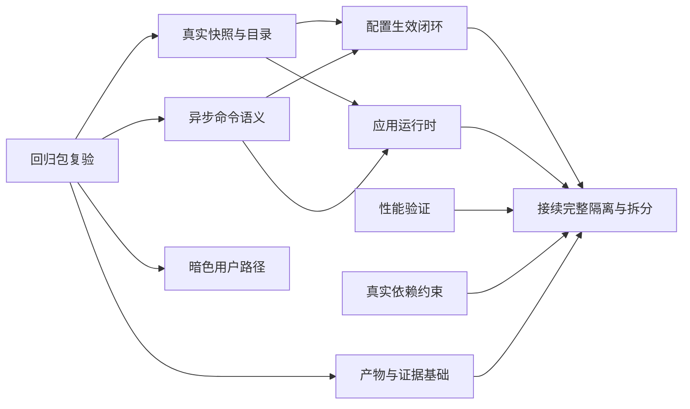

# 审查后工程完善计划：数据闭环、生命周期与交付验证

- 日期：2026-10-26。
- 状态：评估通过（2026-10-26，四点修订已并入：E01三拆/E05前置/Contracts归属/工作量锚点；E02.1范围收窄）。W1（E00+E08基础+E05）按零交集三路并行执行。
- 观察基线：`4a529dc2afa642d7b737b902160fb0430b3abcd8`。
- 前置修复：`5ef523b`，R1～R9回归包；归档提交`4a529dc`。
- 依据：[完整审查报告](../reviews/2026-10-26-post-plan-full-review.md)、[Plan A](2026-10-26-hardware-process-isolation-plan.md)、[Plan B](2026-10-26-architecture-decoupling-plan.md)。

## 1. 目标与现状

本计划将已建立的契约、模块服务、主题引擎和Host原型接成完整运行路径。主要目标是：同一批采样供多个消费者使用；设置的保存与实际生效可区分；后台资源由明确对象管理；异步操作有可验证语义；重构的性能和交付结果可以追溯到实际产物。

| 当前结果 | 本计划的处理 |
|---|---|
| R1～R9已提交修复，报告归档 | 作为前置复验，不重新安排同一套修复；发现未覆盖路径时只补针对性修复 |
| 修复包报告19项专项通过，主测试发现2440/执行2433/失败0 | 记录为修复包已有证据；不是本计划独立运行结果，也不自动解释为整个解决方案总数 |
| R5目前是源码级护栏 | 补真实Helper状态迁移测试，明确它与源码扫描的证据差别 |
| R3已改目录后台单飞构建 | 保留其响应性修复；后续形成生产者发布的目录缓存，减少重复锁内遍历 |
| C1快照仍由读取动作生成批次，时效/revision等有占位 | E01做实；迁移消费者前先满足快照合同 |
| B3生产保存使用选择性应用安全子集 | E03逐模块接线，保留原有安全检查和失败处理 |
| 暗色引擎与状态机已有，实际SettingsForm路径未完成 | E05形成完整用户功能 |
| I2保留主进程采集，是获准的隔离原型 | E09接续原Plan A的I3～I5，完成替换后重新测性能 |
| 架构棘轮主要基于文本统计，Host测试有固定产物路径 | E07/E08补真实依赖和产物证据 |

不合并无关功能、全量UI换肤或权限分离设计。维持Windows/.NET 8产品范围。旧计划继续承担具体阶段的实现，本文件定义收口顺序和跨阶段验收，不再建立一套竞争的采集接口。

## 2. 实施约束

1. 延续已有`IHardwareClient`、`HardwareSnapshot`、`HardwareCatalog`等契约。需要演进时明确协议兼容方案，不能让本地/管道实现表达不同的成功、时效或缺失含义。
2. 既有修复不回退：稳定设备绑定、探测策略、真实0/缺失区分、Web认证与有效需求、插件发布租约、GPU回退与窗口关闭优先级均作为约束。
3. 配置文件由主程序单一写入；目录与样本由采集生产者发布；窗体、渲染资源、订阅和子进程均有明确所有者。
4. UI绘制和交互不得同步等待硬件锁、IPC或后台任务。取消等待与取消底层执行分开表达。
5. 原型模式可以保留用于A/B，但正式隔离模式不能隐式创建主进程LHM补位。
6. 不把模块间副作用包装成“全局原子事务”。记录哪些配置已保存、哪些已生效、哪些失败。
7. 测试优先验证产品入口、状态迁移与真实组件边界。源码扫描仅作附加护栏。
8. 开工重新固定HEAD及工作树差异；现有两份未提交文档、`.cua-helper/`等本机材料不纳入产品代码修改。

## 3. 任务、依赖与交付批次

| 编号 | 任务 | 优先级 | 前置 | 主要交付 |
|---|---|---|---|---|
| E00 | 回归包独立复验与启动基线 | P1 | 已提交R1～R9 | 复验记录、真实R5状态测试、实际门禁口径 |
| E01 | 真实采样快照、目录与需求闭环 | P1 | E00 | 单一生产者发布、真实代次/质量、消费者迁移入口。**按 A(生产者发布)/B(目录与需求)/C(消费者迁移)三个独立停靠交付：C 在 A/B 验收后另行派工** |
| E02 | 异步命令及超时/取消/合并语义 | P1 | E00；与E01约定版本字段 | 两种客户端行为一致、配置不丢失、操作有界 |
| E03 | 配置差异与模块生效反馈 | P1 | E01、E02 | 保存链真实模块接线、失败结果和最小影响面 |
| E04 | 应用运行时与资源生命周期 | P1 | E01、E02 | 单一组装根、订阅归属、统一关闭 |
| E05 | 设置明暗主题用户路径 | P1 | 可与E00并行（基线风险自担）；保存提交与E03协调 | 选择/预览/保存/取消/系统跟随完整闭环 |
| E06 | 重构性能与缓存分配优化 | P2 | E00留基线；相关代码稳定后终验 | 热路径分配测量、同机A/B、回归预算 |
| E07 | 真实依赖检查与分层约束 | P2 | E00留基线；E01/E04后分阶段收紧 | 程序集/类型依赖检查、可解释例外 |
| E08 | 实际产物与可重复交付证据 | P1 | E00后先做基础；每批重复验收 | 产物路径/摘要、真实入口测试、CI条件闭合 |
| E09 | 接续I3～I5及B4～B6 | P1/P2 | 对应E01～E08门禁 | 正式隔离候选与架构阶段验收 |

建议批次：

- **M0**：E00 + E08基础部分，固定可相信的修复与测试基线。
- **M1**：E01/E02；E05独立并行，保存入口由同一集成人收口。
- **M2**：E03/E04，验证多个消费者和设置/退出路径。
- **M3**：E06/E07/E08收紧，产出可交接的单进程实现和隔离客户端。
- **M4**：E09执行原计划后续阶段；完整隔离与深层规则拆分分别验收。

工作量锚点（2026-10-26评估，独立估算、非工期承诺）：E00约1～1.5、E01约4～7（A/B/C分计约1.5～2/1.5～2.5/1～2.5）、E02约3～5、E03约2～4、E04约2～3、E05约1.5～2.5、E06/E07/E08各约1～2.5；M0～M3合计约12～20人日（不含E09——其体量为Plan A的I3～I5与Plan B的B4-2/B5/B6，另行估算）。并行压缩后关键路径约8～12人日。

共享文件集中管理：`UIController`、`SettingsForm`、`AppActions`、`HardwareClientAdapter`、`PipeHardwareClient`由明确负责人收口。**Contracts按文件切分归属：快照/目录/需求模型归E01，IpcMessages与操作/命令模型归E02，接口`IHardwareClient`的演进由集成人独占**（E01/E02开工前由集成人钉死契约演进方案，否则不并行）。实现工作可按数据、命令/运行时、主题、验证工具分工，避免并行覆盖这些文件。

## 4. E00：回归包复验与基线

**输入**：`5ef523b`、审查报告、`ReviewFix20261026Tests`及I2专项测试。

实施：

1. 固定源SHA、补丁SHA、依赖、配置和产物摘要，独立复验R1～R9。暂不因提交说明中的“已修复”直接提升验收状态。
2. R1走实际策略切换入口，验证Off确实停止相应设备访问，并核对保存/运行时状态。R2验证合法握手后的协议异常、启动失败、回收、退避与暂停。
3. R3验证调用线程响应、并发目录请求合并、关闭时在途任务；后台化不等于已经解决目录生命周期。
4. R4跨帧只改颜色；R6使用真实同级窗口链；R8超过窗口容量仍有界；R9测试帧序号与采样批次分别缺失以及会话切换重置。
5. R5补一个窄的窗体/屏幕/时钟接缝，或利用现有Helper可隔离构造路径，覆盖“泊出→恢复位置→重新泊出→关闭自动隐藏”。避免为测试启动完整采集器。
6. R7必须走`CloneForDiff → Merge → 选择性应用`的完整保存编排：有内存口令、仅持久化哈希、真实修改口令、无改动保存分别验证；只测试ComputeDiff不足以证明保存入口没有幻影重配。
7. 建立小型GUI验收清单：设置空保存/修改保存、面板显隐、任务栏模式、自动隐藏、多屏恢复；有目标设备时补控制器开关与设备释放实测。

**通过条件**：9项逐条有复验证据和剩余边界；Helper行为与源码护栏分开记账；本地跳过测试和完整CI条件清楚记录。这里只补发现的遗漏，不另起一轮无边界重构。

## 5. E01：真实快照、目录与需求

**主要落点**：`HardwareSamplingCoordinator`、`HardwareMonitor`、`HardwareValueProvider`、`HardwareClientAdapter`、Contracts、UI/Web/历史/传感器窗口。

### E01-A：生产者发布

- 每次真实采样完成后生成并原子发布一份完整、不可变的快照；`GetLatestSnapshot`只返回已发布数据。
- 区分会话epoch、设备树代次、采样BatchId、CatalogVersion、ConfigRevision。普通读取不推进任何代次；设备重建不复用旧设备绑定。
- 时间保存真实采样起止/发布时刻；过期按单调时间计算。接收侧保留源样本年龄，不因收到缓存或重启客户端变回Fresh。
- 质量、缺失原因、单位、设备ID与读数同批发布。正常0保留为有效值；失败/过期不会通过通用回退层无限保活。
- 初始化返回明确的空/初始化状态，不伪造成功批次；并行读取同一批次不会混合新值和旧目录。

### E01-B：目录与消费者需求

- 设备/传感器结构目录在设备或配置变化时由生产者更新。频繁传感器值变化通过快照更新，避免每个UI定时器遍历整个设备树。
- E00/R3已引入的单飞构建可作为过渡；消费者不直接等待硬件锁，关闭后不再发布给已释放窗口。
- 传感器窗口按稳定ID保存展开/滚动状态，目录版本变化时重建结构，普通数值更新不重建整棵树。
- 需求按消费者身份登记并返回可释放的订阅/租约，聚合UI、任务栏、合法Web、历史、传感器窗口需求；关闭一个窗口不会清掉其他消费者需求。
- 保持原有采样最小周期和历史记录策略。无授权的Web请求不能增加采样；本计划不顺带把“隐藏指标是否记录”改成新的产品策略。
- 特大原始传感器目录按同一目录版本分页；跨页版本变化明确重试，不拼接两代设备树。

### E01-C：逐个迁移数据消费者

先默认进程内客户端，再相同契约的管道客户端。依次迁移面板/任务栏、Web、历史/告警、硬件窗口与辅助界面。

UI只持有显示状态，历史/告警读取原始样本，不读取平滑动画值。连续累计量按会话、设备epoch和批次去重；断连缺口不能按旧速率补算。

**验收**：同一批数据多次读取，BatchId/时间不变；采样失败、缓存过期、设备换序与重启各有用例；多个消费者只触发一轮采样；隐藏主窗仍可满足合法Web/历史需求；关闭传感器窗口释放需求；各展示端没有混代次和真实0/缺失歧义。

## 6. E02：异步操作和命令语义

**主要落点**：`IHardwareClient`、本地适配器、`PipeHardwareClient`、Host命令处理、监督器和调用方。

| 操作 | 约定 | 合并策略 |
|---|---|---|
| 读取最新快照 | 同步、纯本地、不触发采样 | 返回同一已发布批次 |
| 请求到期采样 | 异步、共享唯一协调器 | 同一采样周期合并 |
| 显式硬件重扫 | 异步、有独立操作ID及状态 | 同代次重复请求可加入在途操作；不把UI Tick当作重扫 |
| 获取目录 | 异步读取已发布目录/分页 | 同目录版本可共享 |
| 应用配置 | 异步，返回实际生效revision | 仅相同revision/内容可合并；不同版本排队或明确被新版本取代 |
| 提交需求 | 更新某消费者的需求revision | 同消费者可保留最新值，不覆盖其他消费者 |

实施：

1. 将同步IPC配置应用改为真正异步；移除UI路径上**实际阻塞消息循环**的等待（E00先盘点清单：已知实例`ThemePreviewService.cs:146`的UI线程同步下载；`SystemHardwarPage`位于`await WhenAll`之后的`.Result`属安全用法，不一刀切清扫）。
2. 逐调用方迁移现有`RequestRescanAsync`的模糊用途，区分“到期采样”与“重新枚举”。协议命令和API兼容方式写明，不直接改变旧消息含义。
3. 操作状态至少包含排队/执行/完成/失败/已取消等待。超时只表示本调用方停止等待，不能报告底层已停止。
4. 一个加入者取消，不取消其他加入者共享的采样或重扫。取消底层执行必须由操作所有者明确发起，并报告是否支持。
5. 对已超时、仍在执行的非幂等操作保留有界操作记录；新请求取得明确的busy/operationId，避免立即重复重扫。
6. 请求队列、待应答表、执行记录都有容量和截止期限。超限返回可解释结果，不无限Task.Run或静默丢配置。
7. Host重连后重放最新期望配置和有效需求；旧会话应答不能完成新命令。只有实际应用版本确认后，才将该版本对应读数标为当前有效数据。

**验收**：两种客户端运行同一语义测试；并发提交配置v1/v2，最终明确为v2；两个调用者共享操作、其中一个取消，另一个可完成；超时后再次请求不启动重复底层操作；断连/关闭时所有等待者有界结束，无悬空TCS或重复采样器。

## 7. E03：配置保存与模块生效

**主要落点**：`SettingsForm`、`SettingsChanger`、`SettingsProjection`、`AppActions`及模块服务。

1. 建立完整的字段归属表，覆盖采样、显示、任务栏、Web、插件、启动行为及运行态字段；新增字段必须明确归属，不能永远落到“Other→整组重建”。
2. 区分草稿、内存已提交、已持久化、已请求应用、实际生效。只有实际写入成功才显示“已保存”，应用失败不能伪装为成功。
3. 比较不可变配置投影及明确凭据变更状态；不要重新把全局Settings传给每个模块，也不要为比较而破坏JsonIgnore的敏感数据策略。
4. 将现有选择性应用逐模块迁入实际服务：一次只接一种模块，确保新分派器与旧Apply路径不会重复执行同一动作。
5. 模块结果携带saved revision、effective revision、失败原因和可用状态。未接线返回NotWired/失败状态，不返回Applied=true。
6. UI以用户可理解的文案反馈，如“设置已保存，端口被占用，网页服务未启动”；操作ID、revision和堆栈留在诊断信息中。
7. Web安全拒绝、插件发布租约和市场事务、设置运行态合并不回退；插件配置变化可能改变指标集合/标签时，由明确的数据/定义变化通知更新显示，不盲目假设纯插件配置永远没有显示影响。

**验收矩阵**：空保存不触发模块动作；颜色/语言变化不重建硬件；端口变化只影响Web；设备策略变化走采样协调器；开机启动无变化时不调用计划任务；模拟文件写入失败、端口占用、硬件应用失败和插件失败，显示保存与实际状态的差别；取消草稿不产生副作用。

## 8. E04：单一应用运行时和生命周期

**主要落点**：启动入口、`UIController`、`HardwareGateway`、Web/插件控制器、Host监督器和窗口订阅。

- 引入轻量`ApplicationRuntime`或等价所有者，启动时手工组装，不依赖新增DI框架。
- 运行时拥有采集客户端、数据存储、需求聚合、模块应用服务及监督器。UIController拥有布局、动画和渲染资源，窗口拥有自己的订阅。
- 默认进程内模式由运行时拥有采集器；隔离模式由运行时拥有Host客户端。消费者不负责决定启动哪种采集实现。
- 静态Gateway作为过渡时，用一个不可变注册快照发布monitor/client配对，并带所有者令牌；旧实例释放不能注销新实例。阶段结束再逐个替换为实例注入。
- 统一退出顺序：标记Stopping/拒绝新操作→停止生产需求和监听入口→取消或完成在途操作→停止采集/Host→释放订阅及UI资源。保留窗体关闭优先级与GPU清理约束。
- 正常关闭有明确期限和结果；超时再执行受控终止。不能在先清掉进程引用之后才尝试shutdown。
- 主窗隐藏、任务栏独显、关闭传感器窗口与应用退出分别定义；隐藏一个消费者不等于结束整个运行时。

**验收**：反复开关窗口不增加后台采样器、Timer、事件订阅或ETW会话；旧UI销毁不注销新运行时；主窗隐藏时Web需求正常；后台任务未结束时退出可完成或给出明确超时结果；主程序被结束后没有孤儿Host及辅助进程。

## 9. E05：设置明暗主题实际接线

**主要落点**：`SettingsForm`、主题选择所在设置页、`SettingsThemeManager`、`SettingsThemeApplier`、系统主题消息和语言资源。

实施顺序：

1. 构建设置窗体前读取已提交模式并初始化配色，避免先显示浅色再翻成深色；提供跟随系统/浅色/深色选择。
2. 选择只改草稿并即时预览；保存成功后提交模式，取消/关闭恢复已提交模式；失败时按E03反馈，不把未保存状态认作成功。
3. 接入`ThemeChanged`，在UI线程更新实际控件树；窗体销毁注销所有订阅，迟到系统消息不能访问已释放句柄。
4. 系统配色变化只影响跟随系统模式。处理静态系统事件的线程切换、句柄未建立和窗口正在关闭等状态。
5. 设置配色与悬浮窗Skin/GPU材质分开；切换设置明暗不能重启采样、Web、插件或改变WDA策略。
6. 补齐项目现有9份语言资源中的模式名与提示。对原生ComboBox选中区域等不能完全控制的部分，如实记录视觉边界。

**真实界面验收**：首次打开、预览、保存后重开、取消、关闭按钮、系统浅深切换、混合DPI、多设置页切换。至少包含输入框、禁用控件、菜单、市场页/预览区域和错误提示；独立状态机测试不能代替SettingsForm验收。

## 10. E06：性能与分配

先测量再优化。保持格式行为fixture，性能改动与业务规则修改分开提交。

| 场景 | 测量 | 优化/通过目标 |
|---|---|---|
| 纯格式化缓存命中 | 预热后固定输入多次调用，记录当前线程分配与执行时间 | 避免每次无变化仍复制state；结果类型/复用方案比较后确定，优先使热路径接近零分配 |
| 数值/颜色/配置实际变化 | 执行时间、分配、输出 | 必须正确失效缓存，不能以跳过颜色或单位更新换取性能 |
| 真实UI 10/30/60个可见项 | 每帧分配、UI延迟、GC、CPU时间 | 同机同配置对比，不把纯函数微基准当整机性能结论 |
| 目录查询与传感器窗口 | UI线程等待、目录重建次数 | 目录结构未变时不重复遍历LHM树，响应不被采样锁拖住 |
| 默认/隔离两种模式 | 两进程合计CPU与私有字节、首次有效样本时间 | 完成I3替换后再与旧实现比较，不把双采集原型当最终结果 |

实现候选包括复用未变化的不可变state、将轻量结果变成值类型、按版本缓存格式化上下文。选择时检查现有调用/反射/测试，不破坏纯规则可测试性。避免引入跨线程共享可变对象或为减少分配而丢失状态更新。

I2已提出的额外私有字节≤50MiB、额外CPU≤5ms/秒、接收p95≤100ms是原型候选预算。E00固化环境，E09在完整隔离后评估；超出时给出实测原因和取舍，不删测量项或混用单核CPU时间与整机百分比。

## 11. E07：真实架构依赖约束

1. 记录当前程序集与类型依赖基线，标注合法的启动组装例外；兼容现有命名空间，全面重命名独立处理。
2. 先用Roslyn语义符号或程序集元数据检查实际类型引用，覆盖using、全限定名称、别名和泛型参数，不能只统计using数量。
3. Contracts禁止WinForms/LHM/Vortice和主程序依赖；Sampling禁止UI/Web/Plugins；纯指标规则禁止全局服务、硬件句柄及I/O副作用。
4. 暂未提取程序集的区域按类型/命名空间检测，明确例外类型和计划撤除阶段；迁入真实工程后改用编译引用边界。
5. 校验ProjectReference无环、SDK递归Compile未重复编译新项目源码、发布清单包含实际依赖。移动文件时同步测试链接和反射探针。
6. 保留旧棘轮的历史可比性，新增指标单独编号；禁用或调整规则必须说明理由，不把全限定引用替换记为依赖已经消除。

**验收**：增加一条全限定反向引用、别名引用和间接类型引用均能触发对应检查；合法组装例外不误报；新检查真实运行于CI/Release，旧基线不会自动重写。

## 12. E08：产物、测试与交付证据

E00后先完成产物定位与证据模板；后续各批次复用，最终验收再汇总。

- I2测试接受明确的Host产物路径，优先使用本轮构建清单；目录缺失/版本不符直接失败，不在Debug/Release或其他工作树之间静默挑一个旧产物。
- 每份结果记录源SHA、dirty补丁摘要、配置、测试程序集摘要、主程序/Host/Contracts摘要、依赖锁定情况和命令。区分测试版本与实际运行版本。
- 记录TRX的发现/执行/通过/失败/跳过及逐项原因。完整CI配置插件仓库和所需条件；本地缺环境允许记录待验，不能直接标记完整发布门禁通过。
- 关键测试类纳入必须执行集合，包括回归包、配置保存真实入口、快照/需求语义和进程故障链。新增用例后基于实际发现数同步CI/Release阈值，保留合法跳过说明。
- 性能记录同时包含默认/隔离两种模式的相同环境和配置；Host重启时按PID生命周期累计CPU，不把计数器归零误算为CPU降低。
- 建立一份可重复的GUI冒烟步骤和记录格式；需要GUI/驱动/目标硬件的结果单列。报告由机器结果与人工记录汇总，不凭提交标题推断完成。
- 保留构建warning基线，新增warning在对应改动中处理；不顺带清理所有历史warning。修复行尾空白与无意换行噪音。

**每批通过条件**：干净检出可构建并运行相应测试；实际执行路径/产物可证明；Debug/Release和该批相关探针通过；未执行项逐条说明；正式发布时完整CI条件下门禁通过。

## 13. E09：接续Plan A/B的后续实施

### E09-A：完整隔离候选

按原Plan A的I3/I4/I5推进：正式采集实现和静态发布器迁入Host，FPS/ETW/设备重建与资源管理随会话迁移，主程序仅接收快照并单一写盘。

关键门禁：隔离模式的主程序不创建或打开LHM Computer；每个设备只有一个采集所有者；正常退出确实走受控释放；断连、卡住、异常帧、启动失败和重复失败均有界恢复；新会话重放最新配置/需求，目录与读数版本一致。

随后把主程序、Host、Contracts及依赖作为同一发布单元，验证缺组件、版本错配、更新中断与完整回滚。默认是否启用隔离模式，以实际可靠性和资源成本验收决定，不在本计划文档中提前改变产品默认值。

### E09-B：深层解耦收口

按原Plan B的B4-2/B5/B6推进MetricUtils纯化、MetricSample/显示状态分离和Sampling/Domain工程边界。沿已做实的快照与模块接口迁移，不再逐个搬动静态查询并保留隐藏依赖。

行为有意修改与纯重构分开提交；B0已记录的疑似语义缺陷逐项决定，不借“重构保持行为”把问题永久固化，也不顺手修改所有单位/阈值规则。

**整体完成条件**：原Plan A/B阶段状态按实际实现和验收更新，用户功能、进程隔离、代码边界与性能证据分别可验证；尚缺目标硬件验证的F系列问题维持待验状态。

## 14. 回滚与交接

- 每个E任务按职责拆提交，行为修复、接口演进、文件迁移和性能优化分开。
- 契约演进先确保两端兼容，再迁移消费者，最后撤除兼容桥；禁止两个采样循环长期同时运行作为“兼容层”。
- 配置兼容读取与备份沿用既有方案；新增运行时revision不要求改用户JSON结构。确需持久化新字段时单列迁移用例。
- 单进程实现先作为等价参考验收；隔离失败不得自动转回主进程探测而使用户误以为仍处于隔离模式。
- 交接表至少包含任务ID、源/产物SHA、已执行用例、失败/待验、用户可见变化、兼容影响和回滚提交；同一成果不在原Plan A/B重复计算工作量。

## 15. 建议的第一批工作

1. E00核对修复包，优先补R5真实Helper迁移测试与R7完整保存入口测试。
2. E08先修Host测试产物定位和记录模板，确保之后测到的是本次构建。
3. E01/E02分别完成采样发布边界和命令语义；E05可独立并行，设置保存入口集中集成。
4. 第一批验收后再进入E03/E04；在生命周期和数据来源稳定后执行E09原生迁移及深层工程拆分。

该顺序的近期成果是：修复包有独立证据、暗色功能可实际操作、数据链与命令语义可以被同一套测试验证。完整隔离和架构拆分依后续阶段逐项验收。
