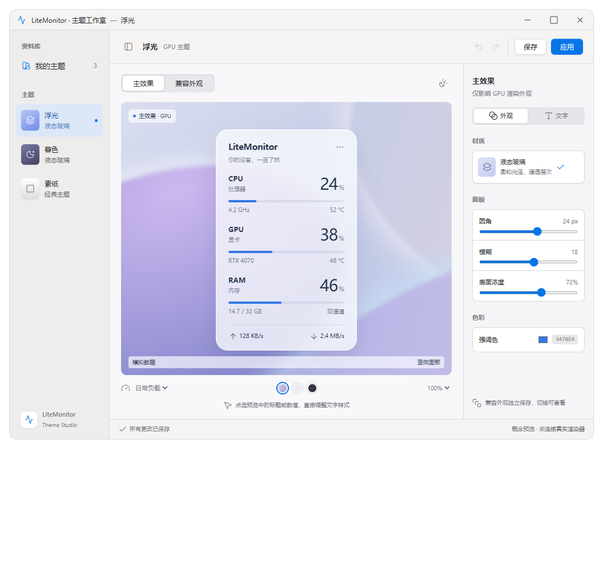

# 主题工作室重做计划：苹果风格工作区与 Windows 原生窗口栏

- 日期：2026-10-26。
- 状态：待评估；本轮交付计划与设计参考，尚未实施产品代码。
- 观察基线：master @ 18e63c9236b8d1ecb6388c11b738399e84ccc980。开工时重新记录实际 SHA 与工作树差异。
- 已确认方向：双管线可视化调参、准确预览、保存与发布准备；苹果风格工作区，使用 Windows 原生最小化、最大化／还原、关闭控件。
- 衔接：[工程改进计划](2026-10-26-post-review-engineering-improvement-plan.md)的 E03/E05/E08、[架构解耦计划](2026-10-26-architecture-decoupling-plan.md)、[既有主题市场合同](../superpowers/plans/2026-10-25-theme-marketplace-plan.md)。

## 1. 目标与范围

交付一个真正可用的主题工作室：用户能判断正在编辑什么外观，每次调参能在对应的真实渲染路径上验证，保存后重开内容一致，应用后能看到实际生效结果，导出的主题能继续走现有市场投稿流程。

视觉沿用已确认原型：暖灰资料库、轻盈工具栏、中心画布、分组属性检查器、克制的蓝色强调。窗口操作遵循 Windows 习惯，内部编辑体验借鉴苹果创作工具。

参考图是交互概念稿。材质表现、参数范围和控件可用状态不构成生产能力承诺；正式属性面板以第 4 节能力合同为准，尤其不能照搬原型中“两套独立字体／圆角”的假设。

### 首版包含

1. 原生可调整大小的 Windows 窗口；资料库、画布、属性三栏，可折叠、可调整宽度。
2. 经典／GPU 主题类型；GPU 主题的“主效果／兼容外观”编辑目标；实际预览路线与失败原因。
3. 现有材质、配色、字体、布局、阈值的可视化编辑；只呈现实际受支持的作用范围。
4. 同源渲染的竖向、横向、任务栏预览，按真实支持情况开放；模拟场景、背景切换、画布缩放、点选定位属性。
5. 有界撤销／重做、未保存提示、草稿恢复、保存／另存为、显式应用、主题 JSON 与效果图导出、市场投稿准备。
6. 工作区明暗外观、键盘操作、辅助功能、高 DPI 与跨显示器支持。

首版保持现有模板式布局，不引入自由拖拽布局、图层编排、自定义脚本、着色器编写、云同步或市场账户系统，也不迁移至 WPF、WinUI 或 WebView。

## 2. 已核实的现状与复用边界

以下为本次代码阅读所得，不代表已完成独立运行验收。

| 现有落点 | 当前行为 | 本计划处理 |
|---|---|---|
| [ThemeEditorForm.cs](../../src/ThemeEditor/ThemeEditorForm.cs) | 左侧资料库、中间选项卡、右侧预览；固定坐标、手动 DPI 乘法与 AutoScale 并存 | 重做窗口组合，拆出文档、属性与预览 |
| 同上，保存／应用入口 | 保存后弹窗询问应用；应用通过反射寻找 MainForm 私有字段 | 独立操作、注入应用入口，分别报告保存与生效结果 |
| [ThemeEditHistory.cs](../../src/ThemeEditor/ThemeEditHistory.cs) | 最多 32 个配置撤销快照，无重做；序列化签名判断变化 | 保留配置克隆基础，补事务合并、重做与容量上限 |
| [ThemeFileService.cs](../../src/ThemeEditor/ThemeFileService.cs) | 同目录临时文件与安全替换，已有故障注入测试 | 保留原子写入；补文档冲突和结果编排 |
| [ThemePreviewControl.cs](../../src/ThemeEditor/ThemePreviewControl.cs) | 经典预览使用 UILayout/UIRenderer 与固定输入；主题更新会重建副本和 GPU 控件 | 复用生产渲染，拆出输入、预览会话与命中定位 |
| [GpuThemePreviewControl.cs](../../src/ThemeEditor/GpuThemePreviewControl.cs) | 使用 GpuSceneRenderer；不创建捕获源；启动使用 GpuStartupGuard.Shared | 补更新／销毁合同，核查与生产启动保护的隔离 |
| [MaterialRuntimeSettings.cs](../../src/Rendering/Configuration/MaterialRuntimeSettings.cs) | 当前只有 floatingToolbar 样式从主题 Font/Color 生成 ForegroundTheme | 按材质、样式声明能力，不给所有 GPU 主题开放同一套文字控件 |
| [ThemeRenderingConfig.cs](../../src/Rendering/Configuration/ThemeRenderingConfig.cs) | backend/material/parameters/motion/fallback/fallbackStyle，保留扩展字段 | 优先兼容现有格式，不另造编辑器主题格式 |
| [LegacyFallbackStyleResolver.cs](../../src/Rendering/LegacyFallbackStyleResolver.cs) | fallbackStyle 为六个独立配色槽，缺省／非法值有明确解析行为 | 同源解析，显示显式值、默认值与诊断 |
| [RenderingTransitionCoordinator.cs](../../src/UI/RenderingTransitionCoordinator.cs) | 回退派生主题共享字体与布局，保留告警配色 | 回退预览同源，必要时提取纯解析逻辑共用 |
| [SettingsThemeManager.cs](../../src/UI/Settings/SettingsThemeManager.cs)及 Palette | 已有工作区明暗配色基础 | 接入同一套设置外观，不把面板主题当编辑器皮肤 |
| [LiteMonitor.csproj](../../LiteMonitor.csproj) | 已配置 PerMonitorV2 | 修正编辑器自己的缩放，不再次全局切换 DPI 模式 |
| [ThemeMarket.cs](../../src/Plugins/ThemeMarket.cs) | 索引、下载、安装、卸载已实现，未见投稿上传 API | 导出单文件主题与投稿资料，不虚构“一键上架” |

已有的主题保存、未知字段、取消编辑、只读配置、派生字体等测试继续运行，不能通过删除旧回归测试完成重做。

## 3. 视觉与窗口合同

### 3.1 Windows 原生窗口栏

- 使用标准可调整边框的 WinForms Form，保留系统非客户区、标题栏、最小化及最大化按钮。
- 保留拖动、双击最大化、Alt+Space、Alt+F4、系统贴靠、键盘调整大小、任务栏切换；支持的 Windows 版本分别实测。
- 不绘制红黄绿按钮，不用自绘控件冒充系统按钮，首版不改写标题栏命中测试或非客户区布局。
- 标题显示应用名、文档名及未保存状态；字体、按钮尺寸和系统圆角由 Windows 管理。
- 标题栏明暗按系统可用能力处理，支持不完整时保留系统默认表现，优先保证窗口行为。

### 3.2 内部工作区

| 区域 | 视觉要求 | 交互要求 |
|---|---|---|
| 资料库 | 暖灰底、紧凑主题项、类型与材质副标题 | 新建、复制、重命名、删除、另存为归入清晰菜单；切换先处理未保存修改 |
| 文档工具栏 | 文档名、修改状态、撤销／重做、保存、应用、次要导出菜单 | 操作有明确结果；保存不再弹“是否立即应用” |
| 画布工具栏 | 主效果／兼容外观、预览形态 | 类型、编辑目标与实际路线同时可辨认 |
| 画布 | 预览居中，柔彩、浅色、深色、棋盘格背景 | 背景只影响测试环境；点选定位属性；不承担自由布局 |
| 属性检查器 | 外观、文字、布局、阈值；常用项在前，高级项折叠 | 当前值、单位、范围、作用域和默认／覆盖关系可见 |
| 状态区 | 保存状态、预览路线、必要诊断 | 失败不只变颜色；可重试，保留草稿 |

编辑器配色与监控主题分开。复用 SettingsThemePalette 语义色，仅对工作区控件应用；预览、色样和渲染承载窗口不被递归换色器覆盖。不为预览临时修改全局 UIColors。使用 Windows 可用的系统 UI 字体，不打包苹果专有字体。

用间距、细边界和有限层级组织内容。文字按系统字体设置生成，原型里的小字号不直接照搬；焦点、选中态、禁用原因在明暗模式下均可辨认。高对比度模式优先使用系统颜色。

文案接入现有语言资源，不在同一个按钮堆放中英双语。支持 Ctrl+S 保存、Ctrl+Shift+S 另存为、Ctrl+Z 撤销、Ctrl+Y／Ctrl+Shift+Z 重做；缩放快捷键不抢占文本框的正常输入，Esc 取消当前临时操作。折叠检查器或切换目标后焦点仍可预测。

## 4. 双管线与属性能力合同

### 4.1 三个独立状态

1. **主题类型**：经典或 GPU，由文档配置决定。
2. **编辑目标**：经典外观、主效果或兼容外观，决定检查器作用域。
3. **实际预览路线**：真实渲染器、视图、背景输入及不可用原因。

切换编辑目标只切换文档视图，不修改 rendering.backend，不改变 GPU 全局开关，不触发主窗口换肤。

经典主题只显示“经典外观”；GPU 主题显示“主效果／兼容外观”。GPU 主效果失败时保持目标选中，展示原因及“查看兼容外观”，不静默显示常规绘制画面却继续标为 GPU。

任务栏若使用常规绘制，明确标为“任务栏 · 常规绘制”，不能因主题类型为 GPU 就改用 GPU 标签。

### 4.2 先冻结字段映射，再制作控件

TE00 逐字段记录：属性标识、JSON 路径、合法范围、默认解析器、材质／样式、视图、共享关系、命中对象及预览失效级别。UI 与预览共用该描述，不各自维护能力判断。

| 属性族 | 当前支持语义 | 首版编辑规则 |
|---|---|---|
| 经典配色、字体、布局、阈值 | 既有经典渲染器读取 | 保留现有能力，补单位、校验和定位 |
| GPU 材质、运动参数 | ThemeRenderingConfig 与 MaterialRuntimeSettings 解析 | 只开放实际消费字段，范围同解析器 |
| GPU 标准样式前景 | 可能使用固定前景，不应假设读取普通 Font/Color | 说明限制，不显示“能调但无效果”的控件 |
| GPU floatingToolbar 前景 | 消费主题主体的一部分 Font/Color | 字段显示“共享”及受影响角色，逐项验证 |
| GPU 兼容独立配色 | fallbackStyle 的 background、panelBackground、border、text、mutedText、accent | 六项独立编辑，支持清除显式覆盖 |
| GPU 兼容字体、布局、圆角、阈值 | 与主题主体共享，不是 fallbackStyle 独立字段 | 需要编辑时标“共享设置”，不能宣称仅影响兼容外观 |
| GPU 回退强调色 | 现有桥接映射至 Color.TextTitle | 标为“标题强调色”；不冒充进度条色，不占用告警色 |

原型中两套独立圆角、字体和字号仅用于交互探索。首版不据此新增 fallbackFont/fallbackLayout；以后若需要完全独立样式，单独设计生产解析、版本兼容、迁移与市场校验。

缺省与显式值区分显示：打开旧主题不将所有默认值写入 JSON；“恢复默认”按描述器删除覆盖或恢复字段。非法值保留并提示，不在加载时静默改写；预览使用解析器安全回退时必须显示诊断。

## 5. 文档、保存与应用合同

### 5.1 独立编辑会话

文档至少包含：源路径、来源摘要、配置草稿、已保存基线、revision、历史、校验及预览状态。会话仅保存配置，不持有主窗口 Theme、Font、GPU 或采集器。

- 从原始配置克隆草稿；不能编辑 ThemeManager.Current，也不能将运行时已缩放对象作为原始主题保存。
- 保留源 JSON 的字段存在性与原始扩展节点，以显式编辑补丁写回。解析仍使用现有配置解析器；单纯全量序列化带默认值的 Theme 不能满足“缺省不被物化”的要求。历史与恢复同时保留这些信息。
- 同一路径在本进程只允许一个可写会话，重复打开聚焦已有窗口；外部修改仍做摘要检测。
- 连续滑块拖动、一次颜色选择或连续文本输入合并为一个可撤销事务，包含 rendering 与未知扩展字段。
- 历史初始上限 100 个事务、8 MiB 配置快照，任一触限淘汰最旧事务，保留当前草稿与保存基线。
- 目标、缩放、背景、选中项与工作区明暗属于视图状态，不写主题、不制造脏状态。
- 关闭、切换主题、删除或重命名当前文档时提供保存／放弃／取消；失败留在当前草稿。

恢复草稿写入应用用户数据目录，与正式主题及市场安装记录隔离。建议空闲 2 秒持久化配置，TE01 冻结数量和总容量上限。恢复时比较原文件摘要，冲突打开恢复副本，不自动覆盖。

### 5.2 操作语义

| 操作 | 成功定义 | 失败或部分成功 |
|---|---|---|
| 保存 | 指定配置修订经验证及原子写入，更新保存基线 | 保留原文件与草稿；写盘前不标“已保存” |
| 另存为 | 新路径写入成功后再切换文档身份 | 重名明确选择，失败保留原身份 |
| 应用 | 已保存版本通过现有编排接入主窗、横向／任务栏及相关消费者 | 分别显示“已保存、已应用／兼容生效／应用失败” |
| 导出 JSON | 导出选定修订，保留扩展字段 | 不自动应用，不修改主设置；允许导出合法草稿 |
| 导出效果图 | 指定修订、目标、真实路线及固定场景生成图像 | GPU 不可用则失败或主动选择兼容图，不冒充 GPU 图 |
| 准备投稿 | 校验最终 JSON，生成辅助资料，引导现有投稿入口 | 未上传、待审核、已上架分开；本地导出不报发布成功 |

存在修改时，“应用”提供明确的“保存并应用”路径并顺序执行。保存失败不进入应用；应用失败不撤销已经完成的文件保存。Skin 与实际运行主题不一致时，通过现有设置编排报告差异与重试，编辑器不反射字段，也不另建全局设置写入路径。

同名主题内容更新必须触发重新加载，不能因 Skin 名相同而跳过。保存开始时捕获 revision 与不可变配置；写盘期间继续编辑，只把已写入的修订标为保存基线，后续修改仍为未保存。

源文件摘要发生变化时，保存进入冲突处理：重新载入、另存副本或用户明确覆盖。只读目录、文件占用、磁盘失败均给出可操作提示，不自动切换保存路径。

写回补丁按现有大小写规则定位字段，避免生成重复的大小写变体；最终载荷重新通过现有解析与校验，再交给 ThemeFileService 的共用原子写入核心。必要时为它增加载荷入口，不能另写一套替换文件逻辑。新建／重命名沿用主题文件名规则，处理重名、大小写冲突和 Windows 非法字符。

### 5.3 发布准备与市场兼容

现有市场使用单个 JSON 主题，索引顶层 schema 保持 1。首版不把 zip、预览图或编辑器元数据塞进下载主题，不擅自升级索引版本。

“准备投稿”输出本地资料目录：

- 最终 theme.json，保留现有格式与未知配置字段。
- 基于最终文件字节的 SHA-256、长度及名称／作者／版本／材质／能力信息；非主题字段放辅助文件。
- 可用路线的预览 PNG，图或伴随资料标明主效果／兼容外观、场景、版本和渲染条件。
- 现有投稿模板所需说明与正确仓库入口；在线提交和审核继续走原流程。

资料须通过现有市场校验，包括远程引用限制；本地可编辑不等于可投稿。首版交付边界为“生成材料 → 人工提交 PR → 市场 CI／维护者审核”，不新增认证、上传、审核服务。对外提交是用户在投稿流程中的显式操作。

## 6. 预览准确性与资源合同

### 6.1 生产渲染同源

- 经典使用对应的 UILayout/UIRenderer、HorizontalRenderer、TaskbarRenderer。
- GPU 使用 GpuSceneRenderer、UiSceneSnapshotAdapter、MaterialRuntimeSettings 和同源样式解析。
- 回退使用 LegacyFallbackStyleResolver 与生产派生主题逻辑。需要提取纯函数时只做共用提取并补测试，不另写近似实现。
- 命中选择复用布局结果或场景节点的对象标识、边界，不维护第二套手工坐标。

首版只用固定模拟数据和固定背景，不启用桌面捕获，不订阅实时硬件，也不启动第二套采集。将来实时预览只读已有快照并另行说明非确定性。

### 6.2 场景与预览结果

场景至少包含：日常负载、高负载、告警／危险、真实零值、无值／过期、长标签／宽数值、多 GPU。固定设备键、单位、阈值与时间，动画对比使用固定时刻。

切换主效果与兼容外观保留相同输入和背景。DASH 与真实零值区分；不能只让 GPU 数值为空，却显示假的旧温度或旧状态。

预览请求携带文档 revision、目标、视图、DPI 和尺寸代次，只提交仍匹配会话的结果。截图固定到选定修订，不混入编辑前后的配置。

### 6.3 GPU 会话与降级

- 字体、颜色、数值更新尽量更新现有会话；尺寸、DPI、后端或设备变化按需要分级重建。
- 替换“每次 SetTheme 都 Dispose 并新建 GPU 控件”的高频路径；滑块事件不触发逐次设备创建。
- 启动保护区分生产与预览归属，不清理、伪造、消耗生产崩溃标记。Shared 保护若妨碍安全并发，先完成隔离验证再开放入口。
- 尊重安全模式与 GPU 启用策略；不可用时仍可编辑／保存草稿，主动查看兼容外观。
- 遵循现有 D3D／WinForms 线程合同，不用 Task.Run 简单包装控件或设备操作。
- 处理 HandleDestroyed／重建、DpiChanged、隐藏、最小化、设备丢失、切换文档和关闭；先停帧，再释放自有资源。
- 自建 Font／Bitmap／设备由会话释放；借用主运行时的字体不释放，保留生产派生主题的共享字体合同。

## 7. DPI、缩放与小工作区

三个量分开：系统 DPI 决定编辑器控件物理大小，主题配置决定最终面板逻辑尺寸，画布缩放只改变观察倍率。100% 预览定义为当前显示器上 1:1 的生产物理像素；显示逻辑尺寸、目标 DPI 和观察倍率。

1. 继续使用现有 PerMonitorV2；以 96 DPI 逻辑尺寸定义布局，由单一入口完成转换。
2. 移除 CreateGraphics 启动测 DPI、重复乘法和“窗口实际宽度再乘 DPI”等路径。跨屏按当前 DPI 更新会话拥有的字体、位图和交换链资源。
3. 默认窗口目标约 1120 × 760 DIP，首次打开按实际工作区夹取；恢复位置验证显示器拓扑，不放到已移除的屏幕。
4. 宽工作区显示三栏；不足约 1000 DIP 时资料库可折叠、检查器变窄；不足约 820 DIP 时检查器改为可切换独立面板。阈值在 TE02/TE05 用真实控件验证后冻结。
5. 以 720 × 480 DIP 紧凑工作区仍可编辑、保存为目标。工作区更小时允许属性局部滚动，关键操作始终可达，不强推大于工作区的最小窗口。
6. 分栏宽度、位置、折叠状态属于编辑器偏好，不写 Theme；缩放和跨屏往返不累计修改主题 Layout/Font。

验收覆盖 100/125/150/175/200/250/300%，含 1080p 高缩放、4K、100%↔200% 混合 DPI、负坐标副屏、拔屏后重开。分别记录裁切、字体清晰度、预览尺寸及累计缩放，不能只凭 4K 机器打开一次判通过。

## 8. 模块与接线

下列名称为建议，在 TE00 按项目结构收敛；抽象服务于真实边界，不建设通用设计器框架。

| 模块 | 职责 | 约束 |
|---|---|---|
| ThemeStudioForm／Workspace | 原生窗口、三栏组合、快捷键、布局状态 | 不做原子写入，不直接持有硬件服务 |
| ThemeDocumentSession | 草稿、revision、保存基线、历史、冲突、恢复 | 不存控件或渲染资源 |
| ThemePropertyCatalog | 字段、能力、范围、默认、共享关系、失效级别 | 生产解析为事实来源 |
| PropertyInspector | 分类、绑定、校验、继承状态、键盘操作 | 不直接改运行时主题 |
| ThemePreviewCoordinator／Session | 模拟输入、渲染适配、选择、代次、生命周期 | 不创建采集器，不默认抓屏 |
| ThemeDocumentStore | 封装 ThemeFileService、摘要冲突、恢复目录 | 保留原子写入与未知字段 |
| ThemeApplyGateway | 接入 AppActions／UIController 的现有主题应用，返回结果 | 无反射，不新增设置保存所有者 |
| ThemeExportService | JSON、真实效果图、投稿资料 | 独立输出，市场格式不变 |
| StudioPalette／Controls | 语义配色、必要的检查器自绘控件 | 原生输入与可访问性优先，不污染预览 |

从 [MenuManager](../../src/UI/MenuManager.cs) 注入打开与应用依赖；旧 ThemeEditorForm 仅在过渡期作薄适配，最终菜单默认打开新工作室。UIController、[AppActions](../../src/Core/Actions/AppActions.cs)、RenderingTransitionCoordinator、SettingsThemeManager 等共享文件由同一集成人收口。

与 E05 复用工作区明暗外观，与 E03 复用保存／生效结果，与 E08 复用构建产物和证据。重做无需等待硬件进程隔离完工，也不另造采样或设置基础设施。

## 9. 任务、依赖与交付批次

| 任务 | 交付 | 前置 | 通过条件 |
|---|---|---|---|
| TE00 能力合同与基线 | 源码基线、逐字段矩阵、视图表、旧测试结果、风险原型 | 无 | 原型与生产差距清楚；回退映射、命中、GPU 保护归属可验证 |
| TE01 文档模型 | 独立草稿、revision、撤销／重做、未保存与恢复、冲突 | TE00 | 修改不影响运行中主题；历史有界；已知与未知字段往返无损 |
| TE02 原生窗口与视觉壳 | 系统标题栏、三栏、配色、基本快捷键、折叠面板 | TE00 | 明暗／紧凑布局可操作，窗口按钮与贴靠使用原生行为 |
| TE03 属性检查器 | 配色、字体、布局、阈值、材质与作用域绑定 | TE00、TE01；视觉接 TE02 | 逐字段消费验证；切目标不改 backend；共享项不假装独立 |
| TE04 同源预览 | 经典／GPU／回退、场景、点选、缩放、导出帧接口 | TE01、TE03；GPU 原型通过 | 相同输入与生产一致；路线真实；失败保留草稿；资源无遗留 |
| TE05 DPI 与交互 | 混合 DPI、紧凑布局、键盘、辅助功能、系统窗口行为 | TE02、TE04 | 第 7 节矩阵及焦点／键盘流程通过 |
| TE06 保存与应用 | 原子写入、另存为、冲突、保存并应用、实际结果 | TE01、TE04；协调 E03 | 分别报告保存与应用；同名重载；取消／失败不污染运行时 |
| TE07 导出与投稿 | 单文件 JSON、可追溯图、摘要、资料与投稿入口 | TE04、TE06 | 现有市场合同可校验；无伪上传／上架成功状态 |
| TE08 性能与回归 | 延迟、资源压力、生产对照、必测矩阵、录屏 | TE00 起建基线；最终依赖 TE03～TE07 | 满足第 10 节，硬件相关未验证项不冒充通过 |
| TE09 默认入口与交付 | 入口切换、旧 UI 退场、迁移／回滚说明、产物记录 | TE05～TE08 | 从菜单完成创建至投稿准备；旧主题兼容且可回滚 |

建议分五批，每批可独立审查：

- **M0：TE00。** 固定能力矩阵和 GPU 生命周期原型，先解决“哪些控件确实生效”。
- **M1：TE01 + TE02，接 TE03 经典主题闭环。** 原生窗口、视觉壳与真实文档，可撤销、保存、重开。
- **M2：TE03/TE04 的 GPU 与兼容外观。** 明确共享设置，完成失败状态、点选、会话复用；TE05 同步收口。
- **M3：TE06 + TE07。** 应用结果、效果图、投稿资料完整贯通。
- **M4：TE08 + TE09。** 资源／DPI／可访问性验收，默认入口切换与旧 UI 退场。

TE01、TE02 可在 TE00 后按文件边界并行。属性描述、共享解析、应用入口与设置接线不能多人同时修改。TE08 的基线和用例从第一批建立，不等到末尾才发现预览不可测。

粗估 18～28 人日，包含视觉打磨与 Windows 实机矩阵，不是工期承诺。若 TE00 发现缺少可复用布局／命中边界、GPU 保护不能隔离、支持范围需扩展，先更新估算与边界，不把新增生产渲染能力藏进 UI 工作量。

## 10. 验证与验收

### 10.1 自动化行为测试

- 文档：修改、撤销、重做、保存、保存中继续编辑；共享／独立字段；脏状态、恢复、重复打开和外部冲突。
- 配置：旧经典、缺 rendering、标准 GPU、floatingToolbar、cyber_punk、缺／非法 fallbackStyle、各层未知键、只读及故障写入；默认值不因打开保存被无意义物化。
- 属性：逐字段变化能改变对应生产输出；不支持项有解释；fallback 强调色不破坏告警、条形图和正文语义。
- 应用：同名重载、保存失败、设置写入失败、GPU 降级、运行时失败、重试及回报；不能只断言调用过保存函数。
- 预览：无值与零、过期、长文本、场景和文档快速切换、旧代次帧丢弃、截图修订固定。
- 生命周期：首次成功帧、设备丢失、句柄重建、跨 DPI、隐藏／最小化、关闭、导出与活动预览并发。

复用并扩展 ThemeEditorAppearanceTests、GpuThemeEditorPreflightRegressionTests、ThemeSaveTests、ThemeFallbackStyleTests、LegacyFallbackThemeRoutingTests、DerivedThemeRuntimeFontTests、RenderingRouteStatusBuilderTests。源码护栏只作补充，不代替控件状态和真实渲染测试。

### 10.2 画面一致性

固定尺寸、字体、DPI、主题 revision、模拟输入、背景和动画时间，对照生产入口与工作室：

1. 布局、文本、单位、角色颜色、条形进度、无值状态一致。
2. 主效果、兼容分别比对；横向／任务栏用各自布局，不拉伸竖向截图冒充。
3. GPU 在同一机器做生产／预览成对对比，记录驱动、后端；像素阈值在 TE00 固定，不要求跨驱动逐像素相同。
4. 固定背景不等于真实捕获。折射类材质以相同固定输入检查，并标明背景条件。
5. CPU 环境验证经典／兼容与 GPU 不可用处理；GPU 实测另作发布必需证据，CI 跳过不等于通过。

### 10.3 性能与资源

在 TE00 记录的基准机器和场景上测量，下列是目标而非现有成绩。

| 项目 | 首版目标／判据 |
|---|---|
| 调参 | 合并至帧节奏；输入至最新有效预览 P95 ≤ 100 ms，耗时重建有状态提示 |
| 开启 | 首屏可操作目标 ≤ 1 s，GPU 预热异步进入可见状态，不同步等待硬件／市场网络 |
| 修改成本 | 不逐事件重建控件树、Font、D3D 设备；文件读写和缩略图不阻塞消息循环 |
| 帧调度 | 交互目标 30 FPS，可配置；固定画面不必满帧，隐藏／最小化停帧 |
| 稳定性 | 预热后开关编辑器 50 次、切换目标 200 次、滑块修改 1000 次，资源不线性累积 |
| 释放 | 关闭后自有会话、定时器、订阅、Font／Bitmap、GPU ledger 租约释放，主窗口正常 |

结合 Private Bytes、GDI／USER、GPU ledger、句柄计数观察，不只凭托管 GC 曲线判断。记录同机阈值与系统缓存噪声；超标先定位，不直接放宽阈值。

### 10.4 实机与完整流程

必须完成 DPI 矩阵、明暗／高对比度、Tab 顺序、屏幕阅读器名称／状态、缩放后命中、系统按钮、最大化还原、跨屏／贴靠、主面板 GPU 同时运行、预览失败与恢复。

从软件菜单完成以下路径：

1. 旧经典主题 → 修改 → 撤销／重做 → 保存 → 重开。
2. GPU 主题 → 主效果 → 兼容配色 → 共享字体提示 → 各自预览与重开。
3. 未保存关闭／切换的保存、放弃、取消分支；恢复与外部冲突。
4. 保存并应用 → 主面板／横向／任务栏及相关主题消费者按真实路线更新。
5. GPU 关闭、安全模式、初始化失败 → 清晰原因 → 主动查看兼容外观。
6. 导出 JSON／效果图 → 生成投稿资料 → 既有市场校验；未上传不显示已发布。

记录源 SHA、构建配置、实际运行产物摘要、命令与结果、DPI／显示器条件、截图或录屏，以及失败／跳过／未验证清单。交付说明明确验证过的路线与机器。

## 11. 切换、兼容与回滚

过渡期按内部调试入口保留旧编辑器用于对照，新入口完成 M4 后才成为默认，随后移除旧大窗体。避免长期维护两个可独立修改主题的产品入口。

首版保持主题格式兼容，工作区偏好另存。必要的 schema 扩展须在 TE00 明示，同时覆盖旧客户端、运行时与市场；不能在 UI 改动中悄悄引入。

按文档模型、视觉壳、属性／预览、应用／导出、入口切换分提交。回滚入口时保留用户主题与恢复草稿；新保存文件须能由原有加载器读取，不依赖删除用户文件。

## 12. 建议的开工批次

先执行 TE00，交付：

1. 完整字段／目标／材质／视图能力表。
2. 原生标题栏与三栏最小布局原型在 100%、200% 和紧凑工作区的截图；完整视觉壳仍归 TE02。
3. 同一个 GPU 主题的主效果／回退同源证明，以及生产与编辑器资源同时存活的证据。
4. 克隆、未知字段、原子保存与旧回归测试的基线。

随后进入 TE01/TE02，使“新工作区里的经典主题能真实编辑、撤销、保存、重开”成为第一份可独立评估的产品交付，再扩大至 GPU 双外观与投稿准备。
