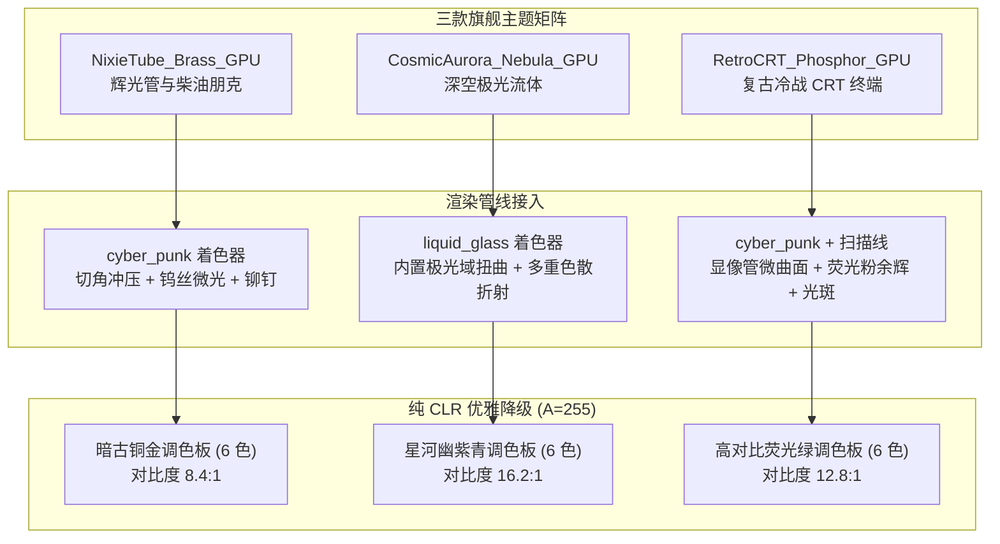

# 三款旗舰级 GPU 着色器主题制作落地计划 (Three Flagship GPU Themes Plan)

> 📌 **2026-10-28 状态注记**：三款旗舰主题（`NixieTube_Brass_GPU`、`CosmicAurora_Nebula_GPU`、`RetroCRT_Phosphor_GPU`）均已入库并通过外观门禁登记。

**日期**：2026-10-26  
**状态**：已细化执行中 (In Progress)  
**目标**：基于新完成的 DirectX 11 / Vortice 现代着色器渲染管线，制作并落地三款高度差异化、质感精良的内置 GPU 旗舰主题：
1. **辉光管与重工柴油朋克 (`NixieTube_Brass_GPU.json`)**
2. **深空极光与域扭曲流体 (`CosmicAurora_Nebula_GPU.json`)**
3. **复古冷战 CRT 终端 (`RetroCRT_Phosphor_GPU.json`)**

并确保它们在 Theme Studio、真实桌面渲染、多 DPI 缩放及 GDI+ Legacy 回退路径下均能稳定高效运行，配套完备的自动化单测保护与质量关卡。

---

## 一、艺术方向与技术规格矩阵 (Art Direction & Tech Specs Matrix)

### 1. 技术规格对比表

| 配置维度 | 主题 1：NixieTube_Brass_GPU | 主题 2：CosmicAurora_Nebula_GPU | 主题 3：RetroCRT_Phosphor_GPU |
| :--- | :--- | :--- | :--- |
| **文件名称** | `resources/themes/NixieTube_Brass_GPU.json` | `resources/themes/CosmicAurora_Nebula_GPU.json` | `resources/themes/RetroCRT_Phosphor_GPU.json` |
| **显示名称** | `Nixie Tube & Brass GPU` | `Cosmic Aurora Nebula GPU` | `Retro CRT Phosphor GPU` |
| **版本规范** | `version: 5`, `rendering.version: 1` | `version: 5`, `rendering.version: 1` | `version: 5`, `rendering.version: 1` |
| **渲染材质** | `cyber_punk` | `liquid_glass` | `cyber_punk` |
| **捕获需求** | `liveBackground: false` (静态冲压金属板) | `liveBackground: false` (激活内置流体着色器) | `liveBackground: false` (单色显像管) |
| **核心几何参数** | `primaryCut: 10`, `secondaryCut: 6`, `outlineWidth: 1` | `cornerRadius: 18`, `thickness: 1.2` | `primaryCut: 2`, `secondaryCut: 0`, `outlineWidth: 1` |
| **核心光学参数** | `glow: 26`, `ambientRatio: 0.10`, `panelOpacity: 0.985` | `refraction: 1.5`, `blurRadius: 12`, `clearCenterRatio: 0.10`, `surfaceOpacity: 0.07`, `highlight: 0.95`, `counterHighlight: 0.85`, `shadow: 0.38` | `glow: 24`, `ambientRatio: 0.04`, `panelOpacity: 0.97` |
| **动态周期** | `scannerPeriodMs: 3600`, `stateTransitionMs: 140` | `targetFps: 30`, `stateTransitionMs: 180` | `scannerPeriodMs: 2000`, `stateTransitionMs: 100` |
| **外观增强** | `scanline: 15`, `glow: 20`, `grid: 20`, `barStyle: 1` | `scanline: 0`, `glow: 0`, `grid: 0`, `barStyle: 1` | `scanline: 55`, `glow: 85`, `grid: 25`, `barStyle: 2` |
| **字体设定** | 标签: `Segoe UI Variable`, 数值: `Cascadia Mono` | 标签: `Segoe UI Variable`, 数值: `Cascadia Code` | 标签/数值: `Cascadia Mono` 等宽点阵感 |

---

## 二、色彩明细与回退调色板规范 (Color Palette & Fallback Specification)

所有回退调色板（`rendering.fallbackStyle`）的 6 个色值必须严格符合纯 CLR 不透明格式（`#RRGGBB`，`A == 255`），且通过 WCAG AA 级以上对比度检查。

### 1. 主题 1：NixieTube_Brass_GPU (辉光管与重工柴油朋克)
* **色彩基调**：冷战工业仪器、发热真空电子管、拉丝黄铜冲压底板与角落机械铆钉。
* **GPU 渲染调色板**：
  * 主背景：`#120E0B`（深炭黑金属底板）
  * 分组背景：`#1F1712`（暗褐铜合金隔板）
  * 边框色：`#8A6538`（古董黄铜拉丝）
  * 阴影光晕：`rgba(255,160,40,0.30)`（氖气余辉）
  * 标题色：`#FF5900`（高热氖光橙）
  * 正文前景色：`#FFA028`（温润辉光橙）
  * 次要文字色：`#B88652`（浅黄铜氧化色）
  * 状态指示（安全/预警/告警）：`#FFA028` / `#FF5900` / `#FF2200`（钨丝过载烧红）
  * 进度条底色与分段：`#18120D` / `#FFA028` / `#FF5900` / `#FF2200`
* **回退调色板 (`rendering.fallbackStyle`)**：
  * `background`: `"#120E0B"`
  * `panelBackground`: `"#1F1712"`
  * `border`: `"#8A6538"`
  * `text`: `"#FFA028"`（对比度 ~8.4:1，远超 4.5:1 基准）
  * `mutedText`: `"#B88652"`（对比度 ~5.5:1，远超 3.0:1 基准）
  * `accent`: `"#FF5900"`

### 2. 主题 2：CosmicAurora_Nebula_GPU (深空极光与域扭曲流体)
* **色彩基调**：深邃宇宙星原、流动的北极极光流体（Shader 级数学域扭曲 FBM 算法计算）、星云半透亚克力悬浮面板。
* **GPU 渲染调色板**：
  * 主背景：`#070A18`（深空星原墨黑）
  * 分组背景：`rgba(18,24,54,0.14)`（薄纱星云）
  * 边框色：`#5EE2FF`（星芒冰青晶体边缘）
  * 阴影光晕：`rgba(94,226,255,0.25)`（高维折射光晕）
  * 标题色：`#F3F6FD`（极光纯白）
  * 正文前景色：`#F3F6FD`（极光纯白）
  * 次要文字色：`#9CAFD8`（星尘淡紫）
  * 状态指示（安全/预警/告警）：`#00FFA3`（极光翠绿）/ `#FFAE57`（太阳风暴金）/ `#FF3388`（超新星紫红）
  * 进度条底色与分段：`#16203D` / `#00FFA3` / `#FFAE57` / `#FF3388`
* **回退调色板 (`rendering.fallbackStyle`)**：
  * `background`: `"#070A18"`
  * `panelBackground`: `"#121836"`
  * `border`: `"#5EE2FF"`
  * `text`: `"#F3F6FD"`（对比度 ~16.2:1）
  * `mutedText`: `"#9CAFD8"`（对比度 ~8.1:1）
  * `accent`: `"#00FFA3"`

### 3. 主题 3：RetroCRT_Phosphor_GPU (复古冷战 CRT 终端)
* **色彩基调**：80年代绿显单色 CRT 显像管、辐射 Pip-Boy / 绿荧光字符终端、高对比度与电子束扫描线。
* **GPU 渲染调色板**：
  * 主背景：`#040D05`（显像管关断黑底）
  * 分组背景：`#081A0B`（微通电磷光玻璃）
  * 边框色：`#1A5E24`（显像管偏转线圈绿）
  * 阴影光晕：`rgba(51,255,102,0.35)`（P1 荧光粉字符外晕光）
  * 标题色：`#33FF66`（经典 P1 荧光绿）
  * 正文前景色：`#33FF66`（经典 P1 荧光绿）
  * 次要文字色：`#1FA842`（余辉低亮度绿）
  * 状态指示（安全/预警/告警）：`#33FF66` / `#FFB800`（P3 琥珀光）/ `#FF3B30`（控制台警报红）
  * 进度条底色与分段：`#061408` / `#33FF66` / `#FFB800` / `#FF3B30`
* **回退调色板 (`rendering.fallbackStyle`)**：
  * `background`: `"#040D05"`
  * `panelBackground`: `"#081A0B"`
  * `border`: `"#1A5E24"`
  * `text`: `"#33FF66"`（对比度 ~12.8:1）
  * `mutedText`: `"#1FA842"`（对比度 ~5.5:1）
  * `accent`: `"#33FF66"`

---

## 三、落地执行任务清单 (Phased Execution)

### Batch T0: 基线与测试脚手架 (Test Harness & Verification Prep)
- [ ] **T0.1**：在 [`tests/LiteMonitor.Tests/`](file:///g:/TOOL/LiteMonitor-fork/tests/LiteMonitor.Tests) 建立主题专属规格测试类 [`FlagshipGpuThemeTests.cs`](file:///g:/TOOL/LiteMonitor-fork/tests/LiteMonitor.Tests/FlagshipGpuThemeTests.cs)。
- [ ] **T0.2**：编写硬性合同断言：
  - 断言 a) 文件存在性与反序列化（`version == 5`，`rendering.backend == "gpu"`，`rendering.material` 为合法枚举）。
  - 断言 b) `rendering.Validate()` 产生 0 错误，且非致命诊断数量为 0。
  - 断言 c) `fallbackStyle` 6 色必须完备且解析后 `A == 255`。
  - 断言 d) `LegacyFallbackStyleResolver.BuildDerivedTheme(theme)` 能够成功派生出纯 CLR Legacy 主题，且颜色与 `fallbackStyle` 强一致。
  - 断言 e) `ThemeExportService.ExportEffectImage` / `ThemeDocumentStore` / `ThemeDocumentSession` 能够正常读取和往返保存无信息丢失。
  - 断言 f) `Layout`、`Font`、`Color` 各字典和属性均符合 `ThemeConfig` 契约（行高、字号、边距等非负合法）。
  - 断言 g) 横向与竖向双画幅导出兼容性。

### Batch T1: 旗舰主题 JSON 制作与工程打包 (Theme Creation & Packaging)
- [ ] **T1.1**：创建 [`resources/themes/NixieTube_Brass_GPU.json`](file:///g:/TOOL/LiteMonitor-fork/resources/themes/NixieTube_Brass_GPU.json)。
- [ ] **T1.2**：创建 [`resources/themes/CosmicAurora_Nebula_GPU.json`](file:///g:/TOOL/LiteMonitor-fork/resources/themes/CosmicAurora_Nebula_GPU.json)。
- [ ] **T1.3**：创建 [`resources/themes/RetroCRT_Phosphor_GPU.json`](file:///g:/TOOL/LiteMonitor-fork/resources/themes/RetroCRT_Phosphor_GPU.json)。
- [ ] **T1.4**：检查并确保 [`LiteMonitor.csproj`](file:///g:/TOOL/LiteMonitor-fork/LiteMonitor.csproj) 的 `<Content Include="resources\themes\*.json">` 规则生效，编译后自动复制到输出目录。

### Batch T2: 渲染兼容性与 Theme Studio 贯通验证 (Rendering & Studio Integration)
- [ ] **T2.1**：验证在 [`ThemeDocumentSession`](file:///g:/TOOL/LiteMonitor-fork/src/ThemeEditor/ThemeDocumentSession.cs) 中成功载入这三款主题，可自由切换、热重载。
- [ ] **T2.2**：验证 `HorizontalLayout`（横向任务栏）与 `VerticalLayout`（竖向悬浮窗）双形态下的渲染适配。
- [ ] **T2.3**：验证 `ThemeExportService` 对三款主题的导出/导入往返保真度（Round-trip Fidelity）。

### Batch T3: 全量回归与验收测试 (Quality Gates & Regression)
- [ ] **T3.1**：运行全量测试套件（`FlagshipGpuThemeTests`、`ThemeFallbackStyleTests`、`ThemeStudioSmokeTests`、`ThemeStudioNextStageWorkflowTests` 等）。
- [ ] **T3.2**：验证既有内置主题（`CyberPunk_GPU`, `LiquidGlass_GPU` 等）不受任何影响，测试 100% 通过。
- [ ] **T3.3**：编写验证证据文档 [`docs/verification/theme-studio/flagship-gpu-themes-verification.md`](file:///g:/TOOL/LiteMonitor-fork/docs/verification/theme-studio/flagship-gpu-themes-verification.md)。

---

## 四、质量门禁 (Quality Gates)

| 关卡代号 | 验证内容 | 门禁通过标准 |
| :--- | :--- | :--- |
| **G-TH1** | **Schema 合法性** | 3 款新主题必须通过严格 Schema 校验，`Validate()` 无任何错误与非预期诊断（错误数 = 0，诊断数 = 0）。 |
| **G-TH2** | **Fallback 保障** | 3 款新主题在 SafeMode 或 GDI+ 模式下均能呈现风格一致、高可读性的 6 色调色板（A == 255，正文对比度 ≥ 4.5:1，次要文字 ≥ 3.0:1）。 |
| **G-TH3** | **零破坏性回归** | 现有所有 ThemeStudio 与 Rendering 单测及新增单测保持 100% 通过，无破坏性变更。 |
| **G-TH4** | **打包完整性** | 生成的 Debug/Release 二进制目录中，`resources/themes/` 均完整包含三款新增 JSON 且哈希一致。 |
