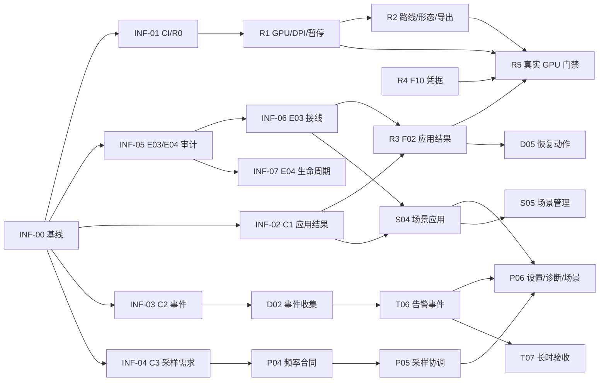

# 修复与四项产品能力执行计划

- 日期：2026-10-27。
- 状态：执行基线 v2.1（独立复审有条件通过；唯一 P1 已修）。G0 工程完成、待独立复核签字；R1/R2 自动化验证完成，实机 DPI/GPU/截图证据待 G1；本文件不表示所有验收已通过。
- 执行进度（2026-10-27）：G0 工程完成；R1（F11/F08/F07）自动化完成；R2（F04/F05/F06/F09）自动化完成；R3/F02 核心路径、同名摘要、Settings 写失败与 Partial 呈现完成，仍有模块级故障注入、GPU 首帧、恢复旧主题再失败 3 类未闭合；R4/F10 凭据分类、授权核心、设置页入口、回环重定向逐跳、IDN 与实例删除清理完成，真实代理/DNS 未闭合；R5/F03 自动化门禁完成（200 次真实切换 + R10 真实首帧/目标切换出帧门禁通过；N01–N03 复核问题修复后全量 2759 通过/8 跳过/0 失败，7m59s，见 `docs/verification/execution/R5/README.md`）。真实 DPI/会话/供电留 G1。**G1 未签字，Slice 1 不发布**，见 `docs/verification/execution/G1/README.md`。
- P1/P2 复核修复（2026-10-27）：`docs/reviews/2026-10-27-p1-p2-closure-review.md` 复核后，R01–R06/R09 等 13 个原编号可关闭；R07/R08/R10 以 C01/C02/C03 重新打开并修复（R07 源时间/设备身份中断计时，R08 同名主题按提交哈希判定并恢复原路径，R10 长压力测试改为子 testhost 进程隔离，超时 Kill 进程树）；另修复 C04（规则内容变化重置计时）、C05（诊断包 IPv6/路径脱敏）、C06（实际切页停诊断 Timer）、C07（首次 GPU 失败回退配色）。复核定向 23/23（C01/C02/C04/C05/C06）、C03 父/子进程 2/2；N01–N03 修复后全量 2759 通过/8 跳过/0 失败，7m59s（`r5-full-tests-recheck.log`），不再引用修复前 2751 基线。N01–N03：C03 子进程启用 GPU 并断言首帧/帧推进/设备不重建；子进程改为 `vstest` 当前输出程序集并用 sentinel 拒绝零匹配；脱敏仅识别 4 段 IPv4 或含冒号 IPv6，普通数字不再误删。见 `docs/verification/execution/R5/p1-p2-recheck-fixes.md`。关闭矩阵见 `docs/verification/execution/R5/p1-p2-closure.md`。R11/R12 仍开放。
- 诊断进度（2026-10-27）：D01/D02/D04 核心合同、Provider、事件收集与导出服务完成；D01 的渲染/Web/插件/IPC Provider 已由 MainForm 组合根接入（插件仅计数、IPC 明示未仪表化），D02 上次运行标记已落地；D03 四区域基础页、过滤与 Esc 已接入设置侧栏，D05 手动硬件重扫已接，21/21 定向测试通过；D03 的慢模块/1 Hz 资源/明暗验收、D05 重试失败应用/GPU 重试与 D06 真实故障矩阵未完成，见 `docs/verification/execution/D01-D04/README.md`。因此仍不满足 G2。
- 趋势进度（2026-10-27）：T01/T02 的 `ShortTermTrendBuffer` 核心已完成（批次去重/乱序拒绝/SessionEpoch 清空/32×3600 容量），并已由 `UIController.Tick` 消费 `GetLatestSnapshot` 写入（异常隔离、不触发采样）；趋势窗已接 1 小时缓冲，7/7 定向测试通过。T03 的 v2 按天 JSONL 存储、manifest 增量导入、损坏行跳过与容量淘汰已落地，并由 `HardwareHistoryLogger` 接管写入（旧 `HardwareHistory.json` 只读导入、不再双写）；4/4 定向测试通过，见 `docs/verification/execution/T01-T03/README.md`。T04 指标快捷入口、分辨率/覆盖率标题、主题/DPI 适配与图表 `ApplyPalette` 已落地；专项 5/5、趋势定向 9/9、构建 0/0，见 `docs/verification/execution/T04/README.md`。T05 告警状态机、回差/持续时间/采样缺口/多设备独立事件/冷却/静音/输入不可用与旧温度配置迁移已落地，10/10 定向测试通过，见 `docs/verification/execution/T05/README.md`；T06 已用 `CheckRuleAlerts` 替换旧温度通知路径，接入托盘通知、诊断事件、全局静音与旧设置重建，29/29 定向测试通过，见 `docs/verification/execution/T06/README.md`；T07 长时/资源验收尚未开始。
- 场景进度（2026-10-27）：S01 字段允许列表（类型/边界/模块归属、排除清单、null/空单位语义）、S02 `profiles.json` 版本化库（32 场景/2 MiB、原子写、备份回退、修订冲突、损坏隔离）、S03 预检/差异（主题/版本/监控项接缝、阻塞与警告分级、仅允许字段差异）与 S04 串行应用核心（固定修订、候选设置、保存失败不调模块、Partial 结果）已落地；Scenario 定向 19/19 通过，构建 0/0，见 `docs/verification/execution/S01-S04/README.md`。S04 的生产接线（Settings 请求 Id/修订、MainForm 启动、E03 模块应用器）、S05 管理与托盘、S06 故障/拓扑验收未完成，G4 未满足。
- 低功耗进度（2026-10-27）：P01/P02 纯策略 `PowerPolicy` 与 P03 的 `PowerDisplayScheduler` 已落地；GPU 宿主 `GpuPresentationHostController` 已加 `UpdatePowerContext`/可见性暂停恢复；策略/调度 + GPU 宿主回归 28/28、主项目构建 0/0，见 `docs/verification/execution/P01-P03/README.md`。GDI/WinForms 非 GPU 路径、真实 AC/DC/锁屏事件源、任务栏独立策略、P04–P07 与实机功耗/性能验收未完成，G4 未满足。
- v2 修订：INF 编号、G2/G3 解耦、关键路径、Settings/UI owner、LanguageManager 英文回退、`[JsonExtensionData]`、T03 增量导入、证据路径、性能阈值；v2.1 移除 D01/T01 对 R1 的多余依赖。
- 依据：[总索引](2026-10-27-repair-and-product-roadmap.md)、[P1/P2 修复计划](2026-10-27-p1-p2-remediation-plan.md)、[诊断中心](2026-10-27-diagnostics-center-implementation-plan.md)、[趋势与告警](2026-10-27-trends-alerts-implementation-plan.md)、[场景配置](2026-10-27-scenario-profiles-implementation-plan.md)、[低功耗模式](2026-10-27-low-power-mode-implementation-plan.md)、[独立审查](../reviews/2026-10-27-all-recent-changes-review.md)。
- 代码基线：`4de25d38add7f8b2342303805fdf0b654c57fa55`，加当前工作区差异。
- 测试基线：三程序集 2725 项 / 2718 通过 / 7 环境跳过 / 0 失败；Release 构建 exit 0、44 warnings。
- 默认资源假设：2 名开发（A/B）+ 1 名兼岗集成/验收；单人变体见 §14。
- 估算口径：人日，含实现、单元测试和自验；不含评审等待、实机排队、返工和发布运营。区间按 P50–P80，不作为对外工期承诺。

## 0. 一页结论

**执行方式：三个可发布切片，而不是一次交付全部功能。**

| 切片 | 内容 | 出口 | 说明 |
|---|---|---|---|
| **Slice 1：修复** | R0–R5，F01–F11 | G1 | 可单独作为修复版发布；新功能开关全部关闭 |
| **Slice 2：诊断 + 趋势告警** | D01–D06、T01–T07 | G3 | 诊断先只读，趋势/告警后接；告警 v2 先影子运行 |
| **Slice 3：场景 + 低功耗** | S01–S06、P01–P07 | G5 | P-A 可先发；P-B 通过性能门禁后再默认开放 |

**关键路径：**

```text
INF-00 基线 → INF-01 CI → C1/C2/C3 合同冻结
  ├─ R1 → R2/R3 → R5 → G1（Slice 1 发布）
  ├─ D01–D04 + T01–T03 → G2 → D05–D06 + T04–T07 → G3（Slice 2 发布）
  └─ S01–S02 + P01–P02 → S03–S04 + P03 → S05–S06 + P04–P06 → G4 → P07 → G5（Slice 3 发布）
```

**最大风险：** E03/E04 剩余工作量、真实 GPU/DPI/电源机器不足、共享文件并行冲突。三者都在 G0/G1 设了检查点，不能靠“文档说已承接”绕过。

**开工前五个动作：**

1. INF-00 冻结基线、工作区差异和证据目录，并修 N08/N09 表述与 5 处失效链接。
2. INF-01 修 CI 续行，先让门禁真实变绿。
3. INF-02/INF-03/INF-04 冻结应用结果、诊断事件、采样需求三个合同。
4. INF-05 完成 E03/E04 缺口审计，指定 owner 和切片。
5. R1 开始 F11 代次修复，不等所有文档完美。

## 1. 目标、范围与不做

### 1.1 本轮目标

1. 逐条关闭审查确认的 4 项 P1、7 项 P2，并保留真实 GPU/DPI/资源证据。
2. 交付诊断中心：运行状态、事件时间线、本地脱敏诊断包。
3. 增强趋势与告警：短时明细、数据缺口、设备身份、可解释告警状态机。
4. 交付手动场景配置：差异预览、串行应用、部分失败和恢复。
5. 交付低功耗模式：显示/动画调度先独立发布，再协调多消费者采样频率。

### 1.2 明确不做

- 不做自动游戏/RDP/电源场景识别；首版场景只做手动切换。
- 不做场景包市场、联网下载、跨设备同步。
- 不做 GPU 点选拾取 Phase F、O02/O03 优化、Host 隔离 I3–I5。
- 不优化插件自身轮询，不越过插件声明的最小周期。
- 不把磁盘可用空间、网络连通性等缺少可靠数据源的指标推断为故障。
- 不做诊断包自动上传、崩溃转储、原始日志打包。
- 不宣称瓦数、续航百分比或未测量的省电收益。
- 不用整份 `settings.json` 替换、放宽代次检查、吞异常、强制重建 GPU 设备、关闭凭据校验来“消除失败”。

### 1.3 完成的含义

每项交付必须同时有：实现、回归、用户入口、资源所有权、剩余限制。构建通过、测试条数达到历史数字、界面截图正确，均不能单独证明完成。

### 1.4 对原计划的执行修订

本执行计划不改变五份计划的目标，但把评审发现的缺口落成可执行决策：

| 修订 | 原计划 | 执行计划 |
|---|---|---|
| E03/E04 显式化 | 多处写“承接” | INF-05 审计 + INF-06/INF-07 独立工作包，G1 前完成 |
| 应用结果统一 | R3/S04/D01 各自定义 | C1 外层 `ApplyOperationResult`，Core/E03 为 owner |
| 历史 v2 存储 | 建议单文件 `HardwareHistory.v2.json`，64 MiB | 默认按天分段 JSONL + manifest；单文件方案需 D0-3 特批并 +2 人日 |
| 诊断崩溃边界 | 进程内事件，未说明崩溃 | D02 只做“上次运行是否正常退出”标记；首版不承诺崩溃转储 |
| F09（任务栏导出）形态 | 演进 orientation 参数 | 独立 `PreviewFormFactor`（Vertical/Horizontal/Taskbar），投稿默认 orientation 不变 |
| 功能开关/迁移 | 未统一要求 | C5 四开关默认关闭；迁移前备份；旧告警路径保留到 T06 |
| 1 小时明细重启 | 仅本进程，未说明 UX | T04 明确“自启动以来”，或用分钟聚合回填；不伪造秒级数据 |

## 2. 执行原则

1. **合同先行。** 先冻结 `ApplyOperationResult`、诊断事件、采样需求三个合同，再让 R3/S04/D01/T04/P04 并行开发。
2. **单 writer。** 共享文件同一时间只有一个写者；其他线通过接口、新文件或适配器接入。
3. **真实证据。** GPU、DPI、电源、Host 重连必须有实机证据；缺测项写“未验证”，不写“通过”。
4. **功能开关。** 新功能默认关闭；诊断只读可先开 beta；告警 v2 先影子运行，确认无重复通知后再撤旧路径。
5. **小步发布。** 按 Slice 1/2/3 出门，不把四个功能捆成一个发布。
6. **本地化同步。** 新增用户文案必须进 `resources/lang`；zh/en 必填，其余 7 个语言回退英文并登记。
7. **变更控制。** 任何新增范围都要说明对估算、关键路径和门禁的影响；不接受“顺手做一下”。

## 3. 基线、前置条件与 D0 决策

### 3.1 基线核对

| 项 | 当前状态 | 开工动作 |
|---|---|---|
| 代码 | HEAD `4de25d3`，工作区有 docs 删除、6 份计划、审查/证据、未跟踪 `resources/plugins/vps_traffic.json` | INF-00 记录 HEAD、diff、产物摘要；计划文档单独提交，不混入代码 |
| 测试 | 2725 / 2718 / 7 / 0；Release 44 warnings | 记录 TRX 摘要和跳过原因；新增测试更新门禁清单 |
| CI | `ci.yml:432-435` 的 434 行缺续行反引号，435 行成为独立命令 | INF-01 改参数数组；真实 Release 门禁验证 |
| E03/E04 | 工程计划 W2 已完成，W3（E03/E04）仍是下一步 | INF-05 审计；INF-06/INF-07 补齐；R3/S04/D01/P 不得假设已完成 |
| 硬件 | 真实 GPU/DPI/供电场景部分缺测 | D0-6 指定机器；R5/P07 使用独占时段 |
| 文档 | 9 处 docs 删除、5 处失效引用 | INF-00 只修失效引用，不恢复用户有意删除的文件 |

### 3.2 D0 决策（G0 前必须拍板）

| ID | 决策 | 推荐默认 | 不决定的后果 |
|---|---|---|---|
| D0-1 | 团队与 owner | 2 名开发 A/B + 兼岗集成 | 无法做容量承诺 |
| D0-2 | Slice 1 是否单独发布 | 是，修复版先出 | 新功能会拖住修复 |
| D0-3 | 历史 v2 存储格式 | 按天分段 JSONL + manifest，见 T03 | 64 MiB 单文件 JSON 的峰值和损坏风险 |
| D0-4 | 诊断崩溃边界 | 首版只做“上次运行是否正常退出”标记，不做崩溃转储 | 用户误以为能诊断崩溃 |
| D0-5 | 功能开关默认值 | 全部关闭；诊断只读 beta 可开 | 新功能误影响旧用户 |
| D0-6 | R5 GPU 机器 | 预留一台真实 GPU 机器；无 GPU 不签收 F03 | F03 永远“未验证”，Release A 不能声称修复 |
| D0-7 | `vps_traffic.json` 归属 | 若是产品模板，脱敏后入库并做测试夹具；若是用户本地文件，不提交 | F10 回归依赖未跟踪文件 |
| D0-8 | 范围冻结 | 本轮只做五份计划内事项 | 范围蔓延，关键路径失控 |
| D0-9 | 英文底表回退 | `LanguageManager` 常驻 `en.json` 底表；当前语言缺 key 先回退英文 | 非中英文用户看到 raw key |
| D0-10 | Settings 分部类命名 | `Settings.Alerts.cs`、`Settings.Power.cs`；A 复核合并 | B 的字段改动与 A 的单 writer 冲突 |

## 4. 组织、职责与文件所有权

### 4.1 角色

| 角色 | 职责 |
|---|---|
| A（渲染/主题/场景/UI） | R1–R2、S、P03、主题/渲染/设置 UI；共享 UI 文件唯一 writer |
| B（诊断/趋势/采样/低功耗） | R3、R4、D、T、P01–P02、P04–P07、INF-07、本地化 key |
| 集成/验收（兼岗） | INF-00、INF-10、门禁证据、合并顺序、独立复验、发布检查 |
| 产品/范围 owner | D0 决策、切片放行、剩余限制签收 |

> 两人团队不按“计划”分，而按“文件所有权 + 合同”分。D03/T04/S05 这类 UI 任务由 A 出界面、B 出服务，集成时一人合并。

### 4.2 文件所有权

| 范围 | 文件/目录 | Owner | 规则 |
|---|---|---|---|
| 主题/渲染 | `src/ThemeEditor/GpuThemePreviewControl.cs`、`ThemePreviewControl.cs`、`ThemeStudioForm.cs`、`ThemeExportService.cs`、`src/Rendering/Presentation/GpuSceneRenderer.cs`、`src/Rendering/Gpu/Effects/FrameScheduling.cs` | A | R1–R3、P03 串行修改；其他线只读 |
| 应用编排 | `src/Core/Actions/AppActions.cs`、`Services/ModuleServices.cs`、`SettingsChanger.cs`、`SettingsProjection.cs`、`SettingsHelper.cs` | A/Core | C1 合同 owner（A）；R3 实现 B/Core、A 评审；S04/D01 只消费 |
| 诊断 | 新建 `src/Diagnostics/*`（名称开工核对）；只读 `RenderingRouteStatusBuilder.cs` | B | 不复制 GPU 判断；不引用窗体 |
| 趋势 | `src/Core/HardwareHistoryLogger.cs`、`src/UI/HardwareTrendForm.cs`、新建 `src/Trends/*` | B | T01–T07；不改 `UIController` 告警逻辑前先抽取 |
| 采样/IPC | `src/System/HardwareServices/HardwareSamplingCoordinator.cs`、`DemandRegistry.cs`、`src/Contracts/SamplingModels.cs`、`IpcMessages.cs` | B | C3 合同；P04–P05 串行 |
| UI 壳 | `src/UI/UIController.cs` | A | 唯一 writer；T/P 通过服务/接口接入，禁止两条线同时改 |
| 设置 | `src/Core/Settings.cs` | A | INF-08 迁移/开关；`[JsonExtensionData]` 保留未知字段；唯一 writer |
| 设置分部类 | `src/Core/Settings.Alerts.cs`、`Settings.Power.cs` | B | 只放告警/省电字段；A 复核合并；不改 `Settings.cs` 本体 |
| 语言 | `resources/lang/*.json` | B | 各功能提交 key；B 统一合并；zh/en 必填 |

### 4.3 分支与合并

- `main` 保持可发布；所有改动走短分支 + PR，禁止直接 push。
- 分支命名：`contract/<id>`、`feat/<task-id>-<slug>`、`fix/<bug-id>-<slug>`、`release/<version>`。
- 合同分支先合；再合 Core/Service；最后合 UI 与语言。共享文件按 §4.2 单 writer 串行合并。
- 分支寿命不超过 3 个工作日；每日 rebase；合并用 squash；PR 必须带测试、截图/证据、回滚说明。
- 多 agent 并行时按目录/文件所有权切，不按计划文档切；每个 agent 交 patch + tests + evidence，不直接改共享文件。

## 5. 合同冻结（C1–C5）

> 名称在开工时与现有类型核对；能扩展原合同就不创建同义接口。合同冻结后，变更需走变更控制。

### C1：统一应用结果 `ApplyOperationResult`

- Owner：Core/E03；消费者：R3、S04、D01。
- 外层字段：`OperationId`、`RequestRevision`、`EffectiveRevision`、`OverallStatus`、`Modules[]`、`FailureCode`。
- `ModuleApplyResult` 扩展：`Module`、`Applied`、`SavedState`、`EffectiveState`、`FailureReason`、`ModuleRevision`、`Retryable`。
- 现有 `ThemeApplyResult` 保留为主题细节，不另建第三套；场景/诊断只读外层。
- 状态至少区分：`Applied`、`Partial`、`Pending`、`Failed`、`Cancelled`、`Unknown`。
- 通过条件：R3/S04/D01 的单元测试都使用同一外层；不再出现“界面重建完成 = 应用成功”。

### C2：诊断事件合同 `DiagnosticEvent`

- Owner：诊断线；消费者：D、T、S、P。
- 字段：单调 `EventId`、UTC 显示时间、模块、严重程度、稳定 `ReasonCode`、`OperationId?`、会话身份、允许列表内的结构化上下文。
- 容量：1024 条；序列化上下文“约 2 MiB”（按实际开销计算，不写死 1024×2 KiB）；单条 ≤2 KiB；淘汰最旧并记录丢弃数；相同故障限频合并。
- 不记录每帧、每个传感器值、每次正常轮询；不包含口令、令牌、Cookie、授权头、DPAPI 密文、原始路径/IP。
- Host 事件来源先定义为“主进程 Host 监督器 + `GetHealth` 状态变化”，不要求 Host 进程内推送；若后续要 Host 内部事件，另开 IPC 操作。
- 通过条件：事件顺序、容量、合并、关闭、脱敏测试；诊断窗口关闭不清空应用事件。

### C3：采样需求 `ConsumerSamplingDemand`

- Owner：采样线；消费者：T、P、D（只读）。
- 新增正式合同：`ConsumerSamplingDemand(string ConsumerId, bool Active, int MaxIntervalMs, bool Degradable, string Reason, SamplingChannels Channels)`；`SamplingChannels` 为 Ui/Taskbar/Web/History/SensorWindow 位标志，`DemandRegistry` 内部按 consumerId 存该模型并保留通道位。
- 兼容层：现有五布尔 `SamplingDemand` 仅用于旧 IPC/旧调用；新代码不再扩展布尔字段。旧 `submit-demand-v2` 仍可接受五布尔，映射为 `ConsumerId` + `MaxIntervalMs=0`（表示沿用原周期）、`Degradable=false`。
- 聚合：取所有 Active 消费者的最短 `MaxIntervalMs`，`0` 视为未声明；结果受 1000ms 物理下限约束；`Degradable=false` 的消费者不得被省电策略降频。
- 本地与 IPC 两端同语义；旧对端不支持新字段时保持原安全周期，并显示“仅显示节能已应用”。
- 通过条件：旧/新对端往返、重连重放、告警硬需求优先、无消费者不采集、per-consumer 语义测试。

### C4：本地化 key 合同

- 文件：`resources/lang/<culture>.json`；命名 `feature.section.control`。
- zh/en 必填；de/es/fr/ja/ko/ru/zh-tw 允许回退英文，但必须登记。
- 运行时回退：`LanguageManager` 常驻 `en.json` 底表；当前语言缺失时先查英文，再返回 key；INF-09 一并改造。
- CI 检查：新增 key 缺失、空值、重复 key 失败；禁止硬编码用户可见中文/英文。
- 通过条件：每个功能的设置、诊断、告警、场景文案都有 key；缺 key 时 de/ja 实测回退英文；截图至少在 zh/en 各一张。

### C5：功能开关、迁移与回滚

- 开关：`DiagnosticsCenter`、`TrendsAlertsV2`、`ScenarioProfiles`、`LowPowerMode`；默认关闭，诊断只读 beta 可开。
- 迁移前备份：`settings.json`、旧历史文件、`profiles.json` 各自带时间戳备份；迁移记录版本化、幂等。
- 设置兼容：`Settings` 增加 `[JsonExtensionData]` 未知字段字典；旧版读取新字段后保存不得删除；新增字段必须有默认值。
- 回滚：关开关优先；旧告警路径保留到 T06 验收后；历史 v2 损坏回退 v1 只读；场景无效保留当前配置。
- 通过条件：备份/恢复演练、开关切换、旧版保存后未知字段仍在、无重复迁移。

## 6. 阶段、里程碑与日历

### 6.1 门禁

| Gate | 时点 | 必须通过 | 证据 |
|---|---|---|---|
| **G0** 开工 | W0 末 | INF-00/INF-01 完成；C1–C3 合同冻结；INF-05 审计；D0 决策 | 基线报告、合同文档、CI 绿、审计矩阵 |
| **G1** 修复 | W5 末 | R1–R5；F01–F11 全部关闭；INF-06/INF-07 完成；全量回归；真实 GPU | `docs/verification/execution/G1/` |
| **G2** 只读诊断 | W9 末 | D01–D04、T01–T03；无额外采样；泄漏测试。S/P 可并行预研，但不纳入本门禁 | G2 证据包 + 诊断 beta 签收 |
| **G3** Slice 2 发布 | W13 末 | D05–D06、T04–T07；告警迁移；长时运行；旧告警路径撤除记录。S/P 不纳入本门禁 | G3 证据包 + Slice 2 发布检查单 |
| **G4** Slice 3 功能完整 | W15 末 | S01–S06、P01–P06；场景管理；P-B 核心；S/P 故障矩阵 | G4 证据包 + 性能报告 |
| **G5** 发布 | W17 末 | P07、L01–L04；全矩阵；文档；回滚演练 | 发布检查单 + 剩余限制签收 |

### 6.2 建议日历（2 人，以 Gate 为准）

> W0 从 2026-10-27 起算；W1 从下一个周一开始。若 G0 推迟，后续周次整体顺延，不以日期倒逼质量。

| 周次 | 重点 | 出口 |
|---|---|---|
| W0 | INF-00–INF-05、R0、合同冻结 | G0 |
| W1–W4 | R1–R4；INF-06–INF-08；D/T/S/P 只做接口/纯逻辑 | R1–R4 完成 |
| W5 | R5、全量回归、G1 | G1 / Slice 1 可发布 |
| W6–W9 | D01–D04、T01–T03；S01–S02/P01–P02 预研，不纳入 G2 | G2 |
| W10–W13 | D05–D06、T04–T07；S03–S04/P03 并行实现，不纳入 G3 | G3 / Slice 2 可发布 |
| W14–W15 | S05–S06、P04–P06；G4 | G4 / Slice 3 功能完整 |
| W16–W17 | P07、L01–L04、发布演练 | G5 / Slice 3 可发布 |

> 2 人 × 18 周 = 180 人日容量；估算 118–168 人日，余量约 7–34%。不建议再压到 15 周以内；压测排队和返工没有余量。

## 7. 工作分解

### 7.1 基础与合同（INF-00–INF-10，约 14–22 人日）

> 编号约定：`INF-xx` 为基础/合同工作包；`Fxx` 为既有缺陷编号（F01–F11）；`R/D/T/S/P` 为能力任务。

| ID | 工作包 | 交付 | 依赖 | 估算 | Owner | 完成判据 |
|---|---|---|---|---|---|---|
| INF-00 | 基线冻结 | 基线报告、证据目录、工作区差异清单、N08/N09 表述修订、5 处失效链接修复 | — | 0.5–1 | 集成 | HEAD/测试/构建/未跟踪文件均有记录；链接检查通过；N08/N09 含未实现表述不进入用户文档 |
| INF-01 | CI 修复（R0） | `ci.yml` 参数数组或正确续行 + 本地脚本 | — | 0.5–1 | A | 无独立 `-p:` 命令；真实退出码；Gate 2 绿 |
| INF-02 | C1 合同 | `ApplyOperationResult` + `ModuleApplyResult` 扩展 + 测试 | INF-05 | 2–3 | A/Core | R3/S04/D01 共用；无第三套模型 |
| INF-03 | C2 合同 | 事件模型、EventStore 骨架、脱敏允许列表 | — | 1–2 | B | 容量/合并/关闭/脱敏测试 |
| INF-04 | C3 合同 | `ConsumerSamplingDemand`、IPC DTO、版本判定 | — | 1–2 | B | 旧/新对端、重连、per-consumer 最短间隔测试 |
| INF-05 | E03/E04 审计 | 模块应用与生命周期缺口矩阵、owner、切片 | INF-00 | 1–2 | A | 每个模块有当前路径/目标/缺口/负责人 |
| INF-06 | E03 必需接线 | Appearance/Taskbar/Sampling/Visibility 的真实模块结果 | INF-02/INF-05 | 3–4 | A | 每模块返回 `ModuleApplyResult`；部分失败可重试 |
| INF-07 | E04 生命周期收口 | 应用级 owner、窗口订阅、关闭顺序 | INF-05 | 1.5–2.5 | B | 50 次开关无订阅/句柄增长；退出有序 |
| INF-08 | 开关与迁移 | 功能开关、`Settings` 分部类骨架、`[JsonExtensionData]`、备份/恢复 | C5 | 1–2 | A | 默认关闭；旧版保存不丢未知字段；备份/恢复演练通过 |
| INF-09 | 本地化模板 | key 模板、zh/en、`LanguageManager` 英文底表、CI 检查、回退规则 | — | 1–1.5 | B | 缺 key/空值/重复 key 失败；缺 key 实测回退英文 |
| INF-10 | 协作规则 | 分支/PR/证据/单 writer 检查单 | — | 0.5 | 集成 | 团队签字；PR 模板可用 |

### 7.2 修复（R1–R5，约 20–29 人日；R0 已计入 INF-01）

| ID | 工作包 | 交付 | 依赖 | 估算 | Owner | 完成判据 |
|---|---|---|---|---|---|---|
| R1 | F11/F08/F07 | GPU 代次、DPI、最小化/隐藏/恢复 | INF-01 | 5–7 | A | 30 次连续修改、同/变尺寸、96–192 DPI、50 次隐藏恢复 |
| R2 | F04/F05/F06/F09 | 同源回退、横向形态、任务栏设置快照、独立 formFactor 的任务栏导出 | R1 | 5–7 | A | 像素/截图验证；生产样式不变；投稿默认 orientation 不变 |
| R3 | F02 | 加载/保存/运行时/模块/首帧分阶段结果 | INF-02/INF-06 | 4–6 | B/Core（A 评审 C1） | 六类注入矩阵；部分成功可重试；不假称原子回滚 |
| R4 | F10 | `X-API-Token` 分类、动态主机授权、模板归属 | INF-01 | 2–3 | B | 未授权请求带凭据数 = 0；不访问真实 VPS |
| R5 | F03 + 全回归 | 真实 GPU 门禁、200 次切换、RunSta Join、证据更正 | R1–R4 | 4–6 | A+集成 | GPU 能力不满足直接失败；资源曲线/句柄/线程退出 |

### 7.3 诊断中心（D01–D06，约 15–21 人日）

| ID | 工作包 | 交付 | 依赖 | 估算 | Owner | 完成判据 |
|---|---|---|---|---|---|---|
| D01 | 模块事实适配 | 采集/渲染/配置/IPC/Web/插件 Provider | C1 | 2–3 | B | 每模块有来源/时间/原因码；缺失字段明确 |
| D02 | 有界事件收集器 | EventStore、限频合并、上次运行标记 | C2 | 2–3 | B | 1024 条滚动、约 2 MiB、丢弃计数、关闭语义 |
| D03 | 诊断窗口 | 四区域、过滤、详情、导航、明暗/键盘 | D01 | 3–4 | A | 1 Hz 刷新；慢模块后台补齐；无额外采样 |
| D04 | 导出服务 | 允许列表、同源预览、ZIP 清单/摘要、取消/原子完成 | D01/D02 | 3–4 | B | 预览与 ZIP 同模型；泄漏测试；10 MiB 截断 |
| D05 | 恢复动作接线 | 重试失败应用、硬件重扫、GPU 重试 | D03、R3 | 2–3 | B | 只复用受控命令；执行中/完成/失败可见 |
| D06 | 联调与基线 | 真实故障场景、资源测试、操作说明、证据 | D01–D05 | 3–4 | B+集成 | 故障矩阵逐项一致；50 次开关无增长 |

### 7.4 趋势与告警（T01–T07，约 23–31 人日）

| ID | 工作包 | 交付 | 依赖 | 估算 | Owner | 完成判据 |
|---|---|---|---|---|---|---|
| T01 | 快照消费/身份/质量 | 去重、乱序拒绝、StableDeviceId、质量/年龄适配、`ConsumerSamplingDemand.MaxIntervalMs` 预留 | C3 | 3–4 | B | 同批次 100 次不重复；换设备/目录/Host 重启独立 |
| T02 | 秒桶环形缓冲 | 32 指标 × 3600 桶、峰值/缺口/质量 | T01 | 3–4 | B | 115,200 上限、16 MiB 实测、32 指标压力 |
| T03 | 历史 v2 与迁移 | 分段 JSONL + manifest、`LastImportedTimestamp` 增量导入、旧 v1 只读导入、备份/截断 | T02 | 4–5 | B | 降级后再升级不丢 v1 新数据；损坏可截断；统计口径对照 |
| T04 | 趋势窗口增强 | 指标快捷入口、分辨率/覆盖率、游标、DPI/主题 | T02/T03 | 3–4 | A | 单指标入口正确；后台查询不覆盖新选择；重启后 1h 无明细时标注“自启动以来”或用分钟聚合回填 |
| T05 | 告警引擎与迁移 | 状态机、回差、假时钟、旧配置迁移 | T01/T02 | 4–5 | B | 临界抖动/长间隔/回拨/多设备独立冷却 |
| T06 | 通知/设置/事件接线 | 真实通知、静音、诊断事件、旧路径撤除 | T05、C2 | 3–4 | B | 新旧执行器从未同时通知；迁移幂等 |
| T07 | 长时与资源验收 | 24h 等效、实机长跑、多消费者、全回归 | T01–T06 | 3–5 | B+集成 | 加速时钟不替代真实长跑；资源稳态 |

### 7.5 场景配置（S01–S06，约 17–24 人日）

| ID | 工作包 | 交付 | 依赖 | 估算 | Owner | 完成判据 |
|---|---|---|---|---|---|---|
| S01 | 字段允许列表 | 类型/边界/模块映射；排除字段清单 | C1 | 2–3 | A | 未列字段不能被捕获或应用 |
| S02 | 版本化库 | `profiles.json`、原子写、修订冲突、备份 | S01 | 2–3 | A | 32 场景/2 MiB；损坏可恢复；不阻塞采样 |
| S03 | 预检/差异 | 主题/设备/屏幕解析、无副作用差异页 | S02 | 2–3 | A | 缺失资源明确；不自动绑第一块同名设备 |
| S04 | 串行应用与 E03 | 固定修订→预检→候选→持久化→模块→确认；启动顺序；单模块超时 | S03/INF-06 | 4–6 | A/Core | 部分成功/恢复/Pending/Unknown；设置草稿不被覆盖 |
| S05 | 管理与托盘 | 创建/复制/重命名/排序/删除/启动请求/自定义状态 | S04 | 4–5 | A | 键盘/明暗/DPI；已自定义只比较允许字段 |
| S06 | 故障与拓扑验收 | 多屏/设备离线/并发保存/磁盘失败/资源 | S05 | 3–4 | A+集成 | 不错误重绑定；可见性不变量；50 次开关无增长 |

**S04 启动顺序（固定）：** Settings 加载/迁移 → 读取请求 `ProfileId/Revision` → 无效/缺失则保留当前配置并记录 → 预检主题/设备/屏幕 → 构建候选设置 → 持久化请求 → 按 Appearance → Taskbar → Sampling → Visibility/Placement 应用 → 确认 `EffectiveProfileId/Revision` → 发 Pending/Partial/Applied 事件。单模块默认 10 秒超时、总预算 30 秒；超时记 Unknown，不阻塞 UI，不自动回滚已成功模块。

### 7.6 低功耗（P01–P07，约 20–28 人日）

| ID | 工作包 | 交付 | 依赖 | 估算 | Owner | 完成判据 |
|---|---|---|---|---|---|---|
| P01 | 能源/可见性上下文 | AC/DC/未知、锁屏/会话、每窗口状态 | INF-07 | 2–3 | B | 事件可注入、可释放；未知不误判低电量 |
| P02 | 纯策略解析 | 期望/有效预算、原因、去抖、紧急提升 | P01 | 2–3 | B | 假时钟覆盖；重复状态不重复下发 |
| P03 | 显示/GPU 调度接线 | 停帧、低帧、失效绘制、恢复；含 WinForms/GDI 路径 | P02、R1/R2 | 4–5 | A | 主窗最小化停帧、任务栏正常；恢复目标修订出帧 |
| P04 | 需求频率合同演进 | `ConsumerSamplingDemand`、本地/IPC `MaxIntervalMs`、旧对端边界、聚合 | C3、P02 | 3–4 | B | 最短间隔聚合；旧对端原周期；重连重放 |
| P05 | 单一采样协调 | 有效周期/确认修订、时效预算、重连 | P04 | 3–4 | B | 不补跑、不伪造、不忙循环；设备不重开 |
| P06 | 设置/诊断/场景协同 | 实际模式/受限原因可见；不反写偏好 | P05、S04、T06 | 2–3 | B | 场景/主题/`RefreshMs` 不被临时预算改写 |
| P07 | 性能/兼容验收 | 2 分钟预热 + 10 分钟 ×3 轮；固定配置 | P01–P06 | 4–6 | B+集成 | 帧/采样/资源/GPU 指标达标；如实报告未降频 |

### 7.7 发布与文档（L01–L04，约 9–13 人日）

| ID | 工作包 | 交付 | 依赖 | 估算 | Owner | 完成判据 |
|---|---|---|---|---|---|---|
| L01 | 全量回归与证据 | 三程序集、市场/GPU/DPI/电源矩阵、TRX/截图/CSV | G4 | 3–4 | 集成 | 跳过项逐条列因；缺测写未验证 |
| L02 | 文档/CHANGELOG/迁移说明 | 用户帮助、README、版本说明、限制清单 | 各功能 | 2–3 | B | 用户能查到入口/限制/回滚 |
| L03 | 本地化收口 | 9 语言 key、zh/en 截图、回退清单 | 各功能 | 2–3 | B | CI 无缺 key；无硬编码 |
| L04 | RC/回滚演练 | 发布候选、开关关闭、备份恢复、降级 | L01–L03 | 2–3 | 集成 | 回滚演练通过；无 P0/P1 未关 |

**合计：118–168 人日（P50 约 143）；R0 已计入 INF-01，不重复计算。**

## 8. 并行波次与集成顺序

### 8.1 波次

| 波次 | 可并行 | 硬前置 | 说明 |
|---|---|---|---|
| **W0** | INF-00、INF-01、INF-02、INF-03、INF-04、INF-05、INF-09、INF-10 | 无 | 合同/基线优先；R0 单独先绿 |
| **W1** | R1、R4、D01–D02、T01–T02、S01–S02、P01–P02 | G0 | 后四项只做接口/纯逻辑/存储，不碰共享 UI |
| **W2** | R2、R3、INF-06–INF-08、D03–D04、T03–T04、S03–S04、P03 | R1；C1；D01；T02；S02；P02 | R2/R3 与 S04 共享编排，串行合并 |
| **W3** | R5、D05–D06、T05–T07、S05–S06、P04–P07 | R1–R4；D03；T04；S04；P03 | 真实硬件/长跑独占机器，不能与 LHM 全量并发 |

> “可并行”是逻辑并行，不是无限加人。2 人团队每波最多 2–3 条活跃写线；其余只做只读调研、测试准备、翻译和文档。

### 8.2 集成顺序

1. 合同（C1–C5）→ 2. Core/Service（INF-06/INF-07、R3、S04）→ 3. 功能服务（D/T/P）→ 4. UI（D03/T04/S05/P03/P06）→ 5. 语言/文档。
2. 共享文件按 §4.2 单 writer 合并；同一文件的两个 PR 不并行排队，先合前者、后者 rebase。
3. 每个 Gate 前 2 天冻结共享文件，只修阻塞缺陷；Gate 后重新开放。

## 9. 测试、验收与证据

### 9.1 测试层

| 层 | 内容 | 执行方式 |
|---|---|---|
| 单元 | 纯策略、告警状态机、允许列表、脱敏、解析、迁移 | `dotnet test`；可并行 |
| 集成 | 设置持久化、模块结果、IPC 往返、事件存储、临时文件损坏 | 每套件串行；临时目录隔离 |
| UI | 入口、键盘、明暗、DPI、截图、取消/关闭 | WinForms；96/120/144/168/192 DPI；真实 175% 另列 |
| 硬件 | 真实 GPU、200 次切换、AC/DC、锁屏、多屏、Host 重连 | 独占机器；LHM/硬件全量套件不与其他 lane 同机并发 |
| 性能 | 2 分钟预热 + 10 分钟 ×3 轮，常规/节能对照 | 固定主题/监控项/窗口/驱动/供电/配置摘要 |
| 隐私 | 虚构秘密、路径、IP、异常、插件输出；检查预览与解压后每个文件 | 脚本 + 人工复核 |

### 9.2 必测矩阵

| 领域 | 必测场景 |
|---|---|
| R | 30 次连续热更新、主效果↔兼容、非法参数恢复、96–192 DPI、真实 175%、最小化停帧/恢复、任务栏导出 |
| D | 硬件初始化中、缺失/过期样本、GPU 首帧失败、Host 重连、Web 端口占用、插件失败、配置部分成功、ZIP 泄漏 |
| T | 同批次 100 次、乱序/断连、设备换序/拔插、有效零值、同秒尖峰、假时钟、旧告警迁移、历史损坏、24h 等效 |
| S | A→B→A、部分失败/重试/恢复、设置草稿、并发点击、外部改库、设备离线、混合 DPI、退出中应用 |
| P | 主窗最小化+任务栏可见、全隐藏+告警、授权 Web、无消费者、AC/DC/未知、Host 旧版/重连、GPU 故障/DPI 恢复 |
| 跨功能 | GPU 失败诊断解释、隐藏主窗告警/Web、场景切换历史身份、省电不补数据、部分失败不显示整体成功 |

### 9.3 反“假绿”规则

- 不得放宽 `RenderGenerations`、吞异常、强制重建设备、关闭凭据校验。
- 不得用 Fake Gateway 返回值证明端到端闭环；必须走真实事件/呈现结果。
- 不得用固定休眠后读配置字段代替“目标修订成功出帧”。
- 不得把跳过项计入通过；不得用静态字符串断言代替像素/布局/截图。
- 不得用加速时钟代替真实 24 小时资源证据；不得用模拟 AC/DC 代替真实电源签收。
- 不得在未测量时宣称省电百分比或续航提升。

### 9.4 证据目录

每个 Gate 建 `docs/verification/execution/Gx/`，至少包含：

- `README.md`：范围、环境、结论、剩余限制、签收人。
- TRX/测试摘要：总数/通过/跳过/失败，跳过逐条列因。
- 截图/像素证据：DPI、明暗、横向/任务栏、诊断页面。
- 性能 CSV：原始数据、中位数/离散度、配置摘要。
- 资源曲线：句柄/GDI/USER/私有字节/设备开关计数。
- 失败注入记录：注入点、预期、实际、复现步骤。

## 10. 性能与低功耗验收

### 10.1 测量协议

- 同机、同主题、同监控项、同窗口尺寸、同供电、同驱动、同配置摘要。
- 预热 2 分钟，测量 10 分钟；常规/节能各至少 3 轮；报告中位数与离散度。
- 采集：CPU 时间、定时唤醒、真实呈现帧、GPU 占用/引擎、捕获帧、采样次数/耗时、样本年龄、私有字节、句柄、设备 Open/Close。
- Host 模式按主/子进程合计；CPU/GPU 下降不直接换算瓦数或续航。

### 10.2 放行阈值

| 指标 | 要求 |
|---|---|
| 不可见窗口呈现帧 | 静置确认后 ≤500ms 内降为 0；仅保留必要的低频维护唤醒 |
| 无采样消费者 | 普通硬件采集次数为 0；维护/退出仍能完成 |
| 模式切换 | 设备 Open/Close = 0；不触发 FullRescan |
| 告警/Web 时效 | 样本年龄不超过规则/会话最大间隔；不插值伪造 |
| 装饰帧上限 | 实测不超过目标 +10%；可见窗口不低于用户目标下限 |
| CPU/GPU 收益 | G3 前预注册最小效应量；建议 CPU 时间中位数下降 ≥10% 且 3 轮同向，否则只宣称功能正确，不宣称省电 |
| 资源稳态 | 50 次开关/长跑后句柄、GDI、USER、私有字节无持续增长 |

## 11. 发布、迁移与回滚

### 11.1 发布切片

| 切片 | 内容 | 发布条件 | 默认开关 |
|---|---|---|---|
| **Slice 1** | R0–R5 | G1，含真实 GPU 签收 | 新功能全关 |
| **Slice 2** | D01–D06 + T01–T07 | G3，诊断只读先 beta；告警 v2 影子通过 | `DiagnosticsCenter=on(beta)`、`TrendsAlertsV2=off` 起步 |
| **Slice 3** | S01–S06 + P01–P07 | G4 功能完整，G5 发布；P-A 可先发，P-B 性能过门禁 | `ScenarioProfiles`、`LowPowerMode` 默认 off |

### 11.2 迁移

- `settings.json`：迁移前备份；`[JsonExtensionData]` 保留未知字段；告警迁移幂等；不静默开启已关闭告警。
- 历史：v1 只读导入并备份；v2 分段 JSONL + manifest；记录 `LastImportedTimestamp`，降级回 v1 期间的新数据在再升级时增量补导；损坏截断到最后有效行并提示；不阻塞采样/开窗。
- 场景：`profiles.json` 独立原子写；无效/高版本不应用；请求 ID 不存在时保留当前配置并报告未解析。
- 诊断：不迁移用户配置；只读允许列表投影；每次导出新随机设备化名。

### 11.3 回滚

1. 首选关功能开关；旧告警路径保留到 T06 验收后。
2. 历史 v2 异常 → 回退 v1 兼容模式（优先只读；若旧版继续写入，记录 `LastImportedTimestamp` 并在再升级时增量补导）；不删除 v2 文件，保留现场。
3. 场景异常 → 停用场景入口，保留当前设置；不自动恢复旧场景。
4. 设置迁移异常 → 用备份恢复；记录迁移失败原因。
5. 旧版通过 `[JsonExtensionData]` 保留未知字段；降级后不再次自动迁移；再升级按迁移记录增量处理。

## 12. 风险登记

| ID | 风险 | 概率/影响 | 缓解 | 触发/owner |
|---|---|---|---|---|
| X1 | E03/E04 比预估大 | 高/高 | INF-05 审计、INF-06/INF-07 独立切片；必要时缩减 S05/S06，不伪造应用成功 | INF-05 超 2 人日 / A |
| X2 | 无真实 GPU/DPI/电源机器 | 高/高 | D0-6 预留；R5/P07 独占；缺测写未验证，Release A 不签 GPU | W3 仍无机器 / 集成 |
| X3 | 共享文件冲突 | 高/中 | 合同先行、单 writer、短分支、Gate 前冻结 | 每周冲突 >2 / 集成 |
| X4 | 告警迁移重复通知 | 中/高 | 影子运行、对照测试、T06 后才撤旧路径 | 任一重复 / B |
| X5 | 历史 v2 损坏/IO 抖动 | 中/高 | 分段 JSONL、manifest、备份、截断、v1 回退 | 解析失败/写入超时 / B |
| X6 | 本地化漂移 | 中/中 | key CI、zh/en 门禁、`LanguageManager` 英文底表回退 | 缺 key / B |
| X7 | 性能噪声大 | 中/中 | 固定机器、3 轮、中位数/IQR、预注册阈值 | 方差 >20% / B |
| X8 | 范围蔓延 | 高/中 | D0-8 范围冻结、变更控制、切片发布 | 新需求 / 产品 owner |
| X9 | `vps_traffic.json` 归属不清 | 低/中 | INF-00 决策；产品模板脱敏入库或测试夹具 | G0 前 / A |
| X10 | 设置降级/未知字段 | 中/中 | 备份、`[JsonExtensionData]` 保留、迁移幂等 | schema 变更 / A |
| X11 | 实机测试排队 | 高/中 | W3 预订时段；LHM 套件串行；性能/GPU 分日 | W3 / 集成 |
| X12 | 诊断包泄漏 | 低/高 | 允许列表、同源预览、虚构秘密测试、不上传 | 任一泄漏 / B |
| X13 | W1–W4 A 负荷偏高 | 中/中 | R3/INF-07 已转 B；每周看板核对；必要时把 R2 的导出准备交 B | A 周负荷 >5 人日 / 集成 |

## 13. 文档与本地化

### 13.1 每个功能的文档包

- 用户入口与操作说明（托盘/设置/菜单）。
- 设置项说明、错误码/原因码、可采取动作。
- 迁移说明与回滚方式。
- 已知限制：未验证的 GPU/DPI/电源组合、首版不支持项。
- 截图：zh/en 各至少一张；关键状态（部分成功、Pending、Unknown、诊断导出）。

### 13.2 本地化

- zh/en 必须同步；de/es/fr/ja/ko/ru/zh-tw 可回退英文，但要有清单。
- 新 key 命名 `feature.section.control`；禁止拼接句子；单位/占位符保留。
- CI 检查缺 key、空值、重复 key；发布前生成“未翻译 key 清单”。

## 14. 团队规模变体

### 14.1 单人

- 同顺序，但写代码串行；可并行的只有只读调研、测试准备、翻译、文档。
- 建议 28–34 周；同时最多 2 个 worktree，且只有一个写共享文件。
- 若必须压缩：优先 R0–R5、D01–D04、T01–T06、S01–S05、P01–P03；把 D05–D06、T07 长跑、S06、P04–P07 放到下一周期。不要砍 R5 的真实 GPU 证据。

### 14.2 三人及以上

- 增加一名合同/集成 owner，专门维护 C1–C5、合并顺序和证据。
- D/T 可各拆两人；S/P 仍受共享文件限制，不建议超过 2 条写线。
- 真实硬件测试仍串行；不要用多人并行掩盖机器不足。

## 15. 节奏与完成定义

### 15.1 节奏

- 每日 15 分钟同步：昨天、今天、阻塞、共享文件锁。
- 每周 Gate 预检：演示、证据、风险、变更请求。
- 每两周切片演示：只演示真实入口，不用 Fake 数据。
- WIP 限制：每人同时 1 个主任务 + 1 个低冲突支线；共享文件任务不并行。

### 15.2 Definition of Ready

- 有 owner、验收判据、涉及文件、依赖、测试计划、回滚方式。
- 涉及合同/共享文件的，先有合同变更或 owner 同意。

### 15.3 Definition of Done

- 代码：Release 构建通过，无新增 warning；新增测试进门禁清单。
- 测试：单元/集成/UI/硬件按任务要求通过；跳过项列因。
- 证据：TRX/截图/CSV/资源曲线归档到对应 Gate。
- 文档：用户说明、迁移说明、CHANGELOG、限制清单。
- 本地化：zh/en key 完整；其他语言回退登记。
- 运维：功能开关、备份/回滚、监控/诊断事件可用。
- 评审：独立复验签字；无 P0/P1 未关。

## 16. 附录

### 16.1 任务依赖简图



### 16.2 开工检查单

- [ ] D0-1～D0-10 已拍板。
- [ ] INF-00 基线报告已归档。
- [ ] INF-01 CI Gate 2 真实绿。
- [ ] C1/C2/C3 合同文档已评审。
- [ ] `Settings.Alerts.cs` / `Settings.Power.cs` 分部类命名与合并规则已确认。
- [ ] `LanguageManager` 英文底表回退方案已确认。
- [ ] INF-05 缺口矩阵已签字。
- [ ] 文件所有权和分支规则已确认。
- [ ] GPU/DPI/电源测试机器已预订。
- [ ] `vps_traffic.json` 归属已决定。
- [ ] 语言 key 模板和 CI 检查已就绪。
- [ ] 第一个 Gate 的证据目录已建。

### 16.3 关键来源

- [总索引](2026-10-27-repair-and-product-roadmap.md)
- [P1/P2 修复计划](2026-10-27-p1-p2-remediation-plan.md)
- [诊断中心](2026-10-27-diagnostics-center-implementation-plan.md)
- [趋势与告警](2026-10-27-trends-alerts-implementation-plan.md)
- [场景配置](2026-10-27-scenario-profiles-implementation-plan.md)
- [低功耗模式](2026-10-27-low-power-mode-implementation-plan.md)
- [独立审查](../reviews/2026-10-27-all-recent-changes-review.md)
- [执行计划独立审核（v1）](../reviews/2026-10-27-execution-plan-independent-review.md)
- [执行计划独立复审（v2）](../reviews/2026-10-27-execution-plan-independent-review-v2.md)
- [测试基线](../verification/theme-studio/review-2026-10-27/test-summary.json)
- [工程完善计划](2026-10-26-post-review-engineering-improvement-plan.md)


