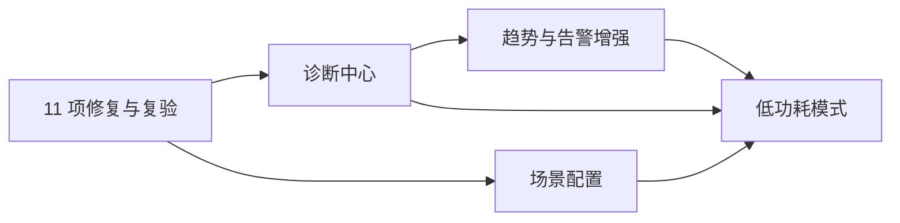

# 修复与四项产品能力实施总索引

- 日期：2026-10-27。
- 状态：计划草案，供评估；尚未开始实施。撰写计划不代表各项验收已通过。
- 代码观察基线：`4de25d38add7f8b2342303805fdf0b654c57fa55`，加当前工作区差异。
- 依据：[独立审查报告](../reviews/2026-10-27-all-recent-changes-review.md)。

## 1. 文档与交付顺序

本轮包含一份缺陷修复计划和四份独立功能实现计划。用户提到的“1、2、3、4”对应诊断中心、轻量趋势与告警、场景配置、低功耗模式。

| 顺序 | 计划 | 主要结果 | 交付前置 |
|---|---|---|---|
| R | [全部 P1/P2 修复](2026-10-27-p1-p2-remediation-plan.md) | 逐条关闭 F01–F11，补真实跨帧和资源验证 | 固定本轮代码及证据基线 |
| D | [诊断中心](2026-10-27-diagnostics-center-implementation-plan.md) | 可理解的运行状态、事件时间线、脱敏诊断包 | R 的状态结果合同稳定；展示可先开发 |
| T | [轻量趋势与告警增强](2026-10-27-trends-alerts-implementation-plan.md) | 短时明细、稳定设备序列、可信告警 | 真实快照与数据质量适配；接入 D 的事件出口 |
| S | [场景配置](2026-10-27-scenario-profiles-implementation-plan.md) | 可预览差异、可追踪结果的手动场景切换 | R 的实际应用结果；E03 的必要模块应用接线 |
| P | [低功耗模式](2026-10-27-low-power-mode-implementation-plan.md) | 显示、动画与采样分别调度，需求可解释 | R 的渲染生命周期；T 的告警时效合同；S 的配置归属 |

推荐产品交付顺序为 **R → D → T → S → P**。数据模型、纯规则与只读界面可以提前准备，用户功能启用仍须满足各计划门禁。共享文件的集成和真实硬件测试串行执行。本文件不自动启动代理、创建工作树或发布产品。

## 2. 已有基础与避免重复建设

| 当前已有 | 本轮的处理 |
|---|---|
| `HardwareSnapshot` / `MetricSample` / `HardwareHealth` | 继续用同一采集契约，不新增独立硬件轮询器 |
| 本地及管道客户端、需求登记、操作状态 | 先核对实际支持能力，两端保持语义一致；隔离 I2 原型不称为完整进程隔离 |
| `HardwareHistoryLogger` 和 `HardwareTrendForm` | 保留长期历史及入口，增强短时分辨率、身份和质量，不再另起一套趋势产品 |
| `CheckTemperatureAlert` | 迁移为可测试规则引擎，切换时撤除旧执行分支，避免双重通知 |
| `SettingsChanger` / `AppActions` 和模块服务 | 承接已有 E03，明确保存与各模块实际应用结果；不新建竞争分派器 |
| 帧调度器、GPU 宿主暂停能力、`DemandRegistry` | 先接入生命周期，再演进频率需求；保留现有单飞采样与探测策略 |

与[工程完善计划](2026-10-26-post-review-engineering-improvement-plan.md)共用 E01/E02 数据和命令合同，复用 E03/E04 的配置与生命周期工作。开工确认已完成阶段，发现缺口登记到原阶段；同一项基础工作只实现一次。

## 3. 四份计划共用的合同

1. **运行事实**：主题请求、已保存配置、实际运行配置和实际呈现帧分开记录。应用结果至少带操作标识、请求修订、各模块结果及可用原因。诊断中心只展示这些事实，不替生产模块推测成功。
2. **数据身份与时效**：趋势、告警与诊断读取同一快照。按 SessionEpoch、BatchId、StableDeviceId、指标种类识别数据；新目录版本不自动等于新物理设备。统一现有质量/年龄适配，缓存读取不会变成新鲜样本。
3. **需求所有权**：窗口、告警和有效 Web 连接各持有自己的需求。关闭一个消费者只释放自己的登记；诊断页面默认只读，不增加采样频率。
4. **配置单写入**：设置、场景切换共用主程序保存编排。省电产生的临时有效频率不反写用户 `RefreshMs`，主题文件里的 `targetFps` 不被电源策略改写。
5. **事件出口**：各模块向一个有界事件收集器发布结构化状态变化；告警、场景切换和电源策略事件接入同一出口。模块不持有诊断窗体，也不为此引入新 DI 框架。
6. **生命周期**：运行时服务由应用级所有者持有，窗口拥有自身订阅。功能关闭、Host 重连和应用退出都有明确释放顺序。

上文为拟议的共享合同，不能把文档中的名称当作已经实现的 API。新增类型先核查原有类型，能扩展原合同就不再创建同义接口。

## 4. 范围和发布边界

- 本轮维持 Windows / .NET 8 / WinForms，沿用设置主题引擎及 Windows 原生标题栏。
- 首版场景配置做手动切换；自动识别游戏、远程桌面或电源切换场景另行扩展。
- 诊断包保存在本地，由用户查看、导出；计划不包含自动上传或给第三方发消息。
- 趋势与告警首版聚焦硬件数值指标。磁盘可用空间、网络连通性等若缺少可靠数据源，应另列后续能力，不能通过“数值低/为零”推断故障。
- 主题工作室点选拾取 Phase F、O02/O03 优化和正式 Host 隔离 I3–I5 继续由原计划承担，不混入本轮功能工期。

## 5. 总体验收

每份计划交付“实现、回归、用户入口、资源所有权、剩余限制”五项记录。构建通过、测试条数达到历史数字、界面截图正确，均不能单独证明功能完成。

当前独立复验基线为三程序集 2725 项、2718 通过、7 项环境跳过、0 失败；它是历史基线而非未来固定条数。新增测试更新门禁清单，跳过项逐条列因，真实 GPU/DPI/供电场景缺测保持未验证。

优先验证跨功能场景：GPU 失败后诊断如实解释；隐藏主窗时告警与有效 Web 需求仍工作；切换场景不丢历史身份；省电不虚假补齐数据；保存或模块应用失败不会显示整个场景已生效。
