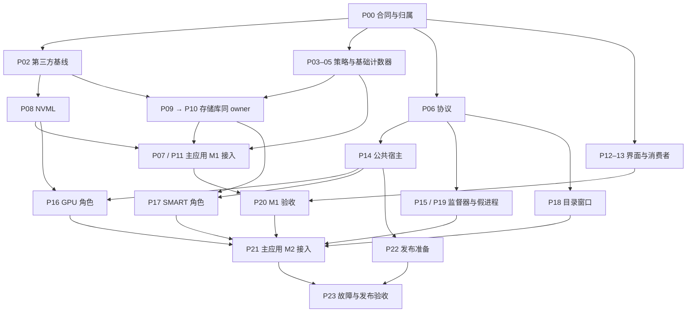

# 硬件稳定性：并行任务与 agent 派发计划

> 状态：待实施。本轮只调整计划；主计划的功能、实机验证、故障注入和发布要求继续有效。
>
> 日期：2026-10-20。基线、证据和范围见[实施计划](2026-10-20-hardware-stability-hardening.md)及[研究记录](../../HARDWARE-ROBUSTNESS-RESEARCH-2026-10-20.md)。

## 1. 并发安排

拆为 **24 个工作包**，按依赖就绪情况派发，不能把 24 个包一次性全部启动。主 agent 始终处理接口决策和共享入口集成；其他 agent 实现独立文件中的模块，并各自交付测试与证据。

**建议从总计 6 个活跃 agent 起步，任务就绪且工具允许时扩到 8 个，均包含主 agent。** 这是调度建议，不是当前工具已确认的并发额度。运行上限取工具限制、可用上下文/用量及真正就绪的独立任务数的最小值。完成任务的 agent 复用或关闭，后续包补位；评审也占一个名额，不另行无限扩容。

没有统一的“等 M1 完成再开始 M2 开发”。M1 修复期间，M2 的协议、监督器、假工作进程、目录界面和发布准备即可推进。M1 验收后才把真实工作进程切入主应用，随后做 M2 最终验收。

## 2. 先固定的接口与归属

主 agent 在 P00 中给出简短接口清单与一个合同版本；其他 agent 可提出修改建议，由主 agent 更新后同步给消费者。下列名称是设计占位，具体签名在实施时一次确定，不能各 agent 自行创造一套。

| 合同 | 必须先确定的内容 |
|---|---|
| 磁盘身份目录 | 稳定 ID、速度计数器映射、连接类型及其可信程度、未知状态；目录读取不得为识别目标而预先打开物理盘、读取 SMART 或触发容量探测 |
| `DiskProbePolicy` | 主计划的三种模式、USB 排除优先级、空允许列表及未知身份拒绝规则；返回允许/拒绝及原因，纯策略不引用 LHM |
| 存储库生命周期 | 策略如何在任何探测/静态监听启动前安装，Open/Stop/Dispose 的完成语义、在途回调、资源所有权和锁顺序；不能以访问静态属性先触发静态构造后再设置策略 |
| 库诊断接口 | 设备 ID、阶段、异常、退避状态；库输出结构化诊断，由应用接入日志，不直接引用应用内部类 |
| 读数与目录 | 数值、单位、Max 的含义与重置规则、有效性、时间、来源、设备身份、目录完整性及修订号；暂时离线不能触发 GPU 数量收缩或删除设置 |
| 进程协议 | 版本、角色、会话、进程代次、配置代次、请求序号、消息大小上限；每角色一个在途请求，旧回复丢弃 |
| 工作进程角色 | 公共宿主管启动/连接/退出；GPU 与 storage 角色只实现自己的 Open/Collect/Close，取消不代表可以中断阻塞的原生调用 |
| 监督器与时间 | 可注入单调时钟、进程控制接口、采集完成截止时间、GPU 有界重试、SMART 故障后停止自动重启；不另起采样时钟 |
| 构建与发布 | 固定项目路径、helper 名称、运行时与依赖位置、主项目 glob 排除规则；测试故障进程不进入发布包 |

P00 只冻结分工所需合同，不等待所有实现细节。P02 另行固定第三方源码与兼容 API；NVML 和存储库分支在此之后使用同一基线。重大 API 变更须通知消费者并重新确认，不能在某个分支中静默改变合同。

## 3. 工作包与依赖

表中“前置”表示开始正式实现/接线前必须已交付的最小产物；技术阅读、用例设计和独立草稿可以提前做。每包测试由实现者一并负责，P19 另做跨进程故障场景。

| ID | 工作包与交付物 | 前置 | 对应主计划 |
|---|---|---|---|
| P00 | 主 agent 固定实际 HEAD、文件归属、接口合同、项目边界；建立任务状态表 | 无 | Task 0 / 贯穿 |
| P01 | 基线与入口证据：独立输出、程序集哈希、已有测试状态、当前完整进程成本、冷启动/设置/Web 调用清单 | P00 | Task 0 |
| P02 | 第三方路线早期冻结：精确源码/包版本、TFM、API、补丁存在证据和构建入口；将项目接线需求交主 agent | P00 | Task 3 前半 |
| P03 | 纯磁盘策略和配置迁移组件及测试；交付配置字段/归一化/迁移接线说明 | P00 | Task 1 |
| P04 | 不触发 SMART 的系统磁盘身份目录、稳定 ID 与计数器实例映射；记录未知身份和副作用边界 | P00 | Task 2 / 4 |
| P05 | 系统计数器速度源，覆盖总计/指定盘/不可用；`UseWinPerCounters=false` 也不转入 SMART | P04 | Task 2 |
| P06 | DTO、目录、读数有效性和版本协议；序列化/未知版本/过期代次测试 | P00 | Task 8 |
| P07 | 主 agent 接入基础模式与配置迁移：所有首次 Open/Reload、缓存及回退路径遵守策略 | P03、P04、P05 | Task 1 / 2 |
| P08 | NVML 生命周期补丁核验或回移，GPU 身份/句柄/Close 同步测试和兼容证据 | P02 | Task 5 |
| P09 | 存储库前置过滤：首次发现、兜底枚举、构造、热插拔、重载统一执行策略 | P02、P03、P04 | Task 4 |
| P10 | 同一存储库 owner 接着完成空信息、监听异常、订阅者异常、句柄清理、停止语义与退避 | P09 | Task 6 库内 |
| P11 | 主 agent 接入真实库、按设备异常边界、日志与失效处理；完成配套依赖最终兼容性检查 | P07、P08、P09、P10 | Task 3 后半 / 4 / 6 |
| P12 | 磁盘模式/选择/生效状态界面与语言，使用非 SMART 目录；通过回调提交设置 | P03、P04 | Task 7 界面 |
| P13 | Web/历史的无效值适配与兼容测试；给主 agent 提供告警/任务栏接线用例 | P00 | Task 7 数据消费者 |
| P14 | Named Pipe 与公共工作进程宿主，消息边界、连接权限、角色分派、连接/退出测试 | P06 | Task 8 / 9 公共部分 |
| P15 | 纯监督器、快照存储、单请求合并、超时/重试/旧代次处理；假时钟与假进程测试 | P06 | Task 8 / 10 |
| P16 | GPU 工作进程角色，完整生命周期、Intel CPU 枚举条件、键/显存/目录映射 | P08、P14 | Task 9 GPU |
| P17 | SMART 工作进程角色，在任何库初始化前安装策略，基础模式不启动 | P09、P10、P14 | Task 9 SMART |
| P18 | 硬件详情窗口及树控件适配合并目录，离线/目录不完整的展示、数值/Max/复制行为与回归测试 | P06 | Task 9 目录界面 |
| P19 | 独立假工作进程及故障用例：挂起仍心跳、退出、延迟旧回复、错误协议、未处理线程异常、原生故障 | P06 | Task 11 准备 |
| P20 | 主 agent 完成 M1 集成、干净包与自动/可用实机验收；独立 agent 审查访问闭环并记录限制 | P01、P11、P12、P13 | Task 7 / M1 |
| P21 | 主 agent 接入两个角色与监督器，替换主进程 GPU/SMART 访问和原始目录入口；应用配置、退出及更新生命周期 | P14、P15、P16、P17、P18、P19、P20 | Task 9 / 10 集成 |
| P22 | 开发/发布脚本与包清单准备，缺失 helper 降级及更新释放验证方案；主 agent 接项目引用 | P02、P06、P14 | Task 10 发布 |
| P23 | M2 最终故障注入、发布烟测、退出清理、完整进程树成本和可用实机验证；独立复审与证据汇总 | P21、P22 | Task 11 / M2 |

P01 和 P02 都从实际基线出发，但 P02 不必等长时间测量或全部实机条件。P09 和 P10 由同一 agent 顺序修改；它们保留两个包，是为了分别核实“没有提前打开设备”和“失败后能清理并继续”，不是为增加人数。

P15 和 P19 在协议冻结后即使用假进程互测，不等待真实显卡/硬盘。P22 可提前交付脚本，只有 P23 能宣布最终包验证通过。P20、P21、P23 的多项工作由主 agent 组织，独立评审与可并行检查按名额另行派发。

### 依赖简图

这是主要合流关系的简图，完整依赖以表格为准。

## 4. 文件写入权

每个 worktree 只接受自己工作包的写集；文件分工高于主计划中较宽泛的“涉及文件”。跨范围需求提交给该文件 owner，不能各改一份再依赖最后自动合并。下列新增路径是建议布局，P00/P02 固定后全员使用同一布局。

| owner / 工作包 | 可直接修改 | 不直接修改的共享接线 |
|---|---|---|
| 主 agent：P00/P07/P11/P20/P21 | `HardwareMonitor`、`HardwareValueProvider`、`DiskManager`、`HardwareScanner`、`SensorMap`、`GpuRegistry`、`HardwareErrorLog`、`Settings`、`SettingsHelper`、`SettingsForm`、`AppActions`、`UIController`、`TaskbarForm`、主窗体生命周期；所有 csproj/sln/依赖锁定及主验收记录 | 接收各包已写好的模块和明确接线需求，按顺序集成 |
| 策略：P03 | 新增 `DiskProbePolicy`、配置迁移组件及独立测试 | `Settings.cs` / `SettingsHelper.cs` 的字段和调用由主 agent 接线 |
| 系统磁盘：P04/P05，同一 owner 可连续做 | 新增系统磁盘目录、计数器源及测试；`PerformanceCounterManager.cs` | 不同时修改 `DiskManager`、值提供器或扫描入口 |
| 依赖准备：P02 | 固定源码导入、来源/补丁/版本清单、依赖核验记录 | 第三方目录只在释放 P08/P09 前导入；之后不整体重新覆盖。项目文件由主 agent 接线 |
| NVML：P08 | 选定 LHM 中 `NvidiaGpu.cs` / `NvidiaML.cs`、该范围新增测试 | 不修改存储库或应用采集循环；候选已有补丁时只补必要差异与证据 |
| 存储库：P09/P10，同一 owner | DIT 枚举/识别/监听/句柄实现、LHM `Hardware/Storage/` 适配、该范围新增测试 | 不让两个 agent 分别修改同一个 `Storage.cs` / `StorageManager.cs` |
| 协议及宿主：P06/P14，可顺序复用一个 agent | `LiteMonitor.HardwareContracts/`；helper 的 `Program.cs`、`Transport/`、公共角色接口及协议测试 | 项目文件由主 agent 创建/接线；角色实现不修改 `Program.cs` |
| 监督器：P15 | 新增 `src/System/HardwareSupervision/` 及其测试 | 不直接接主窗体、不修改共享日志类、不新增普通硬件采样循环 |
| GPU 角色：P16 | helper 的 `Gpu/` 及其测试 | 复用现有 GPU 修复；需调整共享 GPU 工具时向主 agent 提交接线需求；不反向引用主 WinExe |
| SMART 角色：P17 | helper 的 `Storage/` 及其测试 | 不二次修改存储库补丁、不修改公共宿主 |
| 设置界面：P12 | `SystemHardwarPage.cs`、必要的该页独立控件、语言资源及界面测试 | 通过冻结回调应用设置；`AppActions` 由主 agent 接线 |
| 数据消费者：P13 | `src/System/WebServer/`、`src/Core/HardwareHistoryLogger.cs` 及其测试 | 告警、任务栏和主采集需求由主 agent 接线；不得因缺值绕回原生查询 |
| 目录窗口：P18 | `HardwareInfoForm.cs`、`src/UI/Controls/LiteTreeView.cs` 及该窗口独立适配/测试 | `HardwareScanner` 和 GPU 数量同步由主 agent 接线；树节点与绘制不再直接依赖远程 `ISensor` |
| 故障场景：P19 | 独立 `tests/FakeHardwareProbe/`、故障场景/跨进程测试文件 | 不把故障参数加入正式 helper；项目文件由主 agent 接线 |
| 发布：P22 | `scripts/run-dev.ps1`、`scripts/pack-release.ps1`、独立包清单检查 | 项目引用、glob 排除和包版本仍由主 agent 统一修改 |
| 证据：P01 及各实现者 | `docs/verification/parts/<包ID>-*.md` 与各包独占的日志路径 | 不多人追加同一个验收文件，由主 agent 汇总来源及结论 |

同名“新增测试文件”也须登记唯一 owner；测试项目配置和全局测试开关只由主 agent 修改。不同目录中的 `Program.cs` 必须写全路径，避免误改公共宿主。

主 agent 在 P21 中统一发布合并目录、GPU 注册信息与快照，处理 `SensorMap` 的 Clear/Replace 路径，避免主进程关闭 GPU 后又用空本地树覆盖远程卡信息。GPU 数量和标签的保护必须覆盖 UI Tick、设置页、设置保存及迁移入口，不能只修改 Scanner。

若同时实施性能计划：采样协调/缓存/需求的共享修改归主 agent；Web 相关变更归 P13 同一个 owner；性能计划与 P12 的设置页/语言变更也由 P12 同一个 owner 汇总。FPS 状态清理可作为额外独立工作线，但不计入本计划 24 包，也不据此扩大本轮实施范围。

## 5. 按就绪队列运行

1. **启动阶段：** 主 agent 完成 P00 的最小合同后，本地处理项目排除/引用等共享准备；先释放 P01、P02、P03、P04、P06，名额足够时释放 P13。
2. **第一轮补位：** P04 后由同一 agent 做 P05；P02 后放行 P08；P03/P04/P02 齐备后放行 P09→P10；P06 后放行 P14、P15、P18、P19，按空闲名额取任务。
3. **第二轮补位：** 主 agent 做 P07/P11；设置界面做 P12；GPU 与 SMART 角色各自在其库与宿主就绪后开始；P22 准备打包。存储库通常是较长路径，优先保证它有连续上下文和名额。
4. **合流阶段：** 主 agent 完成 P20 后做 P21；其他 agent 继续角色/发布检查或转为独立评审。P23 针对实际组合运行，不能用各模块单独通过替代。

主 agent 在关键路径上始终有本地工作，不把马上必须拿到的决策发出去后空等。可先让空闲 agent 设计用例，但未冻结 API 前不派多个实现者各自搭一套基础设施。

### 必须保留的顺序

- **源码与 API 冻结 → 库补丁：** 不能一边基于 DIT 1.x 修，一边基于 2.x 接。
- **存储前置入口 → 同文件异常/释放实现：** 同一 owner 顺序提交；停止语义证明完成前，不开放依赖它的热切换。
- **协议冻结 → 消费协议的实现：** 可以使用假数据；不能先写互不兼容的消息格式。
- **共享入口集成 → 整体行为验收：** 多条分支并行编码，主 agent 顺序接线；M1 的验收先于 M2 正式切换。
- **全部接通及打包 → 最终故障/性能结论：** 最终统计覆盖主进程与两个 helper；有状态的实机实验按 §6 串行。

## 6. worktree、测试和实机资源

实施时给代码实现 agent 隔离 worktree，统一从已登记的基线/合同开始；发布点通过明确提交或补丁交接，并记录消费的上游提交。不能让同一共享工作目录里的多次 restore/build/test 同时写相同 `bin/obj`，第三方本地包也不能使用相同包版本发布不同内容。

主 agent 先配置主 csproj 对第三方源码、Contracts、helper 和假进程的 Compile/资源排除，再接新增项目。各包需要的 ProjectReference 由主 agent 一次接入其基线；即便先编写未接线的独立文件，也不能把未能编译的草稿报告为完成。

协议、纯监督器和故障场景使用不引用主 WinExe 的独立测试项目，以免其编译依赖正在集成的 M1。现有策略/GPU helper 如需共用，由主 agent 统一抽取或配置源码链接，不能由两个 worker 各复制一套。新增引用和输出布局变更后先重新构建，再执行 `--no-build`。

自动测试可以在隔离 worktree/输出中并行；现有测试项目依赖全局语言/设置状态，保留它原有的串行配置，不能为了多 agent 改成同进程并行。

**真实硬件操作另设单机互斥：** 冷启动探测、外置盘唤醒观测、GPU/SMART 压力/故障、CPU 基线与最终性能比较不得在同一台机器同时运行。否则一个 agent 的探测会污染另一个的“未唤醒”或占用证据。每次记录持有者、模式、时间窗口和完整进程树；其他 agent 此时继续假设备测试/代码工作。只操作本任务拥有的测试进程。

正式打包也串行执行：现有发布脚本会更新仓库中的 Updater 产物并操作暂存目录，其他 agent 不在同一 checkout 同时运行它。开发脚本须明确构建/携带 helper，不能仅以“已加入 sln”视为完成；更新验收须证明主进程和 helper 都已退出并释放文件。

## 7. 交接与验收

每个包交付以下六项，主 agent 快速审查后再集成：

1. 包 ID、基线和消费的合同/上游提交。
2. 修改文件与提交/补丁，不夹带其他包改动。
3. 对外 API、配置/协议变化，以及需要主 agent 接线的准确位置。
4. 测试命令、退出码、覆盖的不变量和证据路径；未运行/受硬件限制的项目明确列出。
5. 资源释放、失败后行为、对旧配置与现有 GPU 修复的影响。
6. 剩余风险和已知依赖；不能以“等待集成”报告为端到端已验证。

P20 独立复审重点：首次构造前阻断、所有回退与静态监听、Web/设置页不扩大访问、NRE 位于正确线程边界、NVML 身份及 Close 同步。P23 独立复审重点：主进程完全脱离 GPU/SMART 原生路径、迟到回复/旧目录不破坏设置、挂起可检测、SMART 不自动反复探盘、发布和退出清理。

最终交付仍以主计划 M1/M2 验收为准。并行改变的是排队与文件归属，不减少故障测试、完整进程成本测量或实机限制说明。
